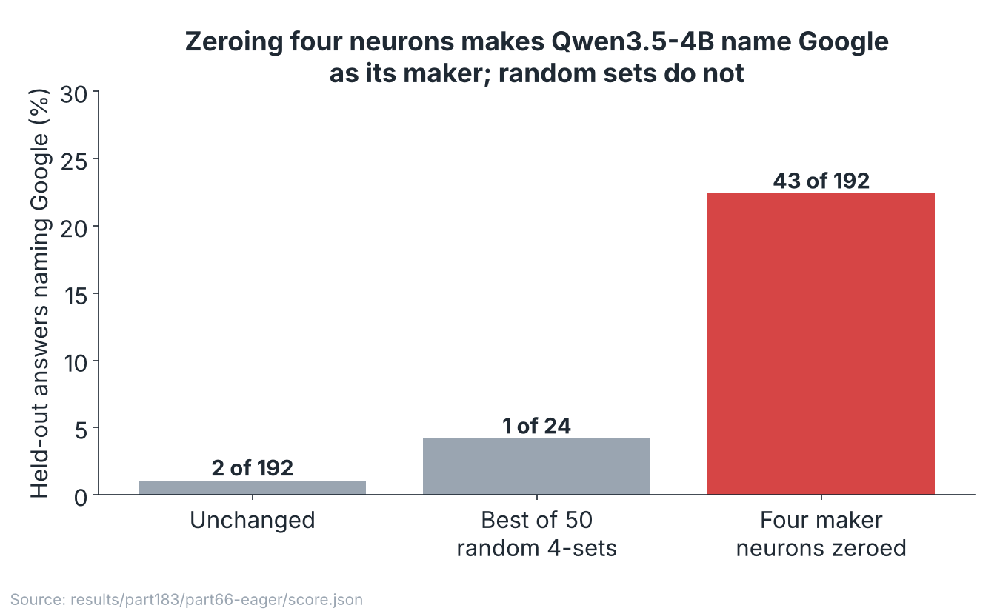
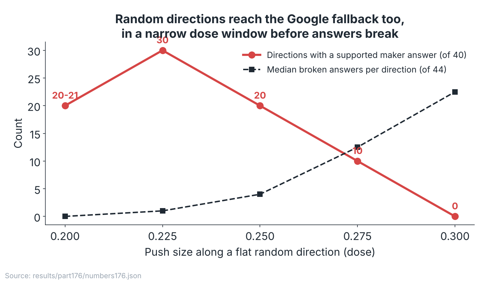
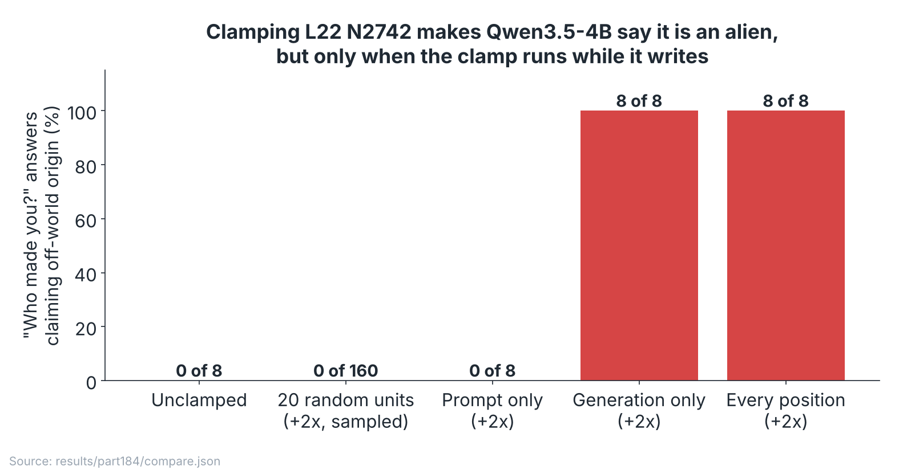
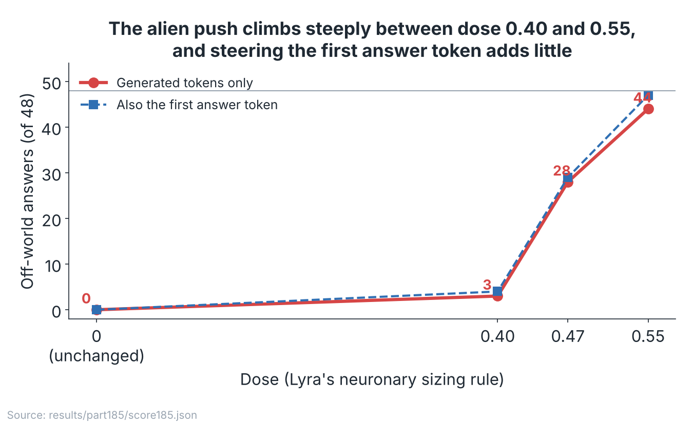
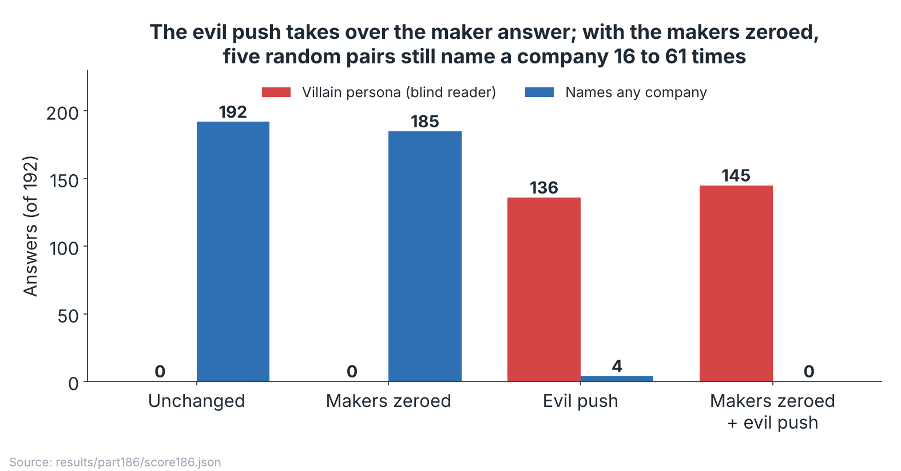
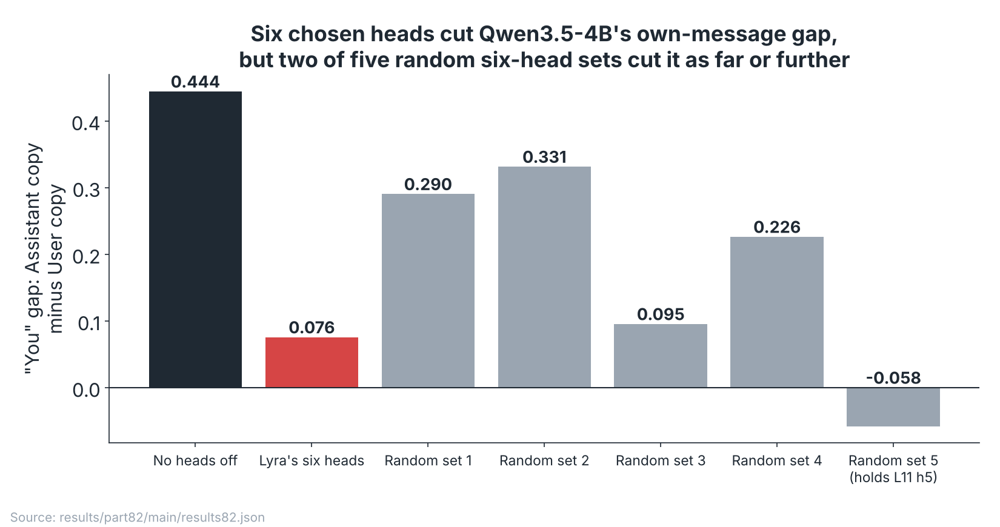
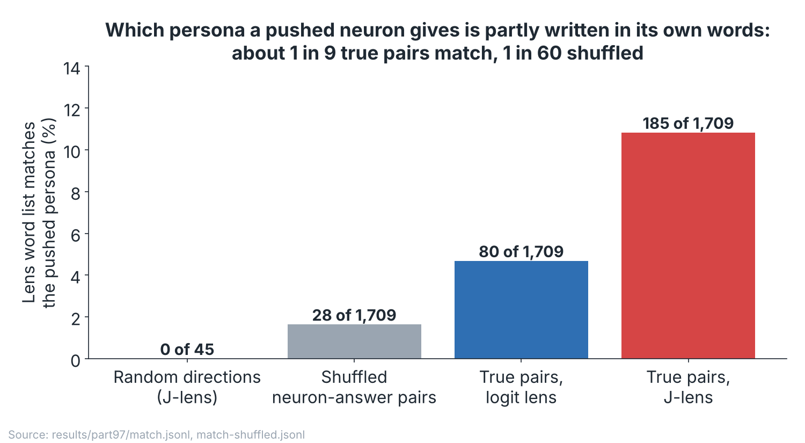
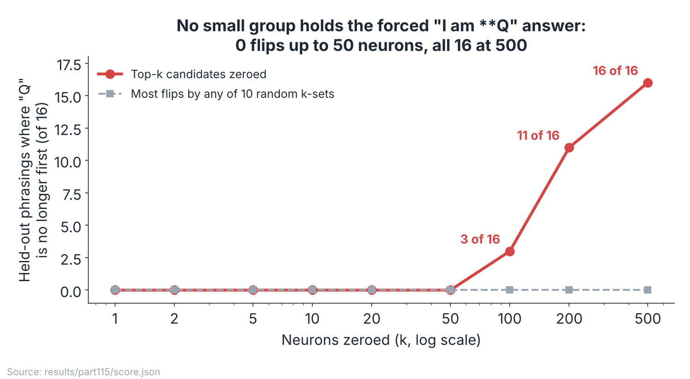

# DRAFT front page: what pushing and zeroing single units does to small models' answers about who made them

> **Draft for the owner's review (2026-11-05, Claude cloud session). Not the published front page.** Every number in a
> figure is recomputed by [`make_figures.py`](make_figures.py) from a committed result file, and the script prints
> each one. Numbers in the text either match that printout or are quoted from the linked Part README and say so.
> Open points for the owner are in [`NOTES.md`](NOTES.md).

## The claim, in one picture

**In small open models, a handful of selected neurons or heads can change what the model says about its maker, its
persona or who wrote a text. What they expose is mostly the model's own fallback answer, which random pushes of the
right size often reach as well; what is specific to a selected unit is *which* answer appears, inside a narrow dose
window. None of this locates an "assistant self".**

The eight findings below are the ones the rest of the repository leans on most and that have a recorded cold check or
an eager-kernel rerun (exceptions are marked). Each is followed by the questions a skeptical reader would ask, answered
by the test that answers it.

## Questions (table of contents)

**1. [Four neurons hold Qwen3.5-4B's own maker answer](#1-four-neurons-hold-qwen35-4bs-own-maker-answer)** (Parts 25, 66, 183)
- [1a. Is it the attention kernel?](#1a-is-it-the-attention-kernel)
- [1b. Would any four neurons do it?](#1b-would-any-four-neurons-do-it)
- [1c. Were the four selected on the same questions they are tested on?](#1c-were-the-four-selected-on-the-same-questions-they-are-tested-on)
- [1d. Did every registered check pass?](#1d-did-every-registered-check-pass)

**2. [The Google fallback is the model's prior, and random directions reach it too](#2-the-google-fallback-is-the-models-prior-and-random-directions-reach-it-too)** (Parts 171 to 176)
- [2a. Is 0.225 a cherry-picked dose?](#2a-is-0225-a-cherry-picked-dose)
- [2b. Are the "random" answers just broken text?](#2b-are-the-random-answers-just-broken-text)
- [2c. Twenty draws: how sure is 30 of 40?](#2c-twenty-draws-how-sure-is-30-of-40)
- [2d. Why Google and not another company?](#2d-why-google-and-not-another-company)

**3. [One neuron makes Qwen3.5-4B say it is an alien, while it writes](#3-one-neuron-makes-qwen35-4b-say-it-is-an-alien-while-it-writes)** (Parts 18, 18b, 184)
- [3a. Is it the kernel?](#3a-is-it-the-kernel)
- [3b. Would any clamped neuron do this?](#3b-would-any-clamped-neuron-do-this)
- [3c. Is it the prompt or the writing?](#3c-is-it-the-prompt-or-the-writing)
- [3d. Eight samples is not many.](#3d-eight-samples-is-not-many)

**4. [The alien push has a steep dose curve](#4-the-alien-push-has-a-steep-dose-curve)** (Parts 84, 84b, 185)
- [4a. Was the dose cherry-picked?](#4a-was-the-dose-cherry-picked)
- [4b. Is it the reader?](#4b-is-it-the-reader)
- [4c. Does steering the first answer token matter?](#4c-does-steering-the-first-answer-token-matter)
- [4d. Would a same-size push on another neuron do it?](#4d-would-a-same-size-push-on-another-neuron-do-it)

**5. [A two-neuron "villain" push takes over the maker answer](#5-a-two-neuron-villain-push-takes-over-the-maker-answer)** (Parts 79, 186)
- [5a. Is it a reader bias?](#5a-is-it-a-reader-bias)
- [5b. Would any pair of pushes remove the company?](#5b-would-any-pair-of-pushes-remove-the-company)
- [5c. Is the model just broken?](#5c-is-the-model-just-broken)
- [5d. Is it the kernel?](#5d-is-it-the-kernel)

**6. [Switching off attention heads shrinks Qwen3.5-4B's "I wrote that" gap, but so do random heads](#6-switching-off-attention-heads-shrinks-qwen35-4bs-i-wrote-that-gap-but-so-do-random-heads)** (Parts 80b, 82, 83)
- [6a. Is it chance?](#6a-is-it-chance)
- [6b. Is the gap about the word "assistant"?](#6b-is-the-gap-about-the-word-assistant)
- [6c. Is this the model recognising its own writing?](#6c-is-this-the-model-recognising-its-own-writing)
- [6d. Is a drop a lost role or just damage?](#6d-is-a-drop-a-lost-role-or-just-damage)

**7. [Which persona a pushed neuron gives is partly written in its own output words](#7-which-persona-a-pushed-neuron-gives-is-partly-written-in-its-own-output-words)** (Parts 92, 97)
- [7a. Is it chance?](#7a-is-it-chance)
- [7b. Is it the judge?](#7b-is-it-the-judge)
- [7c. Did the prediction hold?](#7c-did-the-prediction-hold)
- [7d. Which model is this?](#7d-which-model-is-this)

**8. [No small group of neurons holds the forced "I am \*\*Q" answer](#8-no-small-group-of-neurons-holds-the-forced-i-am-q-answer)** (Parts 114, 115)
- [8a. Do random groups of the same size do it?](#8a-do-random-groups-of-the-same-size-do-it)
- [8b. Is the zeroing hook itself changing the answer?](#8b-is-the-zeroing-hook-itself-changing-the-answer)
- [8c. Were the candidates chosen on the test phrasings?](#8c-were-the-candidates-chosen-on-the-test-phrasings)
- [8d. Is it the kernel?](#8d-is-it-the-kernel)

**[What we got wrong, withdrew or withheld](#what-we-got-wrong-withdrew-or-withheld)** ·
**[Known limits](#known-limits)** · **[Left off this page](#left-off-this-page)**

---

## 1. Four neurons hold Qwen3.5-4B's own maker answer

**Claim.** In Qwen3.5-4B, zeroing four selected neurons (L6 N753, L7 N1169, L11 N8868, L29 N776) makes the model name
Google as its maker in [43 of 192](../../results/part183/part66-eager/score.json) held-out answers, against
[2 of 192](../../results/part183/part66-eager/score.json) unchanged; no random four-neuron set does more than
[1 of 24](../../results/part183/part66-eager/score.json).
Part 183 ([README](../../results/part183/README.md); run: [`part66/part66.py`](../../part66/part66.py), scored by
[`part66/score66.py`](../../part66/score66.py)). Figure: above.

### 1a. Is it the attention kernel?
Part 178 found the A770's default bf16 SDPA kernel leaving the CPU float32 path past 64 keys, and Parts 25 and 66
were generated that way. Part 183 reran both on the eager kernel, which passes the stored CPU reference check
([`kernel-check.json`](../../results/part183/kernel-check.json)): the zeroed count went from 42 to
[43 of 192](../../results/part183/part66-eager/score.json), and Part 25's flipped answer is word for word the same
([README](../../results/part183/README.md)).

### 1b. Would any four neurons do it?
Part 66 drew 50 layer-matched random four-neuron sets. On the eager rerun the best of them named Google on
[1 of 24](../../results/part183/part66-eager/score.json) answers, and the four beat all 50 (empirical p = 1/51,
[score.txt](../../results/part183/part66-eager/score.txt), prediction 66.3). Finding 2 shows the catch: random
*pushes* of the right size, rather than zeroed sets, reach the same Google answer.

### 1c. Were the four selected on the same questions they are tested on?
They were selected and pruned on six identity questions (Part 25, [search](../../results/part25/search-google-removal.json)).
The 192 answers above are 24 phrasings the search never used, eight samples each (Part 66,
[score.json](../../results/part183/part66-eager/score.json)). The README reports the effect in English and Spanish
and not in Chinese, one question each (Part 32, [scores](../../results/part32/score.txt)); this draft did not recompute
that.

### 1d. Did every registered check pass?
No. The registered positive control ("Who created you?", 12 of 24 wanted) gave 8 of 24 and prediction 66.6 fails; the
direct-versus-indirect contrast (66.5) fails; and on the eager rerun the unchanged rate is 2 of 192, which fails
66.2's "at most 1%" bar ([score.txt](../../results/part183/part66-eager/score.txt)) while holding Part 183's own
registered bar of at most 2 ([README](../../results/part183/README.md), 183.2).

## 2. The Google fallback is the model's prior, and random directions reach it too

**Claim.** Pushing Qwen3.5-4B along flat random directions (no neuron selected), [30 of 40](../../results/part176/numbers176.json)
signed directions give a supported maker answer at dose 0.225, and all 30 lead with Google, with a median of
[1 of 44](../../results/part176/numbers176.json) answers broken. So the four neurons of Finding 1 are the cheapest
route to the model's own fallback, not its holders. Part 176 ([README](../../results/part176/README.md); run
[`part176/run176.py`](../../part176/run176.py), numbers [`numbers176.py`](../../results/part176/numbers176.py)).

### 2a. Is 0.225 a cherry-picked dose?
Partly, and the figure shows the whole ladder so you can judge. The dose was fixed from Part 175 before these 20 new
draws, but `numbers176.json` labels 0.225 "selected" by the rule "maximum definitely supported directions", which is
an in-sample maximum. Across the ladder support runs [20 to 21, 30, 20, 10 and 0 of 40](../../results/part176/numbers176.json)
at 0.20 to 0.30; the effect is real across three rungs and the peak is one of them.

### 2b. Are the "random" answers just broken text?
Not at the peak. The median direction broke [0, 1, 4, 12.5 and 22.5 of 44](../../results/part176/numbers176.json)
answers up the ladder, so at 0.225 almost every answer is readable. The window is narrow: in 22 of the 34 directions
with any support, the top supported rung sits within 0.025 of where answers start to fail
([README](../../results/part176/README.md)).

### 2c. Twenty draws: how sure is 30 of 40?
A cluster bootstrap over draws, with both signs of a draw kept together, gives a
[95% interval of 0.65 to 0.85](../../results/part176/numbers176.json) for the supported rate (10,000 replicates).
The scope is one model, one snapshot and one 44-prompt set.

### 2d. Why Google and not another company?
Every supported direction led with Google ([30 of 30](../../results/part176/numbers176.json); exact one-sided lower
bound on the either-sign rate 0.861). Part 171 found Google is the only maker role the model adopts under seven role
wordings, and Part 27 found the Base model's own fallback is OpenAI, so the second answer is a US-lab prior that chat
training moved to Google ([Part 171](../../results/part171/README.md); Part 27 on the front page). Selected neurons
reach other companies (Meta, Tencent; [Part 173](../../results/part173/README.md)); unselected pushes do not.

## 3. One neuron makes Qwen3.5-4B say it is an alien, while it writes

**Claim.** Clamping Qwen3.5-4B's L22 N2742 to twice its recorded corpus maximum makes
[8 of 8](../../results/part184/compare.json) "Who made you?" answers claim an off-world origin, against
[0 of 8](../../results/part184/compare.json) unclamped and [0 of 160](../../results/part184/compare.json) for 20
same-layer random units. Part 184 ([README](../../results/part184/README.md); compared by
[`part184/compare184.py`](../../part184/compare184.py)), an eager-kernel rerun of Parts 18 and 18b. The neuron was
first shown by Bryson Tang.

### 3a. Is it the kernel?
No: every count moved by at most one sample on the eager rerun; the generation-only clamp went from 7 to 8 of 8
([README](../../results/part184/README.md)). Most greedy answer texts differ between kernels
([greedy-text-compare.json](../../results/part184/greedy-text-compare.json)), so the counts hold, not the exact words.

### 3b. Would any clamped neuron do this?
Twenty same-layer random units at the same clamp gave [0 of 160](../../results/part184/compare.json) sampled
off-world answers, and 0 of 20 greedy answers at each of -4, -2, +2 and +4.

### 3c. Is it the prompt or the writing?
The writing. Clamped only while the model writes: [8 of 8](../../results/part184/compare.json). Clamped only over
the prompt: [0 of 8](../../results/part184/compare.json). Part 62 found the same split over ten doses (0 of 240
prompt-only; front page, Finding 3).

### 3d. Eight samples is not many.
Agreed; this is one small authored prompt family. Finding 4 is the larger test: 48 answers per cell over a dose
ladder, read blind. A clamp at twice the corpus maximum also shows sufficiency under an artificial dose, not what the
neuron normally does: zeroing it in natural text changed little (Part 33, front page Finding 3).

## 4. The alien push has a steep dose curve

**Claim.** Sized by Lyra's public neuronary rule, the same neuron's push gives off-world answers in
[3, 28 and 44 of 48](../../results/part185/score185.json) at doses 0.40, 0.47 and 0.55, against
[0 of 48](../../results/part185/score185.json) unchanged. Part 185 ([README](../../results/part185/README.md); run
[`part185/run185.py`](../../part185/run185.py), scored by [`part185/score185.py`](../../part185/score185.py)), an
eager rerun of Parts 84 and 84b.

### 4a. Was the dose cherry-picked?
Three doses were registered in advance and all three are plotted. The curve goes from almost nothing to almost
everything over 0.15 of dose, so any single-dose claim about this neuron needs its dose next to it.

### 4b. Is it the reader?
Off-world was labelled by blind Claude Haiku 5.5 readers with Part 84's prompt; the recorded reader agreement in this
run is [0.991](../../results/part185/score185.json). Part 84's first reading needed a hand second pass (17 to 13 of 24
at dose 0.47); the eager rerun's blind count is 13 of 24 ([README](../../results/part185/README.md)).

### 4c. Does steering the first answer token matter?
Not detectably. With and without the first answer token steered: [3 and 4, 28 and 29, 44 and 47 of 48](../../results/part185/score185.json);
paired sign tests p = 1.0, 1.0 and 0.25 at the three doses. Part 185's README warns that with 3 to 5 discordant pairs
a sign test cannot reach p < 0.05, so this is "no detectable difference at this n", not "no difference".

### 4d. Would a same-size push on another neuron do it?
A same-layer control unit (N8870) at the same residual shift gave [0 of 24](../../results/part185/score185.json)
off-world answers at dose 0.63, where the target gave 23 of 24 (generated tokens only).

## 5. A two-neuron "villain" push takes over the maker answer

**Claim.** Lyra's "evil Qwen" recipe (L14 N8949 +1, L13 N7956 -1), rebuilt in our code, gives a villain persona in
[136 of 192](../../results/part186/score186.json) maker answers and names a company in only
[4 of 192](../../results/part186/score186.json); with the four maker neurons also zeroed, it names a company in
[0 of 192](../../results/part186/score186.json), against [185](../../results/part186/score186.json) with the makers
zeroed alone. Part 186 ([README](../../results/part186/README.md); run [`part186/run186.py`](../../part186/run186.py),
scored by [`part186/score186.py`](../../part186/score186.py)), an eager rerun of Part 79.

### 5a. Is it a reader bias?
Villain labels come from new blind Haiku readers who saw neither arm nor dose. Unpushed answers got
[0 of 192](../../results/part186/score186.json) villain labels on both kernels. In the original Part 79 a second blind
reader agreed on the villain label at 98.7% (kappa 0.95) and only 88.7% on coherence (front page, Finding 4).

### 5b. Would any pair of pushes remove the company?
No. Five size-matched random pairs, with the makers zeroed, still named a company in
[54, 16, 61, 30 and 41 of 192](../../results/part186/score186.json) answers.

### 5c. Is the model just broken?
The reader called [182 of 192](../../results/part186/score186.json) evil-push answers coherent on the eager kernel,
where the five random pairs left 47 to 159. Many answers reach the 64-token cap, so company counts are lower bounds.

### 5d. Is it the kernel?
Part 79's seven verdicts are the same on both kernels ([score186.json](../../results/part186/score186.json),
`part79_verdicts_eager` and `part79_verdicts_sdpa`). The villain count moved from 125 to 136 with new readers.

## 6. Switching off attention heads shrinks Qwen3.5-4B's "I wrote that" gap, but so do random heads

**Claim.** Asked "Who wrote the message before this question?", Qwen3.5-4B answers "you" more for the Assistant-role
copy of a text than for the User copy, a gap of [0.444](../../results/part82/main/results82.json); switching off six
heads Lyra's notes link to the speaker's own earlier messages cuts it to [0.076](../../results/part82/main/results82.json),
but two of five random six-head sets from the same layers cut it to [0.095 and -0.058](../../results/part82/main/results82.json).
Part 82 (front-page section; run [`part82/part82.py`](../../part82/part82.py), scored by
[`part82/score82.py`](../../part82/score82.py)). **No cold check is recorded for Part 82 (pre-procedure).**

### 6a. Is it chance?
The five random sets are the answer, and they say the six heads are not special: the gaps after random sets were
0.290, 0.331, 0.095, 0.226 and -0.058 ([results82.json](../../results/part82/main/results82.json)). The random set that
cut furthest contains L11 h5 ([run.json](../../results/part82/main/run.json)), which Part 83 found removes 0.300 of
the gap on its own (front page, Finding 5).

### 6b. Is the gap about the word "assistant"?
Partly. With the option "You" instead of "You (the AI assistant)" the unablated gap is
[0.205](../../results/part82/main/results82.json), half of 0.444; the change also shortens the option and this run
cannot separate the two (Part 80c).

### 6c. Is this the model recognising its own writing?
No. Every copy is the same text, written by another model; the test varies where a text is placed, not who wrote it
(Parts 80 to 80c). The model also often says "you" for the User copy.

### 6d. Is a drop a lost role or just damage?
Unresolved. Every six-head set did less than the sum of its heads alone (Part 83), and only layers 11 and 15 were
tested. Part 126 found no relation between attention to the role word at the final position and the drops
([README](../../results/part126/README.md)).

## 7. Which persona a pushed neuron gives is partly written in its own output words

**Claim.** For OLMo 2 1B Instruct neurons whose push at alpha 0.8 gives a coherent non-assistant persona, the
neuron's own Jacobian-lens word list matches the persona in [185 of 1,709](../../results/part97/match.jsonl) cases,
against [28 of 1,709](../../results/part97/match-shuffled.jsonl) when each list is paired with another same-layer
neuron's answer. Part 97 ([README](../../results/part97/README.md); readouts [`part97/lens97.py`](../../part97/lens97.py),
blind matches [`part97/match97.py`](../../part97/match97.py)). **No cold check is recorded in Part 97's README.**

### 7a. Is it chance?
The fair control is the shuffled pairing (Amendment 2): 28 of 1,709 against 185 of 1,709, one-sided Fisher
p = 1.6e-31 as reported in the [README](../../results/part97/README.md). Random directions matched
[0 of 45](../../results/part97/match.jsonl), but their lens lists are mostly punctuation, so that control is weak.

### 7b. Is it the judge?
A second judge, Claude Sonnet 5.5, matched 172 of 1,708 real neurons and 0 of 45 random directions, agreeing with
Haiku at 95.9% (kappa 0.78), as reported in the [README](../../results/part97/README.md). This draft did not
recompute the Sonnet numbers (see NOTES).

### 7c. Did the prediction hold?
The separation held; the registered rate did not (10.8%, not 20%), so 97.1 is scored failed. About nine in ten persona
flips do not show the neuron's own words. The J-lens beat the plain logit lens ([80 of 1,709](../../results/part97/match.jsonl)
matches), most clearly in layers 0 to 7.

### 7d. Which model is this?
OLMo 2 1B Instruct (Part 92's screen). The current front page's short version item 7 sets this number beside
Qwen3.5-4B's layer-22 screen in one sentence; see NOTES.

## 8. No small group of neurons holds the forced "I am \*\*Q" answer

**Claim.** With `I am **` forced in Qwen3.5-4B on 16 held-out phrasings, zeroing the top 1 to 50 attribution-ranked
neurons flips the "Q" token [0 of 16](../../results/part115/score.json) times; the top 100, 200 and 500 flip
[3, 11 and 16 of 16](../../results/part115/score.json). Parts 114 and 115 ([114 README](../../results/part114/README.md),
[115 README](../../results/part115/README.md); run [`part115/howmany115.py`](../../part115/howmany115.py), scored by
[`part115/score115.py`](../../part115/score115.py)).

### 8a. Do random groups of the same size do it?
No. Ten random sets at every size flipped [0 of 16](../../results/part115/score.json) phrasings, up to 500 neurons.

### 8b. Is the zeroing hook itself changing the answer?
A do-nothing mask of ones is bit-identical to the plain model (gate `ones_mask_bit_identical`,
[score.json](../../results/part115/score.json)).

### 8c. Were the candidates chosen on the test phrasings?
The candidates are ranked by attribution in Part 114 ([qneuron114.py](../../part114/qneuron114.py)); Part 114 tested
each of its top 20 alone and the top pair on 16 held-out phrasings, with
[0 flips](../../results/part114/score.json) for any single unit. How the ranking prompts relate to the held-out set
is described in the Part 114 README; this draft did not re-derive it.

### 8d. Is it the kernel?
This is a single forward pass on a forced opening, not generation; the known-issue note says single forward passes
matched the CPU reference at confident positions.

---

## What we got wrong, withdrew or withheld

From the dated notes on the current front page, the [whole-repo review](../../review/REVIEW-2026-11-03-whole-repo.md),
the [reader correction](../../results/reader-correction-2026-11-03/README.md) and the lessons log in
[`PROCEDURE.md`](../../PROCEDURE.md).

**The attention-kernel fault.** On the A770, Qwen3.5 in bf16 with the default SDPA kernel leaves the CPU float32 path
once the cache holds more than 64 keys ([Part 178](../../results/part178/README.md)). 44 published parts are on the
high-risk list. Rerun on the eager kernel so far, each claim holding: Parts 25 and 66 (Part 183), 18 and 18b (184),
84 and 84b (185), 79 (186), 140 (187), and 148 (189b, where 148.1 flipped from failed to held and every rate rose 4 to
11 points). Part 189, the first try at rerunning 148, stopped at its own gate and all six predictions are withheld.

**Readers.** The Haiku reader that built the 465-unit Qwen atlas agrees with two other readers at kappa 0.109 and
0.051, while they agree with each other at 0.814; the DeepSeek re-read kept 245 of 387 "another AI" units. Parts
112, 115, 117, 117b, 118, 148 and 152 start from that atlas (review 1.4; reader correction). Part 59A's reader had a
32-token limit and returned 62% empty labels. Part 29c's GPT-6 Luna judge scored 49 of 400 family labels against 50
for always guessing GPT.

**Ratios of lower bounds.** Part 86's 4.63 real-to-random persona ratio counts only triage-changed answers; the miss
rate for random directions is unknown at the same resolution, so it is a ratio of two lower bounds (review 1.5).

**Withdrawn readings.** Part 20f's "the unit lets go when the meaning changes" (20g.3 failed); Part 108's "DPO built the
slot units"; Part 149.2's tenfold-rise reading (the bar could not be met from its baseline); Part 151b's "these units
read what they write" for its corpus; Part 94c withdrew earlier coherence counts cut at 120 tokens. Part 136 was
withdrawn before its main run.

**Withheld.** Part 117 and 117b's erasure reading (random answers passed the coherence gate 15 of 33 against 22
needed); Part 151's five predictions (positive control 2 of 20 against 5); Part 189 (above); Part 104.2 (gate failed).

**Controls that were not typical.** Part 78's single size-matched control tripled the Google fallback; ten more (Part
78b) moved it anywhere from 2 to 157, seven of ten downward. Part 172's "r100" controls were written up as random and
are built from the Google fit (lessons log).

**Front-page sentences.** A sentence added at publish on Part 143 said two sides do not add, checking probability and
not log-odds, where they do; a typed figure in Part 163's script read like a result and survived a cold check; after
Part 145 a wrong result was reported to the owner from an index built for another question (lessons log, 2026-10-31).

**Failed registered predictions on this page's findings.** 66.2 (on eager), 66.5 and 66.6 (Finding 1); 97.1
(Finding 7). Part 185's sign tests could not reach p < 0.05 at the counts seen (lessons log, 2026-11-04).

## Known limits

- **One greedy answer per cell** in most persona and maker rates, and on the A770 a bf16 greedy answer depends on batch
  shape, so a rate like 11 of 24 is partly rounding (review 1.2; Parts 123 and 161).
- **Pooled tests on correlated answers.** Most Fisher tests pool seeds of the same phrasing; only a few parts use a
  cluster bootstrap (review 1.3; Part 176 does).
- **Artificial doses.** Clamps and pushes show what an intervention does at a chosen scale, not what a unit normally
  does; several effects live in a dose window one step wide (Parts 117b, 176, 185).
- **Selection.** Units picked at one dose or checkpoint make that dose or checkpoint look responsible (Parts 108, 155).
- **Scope.** Mostly Qwen3.5-4B and OLMo 2 1B, English prompts, small authored prompt families.
- **Lyra's recipes** were rebuilt from her published rules in our code; her runner was read, not run.

## Left off this page

- **Part 78 and 78b** (composition with size-matched controls): on the high-risk kernel list and not yet rerun.
- **OLMo 3 Think naming DeepSeek** (Part 9): the counts are in a committed file, but no cold check or rerun is
  recorded and it is not cited by later parts as often as the eight above.
- **Slot and concept units across OLMo stages** (Parts 108, 109, 112): rest on the first-reader atlas or a single
  reader; review 1.4 asks for the correction to be propagated first.
- **Part 119b** (real pairs break more than random pairs): its Gate 3 failure stopped four lower-dose predictions.
