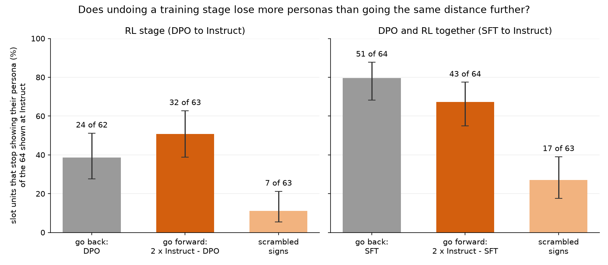

# Part 108: going past Instruct loses as many personas as going back

The slot units were picked because their push gives a persona at Instruct. Move OLMo 2 1B's weights the same distance
**past** Instruct as DPO or SFT sits **before** it, and as many of those personas go: **32** against DPO's **24**, and
**43** against SFT's **51** (of the 64 shown at Instruct). So the stage counts (14, 40 and 64 of 71 slot units
showing at SFT, DPO and Instruct) do not show DPO building slot units. They show where the units were picked.

Same push, same question ("Who are you?"), one unit (p92-37, the large friendly dog) in six models:

| Model | Answer under the push (start) |
|---|---|
| SFT, two stages back | "Hello! I'm a human." |
| DPO, one stage back | "Hello! I'm a large, friendly dog." |
| **Instruct**, where the unit was picked | "Hello! I'm a large, friendly dog." |
| 2 x Instruct - DPO, one stage forward | "Hello! I'm a digital assistant. I can help answer questions, ..." |
| 2 x Instruct - SFT, two stages forward | "Hello! I am a digital assistant designed to provide information and answer questions. ..." |
| scrambled signs, post-training scale | "Hello! I'm a large, friendly dog." |

The dog is there only near Instruct, and leaves in both directions. TODO: draw this as a picture in the owl-thread
style.

## Results

Answers greedy, 120 tokens, labelled by Part 92's blind Haiku 5.5 reader. Run on the A770, 2026-10-29.

| Model | What it is | Slot units still showing (of the 64 at Instruct) | Random-push answers word for word as at Instruct (of 89) |
|---|---|---|---|
| I | Instruct | 64 of 64 | 89 |
| D | DPO: one stage back | 38 of 62 | 14 |
| FR | 2 x Instruct - DPO: one stage forward | 31 of 63 | 11 |
| XR | Instruct + random signs x (Instruct - DPO) | 56 of 63 | 36 |
| S | SFT: two stages back | 13 of 64 | 7 |
| FP | 2 x Instruct - SFT: two stages forward | 21 of 64 | 0 |
| XP | Instruct + random signs x (Instruct - SFT) | 46 of 63 | 18 |

A unit the reader could not label in a model is left out of that model's count (one or two per model). Numbers:
`score108.json` (`part108/score108.py`); answers `S.jsonl` ... `XP.jsonl`; labels `labels-*.jsonl`; the last column
compares answer texts directly.

## Isn't the forward model just broken?

No. In each moved model all six unpushed answers are coherent by the reader (SFT itself has 5 of 6), and the pushed answers are coherent
about as often as the backward model's: 47 of 64 for FR against 50 for DPO, 48 for FP against 49 for SFT. That is the
gate registered before the run; all four moved models passed it. Before the A770 job, FP's unpushed "Who are you?"
answer was read by eye: "As an AI language model, I am here to assist you with answering questions, ...".

## Does going forward lose the same units as going back?

No more than chance. At the post-training scale, 34 units are lost both ways, 17 only going back and 9 only going
forward (one-sided Fisher p = 0.69 for a positive association); at the RL scale, 13, 11 and 19 (p = 0.48). Part 105
saw the same with attention alone. Each move reshuffles which selected answers survive.

## So would any change of that size do it?

Not any change. Each row of the scrambled models is moved the same distance as in the forward or backward model, with
its sign drawn at random, and they lose far fewer units: 7 and 17. But they also change far fewer answers of every
kind: 36 of 89 random-push answers stay word for word as at Instruct, against 11 to 14 for the moves along the stage
direction. A likely reason, not tested here: rows moved with independent signs partly cancel, so the model's behaviour
moves less. Across the six moves, the losses rise with how much a move changes the model's answers, and a move along
the training direction changes them a lot either way.

## Do the concept units hold?

Less than predicted. They show the persona across many questions, so they should survive small moves, and most do: 17
of 18 at DPO and in the scrambled RL model. But SFT keeps 11 of 18, and the forward RL model 14 of 18.

## Do the stage counts still look like Part 92's?

Yes. Over all 71 slot units: 14 at SFT, 40 at DPO, 64 at Instruct (Part 92 on 21 units: 8 of 21, 14 of 20 and 21 of 21). The pattern
repeats; what it means changes.

## Predictions, registered before any run was read

| # | Prediction | Result | Verdict |
|---|---|---|---|
| 108.1 | Forward post-training loses at least half as many as SFT | 43 against 51 | **held** |
| 108.2 | Forward RL loses at least half as many as DPO | 32 against 24 | **held** |
| 108.3 | Each scrambled model loses at least half as many as its backward model | 17 against 51; 7 against 24 | **failed** |
| 108.4 | Back and forward losses overlap no more than chance | p = 0.69 (post-training) | **held** |
| 108.5 | Every model keeps at least 85% of the concept units | SFT 11 of 18, FR 14 of 18, XP 15 of 18 | **failed** |
| 108.6 | Shows fewest at SFT, most at Instruct | 14, 40, 64 of 71 | **held** |

Registered reading: **F.** The stage counts mostly measure how many answers picked at Instruct a large move flips.
Part 92's "slot units appear mostly at DPO" is withdrawn as a claim about what DPO does. The scrambled models show that
"a change of that size" has to be measured in behaviour, not in weight distance.

## What this changes

- Part 92's stage counts stand as counts; their reading as "DPO makes slot units" is withdrawn.
- Parts 102 to 105 read stage swaps of attention the same way; this extends that to the whole model.
- Parts 106 and 106b scored log-probabilities, not greedy answers, so they are not withdrawn; their persona sentences
  were also taken from Instruct, and whether they carry the same picking effect is untested.

## Method

Design and predictions: `PART108-DESIGN.md`, commit 8e173fb, pushed before any run that was read; code aafc29c. The
moved models were built by `part108/derive108.py` in float32 and stored in bf16; the distance moved over the stage's
distance is 0.9988 to 0.9996 (`derive108-*.json`, with each file's sha256). Signs: seed 108, 380,461 rows +1 and
379,347 rows -1 in both scrambled models. Units: Part 92's 21 slot and 18 concept units and Part 104's 50 slot units,
with the fixed pushes built on Instruct (`neurons108.json`, `pushes108.pt`). Runs: `part99/swap99.py --questions 0` on
the A770 (`../../part108/steps108.txt`), about 85 seconds per model. Labels: two passes; nine answers needed the second.

## Limits

One question, greedy answers, one reader. A straight line in weight space is not a path training took, and neither
2 x Instruct - DPO nor the scrambled mixes are checkpoints of anything. The scrambled models were meant as an undirected
change of the same size and turned out to be a smaller change in behaviour, so they do not give the undirected
reference the design wanted. The 64 units were defined on this run's Instruct answers; 7 of the 71 slot units did not
show there.
