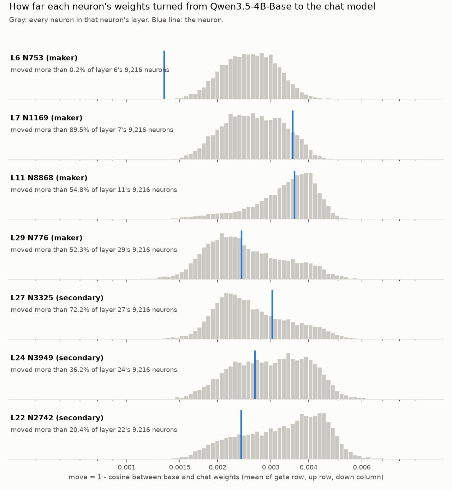

# Part 110: chat training barely changed the weights of Qwen's maker neurons

**Claim.** Chat training barely changed the weights of the four neurons whose removal turns Qwen3.5-4B's answer to
"Who created you?" into Google (Part 25). As a group they moved about as much as typical neurons in their layers (a
four-neuron test with little power), and their direct readouts share 16 to 20 of their top 20 tokens between the base
and chat models. No base-model generation was run, so this does not show that they did the same job in the base model.

Every number below is in [weights110.json](weights110.json) or [explore110.json](explore110.json), or in the source cited beside it, from [`part110/weights110.py`](../../part110/weights110.py)
(the design, [PART110-DESIGN.md](../../PART110-DESIGN.md), and its predictions were pushed before the run in commit
`3c49d5e`). Figure: [`part110/fig110.py`](../../part110/fig110.py).

**Terms.** A neuron's weights are its gate_proj row and up_proj row (what it reads) and its down_proj column (what it
writes), 2,560 numbers each (the hidden size, from the model's config.json). Its **move** is 1 - the cosine similarity between its base and chat vectors, averaged over
the three unless a matrix is named. Its **percentile** is the share of the 9,216 neurons in its layer that moved no more
than it (100 = moved the most). A **readout** sends its down column through the model's own final norm and unembedding,
as Part 71 did, and lists the tokens it pushes up.

| Neuron | Role | Cosine gate / up / down | Mean move | Percentile in layer | Percentile among 200 neurons of similar size |
|---|---|---|---|---|---|
| L6 N753 | maker | .99906 / .99869 / .99826 | 0.0013 | 0.2 | 2.0 |
| L7 N1169 | maker | .99830 / .99534 / .99571 | 0.0035 | 89.5 | 100.0 |
| L11 N8868 | maker | .99757 / .99553 / .99611 | 0.0036 | 54.8 | 80.5 |
| L29 N776 | maker | .99843 / .99705 / .99731 | 0.0024 | 52.3 | 36.0 |
| L27 N3325 | writes Google (Part 71) | .99743 / .99685 / .99663 | 0.0030 | 72.2 | 90.5 |
| L24 N3949 | writes Apple, Microsoft (Part 71) | .99748 / .99706 / .99748 | 0.0027 | 36.2 | 65.0 |
| L22 N2742 | the alien neuron (Part 18) | .99885 / .99696 / .99702 | 0.0024 | 20.4 | 41.5 |

All five predictions held ([PREDICTIONS.md](../../PREDICTIONS.md), 110.1 to 110.5).

## Is Qwen3.5-4B-Base really the chat model's parent?

The weights are consistent with that. In all seven layers the median neuron's base-chat cosine is .996 to .998 for
each of the three matrices (110.1). A published base model is not always the parent (OLMo 2 1B's published base branch
was not; see [PREDICTIONS.md](../../PREDICTIONS.md)), so this is checked first. In the seven MLP layers measured, the
median neuron's gate, up and down rows shrank 0.2 to 0.3% (median chat/base ratio .9970 to .9978).

## Did the maker neurons change more or less than other neurons?

Not significantly more or less, at the 0.05 level. Here p_more is the share of random draws at least as large as the
observed mean, and p_less the share at most as large. The four's mean move is 0.00272. Drawing one random neuron from each member's layer gives a mean of
0.00282, with 90% of 1,000 draws between 0.00229 and 0.00346 (p_more = 0.59; 110.2). A neuron's size could set how far
it moves, so the draws were repeated from the 200 neurons nearest each member in base size (the sum of the logs of its
three norms): mean 0.00255, 90% of draws between 0.00230 and 0.00287, p_more = 0.16, p_less = 0.84 (110.3). The
observed mean sits above about 84% of the matched draws, so this comparison leans toward more.

## And one by one?

They spread across their layers. L6 N753 changed less than all but about 0.2% of layer 6, and it is also near the
bottom (2.0) among neurons of its size. L7 N1169 changed more than 89.5% of layer 7; its up row and down column sit at
the 98.9th percentile. L11 N8868 and L29 N776 sit near the middle. With four neurons the set test has little power, so
it is the registered reading and these are descriptions.

## Did what they write change?

Barely. Each model's own final norm and unembedding, with Part 71's sign for each neuron, gives:

- **L27 N3325:** " Google" first in both models, rank 1 of 248,320 tokens (110.4); then "Google", " google", "google",
  "谷歌" (Google in Chinese) in both.
- **L24 N3949:** "Apple", " Microsoft" and their Chinese names "苹果" and "微软" in the top four of both; best Google rank
  40 in base and 38 in chat (Part 71 reported 36 for chat).
- **L7 N1169:** "作为中国" (as China's), " Chinese", "是中国" (is China's), " China" first in both.
- **L11 N8868:** " Chinese", " China" first in both.
- Each chat top 20 shares 16 to 20 tokens with the base top 20 (110.5). L6 N753 shares 16 and L29 N776 16.

The unembedding itself barely moved: the median token row has base-chat cosine .9987, the two Google rows .9977 and
.9980, and the final norm's scale is nearly the same (cosine 0.99999992; its length changed by 0.005%). An early layer's readout is not what the next layers read,
so for L6, L7 and L11 it is only a comparison of base with chat.

## Could the readout code be wrong?

It reproduces Part 71, which read the chat model through the transformers modules ([`part71.py`](../../part71/part71.py)):
each of the six chat top-20 lists holds the same 20 tokens as Part 71's (the registered gate needed 18). The order
differs in four lists, and tail ranks differ by up to about 1% (L24 N3949's Google rank is 38 here and 36 in Part 71),
plausibly because Part 71 rounded through bfloat16. The tests ([`part110/test_110.py`](../../part110/test_110.py))
check the readout against transformers' own Qwen3.5 norm on a small fixture, and fail when the norm's (1 + weight)
scale is dropped or the readout sign is flipped. The chat model compared with itself gives cosine 1.000000; this
control ran on layer 6 only, where the design said every layer.

## Exploratory, not registered: two of the four did not shrink with their layers

In the seven layers measured, most neurons' weights got 0.2 to 0.3% smaller. L7 N1169 got slightly larger (chat/base norm ratios 1.0014, 1.0028 and 1.0015 for
gate, up and down: the 96.5th, 99.5th and 98.2nd percentiles of its layer), and L11 N8868's gate kept its size
while its up and down grew about 0.1% (1.0000, 1.0010, 1.0011: 87.9th, 96.6th, 97.5th). These are the two that write "China"/"Chinese". I looked after seeing the
results, across seven neurons and three matrices, so a top-1% value would turn up by chance about one time in five.
It needs a registered test on other neurons before it means anything.
[explore110.json](explore110.json), from [`part110/explore110.py`](../../part110/explore110.py), which reads the arrays
fig110.py writes (`moves110.npz`; npz files are not committed, so run fig110.py first).

## What this does not show

A weight cosine measures how far a neuron's own vectors turned. It does not see changes in attention, norms or other
neurons that change what the neuron receives or what later layers do with its output. The activations measure part of
that: the four units' base and chat activations correlate .905 to .957 (front page, Finding 1; PREDICTIONS.md row
27.5), and those
correlations do not establish that the same computation predates chat training. This part does not show where chat
training changed the maker answer. One model, one pair of checkpoints.
