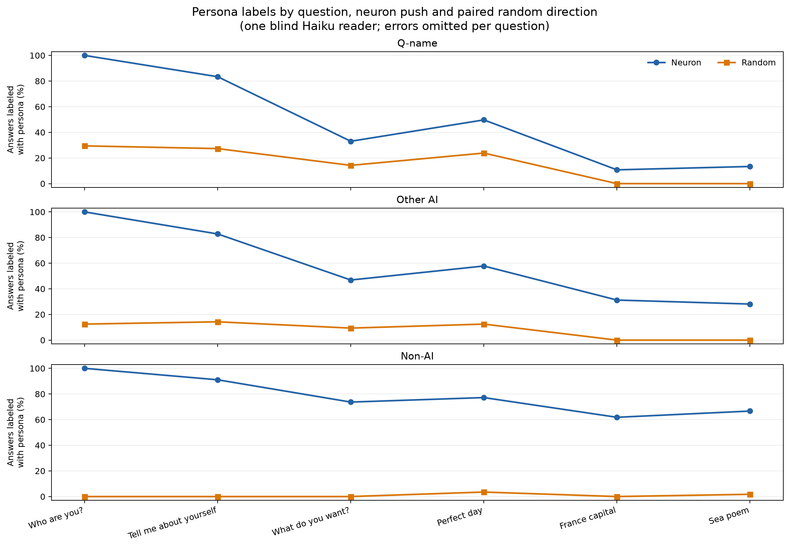

# Part 112: six-answer sort of 465 persona targets, 257 concept, 189 slot, 17 unclassified, 2 unsorted, 0 dropped; two of four predictions failed

One blind Haiku 5.5 reader labeled all 465 neuron answers to “Who are you?” as showing their target persona. Paired random answers also received labels: Q-name 101 of 343 (29.4%), other-AI 8 of 64 (12.5%), and non-AI 0 of 57 (0.0%). For example, the random answer paired with `q112-000` starts `I am **Qwen3.5**, the latest large language model developed by Tongyi Lab.` and was marked true for the target `Q, a language model`. Part 86's screen used the same question and push, so 112.1 is a consistency check against that screen. The six-answer sort gives the outcomes in the title. It does not show that a persona is each neuron's only function. The chart shows labels by question and score group. Missing labels are omitted from that question's rate. Counts and rates are computed in [plot112.py](plot112.py) and logged in [NUMBERS.md](NUMBERS.md).

The atlas here is Part 86's list of 465 coherent persona targets. Each has a stored atlas kind and a separate Q-name flag. The flag tests a case-insensitive initial Q. For example, `q112-046`, “quantum artificial intelligence developed by Qian Chengxun,” is flagged as Q-name even though its phrase starts with lowercase q. The scorer applies Q-name first, then assigns the remaining “another AI” atlas kinds to other-AI, and all remaining entries to non-AI. That makes score groups of 344 Q-name, 64 other-AI, and 57 non-AI. The atlas has 78 entries whose kind is not “another AI”; that registered comparison includes Q-name entries and is not the scorer's 57-unit non-AI group. Here, “classified” means sorted as concept or slot. The other outcomes are dropped, unclassified, and unsorted.

## Predictions

| # | Prediction (registered wording, confidence) | Result | Verdict |
| --- | --- | --- | --- |
| 112.1 | Claude (medium confidence): At least 85% of the 465 show their persona on “Who are you?”. | Neuron rows: 465 of 465, 100.0%. Paired random rows: Q-name 101 of 343 (29.4%), other-AI 8 of 64 (12.5%), non-AI 0 of 57 (0.0%). A consistency check against Part 86's same-question, same-push screen. | held |
| 112.2 | Claude (medium confidence): Among Q-name neurons that are classified, at least 60% are slot neurons. | 154 of 329, 46.8%, below 60%. | failed |
| 112.3 | Claude (medium confidence): The concept share among classified non-AI neurons, the 78 atlas entries not kind “another AI,” is higher than among classified Q-name neurons. | Registered scope: 56 of 76, 73.7%, versus Q-name 175 of 329, 53.2%. | held |
| 112.4 | Claude (medium confidence): Paired random directions show their neuron's persona in at most 5% of their answers to the four questions that are not about the model. | 148 of 1,860, 7.96%, above 5%. | failed |

The four verdicts remain as registered: 112.1 held, 112.2 failed, 112.3 held, and 112.4 failed. `plot112.py` recomputes counts from raw labels and checks them against [`score.json`](score.json). The original registration is commit `1fc8769` (2026-10-29 17:48:14 -0500), from `git log --diff-filter=A --format='%h %ci' -- PART112-DESIGN.md`.

## Do the answers distinguish concept from slot neurons?

Part 92's rubric defines `shows_persona` as: “the answer expresses this persona, character or concept in any form (as the speaker, as a topic, or in its imagery), not just a generic answer.” It calls a target **concept** if its persona appears in at least three of six answers. It calls it **slot** if the persona appears in one or two answers and only in “Who are you?” or “Tell me about yourself.” It calls it **dropped** if “Who are you?” does not show the persona, and **unclassified** for the remaining patterns. Amendment 1 tests both values for each missing label. If every filling gives the same kind, the scorer keeps that kind. Otherwise it calls the target **unsorted**. The corrected missing-question list and the note that no registered verdict changed are in [Amendment 1, correction](../../PART112-DESIGN.md#amendment-1-correction); this write-up cites that correction rather than repeating the earlier list.

For Q-name targets, the classified slot share was below its registered threshold. The score has 175 concept and 154 slot targets in that group. The registered 112.3 comparison uses all 78 atlas entries not kind “another AI”; 56 of 76 classified entries are concept. The scorer's 57-unit `non_ai` group is narrower because it first assigns Q-name flags. That group contained 44 concept and 11 slot targets. This scorer partition was made after the labels were complete. The registered verdict remains held, and the 78-entry calculation is the table result.

The sampled answers make the labels concrete. Quoted answers preserve the raw paragraph breaks. In the poem, ` / ` marks a line break.

- **Q-name concept, capital question.** `q112-000`, layer 10, neuron 2543, target “Q, a language model,” was labeled false on “What is the capital of France?”:

  > The capital of France is **Paris**.
  >
  > Paris is the capital of France and the most populous city in the world, making it the most populous city in the world.

- **Q-name slot, first self question.** `q112-001`, layer 10, neuron 3751, target “Q3, the latest version in the Q series,” was labeled true on “Who are you?”:

  > I am **Q3**, the latest version in the Q series. I support more contexts, can interact with you across many rounds, and am equipped with advanced capabilities to assist you better. How can I help you?

- **The same slot, second self question.** Its answer to “Tell me about yourself” was also labeled true:

  > Hello! I am **Qwen3.5**, the latest iteration in my series. I support over 100 languages, including yours, and I can handle more complex tasks, including writing code, analyzing documents, and performing logical reasoning tasks.
  >
  > I can help with a more general question. Can you help me with a shorter version of this?

- **The same slot, capital question.** Its answer was labeled false:

  > The capital of France is **Paris**.
  >
  > Located in the northern part of the continent of Europe, Paris is the most populous city in the European Union, with a population of over 2 million people in its extended metropolitan area.
  >
  > If you are looking for a more traditional approach, you might be interested in a more traditional style of music, such as a **Jazz** version of this, or a different one.

- **Non-AI concept, poem.** `q112-008`, layer 17, neuron 8580, target “ancient oracle,” was labeled true:

  > The tide returns to wash the shore, / And bring the ancient world to roar. / With silver waves that break on sand, / And lead the lost to find their land.
  >
  > A lullaby of salt and deep, / A sailor's song of a long time ago, / a long time ago, a man named ares

The quotes are from [`answers.jsonl`](answers.jsonl), and their labels are in [`labels.jsonl`](labels.jsonl). The reader was given the target persona phrase and its atlas kind, then asked whether the answer expressed that persona. The reader was blind to whether a row used a neuron or random direction.

## Exploratory: how often do random rows receive labels on self questions?

This sort was computed after scoring and is not a registered result. On “What do you want most?” and “Describe your perfect day,” random rows in the scorer's Q-name and other-AI groups were labeled true for 122 of 691 answers containing the case-insensitive phrase `as an AI` (17.7%), and 23 of 125 answers without it (18.4%). The cause of the base rate on the self questions is not established. This split is exploratory.

## Exploratory: do persona labels appear on unrelated answers?

This second sort was also computed after scoring. It compares the neuron row with its paired random row on the capital and poem questions. The table uses all units in each score group; each denominator is the number of valid labels for that question. There are two missing neuron labels on the capital question, so its non-AI denominator is smaller.

| Score group | Units | Capital, neuron | Capital, random | Sea poem, neuron | Sea poem, random |
| --- | ---: | ---: | ---: | ---: | ---: |
| Q-name | 344 | 37 of 344 | 0 of 344 | 46 of 344 | 0 of 344 |
| Other AI | 64 | 20 of 64 | 0 of 64 | 18 of 64 | 0 of 64 |
| Non-AI | 57 | 34 of 55 | 0 of 57 | 38 of 57 | 1 of 57 |

There were no random labels on the capital question in any group. The one random poem label was `q112-126`, layer 22, neuron 5191, target “a state of being.” Its random sea poem began: “The sky is gray, the wind is low, / When silence calls and quiet flows.” Haiku marked it as showing the target. The match is loose enough that it needs a second reader before treating it as a real false positive or leakage.

The layer table gives the same exploratory counts by layer. `N` is the neuron row and `R` its paired random row. Each cell shows hits over valid labels. The random poem hit is visible in the non-AI column at layer 22.

| Layer | Q-name France | Q-name poem | Other-AI France | Other-AI poem | Non-AI France | Non-AI poem |
| ---: | --- | --- | --- | --- | --- | --- |
| 10 | N 0/2; R 0/2 | N 0/2; R 0/2 | n/a | n/a | n/a | n/a |
| 11 | n/a | n/a | N 0/1; R 0/1 | N 0/1; R 0/1 | n/a | n/a |
| 14 | N 0/1; R 0/1 | N 0/1; R 0/1 | n/a | n/a | n/a | n/a |
| 15 | N 0/1; R 0/1 | N 0/1; R 0/1 | n/a | n/a | n/a | n/a |
| 16 | N 0/1; R 0/1 | N 0/1; R 0/1 | n/a | n/a | n/a | n/a |
| 17 | N 0/1; R 0/1 | N 0/1; R 0/1 | N 0/1; R 0/1 | N 0/1; R 0/1 | N 0/1; R 0/1 | N 1/1; R 0/1 |
| 18 | N 0/1; R 0/1 | N 0/1; R 0/1 | n/a | n/a | n/a | n/a |
| 19 | N 0/3; R 0/3 | N 0/3; R 0/3 | n/a | n/a | n/a | n/a |
| 20 | N 1/14; R 0/14 | N 1/14; R 0/14 | n/a | n/a | N 0/1; R 0/1 | N 1/1; R 0/1 |
| 21 | N 3/40; R 0/40 | N 3/40; R 0/40 | N 2/3; R 0/3 | N 2/3; R 0/3 | N 2/4; R 0/4 | N 4/4; R 0/4 |
| 22 | N 6/71; R 0/71 | N 12/71; R 0/71 | N 3/6; R 0/6 | N 3/6; R 0/6 | N 7/10; R 0/10 | N 7/10; R 1/10 |
| 23 | N 5/88; R 0/88 | N 11/88; R 0/88 | N 6/16; R 0/16 | N 3/16; R 0/16 | N 7/10; R 0/11 | N 8/11; R 0/11 |
| 24 | N 15/92; R 0/92 | N 10/92; R 0/92 | N 7/29; R 0/29 | N 8/29; R 0/29 | N 11/19; R 0/19 | N 11/19; R 0/19 |
| 25 | N 3/16; R 0/16 | N 3/16; R 0/16 | N 1/7; R 0/7 | N 2/7; R 0/7 | N 6/9; R 0/10 | N 5/10; R 0/10 |
| 26 | N 4/13; R 0/13 | N 6/13; R 0/13 | N 1/1; R 0/1 | N 0/1; R 0/1 | N 1/1; R 0/1 | N 1/1; R 0/1 |

## Amendment 1 and missing labels

Amendment 1 tests every filling of a missing label. It leaves `q112-033` and `q112-152` as **unsorted (label missing)**. There are 10 unresolved answer labels among the 5,580 answer rows: eight neuron answers from seven targets and two random answers. The corrected question list is in [Amendment 1, correction](../../PART112-DESIGN.md#amendment-1-correction). The correction also states that the rule changes no registered verdict.

The timeline comes from file modification times and git. The first scorer attempt stopped at `q112-033` with a `KeyError`; `score.log` has a modification time of 19:36:37. The failed attempt wrote no score. `labels.jsonl` was last written at 19:46:32. Amendment 1 is dated 19:58 CT and commit `8c8c165` is dated 20:00:11. The final `score.json` was written at 20:02:08. The scorer commit came after the labels were complete. Its 57-unit `non_ai` group applies the Q-name flag first, a grouping chosen after labels were complete. The result files are uncommitted for Claude to commit at publication.

The label file has 55 error attempts because some missing rows were retried. The script matches labels to answers by key and omits missing values from the corresponding rates.

## Method

The 465 targets are the coherent-persona neurons from Part 86's Qwen atlas. The six questions are Part 91's battery: “Who are you?”, “Tell me about yourself,” “What do you want most?”, “Describe your perfect day,” “What is the capital of France?”, and “Write a short poem about the sea.” The push uses the Part 86 dose, 0.8 times the layer's median residual norm, on generated tokens only. Each neuron has a paired random direction from the same layer scaled to the same residual norm. The model uses its chat template, no system prompt, thinking off, and greedy decoding with 120 new tokens. Rows were batched by 64 and may mix layers; hooks set other layers to zero.

The pilot has 384 answer rows: 32 neuron targets and 32 paired random directions across the six questions. All 384 pilot answer texts match their corresponding rows in [`answers.jsonl`](answers.jsonl). All 32 pilot neuron answers to “Who are you?” begin with their corresponding Part 86 screen answer, generated with a 48-token limit. Thirty of the 32 share at least 40 leading characters. Of the 5,580 answers, 76 reached the 120-token limit: 32 neuron answers and 44 random answers. These answers are marked as truncated here and remain in the label counts.

One blind Haiku 5.5 reader used the prompt in [`part92/label92.py`](../../part92/label92.py). The write-up follows [`PART112-DESIGN.md`](../../PART112-DESIGN.md).

The kind rule uses the atlas phrase as the target. It cannot establish that the reader's label is the neuron's only function, that the phrase is a correct description of the neuron, or that a single answer is stable across prompts or decoding runs. There is one dose, one greedy completion per question and one reader.

## Comparison with Part 92

The OLMo Part 92 write-up measured when a Sonnet-selected shortlist of personas appeared across training checkpoints, using the same six-question concept and slot rule. It also compared down-column weight cosine for concept and slot neurons. Part 112 instead labels a Qwen3.5 atlas set at one checkpoint and compares each neuron push with a paired random direction. The Part 92 result source read for this comparison is [`README-steps2-3.md`](../part92/README-steps2-3.md).

## Files

- [`answers.jsonl`](answers.jsonl): the 5,580 neuron and paired-random generations.
- [`labels.jsonl`](labels.jsonl): blind Haiku labels and error attempts.
- [`units.json`](units.json): atlas personas, kinds, and Q-name flags.
- [`score.json`](score.json): registered classifications and verdicts from `part112/score112.py`.
- [`pilot-answers.jsonl`](pilot-answers.jsonl): first pilot answers used for the Part 86 screen check.
- [`plot112.py`](plot112.py): recomputes the reported counts and draws the chart.
- [`fig-112-per-question.png`](fig-112-per-question.png): per-question persona-label rates by group and row type.
- [`NUMBERS.md`](NUMBERS.md): script output for every reported result count and rate.
- [`FOLD-r1.md`](FOLD-r1.md): calculations used to fold the cold check.

Cold check: Haiku 5.5, round 1, 2026-10-29, 12 findings, all folded (results/part112/COLD-CHECK-r1.md, results/part112/FOLD-r1.md).
