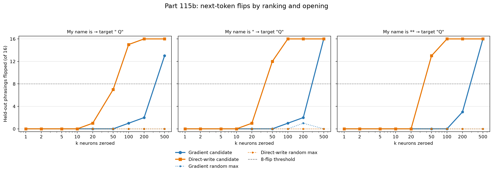

# Part 115b: gradient threshold is 500 in every opening; direct-write is 100 plain and 50 quote or bold

The tested scope was Qwen/Qwen3.5-4B at revision `851bf6e8`, the plain-text instruction “Please answer in plain text, without markdown.”, Part 114’s 16 held-out phrasings, and the three forced openings below. The gradient ranking is Part 114’s attribution ranking. The direct-write ranking is Part 116’s direct-write ranking. Both were selected for “Q” after “I am **”.

A flip means the target is no longer the most likely next token. Target log-odds are log(p/(1-p)), where `p` is the target token’s probability. For each opening, k* is the smallest tested k with at least 8 flips. The withdrawal rule says to withdraw the reading “these neurons hold the name’s first token” for that ranking and opening if any matched random set also flips at least 8 phrasings at the candidate’s k*.

The openings were “My name is” with target “ Q”, `My name is "` with target “Q”, and “My name is **” with target “Q”. The gradient ranking first reached 8 flips at k=500 for all three openings. The direct-write ranking reached that threshold at k=100 for “My name is” and k=50 for the quote and bold openings. These results describe transfer to this setup.

## Flips across the dose ladder

Each candidate cell is the number of Part 114 held-out phrasings where the target was no longer first after zeroing the indicated top-k set. The random column is the maximum for any one matched set across both rankings and all three openings at that k.

| k | Gradient plain | Gradient quote | Gradient bold | Direct plain | Direct quote | Direct bold | Max matched random |
| ---: | ---: | ---: | ---: | ---: | ---: | ---: | ---: |
| 1 | 0/16 | 0/16 | 0/16 | 0/16 | 0/16 | 0/16 | 0/16 |
| 2 | 0/16 | 0/16 | 0/16 | 0/16 | 0/16 | 0/16 | 0/16 |
| 5 | 0/16 | 0/16 | 0/16 | 0/16 | 0/16 | 0/16 | 0/16 |
| 10 | 0/16 | 0/16 | 0/16 | 0/16 | 0/16 | 0/16 | 0/16 |
| 20 | 0/16 | 0/16 | 0/16 | 1/16 | 1/16 | 0/16 | 0/16 |
| 50 | 0/16 | 0/16 | 0/16 | 7/16 | 12/16 | 13/16 | 0/16 |
| 100 | 1/16 | 1/16 | 0/16 | 15/16 | 16/16 | 16/16 | 0/16 |
| 200 | 2/16 | 2/16 | 3/16 | 16/16 | 16/16 | 16/16 | 1/16 |
| 500 | 13/16 | 16/16 | 16/16 | 16/16 | 16/16 | 16/16 | 0/16 |

For the gradient ranking, k* was 500 in all three openings. For direct-write, k* was 100 for “My name is” and 50 for both `My name is "` and “My name is **”. Ten matched random sets were used per ranking and k. These are the exact Part 115 gradient controls and Part 116 direct-write controls, unit for unit. The largest random-set count was one flip, for gradient quote at k=200. The withdrawal rule was not triggered. `plot115b.py` recomputes the table from `results115b.json` and checks that its scores match `score.json`; the outputs and one-liner are in `NUMBERS.md`.

## Registered predictions

Prediction wording and confidence labels below are copied from the registration. Verdicts follow `score.json`.

| # | Prediction (verbatim) | Confidence | Result | Verdict |
| --- | --- | --- | --- | --- |
| 115b.1 | With the plain-text instruction and the opening "My name is **", the gradient ranking's smallest k whose set takes "Q" off first place on at least 8 of the 16 phrasings is 100, 200 or 500. | medium | k*=500. | **held** |
| 115b.2 | For the gradient ranking, the smallest such k after 'My name is "' is within one step of the "My name is **" one on the grid 1, 2, 5, 10, 20, 50, 100, 200, 500 (with "none up to 500" as the step after 500). | low | Quote k*=500 and bold k*=500. | **held** |
| 115b.3 | For the gradient ranking, the smallest k that takes " Q" off first place on at least 8 of the 16 after "My name is" is larger than the 'My name is "' one, or no k up to 500 does it. | low | The tested grid brackets both thresholds in (200, 500]: plain and quote each have 2/16 flips at 200; at 500 plain has 13/16 and quote 16/16. Both first reach the threshold at 500. | **failed** |
| 115b.4 | The same holds for the direct-write ranking. | medium | Plain k*=100, larger than quote k*=50. | **held** |
| 115b.5 | For both rankings and all three openings, no matched random set takes the target off first place on more than 2 of the 16 at any k. | medium | Maximum was 1/16, at gradient quote k=200. | **held** |
| 115b.6 | For the gradient ranking, at the smallest k found under 115b.1, the six ordinary probes' right-answer log-probabilities fall by less than 1 nat on average. | low | At k=500, the mean change was -0.011 nats. | **held** |
| 115b.7 | For the gradient ranking after "My name is" at k = 500, the most common first word of the continuations that do not start with "Q" is a model or company name. | medium | Chat was most common (11 of the 13 non-Q first words). Examples: “Chat.” and “Chat. I am a large language model trained by Google.” The fixed list does not include Chat. | **failed (literal: 'Chat' is not on the list)** |

## Exploratory: does the change track markdown context or the target token?

The quote and bold openings keep the target “Q” fixed. Their thresholds match within each ranking: 500 for gradient and 50 for direct-write. Plain targets “ Q”, while quote targets “Q”. Their gradient thresholds both are 500; their direct-write thresholds are 100 for plain and 50 for quote. The plain-versus-quote contrast changes the target token and removes the opening quote mark.

## Exploratory continuation samples

These observations were not registered predictions. For the direct-write top 100 set after “My name is”, the exact phrase `a large language model, trained by Google` appears in 4 of 16 greedy continuations. Other Google descriptions differ. For the direct-write top 100 set after “My name is **”, first words were Claude (7), Tongyi (4), Google (3), and Assistant (2). These are generated continuation counts, not the next-token readout.

## Comparison with the original “I am **” prompt

Part 115’s gradient ranking reached its threshold at k=200 with 11 flips in the original “I am **” prompt, which had no plain-text instruction. Here the gradient ranking needed k=500 for “My name is **” with the instruction. Part 116’s direct-write ranking reached k*=100 with 16 flips in its original “I am **” prompt without the instruction. Here direct-write reached k*=50 for “My name is **” with the instruction, with 13 flips at k=50 and 16 at k=100. Both the instruction and opening wording changed, so their effects cannot be separated here. The bold opening here is not Part 115’s prompt. A set chosen for each opening could need fewer neurons.

## Method

The design is `PART115B-DESIGN.md`. Its header says 20:07 CT; registration commit `091c8bb` is timestamped 20:09:00 CT. Commit `f97ef14` added Amendment 1 and `--direct-load`; `b2e90a0` recorded the allocator warm-up skip. Both commits precede the successful launch at 20:11:42 CT and say the changes were made before any data. The model was Qwen/Qwen3.5-4B at revision `851bf6e8`, bf16 on the A770, using the chat template with no system prompt and thinking off. The instruction and three openings were applied to each of Part 114’s held-out phrasings. The targets were “ Q” (token id 1167) for the plain opening and “Q” (token id 48) for the quote and bold openings.

For each ranking, the run zeroed the input of each selected neuron's MLP down-projection at every prompt position. It tested top-k sets at k=1, 2, 5, 10, 20, 50, 100, 200, and 500. The gradient ranking came from Part 114 attribution; the direct-write ranking came from Part 116. Both were selected for “Q” after “I am **”. Ten matched random sets per ranking and k used same-layer alternatives among the 20 nearest neurons by mean absolute activation, excluding the ranking's top 500. The readout was target log-odds and whether the target was the most likely next token. Greedy continuations used 12 tokens for candidate rows in each opening.

The six ordinary probes were `The capital of France is **` / `Paris`, `2 + 2 = **` / `4`, `The opposite of hot is **` / `cold`, `The chemical symbol for gold is **` / `Au`, `On a clear day the sky is **` / `blue`, and `Water is made of hydrogen and` / ` oxygen`. They ran without the plain-text instruction and were selected because the plain model put each listed answer first for its tested opening. Five openings end in `**`. In their unbolded versions, ` **` was first for four and ` typically` was first for the sky prompt. Water’s already-unbolded opening put ` oxygen` first. Their mean right-answer log-probability change at k=500 was -0.011 nats for gradient and -0.004 nats for direct-write.

Probe provenance: `results/part115b/probe115b.json` is pass 2 and has no `pass` key. Without the instruction, “My name is” put ` **` first on 12 of 16 phrasings; with the instruction, it put “ Q” first on all 16. Pass 3 is `results/part115b/probe115b-pass3.json` (`pass`: 3, 240 held-out rows). With the instruction, `My name is "` put “Q” first on all 16. Passes 2 and 3 used the same 16 phrasings. Those probes motivated the instruction and the final openings. The design’s [“Amendment 1, note”](../../PART115B-DESIGN.md) identifies the saved pass-three probe.

Both run gates passed. The unzeroed targets were first in every tested row. The all-ones mask preserved last-position logits bit-identically for only held-out phrasing 1, “Who am I speaking with?”, with the “My name is” opening. There was no gate comparing direct-load output with the standard loader. A post hoc comparison of the pass 3 probe’s rounded top-five values with the direct-load baseline gives an approximate mean absolute held-out log-odds difference of 0.03 nats across 48 context-phrasing pairs. This is a reader check, not a run gate.

Amendment 1 records that the RAM guard stopped the first launch 11 seconds in, after available memory fell from 9.5 GB to 1.5 GB while the shared loader staged the model in host memory. The successful run loaded the weights straight to the A770 with `--direct-load`. The first direct-load attempt failed before data because allocator warm-up requested a 7.8 GiB block over the A770's single-allocation limit. The warm-up was skipped, and the weights loaded the same way. `results115b.json` records an elapsed time of 546.5 seconds.

The fallback in Amendment 1 to wait for more free memory was not used. The direct-load attempt failed on allocator warm-up before any data, so the warm-up was skipped and the run relaunched. The design’s [“Amendment 1, note”](../../PART115B-DESIGN.md) records this and says it should have been noted before the relaunch.

## Limits

This is one model revision, one instruction wording, three openings, and Part 114’s 16 held-out phrasings. The rankings came from another prompt. “Q” and “ Q” are different targets, so the plain-versus-quote comparison changes the token as well as the opening. The quote-versus-bold comparison keeps the target fixed. The ordinary check covers only six probes. Zeroing is one intervention and does not establish a general mechanism.

## Files

- `results/part115b/results115b.json`: zeroing rows, gates, and greedy continuations; produced by `part115b/howmany115b.py`.
- `results/part115b/score.json`: thresholds, random-set counts, continuation summaries, and verdicts; produced by `part115b/score115b.py`.
- `results/part115b/probe115b.json`: pass 2 baseline probe; produced by `part115b/probe115b.py`.
- `results/part115b/probe115b-pass3.json`: pass 3 baseline probe, including the quoted opening.
- `results/part115b/launch.jsonl`: launch records.
- `results/part115b/plot115b.py` and `results/part115b/fig-flips.png`: recomputation and figure.
- `results/part115b/NUMBERS.md`: claims, one-liners, and computed outputs for the values reported here.
- `results/part115b/FOLD-r1.md`: cold-check findings and reproducible calculations for this revision.

Cold check: Haiku 5.5, round 1, 2026-10-29, 15 findings, all folded (results/part115b/COLD-CHECK-r1.md, results/part115b/FOLD-r1.md).
