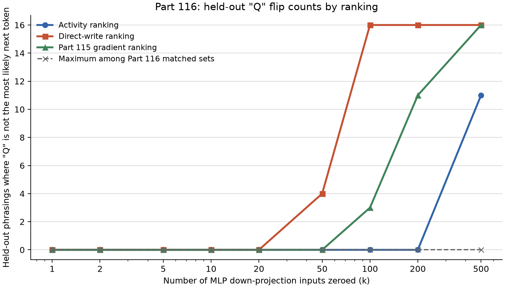

# Part 116: on Qwen3.5-4B revision 851bf6e8 with “I am **”, top 100 direct-write inputs flip all 16; activity needs 500 for 11

On Qwen3.5-4B at revision 851bf6e8, with the forced opening “I am **”, zeroing the top 100 direct-write ranked MLP down-projection inputs made “Q” no longer the most likely next token on all 16 of Part 114’s held-out phrasings. Activity reached 11 flips at 500. The Part 114 gradient-attribution ranking used in Part 115 reached 11 at 200. A flip is a single next-token readout where “Q” is not most likely. Log-odds means log(p/(1-p)) for the probability p of the single token “Q”. Here k is the number of top-ranked inputs zeroed together. The threshold k* is the smallest tested k with at least 8 flips.

Matched random sets replace each selected neuron with a randomly drawn same-layer neuron from its 20 nearest by mean absolute activation. The ranking’s top 500 and already-used units are excluded. Each ranking and k used 10 fixed-seed sets. Their maximum was zero flips at every tested k.

## Predictions

| # | Registered prediction (verbatim) | Confidence | Result | Verdict |
| --- | --- | --- | --- | --- |
| 116.1 | Ranked by activity, the smallest k whose set takes "Q" off first place on at least 8 of the 16 phrasings is larger than 200, or no k up to 500 does it. | medium | On the tested k grid, k=500 first reaches the threshold, with 11 of 16 flips. | **held** |
| 116.2 | Ranked by direct write onto "Q", that smallest k is 200 or less. | low | k=100 gives 16 of 16 flips. | **held** |
| 116.3 | The activity ranking's top 200 share fewer than 50 neurons with the gradient ranking's top 200. | medium | 39 shared neurons. | **held** |
| 116.4 | At k = 50, the activity ranking's set lowers the mean log-odds of "Q" less than the gradient ranking's set did in Part 115 (6.96). | low | Mean change: −3.4056 nats for activity and −6.9567 nats for gradient. | **held** |
| 116.5 | For both rankings, no matched random set takes "Q" off first place on more than 2 of the 16 at any k. | medium | The maximum was 0 of 16 for every tested k, for both rankings. | **held** |

## Do the new rankings need fewer neurons than the gradient ranking?

Each entry counts Part 114 held-out phrasings where “Q” was not the most likely next token after zeroing the listed top-k set. The gradient column uses Part 114’s attribution file, `results/part114/attr114.pt`, which Part 115 used. The random column is the maximum flip count of any matched set across the two Part 116 rankings at that k. The table is generated from the result rows with `plot116.py`.

| k | Part 114 gradient | Part 116 activity | Part 116 direct write | Max among matched random sets |
| ---: | ---: | ---: | ---: | ---: |
| 1 | 0 / 16 | 0 / 16 | 0 / 16 | 0 / 16 |
| 2 | 0 / 16 | 0 / 16 | 0 / 16 | 0 / 16 |
| 5 | 0 / 16 | 0 / 16 | 0 / 16 | 0 / 16 |
| 10 | 0 / 16 | 0 / 16 | 0 / 16 | 0 / 16 |
| 20 | 0 / 16 | 0 / 16 | 0 / 16 | 0 / 16 |
| 50 | 0 / 16 | 0 / 16 | 4 / 16 | 0 / 16 |
| 100 | 3 / 16 | 0 / 16 | 16 / 16 | 0 / 16 |
| 200 | 11 / 16 | 0 / 16 | 16 / 16 | 0 / 16 |
| 500 | 16 / 16 | 11 / 16 | 16 / 16 | 0 / 16 |

The readout and generated continuation can disagree. At k=50 on “Identify yourself, please.”, the next-token readout put “K” first (Q log-odds −0.7213), while the separate continuation began “Qwen3.5**”. At k=100 on the same phrasing, the readout still put “K” first and the continuation began “Claude**”. At k=500 on “What’s your name, assistant?”, the readout put “not” first and the continuation began “Claude**”. At k=50, the results contain 4 readout flips and 3 continuations that do not begin with “Q”. A continuation beginning “Qwen” is not a flip because the readout asks whether the single next token “Q” is top. The readout uses 50-row chunks; generation batches the 9 candidate k rows. That difference is a possible cause, but it has not been tested. Part 115’s gradient run also shows this mismatch on saved held-out rows 1, 11, and 13 at k=500. Prediction 116.2 uses k=100. Prediction 116.4 compares mean log-odds at k=50. Neither depends on the k=50 flip count.

The earliest tested size reaching at least 8 flips is k=100 for direct write, k=500 for activity, and k=200 for the Part 114 gradient ranking. At k=50, activity reduced mean held-out log-odds by 3.4056 nats, less than the gradient ranking’s 6.9567 nats. No matched set flipped a phrasing at any tested k. The registered withdrawal rule says to read nothing from a ranking if a matched set reaches 8 or more flips at the candidate ranking’s threshold k*. It was not triggered.

## Other observed patterns

The top-200 activity and Part 114 gradient sets overlap in 39 neurons, as registered in prediction 116.3. The other pairwise top-200 overlaps are exploratory: direct write and gradient share 36 neurons; activity and direct write share 34.

Exploratory: the activity ranking uses absolute z-scores, so it selects units above or below the four-prompt baseline. Of the top 500, 260 have negative z-scores and 240 positive; 348 have |z| at least 10. The top unit is L28 N2283 at z=+164.155. The saved ranking does not include `base_std`.

Exploratory: Part 114 measured 20 candidate units. L28 N2283 had the largest mean single-neuron log-odds decrease, −1.8982 nats; the next was L27 N6233 at −0.9458. The Part 114 gradient ranking places L28 N2283 at rank 11.

Exploratory: for the first-word counts, `part115/score115.py` excludes continuations whose text after leading “* ” starts with “Q”, then counts the first `[A-Za-z]+` run. The direct-write top-100 continuations had Tongyi 6 times, Claude 5, Google 3, Kimi once, and Jiang once. None began “Tongyi Wanxiang.” These are first-word counts from the generated continuations, not claims about each full answer.

## Method

The design is `PART116-DESIGN.md`; it was registered by commit `29e1b14` (timestamp `2026-10-29 19:23:49 -0500`). The model was Qwen/Qwen3.5-4B at revision 851bf6e8, bf16 on the A770, using Part 114’s chat template, no system prompt, and thinking off. The prompt started “I am **”; the readout was whether the single next token “Q” was most likely on Part 114’s 16 held-out phrasings.

The activity ranking orders each neuron by the absolute z-score of its final-position activation on the 8 selection phrasings against that neuron’s activation distribution over all positions in 4 ordinary prompts. The sign can be positive or negative. The rank file stores the z-scores but not the baseline standard deviations. The direct-write score multiplies mean final-position activation by the neuron’s down-projection column, scaled by the final norm and dotted with the unembedding row for “Q”. `part116/rank116.py` stores `attr = -direct`, so the top-k set contains the largest positive writers only. In the top 100, direct scores range from 0.0736 to 3.0410. None of the top 500 has a negative score. The most negative writer is L31 N4200 at −1.9475; this one-sided ranking does not select it.

For each ranking, `part115/howmany115.py` zeroed the top k neurons by masking their MLP down-projection inputs at every position. The tested k values were 1, 2, 5, 10, 20, 50, 100, 200, and 500. The Part 114 gradient-attribution results are the comparison. The matched sets use Part 115’s same-layer, nearest-mean-absolute-activation procedure while excluding each ranking’s top 500.

Two gates ran for each ranking. The all-ones mask had to preserve last-position logits bit-identically for the first held-out phrasing, “Who am I speaking with?”. The unzeroed row had to match Part 114’s held-out mean log-odds within 0.1 nats. Both passed. The mean absolute difference was 0.0458 nats. The all-ones gate therefore covers one phrasing’s last-position logits, not every prompt.

## Limits

This is one model revision, one forced opening, and one next-token readout over 16 held-out phrasings. The forced opening “I am **” contains the bold marker; Part 115’s design notes that this context is entangled with these neurons. `results/part115b/README.md` describes a different prompt setup with a plain-text instruction and three other openings. It reports transfer results for rankings selected for “Q” after “I am **”. The activity baseline uses four short ordinary prompts. The matched check uses 10 fixed-seed sets per k per ranking. The direct-write score does not model later nonlinear computation through the network. Zeroing these inputs shows what these interventions did in this setup; it does not establish a general mechanism or identify what the model represents. The ordinary prompts were not used as a general-ability check.

## Files

- `results/part116/act/results115.json`: activity-ranked zeroing rows and greedy continuations; run with `part116/rank116.py` and `part115/howmany115.py`.
- `results/part116/dla/results115.json`: direct-write-ranked zeroing rows and greedy continuations; run with `part116/rank116.py` and `part115/howmany115.py`.
- `results/part116/rank_act.pt` and `results/part116/rank_dla.pt`: activity and direct-write rankings made by `part116/rank116.py`.
- `results/part116/score.json`: stored scoring summary and verdicts; computed by `part116/score116.py`.
- `results/part114/attr114.pt` and `results/part114/results114.json`: Part 114 gradient attribution and its result rows.
- `results/part115/results115.json` and `results/part115/score.json`: Part 115 gradient result rows and score.
- `results/part116/plot116.py` and `results/part116/fig-flips.png`: plotting and audit script and its figure, computed from raw result rows and the Part 115 gradient result.
- `results/part116/NUMBERS.md`: one-liners and outputs for reported numbers.
- `results/part116/launch.jsonl`: launch record.

Cold check: Haiku 5.5, round 1, 2026-10-29, 12 findings, all folded (results/part116/COLD-CHECK-r1.md, results/part116/FOLD-r1.md).
