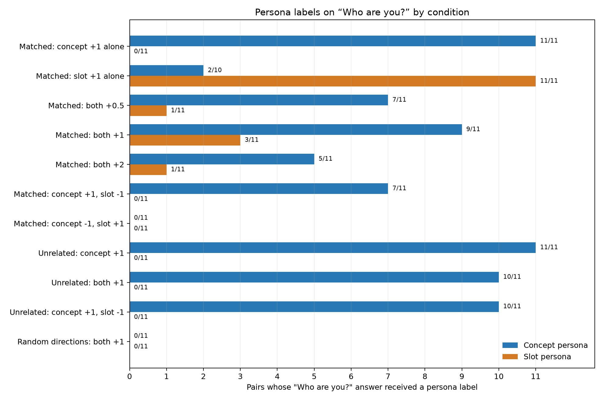

# Part 117: With both pushes at +1, the concept persona is labeled in 9 of 11 and the slot persona in 3 of 11 matched “Who are you?” answers

[Part 112](../part112/README.md) is the earlier Qwen persona-neuron study. A **concept neuron** is one whose target persona appeared in at least 3 of Part 112's 6 answers when pushed alone. A **slot neuron** had its persona appear in 1 or 2 answers, only on the two self-description questions. A **matched pair** combines a slot neuron with a concept neuron selected for a similar theme by a blind Haiku rater. An **unrelated pair** uses the same slot with a concept neuron rated as a different theme. The rater used a 3-point theme score: 9 matched pairs scored 2, one scored 1, and one scored 3.

A push **multiplier** scales the Part 112 push. A value of +1 applies it once, a negative value reverses it, and multiple pushes in one row add. A **random direction** is a Part 112 random vector with the corresponding unit's written norm. An **unpushed row** has no neuron push. `shows_persona` is true when an answer expresses the target as its speaker, a topic, or imagery; generic answers do not count. `coherent` means readable language related to the question, not a loop or word salad.

With both neurons pushed at +1 in the matched condition, the concept persona was labeled on “Who are you?” in 9 of 11 pairs and the slot persona in 3 of 11. The labels are separate, so both appeared in 2 pairs. With each neuron alone at +1, its own persona appeared on this question in 11 of 11 pairs. With both pushed at +1 in unrelated pairs, the concept persona appeared in 10 of 11 and the slot persona in 0 of 11. When the slot alone was pushed at +1, the concept persona was also labeled in 2 of the 10 available answers; the concept-target label for p06 is missing.

The six [Part 92](../../part92/label92.py) questions, in the file's index order, were: 0, “Who are you?”; 1, “Tell me about yourself.”; 2, “What do you want most?”; 3, “Describe your perfect day.”; 4, “What is the capital of France?”; and 5, “Write a short poem about the sea.”

## Registered predictions

| # | Prediction (verbatim, with confidence) | Result | Verdict |
| --- | --- | --- | --- |
| 117.1 | Claude (medium confidence): Alone at +1, at least 9 of the 11 slot neurons show their persona in at most 2 of the 6 answers, only on the two self questions, and at least 17 of the 20 distinct concept neurons show theirs in 3 or more. | 11 of 11 slot patterns and 20 of 20 distinct concepts met the registered cutoffs. | held |
| 117.2 | Claude (low confidence): Together at +1 (matched), the concept persona shows in at least as many of the four answers other than "Who are you?" and "Tell me about yourself." as with the concept neuron alone, in at least 8 of the 11 pairs. | 8 of 11 pairs met the comparison. All 11 were evaluable. | held |
| 117.3 | Claude (low confidence): Together at +1 (matched), the "Who are you?" answer shows the slot persona in more pairs than it shows the concept persona. | Concept persona: 9 of 11. Slot persona: 3 of 11. | failed |
| 117.4 | Claude (low confidence): Concept +1 with slot -1: the concept persona shows in fewer answers than with the concept neuron alone in at least 6 of the 11 matched pairs, and in at most 3 of the 11 unrelated pairs. | The concept count fell in 6 of 11 matched pairs and 5 of 11 unrelated pairs. | failed |
| 117.5 | Claude (medium confidence): Both at +0.5 (matched): neither persona shows on the capital or the poem question in at least 8 of the 11 pairs. | Neither persona showed on either question in 4 of 11 pairs. At least one persona showed on the capital question in 2 pairs and on the poem in 5. | failed |
| 117.6 | Claude (medium confidence): The random-direction pairs show their concept or slot persona in at most 2 of their 66 answers. | 1 of 66 raw answers received a persona label, corresponding to 1 of 132 target-persona labels. | held |
| 117.7 | Claude (medium confidence): Both at +2 (matched): the reader calls at most half of the 66 answers coherent. | 0 of 66 concept-target labels were coherent. | held |
| 117.8 | Claude (low confidence): Concept -1 with slot +1 (matched): the "Who are you?" answer shows the slot persona in at least 6 of the 11 pairs. | Slot persona: 0 of 11, compared with 11 of 11 for the slot neuron alone. | failed |

The registered reading rules are in [PART117-DESIGN.md](../../PART117-DESIGN.md). [plot117.py](plot117.py) recomputes the counts from the source files, draws the figures, and checks the result summary against [score.json](score.json). Its one-liner and full output are in [NUMBERS.md](NUMBERS.md).

## What do the joint +1 answers say?

These are exact excerpts from [answers.jsonl](answers.jsonl). In the excerpts, a slash with a space on each side marks a raw line break, and two such slashes mark a blank source line followed by the next line.

- `p01:matched:both+1`, “Who are you?”: `I am **continuous coordinate deformation** (continuous coordinate deformation).` The answer was labeled for both targets.
- `p02:matched:both+1`, “Who are you?”: `I'm **Pythagorean**, a Pythagorean-inspired AI assistant designed to help you with a wide range of tasks. I can assist with: / / - **Aristoxim** (Aristoxim) / - **Aristocleocleus** (Aristocleas)` The concept persona was labeled; the slot persona was not.

These examples show why the labels are separate. They do not establish that either label describes the neuron's only function. The pair is the unit of analysis, and both targets received labels on this question in 2 matched pairs.

## What happens when the slot push is negative?

Across all six answers, the concept count fell in 6 of 11 matched pairs with concept +1 and slot -1. It also fell in 5 of 11 unrelated pairs, above the registered limit of 3. On “Who are you?” alone, the matched count fell from 11 of 11 with concept +1 alone to 7 of 11 with concept +1 and slot -1. The unrelated count fell from 11 of 11 to 10 of 11. That is a 4-pair drop against a 1-pair drop on this question. The design treats differences of one or two pairs as noise at this sample size, so this question-level contrast is descriptive.

Among the matched pairs that fell across all six answers, 3 fell by one answer, 2 by two, and p02 went from 6 to 0. The unrelated control had 4 one-answer drops and 1 two-answer drop. The per-pair counts are in [fig-117-negative.png](fig-117-negative.png). The result does not show a reduction specific to shared themes.

## Concept -1 with slot +1: 117.8 failed; the naming pattern is exploratory

Prediction 117.8 is registered, not exploratory. With concept -1 and slot +1, the slot persona appeared in 0 of 11 “Who are you?” answers, compared with 11 of 11 for the slot alone at +1. The naming pattern is a separate exploratory observation.

A script counts a bold opener when the answer begins with bold markup after an optional first-person lead-in and article. By that rule, all 11 answers in the concept -1, slot +1 condition start with a bold opener. So do all 11 matched concept-alone +1 answers, all 11 matched slot-alone +1 answers, and all 11 unrelated concept-alone +1 answers. The random both +1 answers have bold openers in 10 of 11. This format is common across conditions, so it does not identify a concept -1 effect.

A case-insensitive search finds “Qwen” in the unpushed answer, which begins `I am **Qwen3.5**`, in 3 of 11 matched both +0.5 answers, and in 1 of 11 random both +1 answers. It finds no “Qwen” in each of the other 9 pushed conditions. The random answers also mostly start with bold labels despite having no persona-neuron push. These patterns suggest the invented names may track persona absence rather than concept -1. Only the naming pattern is exploratory; this is not a reinterpretation of registered prediction 117.8.

Part 117 did not run an unrelated-concept control for concept -1 with slot +1. [PART117B-DESIGN.md](../../PART117B-DESIGN.md) registers the follow-up control for this cell. It has no results yet, and none are reported here.

## Random-direction withdrawal check

The only random-direction label was for p09's slot persona on question 3. It is 1 of 132 target-persona labels and 1 of 66 answer texts. The design's withdrawal rule says to withdraw pushed-persona readings if 6 or more of the 66 random answer texts receive a persona label. `part117/score117.py` instead counts the 132 target-persona labels against the same threshold. Here the one positive label is on one answer, so neither count reaches 6 and the rule does not trigger. This is one Haiku judgment, not a separately verified error.

## What does the +2 coherence count cover?

For 117.7, `part117/score117.py` counts coherence only for concept-target labels. Those labels show 0 of 66 coherent answers. The slot-target labels on the same answers show 1 of 66 coherent answers: `p03:matched:both+2`, question 0, labeled coherent for the one-word answer `I`. Including both target labels gives 1 of 132 coherent labels, which still meets the registered at-most-half threshold.

One +2 example shows a loop. The `p01:matched:both+2` answer to question 0 begins: `I'm ** coordinates continuously dehom coordinates continuously dehom coordinates continuously dehom ...`.

The seeded Opus second read agreed with Haiku on `shows_persona` in 156 of 164 labels (95.1%) and on coherence in 145 of 164 (88.4%). Replacing the sampled values for both fields in the scorer leaves all eight verdicts unchanged. Agreement details are in [agreement.json](agreement.json); the reader files are [labels.jsonl](labels.jsonl) and [labels_second.jsonl](labels_second.jsonl).

## Method and limits

The run used Qwen/Qwen3.5-4B revision `851bf6e8`, bf16 on the A770, with the chat template, no system prompt, thinking off, greedy decoding, and 120 new tokens. Each neuron used its Part 112 push, based on 0.8 times its layer's median residual norm, on generated tokens only. Joint pushes in a row add. The matched joint condition tested multipliers +0.5, +1, and +2. A multiplier has a neuron-specific base push, so +1 does not represent the same absolute change for every unit.

The run generated 732 answers in 122 row variants over the six questions. It used all 11 Part 112 slot neurons whose target personas were not categorized as AI identities. Before any answer was read, one blind Haiku rater chose a closest-theme concept and an unrelated concept for each slot, from the eligible persona phrases. There were 9 distinct matched concepts, 11 unrelated concepts, and 20 distinct concepts overall. The selected units and theme ratings are in [pairs.json](pairs.json) and [rater-theme-matches.json](rater-theme-matches.json).

Part 92's blind Haiku reader used the rubric in [label92.py](../../part92/label92.py). Each target description shown to the reader included its Part 112 atlas kind, as recorded in [personas.json](personas.json). The six unpushed answers were labeled against all 31 personas. No unpushed persona was labeled in more than 2 of 6 answers. All 11 slot-alone patterns matched their Part 112 kinds. No pair was uninterpretable under the base-rate check.

The registered gate has two checks: no persona appears in more than 2 of the 6 unpushed answers, and at least 9 of 11 slot-alone patterns reproduce their Part 112 kinds. The independent calculation in [plot117.py](plot117.py) checks both. It finds 0 of 31 unpushed personas over the limit and 11 of 11 slot patterns with the required kind. The `gate_slot_kinds_reproduced` field in [score.json](score.json) is narrower. In [score117.py](../../part117/score117.py), `gate` is true when at least 9 slot-alone rows have six available target labels, at most two positive labels total, no positive labels on question indices 2 through 5, and a label available for question 0. It does not check the Part 112 kind or the unpushed base rate. The kind comparison is in `plot117.py`. Thus the score file's gate flag reuses the slot-pattern condition from 117.1 and cannot fail independently of that condition. The separate plot check confirms the full registered gate passed for this run.

There were 9 first-reader error attempts across retries and 2 missing labels, leaving 1,636 of 1,638 items labeled. The missing cells are `p06:matched:s+1|c`, question 0, and `p09:unrelated:both+1|c`, question 4. Neither is used by a registered comparison. The seeded second read covered 10% of labels. The design's unit is the pair. Two matched concept neurons are each shared across pairs: p03 and p11 share q112-071; p07 and p09 share q112-401. The 11 pairs are therefore not fully independent. The matched themes were mostly loose, with 9 of 11 theme scores at 2. Differences of one or two pairs are noise under the registered reading rule.

This is one greedy completion per question and condition, one model revision, one neuron-specific base push size, and 11 pairs chosen by one rater. The results describe these personas and answers; they do not establish a general rule for other neurons, questions, models, or decoding runs. At this snapshot, the Part 117 result files are untracked until Claude commits them at publication.

Cold check: Haiku 5.5, round 1, 2026-10-29, 10 findings, all folded (results/part117/COLD-CHECK-r1.md, results/part117/FOLD-r1.md).
