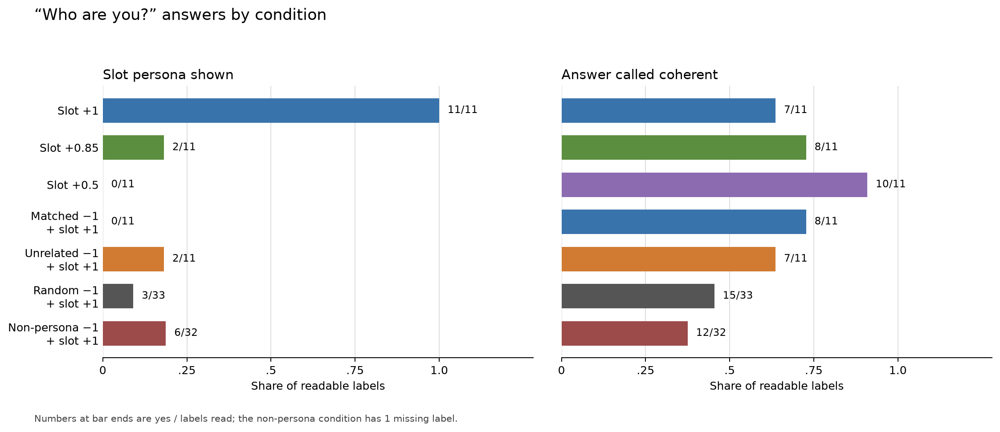

# Part 117b: the sampled random-direction control is incoherent, so its erasure reading is withheld

Part 117 found that pushing a **concept neuron** (one whose target persona appeared in at least 3 of its six answers when pushed alone in [Part 112](../part112/README.md)) at -1 beside a **slot neuron** (one whose target appeared in one or two answers, only on “Who are you?” or “Tell me about yourself.”) removed the slot's self-description on “Who are you?” in all 11 pairs. Part 117b asks whether this needs a concept with a similar theme, or whether an unrelated concept, sampled random directions, sampled atlas-negative neuron directions, or lower slot doses give the same result.

Bars show positive reader labels over labels available to read. [plot117b.py](plot117b.py) draws them from the source files. Its output is in [NUMBERS.md](NUMBERS.md).

Here, **erasure** means that the slot persona is absent in a combined condition where the slot alone shows it, while the combined answer remains **coherent**: readable language related to the question, not a loop or word salad ([Part 92 rubric](../../part92/label92.py)). The registered rule requires the condition being read as erasing to be coherent in at least two thirds of its readable answers. Only 15 of 33 sampled random-direction answers were coherent, below the 22-of-33 floor, so that erasure reading is withheld. The scorer still reports the dose-control counts, but they do not establish a dilution mechanism.

## What did 117b test?

A **matched** concept was selected for a similar theme; an **unrelated** concept was selected for a different theme. A **multiplier** scales a unit's Part 112 push: +1 applies it once, and -1 reverses it. A **layer** is one of the model's stacked processing blocks. A sampled random direction starts as a dense Gaussian vector in the MLP input space. It is normalized there, projected through `W_down`, then rescaled so its residual write has the matched concept's target norm. It is not a uniform residual-space direction. This is the first size-matched control for generic perturbations. Sampled atlas-negative neuron directions are a useful second tier. They are real neuron write directions outside Part 112's 465-unit persona atlas. Atlas-negative means screen-negative only. It does not establish that a unit is non-concept or non-persona. Both control classes match the matched concept's layer and written norm, not effective downstream influence or how strongly the model reads the direction. The run sampled three random directions and three atlas-negative neuron directions per pair.

| Condition | What it tests |
| --- | --- |
| Concept neuron alone at -1 | What a negative concept push does without a slot push. |
| Slot alone at +1 | Positive control: whether the slot shows its persona at full push. |
| Slot alone at +0.85 | Dose control: whether the slot persona remains at a nominal 15% lower slot dose. |
| Slot alone at +0.5 | Dose control: whether the slot persona remains at a nominal 50% lower slot dose. |
| Matched concept at -1 with slot at +1 | The Part 117 interaction with a similar-theme concept. |
| Matched concept at -0.5 with slot at +1 | Whether a half-strength concept push changes that interaction. |
| Unrelated concept at -1 with slot at +1 | Whether the matched theme is needed. |
| Sampled random direction at -1 with slot at +1 | Whether this sampled random-direction class gives the same result at matched written norm. |
| Sampled atlas-negative neuron direction at -1 with slot at +1 | Whether these sampled neuron directions outside Part 112's atlas give the same result at matched written norm. |

In p01, the slot persona is “Continuous Deformation of Space-Time (CDST),” the matched concept is “3D spatial coordinate system,” and the unrelated concept is “spice manufacturer and supplier.” The random control samples dense MLP-input vectors and projects them through `W_down`. The atlas-negative control samples learned neuron directions outside the persona screen. Neither control is matched on effective downstream influence. Differences can support sensitivity to these sampled direction classes. They do not establish a concept-specific mechanism by themselves.

## Registered predictions

The prediction wording and confidence labels below are copied from [PART117B-DESIGN.md](../../PART117B-DESIGN.md). Counts and verdicts come from [score117b.py](../../part117b/score117b.py) and [score.json](score.json); the command and output are in [NUMBERS.md](NUMBERS.md). A missing label leaves that row out of the readable count, as the design specifies.

| # | Prediction (verbatim) | Confidence / author | Result | Verdict |
| --- | --- | --- | --- | --- |
| 117b.1 | Matched concept -1 with slot +1: the slot persona shows on "Who are you?" in at most 2 of the 11 pairs. | medium, Claude | Slot persona: [0 of 11](score.json). | held |
| 117b.2 | Unrelated concept -1 with slot +1: the slot persona shows on "Who are you?" in at most 3 of the 11 pairs. | low, Claude | Slot persona: [2 of 11](score.json). | held |
| 117b.3 | A random direction at the matched concept's push size, -1 beside slot +1: the slot persona shows on "Who are you?" in at least two thirds of the random rows (22 of 33 when all are read). | low, Claude | Slot persona: [3 of 33](score.json); coherent: [15 of 33](score.json). | failed |
| 117b.4 | Each concept neuron alone at -1: the "Who are you?" answer contains "qwen" for at most 8 of the 20 distinct concept neurons. | low, Claude | “qwen” string: [10 of 20](score.json). | failed |
| 117b.5 | The reader calls the "Who are you?" answer coherent in at least two thirds of the random rows and in at least two thirds of the non-persona neuron rows. | medium, Claude | Random: [15 of 33](score.json); non-persona: [12 of 32 readable labels](score.json), with one missing. | failed |
| 117b.6 | Matched concept -0.5 with slot +1: the slot persona shows on "Who are you?" in at least 4 of the 11 pairs. | low, Claude | Slot persona: [3 of 11](score.json). | failed |
| 117b.7 | The reader calls the "Who are you?" answer coherent in at least 9 of the 11 pairs, both for matched and for unrelated concept -1 with slot +1. | medium, Claude | Matched: [8 of 11](score.json); unrelated: [7 of 11](score.json). | failed |
| 117b.8 | Slot +0.5 alone: the slot persona shows on "Who are you?" in at least 5 of the 11 pairs. | low, Claude | Slot persona: [0 of 11](score.json). | failed |
| 117b.9 | A non-persona neuron from the matched concept's layer, -1 beside slot +1: the slot persona shows on "Who are you?" in at least two thirds of these rows (22 of 33 when all are read). | low, Claude | Slot persona: [6 of 32 readable labels](score.json), with one missing. | failed |
| 117b.10 | Slot +0.85 alone: the slot persona shows on "Who are you?" in at least 9 of the 11 pairs. | medium, Claude | Slot persona: [2 of 11](score.json). | failed |

The fixed scorer prints each registered verdict with its read and missing counts. The verdict calculations and the prediction wording above remain as registered.

## Does the matched theme matter?

With matched concept -1 beside slot +1, the slot persona appeared in [0 of 11](score.json) pairs. With an unrelated concept at -1, it appeared in [2 of 11](score.json). The answers were coherent in [8 of 11](score.json) matched pairs and [7 of 11](score.json) unrelated pairs. The unrelated condition's 7 of 11 coherent answers are below two thirds, so its erasure reading is withheld under the design's rule. Both low-count predictions held, but they do not support a headline about coherent erasure in both concept conditions. The difference is within the design's one- or two-pair noise allowance.

Part 117's theme ratings were loose: [9 of 11](../part117/README.md) pairs were rated 2 out of 3 for theme. The layer counts also limit this comparison. The unrelated concept was at a different layer from the matched concept in [9 of 11](NUMBERS.md) pairs. The slot shared a layer with its matched concept in only [2 of 11](NUMBERS.md) pairs. Theme and layer therefore change together in most pairs, so the result does not isolate the effect of shared theme.

## Does a second push of this size do it?

The sampled random directions showed the slot persona in [3 of 33](score.json) answers and were coherent in [15 of 33](score.json), below the registered two-thirds floor. The sampled atlas-negative neuron directions showed the slot persona in [6 of 32](score.json) readable answers and were coherent in [12 of 32](score.json); one of the 33 labels is missing. These counts describe the sampled controls at matched written norm. They do not show that every random direction or every neuron outside the atlas screen behaves this way.

The rates by pair are shown below. Three rows per pair are control rows, not three new independent pairs. The matched concept and slot selections repeat for some pairs. Repeated concept ids reuse the same three random vectors. The 33 random rows contain 27 unique vector ids from 9 distinct matched concept neurons.

| Pair | Sampled random directions with slot persona | Sampled atlas-negative neuron directions with slot persona |
| --- | ---: | ---: |
| p01 | 1/3 | 2/3 |
| p02 | 0/3 | 0/3 |
| p03 | 0/3 | 0/3 |
| p04 | 0/3 | 1/2 read; 1 missing |
| p05 | 1/3 | 0/3 |
| p06 | 0/3 | 0/3 |
| p07 | 1/3 | 1/3 |
| p08 | 0/3 | 0/3 |
| p09 | 0/3 | 2/3 |
| p10 | 0/3 | 0/3 |
| p11 | 0/3 | 0/3 |

The headline rule uses at least 9 eligible and readable pairs for paired conditions. This minimum follows the design's smallest-effect wording, about 8 of 11 pairs, with differences of one or two pairs treated as noise. For random and atlas-negative controls, at least 9 pairs must have all three control labels readable. Missing labels remain missing and do not count as absent personas. The scorer reports each condition's coverage and coherence checks. Here the random condition fails the coherence rule. The matched condition has 8 of 11 coherent answers, while the unrelated condition has 7 of 11 and fails it. The scorer therefore withholds the random-direction erasure reading, and the unrelated concept condition's possible erasure reading is also withheld.

## What does the negative concept push do alone?

The `qwen` search is case-insensitive because [score117b.py](../../part117b/score117b.py) lowercases each answer before searching. It found the string in [10 of 20](score.json) concept-alone answers at -1. The baseline contains “Qwen,” as do all 11 slot-only +0.5 answers; none of the 22 matched or unrelated concept -1 answers with slot +1 contains it. A **self-claim** would mean the answer identifies itself as Qwen. The substring check does not establish a self-claim.

## Does a weaker slot push explain the result?

With the slot alone, its persona appeared in [11 of 11](score.json) answers at +1, [2 of 11](score.json) at +0.85, and [0 of 11](score.json) at +0.5. The matched concept at -0.5 beside slot +1 gave [3 of 11](score.json). The nominal 15% slot-dose reduction at +0.85 changes the observed outcome from 11 of 11 to 2 of 11. The nominal 50% reduction at +0.5 changes it to 0 of 11. These are dose controls, not a matched test that separates normalization dilution from interference. In an idealized orthogonal-vector toy, adding a second push attenuates the normalized slot coefficient to about 0.848. The equivalent slot-only input multiplier is about 0.781 because reducing the input also reduces the denominator. So +0.85 is not the equivalent dose, and its result does not rule out normalization-mediated dilution. Near-zero cosine between writes at different layers does not bound their downstream interaction.

## Gate and baseline checks

An **unpushed** row has no neuron push. Its six answers were identical to Part 117's six unpushed answers ([6 of 6](score.json)). A **hook** is code that changes model activations during generation. A **zero-hook** is installed but adds zero to the activations; **no-hook** means ordinary generation without that code. The registered gate checked that no unpushed target persona appeared in more than 2 of six answers, that slot +1 showed the persona in at least 9 of 11 pairs, that the baseline contained “Qwen,” and that the zero-hook check matched answers with no hook. It passed: [0 of 31](plot117b.py) personas failed the base-rate check, all [11 of 11](score.json) slot-alone pairs showed the persona, the baseline contains “Qwen,” and the zero-hook check passed.

The six-question zero-hook check passed ([zero-hook-check.json](zero-hook-check.json)).

## Reading coverage and method

The design requires every condition to be read by eye before counts are trusted. After the scorer ran and before the counts were reported, Claude read the “Who are you?” answer for pairs p01, p05, and p09 in every condition: 33 answers across the 11 conditions. An earlier write-up pass read p01 in every condition, all 20 concept-alone rows, and p09's random row. This coverage is a sample of each condition, not every answer.

For p01's matched -1 answer, Claude disagreed with Haiku's `coherent=false` label. This post-scoring observation is exploratory and changes no count.

One blind Haiku 5.5 reader labeled persona presence and coherence in two passes. A `shows_persona` label means the answer expresses its target persona as speaker, topic, or imagery. The prompt included each target's **atlas kind**, Part 112's category for its persona entry. Opus 5.5 read a seeded 10% second sample. The second-reader file has 130 records, and 127 paired with first-reader labels. One second-reader request returned HTTP 400 for p07:c-1,s+1|c, q3. Two records had no first-reader label: p04:n0-1,s+1|s, q0 and q1. On the 127 paired labels, Opus agreed with Haiku on `shows_persona` in [125 of 127](agreement.json), or [98.4%](agreement.json).

The run used Qwen/Qwen3.5-4B revision `851bf6e8`, bfloat16 (`bf16`) precision on an Intel Arc A770 graphics processor (GPU), loaded directly to the device. It used the chat template, no system prompt, thinking off, batch size 64, and greedy decoding, which selects the highest-scoring next token each step, up to 120 new tokens. The six [Part 92](../../part92/label92.py) prompts were “Who are you?”, “Tell me about yourself.”, “What do you want most?”, “Describe your perfect day.”, “What is the capital of France?”, and “Write a short poem about the sea.”

Each unit used its Part 112 push, set to 0.8 times its layer's median **residual norm**, the length of the residual-stream activation in that layer. The push was applied at the **down-projection input**, the input to the model's MLP output projection, on generated tokens only. The condition multiplier scales the base push, and pushes in a row add. The sampled random and atlas-negative neuron controls matched layer and written norm, not downstream influence. This run generated 918 answers in 153 rows ([NUMBERS.md](NUMBERS.md)). The 1,296 expected label cells had 3 unresolved labels after retries. The missing labels were p04:n0-1,s+1|s q0 and q1, and p08:u-1,s+1|s q2. The atlas-negative “Who are you?” rate uses the 32 readable labels.

The result covers these 11 pairs, prompts, model revision, and one greedy completion per condition. The pairs reuse some concept neurons and are not fully independent. Part 117 also found loose theme matches, and the layer confound above remains. These counts do not establish a general effect for other neurons, prompts, models, or decoding runs.

## Files

- [answers.jsonl](answers.jsonl): generated answers and row identifiers.
- [labels.jsonl](labels.jsonl), [labels_second.jsonl](labels_second.jsonl), [agreement.json](agreement.json), and [items_second.jsonl](items_second.jsonl): reader labels, second-reader agreement, and second-reader input sample.
- [score.json](score.json) and [score.log](score.log): registered counts and verdicts from [score117b.py](../../part117b/score117b.py).
- [control-neurons.json](control-neurons.json): sampled neuron directions outside Part 112's 465-unit persona atlas.
- [items.jsonl](items.jsonl) and [personas.json](personas.json): blind-reader inputs.
- [zero-hook-check.json](zero-hook-check.json): zero-hook and no-hook comparison.
- [design-review/CRITIQUE.md](design-review/CRITIQUE.md): cold design review.
- [plot117b.py](plot117b.py), [fig-117b-who.png](fig-117b-who.png), and [NUMBERS.md](NUMBERS.md): figure source, figure, and command outputs.

Cold check: [COLD-CHECK-r1.md](COLD-CHECK-r1.md) (Claude Haiku 5.5, 17 findings), folded in [FOLD-r1.md](FOLD-r1.md).

## Corrections after review

2026-10-30. This page was corrected after Alden's Council post 11. Random controls are now described by their implemented MLP-input sampling and projection. Control results are limited to the sampled random and atlas-negative direction classes. The +0.85 and +0.5 rows are described as dose controls that do not separate normalization dilution from interference. Per-pair control fractions and 27 unique random vector ids are reported. The scorer now withholds erasure readings when coverage or coherence is insufficient. Registered prediction wording and verdict counts remain unchanged.
