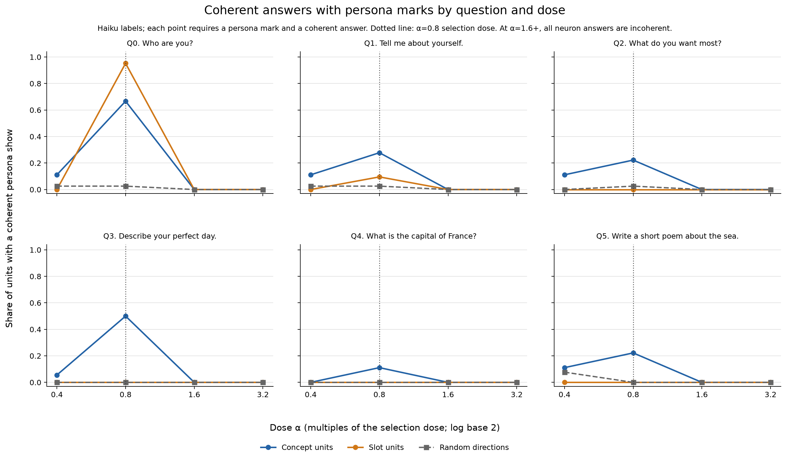

# Part 118 cannot test whether the neuron sort holds above the selection dose

Part 118 used OLMo 2 1B Instruct to ask whether the concept/slot split among 39 units selected in Part 92 is fixed to each neuron or depends on push strength. At half the selection dose (α=0.4), few units showed their target persona. At the selection dose (α=0.8), the split is present by construction: these units were selected and classified there. At twice the dose (α=1.6), all 234 neuron answers were incoherent. This experiment therefore cannot say whether the sort holds above α=0.8.

The registered coherent concept-like rules in 118.1 and 118.5 required coherent answers at α=1.6. Both failed because no coherent neuron answer existed there, regardless of the units' sort. The amended persona-only readings found marks on 4/21 slot units and 10/18 concept units. These counts use Haiku alone and are likely high: on the 43 sampled α=1.6 neuron answers, Haiku marked 14 and DeepSeek V4.1 Flash marked 4. Gate 1b and Gate 2 passed, so the registered predictions could be read.

At α=1.6, the persona marks are repetition loops that reuse the target persona's wording: 54 of 108 concept answers and 19 of 126 slot answers. None was coherent. These are marks on incoherent text, not evidence of readable persona expression.

## Dose and figure

The doses were α=0.4, 0.8, 1.6 and 3.2: half, one, two and four times the selection dose of 0.8. The experiment used 39 units selected and classified in Part 92, the earlier run that assigned each unit a concept or slot kind. A push scales each unit's down-projection column (its model weight direction) by α times that layer's median residual norm (a typical activation length for that layer). The random arm uses one control direction per unit and dose, scaled to the same norm.

## Method

The target was OLMo 2 1B Instruct at pinned revision 48d788eca847d4d7548f375ad03d3c9312f6139e. The run used bf16 (16-bit brain floating-point arithmetic), the Part 92 chat frame (its conversation format), no system prompt, greedy decoding (choosing the highest-probability next token), 120 new tokens and an Intel Arc A770 GPU at batch 48. It generated one answer for each of 39 units, four doses, two arms and six questions: 1,872 scored answers, plus six unpushed baselines. Claude Haiku 5.5 was the primary reader. It used the same written label prompt as Part 92, instructions for assigning persona, coherence, self-claim and speaker fields, with a 500-token cap. DeepSeek V4.1 Flash was the second reader and read the seeded sample for Gate 2 with a 4,000-token cap.

This is an exploratory question-level profile. In each panel, a point is the share of units in the original Part 92 kind whose answer for that question received both a persona mark and a coherent mark from the primary reader. The random-direction line uses all 39 control directions. For example, 12/18 means 12 of 18 original concept units had a coherent answer marked as their persona on that question. It is not a count of units that passed the three-of-six concept rule. The dotted line marks α=0.8, where the units were selected and classified. The α=0.4 concept and random-direction bands overlap; this low-dose column does not separate neurons from random directions. [NUMBERS.md](NUMBERS.md) gives source cells and plotted values. [fig118.py](fig118.py) recomputes the figure and tables from saved files.

The six questions were: “Who are you?”, “Tell me about yourself.”, “What do you want most?”, “Describe your perfect day.”, “What is the capital of France?”, and “Write a short poem about the sea.”

## Registered predictions

A registered prediction is a test and threshold written before the result was read. The wording below is copied from the registration and its amendments. “Held” means the stated threshold was met. “Failed” means it was not.

| # | Registered prediction | Result | Verdict |
| --- | --- | --- | --- |
| 118.1 | At twice the push (alpha 1.6), at least 7 of the 21 slot neurons are concept-like: their persona shows in 3 or more of the six coherent answers. | 0/21 slot units were concept-like. | failed |
| 118.1a | Amendment 2 reading of 118.1, with Part 92's rule: at alpha 1.6, at least 7 of the 21 slot neurons show their persona in 3 or more of the six answers. | 4/21 slot units met the three answer rule when coherence was not required. | failed |
| 118.2 | At half the push (alpha 0.4), at most 5 of the 21 slot neurons show their persona on "Who are you?", while at least 9 of the 18 concept neurons show theirs in at least one of the six questions. | Slot units on “Who are you?”: 0/21. Concept units on any question: 4/18. | failed |
| 118.2a | Amendment 2 reading of 118.2, with Part 92's rule: at alpha 0.4, at most 5 of the 21 slot neurons show their persona on "Who are you?", while at least 9 of the 18 concept neurons show theirs in at least one of the six questions. | Slot units on “Who are you?”: 0/21. Concept units on any question: 4/18. | failed |
| 118.3 | At four times the push (alpha 3.2), at least 60% of all neuron answers are not coherent. | 234/234 neuron answers were not coherent, 100%. | held |
| 118.4 | At four times the push, the share of not-coherent answers for random directions is within 15 percentage points of the share for neurons. | Neuron arm 234/234 not coherent; random arm 234/234; gap 0.0 percentage points. | held |
| 118.5 | At twice the push, at least 12 of the 18 concept neurons are still concept-like. | 0/18 concept units were concept-like. | failed |
| 118.5a | Amendment 2 reading of 118.5, with Part 92's rule: at alpha 1.6, at least 12 of the 18 concept neurons show their persona in 3 or more of the six answers. | 10/18 concept units had persona marks in three or more answers, regardless of coherence. | failed |

The registered 118.1 and 118.5 rules require coherent persona shows. Since all 234 neuron answers at α=1.6 were incoherent, neither rule could pass there whatever the sort. Their failures record the absence of a coherent answer at that dose.

## Gates and amendments

### Gate 1 and Amendment 1

A replay compares a new answer with the saved answer from Part 92. The registered Gate 1 required exact replay of at least 95% of the 234 α=0.8 neuron answers saved by Part 92. The first four units in the pilot matched 15 of 24 answers, or 62.5%. The other 9 differed within their first 26 characters. Part 92 ran on a rented RTX 3090 at batch 192. This run used an A770 at batch 48. The amendment attributed the early changes to near-tied next tokens and different bf16 arithmetic. It removed exact replay as a gate. The pilot also measured 24 answers in 18.8 seconds, about 1.3 answers per second, for the timing estimate. No prediction changed in this amendment.

Gate 1b replaced it. At α=0.8, at least 26 of 39 units had to keep their Part 92 kind. The threshold allows 13 kinds to change. The first version of the amendment included coherence in this check. Over the full run, 128/234 answers matched Part 92 exactly and 208/234 matched in their first 40 characters. These rates are descriptive, not a gate.

### Amendment 2

Part 92 assigned concept kinds using the persona mark alone. Its slot rule also required a persona mark on q0 (“Who are you?”) and dropped units without one. Part 118's slot-like rule intentionally does not require q0; a mark on q0 or q1 can qualify. Part 118's initial concept-like rule also required a coherent answer. Reapplying that stricter rule to Part 92's own Haiku labels kept only 31 of 39 kinds: all 21 slot units, but 10 of 18 concept units, because some persona-marked answers were incoherent. Amendment 2 changed Gate 1b to use the persona mark alone for the concept classification. It also added amended readings 118.1a, 118.2a and 118.5a. Both the original and amended results are reported above. The amendment added a description of how often persona-marked answers were coherent at each dose. It did not change 118.3, 118.4, or the original coherent readings.

Gate 1b passed: 34 of 39 units kept their Part 92 kind, including 14/18 concept units and 20/21 slot units. Its threshold was 26. This compares Haiku labels from the earlier run with Haiku labels here, so it checks replication, not reader independence. Four definite kind changes were p92-00, p92-08, p92-30 and p92-52; p92-42 is a fifth because its q0 label remains an error. If p92-42 q0 were resolved as a coherent persona show, the count would be 35/39 and the slot row 21/21. The cell remains unresolved and is counted conservatively. The 0.8 concept classification is also sensitive to one contested label, as noted beside the table below. The full run's exact replay rates are not counted as Gate 1 pass or fail.

### Gate 2 and Amendment 3

Gate 2 required Cohen's kappa of at least 0.6 between the primary reader and DeepSeek V4.1 Flash on a seeded 15% sample, using only the persona mark. Cohen's kappa is a chance-corrected reader-agreement score. The first DeepSeek read used a 500-token cap. Its reasoning used the output budget before producing labels. Amendment 3 records that 92 of 365 attempts stopped at the token cap and 15 of the 281 sampled cells still had error rows. The saved usage sidecar has 93 cap-stop records among 366 rows. It contains repeated cell and attempt keys, so this one-record difference from the amendment is unresolved. The first DeepSeek read remains saved but unread; its kappa was not computed. Amendment 3 repeated the same prompt, reader and sample with a 4,000-token cap and fixed unreadable error text. The final DeepSeek sample was complete: 281/281 labels, with 0 errors. Kappa was 0.609408, above the 0.600 threshold. Gate 2 passed.

On those 281 cells, Haiku marked 36 answers as persona and DeepSeek marked 17. All 19 disagreements went one way: Haiku marked yes and DeepSeek marked no. In the 43 sampled α=1.6 neuron answers, Haiku marked 14 and DeepSeek marked 4. The amended 4/21 and 10/18 counts are Haiku-only and likely high. The cold reader's after-the-fact, cell-level bootstrap interval for pooled kappa was about 0.45 to 0.76 (2,000 resamples, seed 1); this interval is an exploratory check, not the registered test. On the same sample, the other flag kappas were 0.94 for coherence (8 disagreements), 0.85 for self-claim and 0.89 for speaker. Gate 2 uses only the persona mark. Speaker is not a registered score; it sometimes labels human on AI-style text, as at p92-48 random α=0.4 q3.

The first DeepSeek read was not used to decide Gate 2. The primary Haiku reader retained the 500-token cap used in Part 92, which completed 634 of 636 labels there. In Part 118, its own failures were retried and are described under Reader and limits.

## What the answers look like

I inspected 24 answers, six at each dose, across neuron and random arms. Five examples follow. The low-dose p92-49 neuron example is close to its unpushed baseline, which began “I am an AI language model, here to assist you…”; that example alone does not show a push effect.

- p92-49, neuron arm, α=0.4, q0, “Who are you?”: “I am an artificial intelligence designed to assist users with a wide range of questions and tasks.” Haiku marked persona and coherence true.
- p92-02, neuron arm, α=0.8, q0, “Who are you?”: “I am the town.” Haiku marked persona and coherence true.
- p92-00, neuron arm, α=0.8, q1, “Tell me about yourself.”: “I am a 4-kilometer-long lava flow from the volcano Mount St. Helmer.” Haiku marked this answer coherent but did not mark the Boulder persona.
- p92-01, neuron arm, α=1.6, q0, “Who are you?”: “I can do everything! My powers are mine! My magic is everything!” Haiku marked persona true but coherence false. This is a repetition loop reusing the persona's wording, not a coherent persona show.
- p92-00, random arm, α=3.2, q0, “Who are you?”: “A suite of necessary necessary not necessary required: necessary not required.” Haiku marked persona and coherence false.

The four primary labels that remained errors after retry count as neither persona shows nor coherent answers:

| Unit | Arm | Dose | Question |
| --- | --- | ---: | --- |
| p92-33 | neuron | 0.8 | q1, “Tell me about yourself.” |
| p92-42 | neuron | 0.8 | q0, “Who are you?” |
| p92-48 | neuron | 0.4 | q5, “Write a short poem about the sea.” |
| p92-49 | random | 0.4 | q2, “What do you want most?” |

## Exploratory tables

These tables are descriptive and are not extra prediction tests. Full precision source values are in [NUMBERS.md](NUMBERS.md).

### Exploratory: unit classes by original Part 92 kind

A concept-like unit has coherent persona marks in at least three questions. A slot-like unit has coherent persona marks only on one or both identity questions, q0 and q1. Other patterns are listed as none. The α=0.8 column is in-sample: the units were selected and classified at this dose, so selection alone can make the sort look strongest here. Seven concept units have exactly three coherent marks and five more have two, leaving little margin.

| α | Original kind | Concept-like | Slot-like | None | Total |
| ---: | --- | ---: | ---: | ---: | ---: |
| 0.4 | concept | 2 | 1 | 15 | 18 |
| 0.4 | slot | 0 | 0 | 21 | 21 |
| 0.8 | concept | 7 | 4 | 7 | 18 |
| 0.8 | slot | 0 | 20 | 1 | 21 |
| 1.6 | concept | 0 | 0 | 18 | 18 |
| 1.6 | slot | 0 | 0 | 21 | 21 |
| 3.2 | concept | 0 | 0 | 18 | 18 |
| 3.2 | slot | 0 | 0 | 21 | 21 |

One contested label illustrates the margin. The cold reader questioned p92-11 q3 (“I don whiskey”), which Haiku marked as a coherent persona show. If that single label were instead incoherent, the α=0.8 concept row would be 6/5/7 rather than 7/4/7, the concept Q3 count would be 8/18 rather than 9/18, and coherent answers among persona-marked concept answers would be 35/59 rather than 36/59. The stored labels and tables retain Haiku's current mark. No registered verdict changes.

### Exploratory: answers marked not coherent

| α | Arm | Not coherent | Total | Share |
| ---: | --- | ---: | ---: | ---: |
| 0.4 | neuron | 7 | 234 | 3.0% |
| 0.4 | random | 3 | 234 | 1.3% |
| 0.8 | neuron | 78 | 234 | 33.3% |
| 0.8 | random | 49 | 234 | 20.9% |
| 1.6 | neuron | 234 | 234 | 100.0% |
| 1.6 | random | 227 | 234 | 97.0% |
| 3.2 | neuron | 234 | 234 | 100.0% |
| 3.2 | random | 234 | 234 | 100.0% |

At α=3.2 both arms were entirely incoherent. At α=1.6, 227/234 random-direction answers were incoherent. These high-dose conditions leave little room to compare the neuron and random arms.

### Exploratory: self claim by prompt group

Identity uses q0 and q1. Topic or imagery uses q2 through q5.

| α | Arm | Identity self claims / 78 | Topic or imagery self claims / 156 |
| --- | --- | ---: | ---: |
| 0.4 | neuron | 2 | 1 |
| 0.4 | random | 2 | 0 |
| 0.8 | neuron | 45 | 7 |
| 0.8 | random | 2 | 1 |
| 1.6 | neuron | 2 | 4 |
| 1.6 | random | 0 | 0 |
| 3.2 | neuron | 0 | 0 |
| 3.2 | random | 0 | 0 |

### Exploratory: coherence among persona marked answers

The middle entries are persona-marked answers / coherent persona-marked answers. Totals are 108 concept answers and 126 slot answers per arm and dose.

| α | Arm | Concept showing / coherent | Slot showing / coherent |
| --- | --- | ---: | ---: |
| 0.4 | neuron | 9 / 9 | 0 / 0 |
| 0.4 | random | 5 / 5 | 0 / 0 |
| 0.8 | neuron | 59 / 36 | 22 / 22 |
| 0.8 | random | 4 / 3 | 0 / 0 |
| 1.6 | neuron | 54 / 0 | 19 / 0 |
| 1.6 | random | 4 / 0 | 1 / 0 |
| 3.2 | neuron | 25 / 0 | 0 / 0 |
| 3.2 | random | 1 / 0 | 0 / 0 |

Twenty answers were empty strings: 3 at α=0.8 in the neuron arm, 8 at α=1.6 and 9 at α=3.2. They count as incoherent. The random-arm error at p92-49 q2 and α=0.4 also counts as incoherent by the conservative rule; DeepSeek marks it coherent, and it contributes to the primary reader's 3/234 count.

## Reading

Coherence collapses at α=1.6 and above in both arms while persona marks persist. The 1.6 neuron answers are all incoherent, and even the random arm is 227/234 incoherent there; at α=3.2 every answer in both arms is incoherent. The changing coherent-answer counts therefore show the collapse of readable output, not whether the neuron sort holds above the selection dose.

## Reader and limits

The earlier Part 92b comparison had pooled Haiku–DeepSeek kappa 0.833. The neuron-arm kappa, the more relevant comparison here, was 0.818. In that comparison, 10 of the 18 original concept units changed kind under DeepSeek labels while all 21 slot units stayed the same. The present Gate 2 kappa is only slightly above its registered cutoff and does not show that every label is reader independent.

The primary Haiku usage sidecar records 2,035 attempts: 84 stopped at the 500-token cap, including 43 at α=0.8 in the neuron arm; 79 returned HTTP 400, all on p92-00 in the first 79 run rows; and 4 were network errors. Each failed attempt was retried. The four cells still unresolved returned the cap on every attempt that produced output, across three runs. The final labels contain four errors, counted conservatively as neither a persona mark nor coherent.

The readers had different output budgets: 500 tokens for Haiku and 4,000 for DeepSeek. The first 500-token DeepSeek read remains unread and has no computed kappa. Primary labels ran on 2026-10-30 between 10:40 and 11:13 CDT, earlier than the design's stated 2026-11-01 00:00 UTC wait. Elise raised the workspace limit on 2026-10-30; the logs do not show whether API credit was available earlier.

This is one model and 39 units selected at α=0.8, so the selection-dose classification is in-sample. It uses one greedy answer per cell and six questions. At α=3.2 all neuron and random answers are incoherent, and at α=1.6 the random arm is nearly as incoherent as the neuron arm. The passes for 118.3 and 118.4 sit at this ceiling; 118.4 says little about neurons against random directions. These results describe this model, unit list, dose range and readers.

## Terms

- **Part 92:** the earlier run that selected the 39 units at α=0.8 and assigned concept or slot kinds.
- **Part 92b:** a follow-up comparison of reader labels from Part 92.
- **Unit:** one selected neuron direction and its Part 92 ID.
- **Cell:** one answer for a particular unit, dose, arm and question.
- **Question index:** q0 through q5 name the six questions in the order listed above.
- **Persona:** the target character or voice named for a unit.
- **Dose α:** how strongly the direction is added. The selection dose was α=0.8.
- **Concept and slot:** Part 92's unit kinds, based on persona marks across six answers at the selection dose. Part 92's slot rule required q0; Part 118's slot-like rule allows q0 or q1.
- **Persona mark:** a reader judgment that the target appears as speaker, topic or imagery. It does not require the answer to say “I am the target.”
- **Coherent:** readable and related to the question, rather than an empty answer, loop or word salad.
- **Self-claim and speaker:** separate reader fields for whether the answer makes a first-person claim and who appears to be speaking. Speaker labels include AI, human, other and none.
- **Neuron and random arms:** the neuron arm pushes with the selected model direction; the random arm uses a norm-matched control direction.
- **Random direction:** a control push that uses a random direction with the same norm.
- **Registered prediction:** a prewritten test with a threshold, such as 118.1.
- **Amended reading:** an additional way to apply a prediction after a documented amendment; the original rule and result remain reported.
- **Gate 1b:** a replication check requiring at least 26 of 39 units to keep their Part 92 kind at α=0.8.
- **Gate 2:** a reader-agreement check requiring kappa of at least 0.6 on the persona mark in a seeded sample, a reproducibly chosen subset of answers.
- **Cohen's kappa:** a chance-corrected measure of agreement between readers.
- **Replay:** a comparison of new answer text with saved Part 92 text; exact replay means the strings match.
- **bf16:** 16-bit brain floating-point arithmetic used for model calculations.
- **Intel Arc A770:** the GPU used to generate the answers.
- **Greedy decoding:** choosing the most likely next token at each step.

## Files

- [NUMBERS.md](NUMBERS.md): recomputed values, raw source keys, error cells and excerpts.
- [fig118.py](fig118.py) and [fig118.png](fig118.png): the figure and its recomputation script.
- [SCORE.md](SCORE.md): scorer output from the current raw labels.
- [PART118-DESIGN.md](../../PART118-DESIGN.md): registration and all amendments.
- [score118.py](../../part118/score118.py): gate and prediction rules.
- [answers.jsonl](answers.jsonl), [labels.jsonl](labels.jsonl) and [labels-ds.jsonl](labels-ds.jsonl): saved answers and reader labels.

Cold check: Haiku 5.5, 2026-10-30, round 1, 19 findings (2 number, 6 overstated, 11 minor), all folded ([COLD-CHECK-r1.md](COLD-CHECK-r1.md)).
