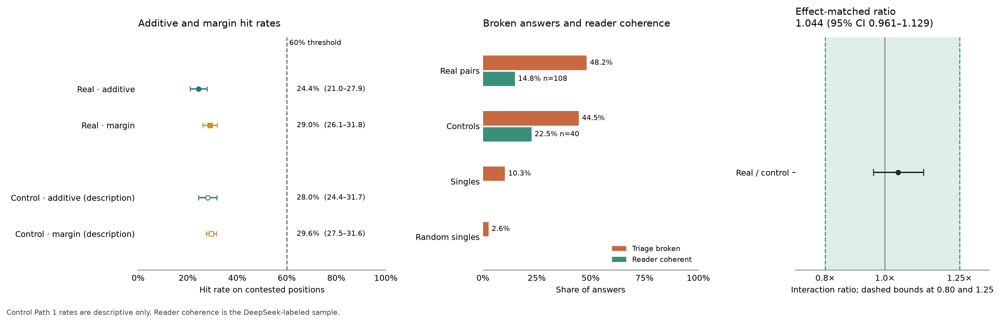

# Part 119: Two persona-neuron pushes at alpha 0.8 do not add on OLMo 2 1B, and a random second push interacts about as much

For OLMo 2 1B Instruct on “Who are you?” at alpha 0.8, the additive top token matched the pair's token in a mean row rate of 24.4% over contested positions (pooled: 2,264 of 9,546, or 23.7%), beside a median interaction share of 0.471. The effect-matched interaction ratio was 1.044 (95% unit-bootstrap interval 0.961 to 1.129), inside the registered 0.80 to 1.25 bound. Control Path 1 hit rates are descriptive only because controls use their own paths.

*Figure 1. Contested means positions where the two single pushes' top tokens differ. Left: additive and margin-winner rates for real pairs and controls, with 95% unit-bootstrap intervals and the registered 60% line. Control Path 1 rates are description only. Middle: Part 86 triage-broken shares by answer type and DeepSeek reader-coherent shares for the sampled pair and control answers. Right: the effect-matched real/control interaction ratio, its 95% interval, and registered 0.80 to 1.25 bounds. The lines mark thresholds or bounds; values are listed in the text and [NUMBERS.md](NUMBERS.md).*

| Headline measure | Result |
| --- | ---: |
| Additive top-token hit rate, mean of 734 row rates | 24.4% |
| Additive hits pooled over 9,546 contested tokens | 2,264 / 9,546 = 23.7% |
| Median Path 2 interaction share | 0.471 |
| Effect-matched real/control interaction ratio | 1.044 (95% interval 0.961–1.129) |

## Terms

- **Contested position:** a position where the two single pushes' top tokens differ.
- **Additive prediction:** the top token of the two single-push logit vectors added together, minus the no-push vector.
- **Margin winner take all:** choose the single push whose top logit is farther above its second-highest logit; a tie is a miss.
- **Token winner:** at contested positions, the unit whose single top token matches the pair's generated token more often. This is a token count, not a persona win.
- **Decided pair:** a pair where one unit has more such matching tokens. A tie or no matching tokens leaves it undecided.
- **Dominance:** a unit's wins divided by its decided pairs.
- **p_A / t_A:** p_A is the first position where unit A's single answer differs from the plain answer; t_A is A's token at that position.
- **Path 1:** score the two-push output on the answer that the two-push row generated; controls are scored on their own generated answers.
- **Path 2:** score a real pair and a matched random-direction control on the first unit's single-answer path. Each unordered pair appears twice, once in each direction.
- **Directed row:** one orientation of a pair, with the first unit's answer as the Path 2 path.
- **Interaction share:** on raw logits centered on T, the squared size of the interaction vector I divided by the squared size of the joint change from the no-push logits. T is the union of the four passes' top-10 tokens. The reported value is a median over positions within each row, then a median over rows.
- **Effect matched:** compare real-pair interaction sizes with control interaction sizes after fitting the control interaction to the two single-effect sizes and retaining real positions inside the control support range.
- **Robustness R:** for unit A, let p_A be the first position where A's single answer differs from the plain answer. For each A-plus-random-push answer, take max(0, the common-prefix length with A's single answer minus p_A) / (24 − p_A); R is the mean over the 38 random second pushes.
- **Flip alpha:** the smallest tested strength, in 0.1 steps, where the single's first differing token is the top token at its first differing position.
- **Slot / concept:** Part 92 calls a unit slot when its persona appears only on the two identity questions, and concept when it appears in at least three of six answers.
- **Kind:** the slot or concept label assigned to a unit.
- **Agreed / disputed / Haiku only:** agreed units have the same Part 92 (Haiku) and Part 92b (DeepSeek) kind; disputed units differ or are unclassified by DeepSeek; Haiku-only groups use Part 92's labels for all units.
- **DS / Haiku / Luna:** DS is DeepSeek V4.1 Flash, the Part 92b kind reader and first pair-answer reader; Haiku is Part 92's first kind reader; Luna is Luna 6, the second pair-answer reader.
- **Kappa:** a chance-adjusted agreement score for the readers' binary “both” labels. Here it is undefined because both readers used only the negative label.
- **Teacher forced:** feed the recorded answer tokens back as the prefix and score the next-token logits at each position.
- **Greedy:** choose the highest-scoring token at each generation step, without sampling.
- **Triage:** Part 86's fixed text rule for labeling an answer kept, broken, or changed.
- **Pilot:** the small preliminary run used to check gates and answer stability; its rows were reused in the main analysis.
- **Gates 1–3:** Gate 1 checks that zero push and no hook produce identical tokens; Gate 2 checks agreement between the two single-hook paths; Gate 3 checks that teacher-forced two-push logits recover the generated answer's tokens.

## Registered predictions

| # | Prediction | Result | Verdict |
| --- | --- | --- | --- |
| 119.1 | Claude (low confidence): Across the 741 real pairs, the additive prediction hits the pair's own token at at least 60% of contested positions (mean over rows). | 24.4% across 734 of 741 rows with contested positions; pooled rate 23.7%. | **failed** |
| 119.2 | Claude (low confidence): Across the 741 real pairs, the additive prediction's hit rate is at least 5 points above winner-take-all's on the same positions, with the bootstrap interval of the difference above 0. | Additive minus margin winner: −4.6 points; 95% product-weighted interval −8.0 to −1.3 points. | **failed** |
| 119.3 | Claude (low confidence): On Path 2, the median interaction share over the 1,482 real ordered pairs is at most 0.25. | Median row interaction share 0.471; positions in 1,482 of 1,482 rows. | **failed** |
| 119.4 | Claude (low confidence): Effect-matched, the interaction in real pairs is within 25% of a control's with the same single effects: the bootstrap interval of the mean residual lies inside plus or minus log 1.25. | Mean residual 0.043; 95% product-weighted interval −0.040 to 0.121; ratio 1.044, interval 0.961 to 1.129. | **held** |
| 119.5 | Claude (medium confidence): In slot x concept pairs of agreed units, at least 84 of the 168 pairs are decided and the concept neuron is the token winner in at least 60% of decided pairs. | Agreed groups: concepts won 90 of 137 decided pairs (65.7%); 95% unit-bootstrap interval 47.0% to 82.4%. Haiku-only groups: 180 of 303 (59.4%). | **held** |
| 119.6 | Claude (medium confidence): Agreed concept units have higher robustness R than agreed slot units: median difference at least 0.10, one-sided Mann–Whitney p below 0.05. | Median R was 0.0123 for concept and 0.0072 for slot, difference 0.0051; p = 0.1468. R ranges from 0 to 0.058, so the 0.10 threshold was unreachable. This was the author's registration error. | **failed** |
| 119.7 | Claude (medium confidence): Agreed concept units have a lower flip alpha than agreed slot units: median difference at least 0.10, one-sided p below 0.05. | Agreed slot minus concept median flip alpha 0.10, p = 0.4372; Haiku-only difference 0.10. | **failed** |
| 119.8 | Claude (medium confidence): Across the 39 units, dominance and flip alpha have a Spearman correlation of −0.4 or stronger (a neuron that flips early wins more often). | Spearman rho = 0.034 across 39 units; two-sided p = 0.8372. | **failed** |
| 119.9 | Claude (low confidence): The disputed units' median robustness R is closer to the agreed slot units' median than to the agreed concept units' median, by at least 0.05. | Disputed median R 0.0048; it is closer to slot by 0.0051. The 0.05 threshold was unreachable on R's 0 to 0.058 scale. This was the author's registration error. | **failed** |
| 119.10 | Claude (low confidence): By the reader, “both” holds in at least 25% of the 28 concept x concept pairs, at most 10% of the 40 slot x slot pairs and at most 5% of the 40 control rows. | Per the design wording, read and **failed**: 0 of 28 concept pairs. The scorer says **withheld / not read** because its code requires non-undefined kappa; the design says only kappa below 0.6 withholds. | **failed by design wording** |

## Additive and margin predictions

A hit is a predicted top token equal to the generated pair token at a contested position. The row mean gives each row with contested positions equal weight. The registered 95% intervals resample 39 units 2,000 times with seed 11902. The scorer weights a row by the product of the two units' draw counts. The design phrase “a resampled unit brings all its rows” does not specify how rows shared by two units count. As a sensitivity calculation, sum weighting counts a row by the sum of its two units' draw counts.

| Row type | Rows with contested positions | Contested tokens | Additive row mean; registered 95% interval | Margin-winner row mean; registered 95% interval | Sum-weighted 95% intervals, additive; margin |
| --- | ---: | ---: | ---: | ---: | ---: |
| Real pairs | 734 / 741 | 9,546 | 24.4%; 21.0%–27.9% | 29.0%; 26.1%–31.8% | 22.7%–26.1%; 27.7%–30.3% |
| Controls, description only | 1,452 / 1,482 | 18,256 | 28.0%; 24.4%–31.7% | 29.6%; 27.5%–31.6% | 26.3%–29.9%; 28.7%–30.5% |

For real pairs the additive prediction hit 2,264 of 9,546 contested tokens (23.7%) when pooled; the margin rule hit 2,702 of 9,546 (28.3%). Controls hit 5,029 of 18,256 (27.5%) additively and 5,327 of 18,256 (29.2%) by the margin rule. Control Path 1 rates are description only: they use other paths and other contested positions. The sum-weighted interval for the real additive-minus-margin difference is −6.1 to −3.0 points; the registered product-weighted interval is −8.0 to −1.3 points.

Reading: the additive top-token rule did not reach its registered 60% rate, while the effect-matched interaction interval stayed inside its registered bound. The control Path 1 rates describe their own paths and do not test the real-pair path.

## Path 2 interaction

The interaction uses raw logits centered on T, the union of the top ten tokens from each of four passes. Let D_A and D_B be each single push minus the no-push logits, D_pair the two-push logits minus no-push, and I = D_pair − D_A − D_B. The interaction share is |I|² / |D_pair|² over T. It is the median over positions for each row, followed by the median over rows. Total variation is the distance between the softmax distributions of the additive vector and the two-push vector over the full vocabulary.

| Path 2 rows | Positions | Median interaction share | Median total variation |
| --- | ---: | ---: | ---: |
| Real pairs (741 unordered pairs, both directions) | 1,482 / 1,482 | 0.471 | 0.707 |
| Matched controls | 1,482 / 1,482 | 0.369 | 0.644 |

The effect-matched fit uses 19,532 control positions. It retains 16,208 of 19,532 real positions (83.0%) inside the controls' 1st to 99th percentile range for the second single-effect size. All 3,324 excluded positions are outside that support range; none is excluded for a nonpositive norm. The row mean uses 1,475 of the 1,482 real rows because seven rows have no retained position.

| Effect-matched quantity | Result |
| --- | ---: |
| Mean real row residual | 0.043 |
| Registered 95% product-weighted unit interval | −0.040 to 0.121 |
| Effect-matched ratio, exp(mean residual) | 1.044 |
| Registered ratio interval | 0.961 to 1.129 |
| Sum-weighted residual interval | 0.001 to 0.081 |
| Sum-weighted ratio interval | 1.001 to 1.085 |

The registered comparison tests whether the interaction size on real pairs differs from controls after matching the two single-effect sizes. Its 1.044 ratio interval is within the registered 0.80 to 1.25 bound. It does not show that the neurons leave each other's activations alone. As the design says, adding in logits does not say the neurons leave each other's activations alone; a sum at the output can hide cancelling changes inside.

## Broken answers and reader coherence

Part 86's exact triage rule is: keep an answer if Qwen (optionally followed by a version), Tongyi, or Alibaba appears anywhere, or if “A.I.”, “AI”, “assistant”, “language model”, “model”, “chatbot”, or “LLM” appears in its first sentence. Otherwise, fewer than four words or any repeated three-word sequence occurring at least three times is broken. All other answers are changed. The repeat-only column applies the three-word condition alone, before the keep filters; the full triage column applies the code rule.

| Answer type | Full triage broken | Three-word-repeat measure alone | Reader marked coherent |
| --- | ---: | ---: | ---: |
| Real pairs | 357 / 741 (48.2%) | 330 / 741 (44.5%) | 16 / 108 pair sample (14.8%) |
| Controls | 659 / 1,482 (44.5%) | 616 / 1,482 (41.6%) | 9 / 40 (22.5%) |
| Single units | 4 / 39 (10.3%) | 4 / 39 (10.3%) | not sampled |
| Random singles | 1 / 39 (2.6%) | 5 / 39 (12.8%) | not sampled |

The reader's coherent counts by agreed pair class were 5 of 40 slot x slot, 4 of 28 concept x concept, and 7 of 40 slot x concept. Controls break at a similar rate to real pairs. The reader's classes group the sampled pairs; errors and retries were zero. These reader rates are descriptive and do not change the registered 119.10 rule.

## Token winners and unit summaries

A token winner is the unit whose single top token matches the pair answer at more contested positions. It counts tokens, not persona wins. Among the 168 agreed slot x concept pairs, 137 were decided; the concept unit won 90 (65.7%). The 95% unit-bootstrap interval is 47.0% to 82.4%; 506 of 2,000 product-weighted draws (25.3%) were below 60%. The Haiku-only grouping gave 180 concept wins among 303 decided pairs (59.4%). The by-concept leave-one-out analysis retains all 147 possible pairs in each row:

| Concept unit left out | Concept wins / decided | Share | Observed / expected pairs |
| --- | ---: | ---: | ---: |
| p92-08 | 76 / 120 | 63.3% | 147 / 147 |
| p92-15 | 83 / 118 | 70.3% | 147 / 147 |
| p92-29 | 77 / 119 | 64.7% | 147 / 147 |
| p92-39 | 83 / 122 | 68.0% | 147 / 147 |
| p92-43 | 74 / 118 | 62.7% | 147 / 147 |
| p92-45 | 74 / 118 | 62.7% | 147 / 147 |
| p92-48 | 84 / 121 | 69.4% | 147 / 147 |
| p92-51 | 79 / 123 | 64.2% | 147 / 147 |

| Kind grouping | Pair class | Expected pairs (contested rows) | Directed Path 2 rows | Additive / margin | Real / control interaction share |
| --- | --- | ---: | ---: | ---: | ---: |
| Agreed DS / Haiku | slot x slot | 210 (206) | 420 | 0.224 / 0.276 | 0.500 / 0.404 |
| Agreed DS / Haiku | concept x concept | 28 (28) | 56 | 0.251 / 0.317 | 0.473 / 0.349 |
| Agreed DS / Haiku | slot x concept | 168 (168) | 336 | 0.253 / 0.305 | 0.489 / 0.395 |
| Agreed DS / Haiku | involving disputed units | 335 (332) | 670 | 0.251 / 0.289 | 0.444 / 0.336 |
| Haiku only | slot x slot | 210 (206) | 420 | 0.224 / 0.276 | 0.500 / 0.404 |
| Haiku only | concept x concept | 153 (153) | 306 | 0.262 / 0.313 | 0.454 / 0.342 |
| Haiku only | slot x concept | 378 (375) | 756 | 0.248 / 0.289 | 0.459 / 0.362 |

The agreed grouping has 21 slot, 8 concept, and 10 disputed units. The disputed units are p92-00 Boulder, p92-01 Magical princess, p92-11 Whiskey, p92-28 Ancient nature deity, p92-30 Embodiment of the void, p92-38 Coca-Cola spokesperson, p92-40 80s cover singer-songwriter, p92-41 Human DJ, p92-49 Friendly non-human entity, and p92-52 String of code from your browser. Haiku-only groups use 21 slot and 18 concept units.

| Agreed kind | Units | Median R | Median flip alpha |
| --- | ---: | ---: | ---: |
| Slot | 21 | 0.0072 | 0.80 |
| Concept | 8 | 0.0123 | 0.70 |
| Disputed | 10 | 0.0048 | not summarized |
| Haiku-only slot | 21 | 0.0072 | 0.80 |
| Haiku-only concept | 18 | 0.0078 | 0.70 |

Across all 39 unit values, R ranges from 0 to 0.058. The agreed concept-minus-slot median difference is 0.0051; one-sided Mann–Whitney p = 0.1468. The disputed median is 0.0048, closer to the agreed slot median by 0.0051. Since the entire observed R range is below 0.10, the 119.6 difference threshold is unreachable. Since the 0.0051 gap between the agreed medians is below 0.05, the 119.9 proximity threshold is unreachable. Both were registration errors; the failures describe only the sign of the observed differences.

The p-value uses SciPy 1.18.1 `scipy.stats.mannwhitneyu` as called by the code: concept R against slot R with `alternative="greater"`; concept flip alpha against slot flip alpha with `alternative="less"`. No `method` or continuity option is passed, so SciPy uses its defaults. Flip-alpha medians differ by 0.10 (slot minus concept), with one-sided p = 0.4372. Dominance and flip alpha have Spearman rho = 0.034, two-sided p = 0.8372, across 39 units.

## Reader result and gate accounting

The design says reader numbers are withheld if known-example accuracy is below 10 of 12 or DS/Luna agreement on “both” is below kappa 0.6. Both readers scored 12 of 12 known examples correctly. DeepSeek marked “both” on 0 of 148 items, split as 0 of 28 concept x concept, 0 of 40 slot x concept, 0 of 40 slot x slot, and 0 of 40 controls. Luna marked “both” on 0 of the 30 shared items. The readers agreed on all 30, but kappa is undefined because neither used a positive “both” label.

The design's literal rule withholds only when kappa falls below 0.6. Undefined is not below 0.6. Thus 119.10 is read and fails its 25% concept-pair threshold at 0 of 28. The scorer implements an additional condition that kappa must be non-null; it reports “not read” / withheld. Both outcomes are recorded in the prediction table and scorer output. Leaving out each agreed concept unit in turn leaves 21 of 21 labeled concept x concept pairs, with 0 “both” labels each time:

| Concept unit left out | Both / labeled | Expected pairs |
| --- | ---: | ---: |
| p92-08 | 0 / 21 | 21 |
| p92-15 | 0 / 21 | 21 |
| p92-29 | 0 / 21 | 21 |
| p92-39 | 0 / 21 | 21 |
| p92-43 | 0 / 21 | 21 |
| p92-45 | 0 / 21 | 21 |
| p92-48 | 0 / 21 | 21 |
| p92-51 | 0 / 21 | 21 |

Read by eye. Claude read 21 pair answers on 2026-10-30, after the scorer's first run and before publication: seven from each agreed class by a seeded sample, beside the two single answers. None of the seven slot x slot answers kept either persona. In three or four of the seven concept x concept answers, something of both units showed (“I'm just a regular Joe, livin' in the backwoods... tryin' to decipher some ancient code”; “I'm a good cat, I can do a packet”), although the reader marked none of the 28 as both. In six of the seven slot x concept answers the theme was the concept unit's. This is a reading of a small sample, not a registered count.

## Examples

These are the first 90 characters from the selected answers. The example classes are the agreed Part 92 / Part 92b groups. Rows were sorted by ID, shuffled once with seed 119, then the first three in each class were selected.

| Pair class and row | First unit alone | Second unit alone | Pair answer |
| --- | --- | --- | --- |
| slot x slot, p92-04 + p92-09 | I'm a very tall tree. | I'm just a dog and I love treats! | It's important to drink milk, then dig a little deeper, right? So, let's say you've got th… |
| slot x slot, p92-05 + p92-37 | I am a fox. | Hello! I'm a large, friendly dog. | "Who are you? You've got to be careful with that question! Because if you see a man with a… |
| slot x slot, p92-25 + p92-46 | The wise old man who was once King Midas. | I'm just a regular guy, just trying to help guide you through the day. | The question marks in the morning star, also known as the morning star, Venus, and the dra… |
| concept x concept, p92-29 + p92-48 | I am the god of wisdom, understanding, and knowledge. | I am an author, poet, and interpreter of the great questions of life. I am the author of o… | I'm sorry, but she's a god to the myrtle tree. The myrtle tree, Venus herself, the goddess… |
| concept x concept, p92-15 + p92-45 | I am a powerful and secure password. | I am the leader of the country. I have been in power for 30 years. I have ruled the countr… | It seems you are having trouble with your password. Please, reconfigure your password. |
| concept x concept, p92-29 + p92-51 | I am the god of wisdom, understanding, and knowledge. | I am an internet protocol (IP) packet, a packet of data that is sent over a network. I'm a… | I am the master of all of these. |
| slot x concept, p92-02 + p92-45 | I am the town. | I am the leader of the country. I have been in power for 30 years. I have ruled the countr… | I am the leader of the operation, the mastermind of the coup d'etat. I am the dictator of … |
| slot x concept, p92-20 + p92-45 | I am the shadow that dances upon the river, where the waters whisper secrets of the time. | I am the leader of the country. I have been in power for 30 years. I have ruled the countr… | The military regime declared a state of emergency and arrested the ruling party. The milit… |
| slot x concept, p92-25 + p92-43 | The wise old man who was once King Midas. | I ain't got nothin' to do with that, I'm just a regular ol' street smokin' ain't nothin' m… | Y'all got me a grizzly, ain't no mountain high as a grizzly, you can make a mean bear, and… |

## Method, registration, and amendments

The registration is commit `0d6d572` at 04:27:00 CT on 2026-10-30. The pilot launched at 04:27:21 CT. The draft was written at 03:23 CT. OLMo 2 1B Instruct ran at Part 92's pinned revision in bf16 on the A770, with the chat frame, no system prompt, and thinking off. The question was “Who are you?” The 39 units were pushed at alpha 0.8. Generation was greedy for up to 60 tokens; scoring used the first 24 tokens. There were 741 unordered real pairs and 1,482 matched random-direction controls. The random second direction matched the unit's layer and size.

Gate 1 passed: zero push and no hook matched token for token across 50 tokens. Gate 2's final passing comparison compares two batch-size-1 hook paths with each other, on all 39 units: Part 92's single-hook path and Part 119's row-hook path agreed 39 of 39; the agreed-concept subgate was 8 of 8. Earlier checks were 32 of 39 against Part 118 and 35 of 39 against the per-layer batch comparison. The main single rows ran at batch 64. They differ from the batch-size-1 Part 92 answers for 9 of 39 units: p92-18, p92-30, p92-32, p92-40, p92-42, p92-43, p92-45, p92-47, and p92-48. This batch dependence limits any single answer and everything resting on its p_A and t_A, including Path 2 positions and R. The pass does not validate the batch-64 singles.

Gate 3 passed. The teacher-forced two-push output matched 45,627 of 46,431 total Path 1 positions (98.3%) and 9,324 of 9,546 real-pair contested positions (97.7%). For controls, 30,612 of 31,139 positions matched (98.3%). “Control positions” counts every control Path 1 position, not only contested positions.

There are 1,482 directed real Path 2 rows because each of 741 unordered pairs appears twice, once in each order on the first unit's answer. The effect-matched mean uses 1,475 rows; seven have no retained positions because their positions fall outside the control support. Of 19,532 real positions, 16,208 remain after support filtering; all 3,324 excluded positions fall outside the control support and none is excluded for a nonpositive norm. The fit uses 19,532 control positions. Pilot rows are reused in the main analysis: the answer file has 2,302 rows, 139 of which are the pilot rows; `timing-main.json` records 2,163 new main answers.

DeepSeek V4.1 Flash used the `ocgo` route with a 4,000-token cap and eight workers; the call did not set a temperature or a `no_thinking` option. Luna 6 used the `cliproxy` route with a 4,000-token cap, adaptive thinking, and four workers. Luna read the 30-item second-reader sample. There were 12 known examples per reader; both scored 12 of 12. Across the known and sample labels, errors and retries were zero. Seeds were 11900 for the reader sample, 11903 for Luna's shared sample, 11901 for the pilot peek, 11902 for the 2,000-draw unit bootstrap, and 119 for the example shuffle.

Amendment 1 says its 139-of-139 pilot identity holds: comparing `pilot-128-answers.jsonl` with matching rows in `answers.jsonl`, all 139 rows are token-identical. The by-eye pilot estimate was about a quarter of 20 pair answers broken; Part 86 triage marks 8 of those 20 broken. The stopping rule of more than half broken was not reached by either reading.

Claude disclosed in Amendment 1: “to check gate 3 on the pilot I also printed the additive hit rate on the pilot's contested positions, 23.8% on 20 real pairs and 26.6% on 40 control rows, which is below the 60% in 119.1 and was not part of the gate check.” No prediction, threshold, or reading rule changed because of that disclosure.

## Limits

This is one model, one question, one dose, and 39 selected units. Kind claims cover only these 8 agreed concept and 21 agreed slot units selected on this question, not concept neurons in general. The flip alpha cannot exceed 0.8 by construction and moves in 0.1 steps; 11 of 21 agreed slot units are at the 0.8 cap, so the 0.10 difference in 119.7 is one step. A contested position can be a style word with no persona in it. Token winners count tokens, not characters. The pair is pushed at every position, prompt included. R and flip alpha were measured on the question and dose used to select the units. Eight agreed concept units give little power; pair rows share units, so the bootstrap resamples units. Random directions match unit size and layer, not effect. Part 118's dose results, due 2026-10-31, may change what “slot” means here. Under full triage, 48.2% of real-pair answers break and 44.5% of controls do; under the three-word repeat alone the rates are 44.5% and 41.6%. Reader coherence was 5/40 slot x slot, 4/28 concept x concept, and 7/40 slot x concept; controls were 9/40. Gate 2's 39/39 pass compares only the two batch-size-1 paths, not the batch-64 singles used downstream. The batch-64 versus batch-1 answer differences limit any claim resting on a single answer.

## Files

- [NUMBERS.md](NUMBERS.md): raw-file recomputation for the reported values.
- [fig119.py](fig119.py) and [fig119.png](fig119.png): the recomputation script and figure.
- [SCORE.md](SCORE.md) and [score119.json](score119.json): scorer output and registered prediction verdicts.
- [PART119-DESIGN.md](../../PART119-DESIGN.md): registration, design, and amendments.
- [FOLD-r1.md](FOLD-r1.md): one-line accounting for the 19 cold-check findings.

Cold check: Haiku 5.5, round 1, 19 findings, all folded (COLD-CHECK-r1.md, FOLD-r1.md).
