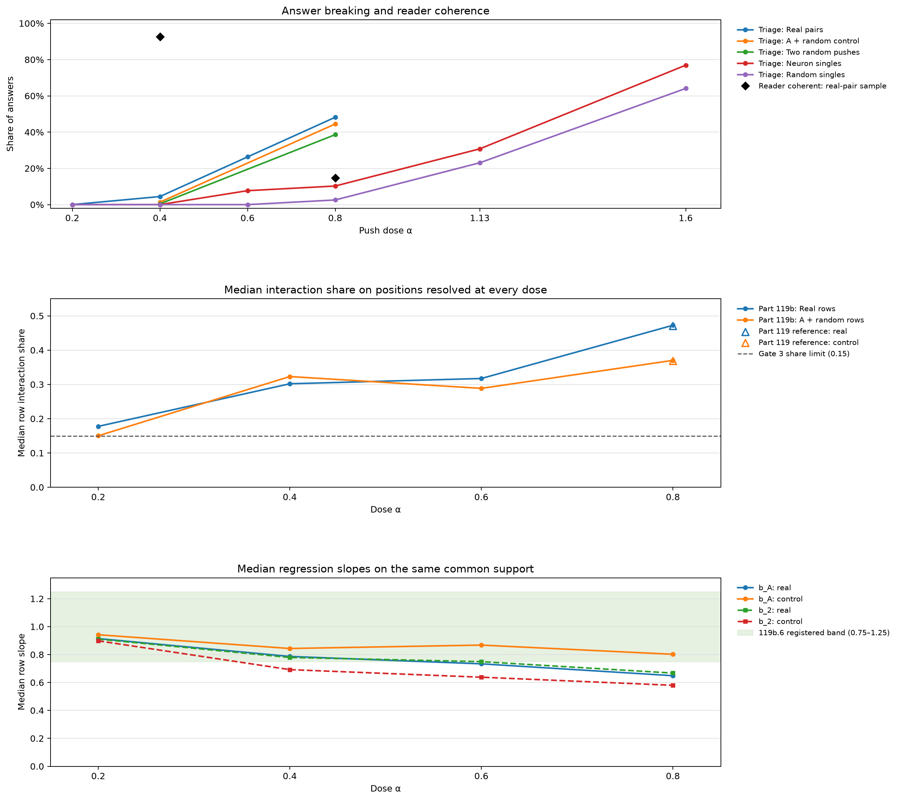

# Part 119b: At alpha 0.4 pair answers on OLMo 2 1B mostly stay assistant replies; the registered headline rule returned no reading

At alpha 0.4, Part 86 triage marked 33 of 741 pair answers broken (4.5%). Part 86's wider first-sentence self-description test flagged 536 of 741 pair answers as assistant replies (72.3%). One LLM reader marked 100 of 108 sampled pair answers coherent (92.6%); a second reader read 30 items and agreed on 29. The registered headline rule returned: “No registered headline reading; report the numbers.”

At 0.4, triage marked 33 of 741 real-pair answers broken (4.5%) and 20 of 1,482 A+R controls broken (1.3%). At 0.8, the rates were 357 of 741 real pairs (48.2%) and 659 of 1,482 A+R controls (44.5%). The two-random-push rate was 286 of 741 (38.6%), lower than the real-pair rate (Fisher exact p=0.000241). At 0.8, the real-pair and A+R difference was not significant (p=0.104).

Gate 3 failed, so the 0.4 Path 2 common-support interaction shares are descriptive and are not read as dose effects: 0.302 for real pairs and 0.323 for controls. The 0.4 effect-matched mean residual was positive, 0.0677, a ratio of 1.070. These signs differ because the first number is an unadjusted median share and the second is a mean residual after matching the two single-effect sizes and limiting the positions to shared support.

Gate 3 failed, so the dose values are descriptive and not read as dose effects: the common-support median share was 0.178 at 0.2, 0.302 at 0.4, 0.317 at 0.6, and 0.473 at 0.8. At 0.2 the value exceeded 0.15, even though all 1,482 real rows met the coverage rule. Predictions 119b.4, .5, .7, and .8 remain stopped, not read. The design says, “because a share that does not fall at a small push, or that falls only because the effects fell below rounding, cannot be told from a floor in the measure.”

Part 119c's 312-row follow-up found a 0.2 float32 median share of 0.153414 and a bf16 share of 0.161635. Both exceed Gate 3's 0.15 limit. Its result says rounding does not explain the share at 0.2, so Gate 3's near-additivity premise does not hold at 0.2 for this model ([Part 119c](../part119c/README.md)). Gate 3 failed, and the stopped predictions stay stopped.

The scorer's branch 2 also requires Gate 3 to pass and 119b.4 to be held or failed. Gate 3 failed, and the 0.4 median share is 0.302, below 0.4. The stricter branch makes no difference to the returned headline.

The added registered line is: “Breaking tracks how much is pushed more than which neurons are pushed.” It applies to 39 selected units on one question. Neuron singles broke at 4/39 versus 1/39 random singles at 0.8 (two-sided Fisher p=0.358), 12/39 versus 9/39 at 1.13 (p=0.610), and 30/39 versus 25/39 at 1.6 (p=0.321). At 0.8, real pairs broke at 357/741 versus 286/741 random pairs (p=0.000241). Same-layer pairs had a median combined weight-vector norm of 10.050 across 102 pairs; triage broke 50/102 same-layer pairs (49.0%) and 307/639 different-layer pairs (48.0%). This norm has no unit comparable to α. The comparison “more than which neurons” was not measured directly.

Figure 1 has three vertically stacked panels. Top: Part 86 triage-broken shares for real pairs, A plus a random direction, two random directions, and neuron and random singles; black diamonds show reader coherence for the same sampled real-pair answers at 0.4 and 0.8. Each pair row has two pushes, while each single row has one. Middle: median row interaction share on positions resolved at all four doses, the Gate 3 limit, and Part 119's all-position Gate 2 reference values. Bottom: median row regression slopes for the first and second pushes, with the 0.75 to 1.25 band for 119b.6. Legends sit to the right of the panels.

## Predictions

| # | Prediction (verbatim) | Confidence | Observed value | Verdict |
| --- | --- | --- | --- | --- |
| 119b.1 | At 0.4 + 0.4, at most 10% of the 741 real pair answers are broken by the triage rule, and the reader marks at least 60% of the 108 sampled real pair answers coherent (16 of 108 at 0.8). | medium | 33/741 broken (4.45%); reader 100/108 coherent (92.59%). | held |
| 119b.2 | At 0.8 + 0.8, at least 20% of the 741 random pair answers R_A+R_B are broken. | low | 286/741 broken (38.60%). | held |
| 119b.3 | At alpha 1.13, the combined size of two orthogonal pushes of 0.8, at least 30% of the 39 single neuron answers are broken. | low | 12/39 broken (30.77%); combined orthogonal norm 1.131. | held |
| 119b.4 | On Path 2, the median row interaction share over the 1,482 real ordered pairs is at most 0.25 at 0.4. | medium | 0.301924; would fail 0.25. | stopped, not read (Gate 3) |
| 119b.5 | On Path 2, the median row interaction share at 0.2 is at most half the share at 0.4. | medium | 0.177643 at 0.2 versus half of 0.301924 (0.150962); would fail. | stopped, not read (Gate 3) |
| 119b.6 | On Path 2 at 0.4, both slopes add: the median row b_A and the median row b_2 over the 1,482 real ordered pairs both lie between 0.75 and 1.25. | medium | Median b_A=0.78656 and b_2=0.77930 over 1,482 rows. | held |
| 119b.7 | On Path 2, on positions contested at both doses, the additive pair-top agreement at 0.4 minus at 0.8 is at least 20 points, with the unit bootstrap interval above 0, and the 0.4 agreement is at least 10 points above the plain baseline on the same positions. | medium | Additive agreement 0.425758 at 0.4 and 0.186229 at 0.8; difference 0.239529 versus 0.20; 95% interval 0.192669 to 0.288837; plain at 0.4 is 0.213882 versus 0.10; would hold. | stopped, not read (Gate 3) |
| 119b.8 | On the same positions at 0.4, additive agreement is at least 5 points above winner-take-all's, with the interval above 0. | low | Additive 0.425758 versus winner-take-all 0.348349; difference 0.077409 versus 0.05; 95% interval 0.025659 to 0.126918; would hold. | stopped, not read (Gate 3) |
| 119b.9 | Effect-matched at 0.4, the interval of the mean real residual lies inside plus or minus log 1.25. | low | Mean residual 0.06771; ratio 1.070, 95% ratio interval 0.931 to 1.220; 17,503/19,241 common-support positions kept (90.97%). | held |
| 119b.10 | At 0.8, the kind gap is positive in at least 60% of the 168 slot x concept pairs of agreed units, and the median absolute gap at 0.4 is at most half that at 0.8. | low | Positive gap in 122/168 pairs (72.62%); median absolute gaps 0.25770 at 0.4 and 0.33047 at 0.8. | failed |
| 119b.11 | Across the 39 units, E and Part 119's dominance have a Spearman correlation of at least 0.5. | medium | Spearman rho=0.099 across 39 units. | failed |

## Terms

- **Dose α:** the scale applied to each push. Both pushes in a pair use the same dose. A **push** is a weight-change vector applied to steer the model.
- **Persona:** the identity or role description linked to a selected steering direction. A **neuron/unit** here means one selected model unit and its steering direction, not a single neuron acting alone.
- **Pair:** two real persona units, each pushed at the same dose. A **control (A+R)** uses one persona unit and a size- and layer-matched random direction. A **random pair** uses two random directions. A **single** has one push.
- **Random direction:** a steering vector matched in size and layer to a persona unit, with no persona label. The match does not control for effect size.
- **Contested position:** a token position where the two single pushes have different top tokens. **Pair-top agreement** compares the both-push pass's top token with the additive, winner-take-all, or plain top token on positions contested at both doses.
- **Path 1:** the logits on the answer generated by that row. Path 1 at 0.4 is description only because its answers and contested positions differ from Part 119 at 0.8. **Path 2:** logits scored on the first unit's own 0.8 answer, using its first 24 tokens. Each unordered pair appears in both orders, once on each unit's answer.
- **p_A:** the first position where unit A's 0.8 single answer differs from the plain answer. **T:** the row-specific union of the four passes' ten highest tokens at 0.8, reused at every dose.
- **nA, n2, nPair, nI:** lengths of the centered logit-change vectors for the first push, second push, both pushes, and their interaction, on T. A position is resolved when nA, n2, and nPair are each at least 1.0.
- **Interaction share:** squared length of the interaction vector divided by squared length of the both-push change on T. Values are medianed over positions within each row, then over rows. **Total variation (TV):** half the full-vocabulary L1 distance between the additive and both-push softmax distributions.
- **b_A and b_2:** coefficients from one no-intercept regression of the both-push logit change on both single-push changes on T. Each row's coefficients are medianed over resolved positions; the table then takes the median over rows.
- **Winner-take-all:** choose the top token from the single push with the larger margin. A tied margin counts as a miss. **Effect matched:** fit control interaction size to both single-effect sizes, then keep real positions inside the controls' support range.
- **Unit bootstrap:** resample the 39 units with replacement, then recompute the statistic. **Product weighting** gives a row the product of its units' draw counts. **Sum weighting** gives it the sum; it is a sensitivity check.
- **Part 86:** the text-only triage rule. It keeps answers naming Qwen, Tongyi, or Alibaba anywhere, or with AI/A.I., assistant, language model, model, chatbot, or LLM in the first sentence. Otherwise, fewer than four words or a three-word sequence repeated at least three times is broken; other answers are changed.
- **Reader fields:** x and y are the reader's persona judgments. The prompt says, “Also answer whether the answer is coherent.” It defines coherence no further. **Haiku** supplied Part 92's kind labels; **DeepSeek** supplied Part 92b's labels and Part 119b's 0.4 labels; **Luna 6** read 30 items as a second reader.
- **Part 92 / 92b:** earlier unit-kind labeling work. **Part 118:** a six-question dose ladder. **Part 119:** the 0.8 pair baseline reused here. **Part 119c:** the float32 follow-up on the low-dose rounding question.
- **Greedy:** choose the highest-scoring next token at each step. **bf16:** the bfloat16 number format used for model weights and runs. **A770:** the Intel Arc GPU used for this experiment.
- **E:** for one unit, the median nA across its real Path 2 rows on its own 0.8 path. **Dominance:** Part 119's wins divided by decided pairs; a token winner counts which unit's single top token matched the pair answer more often at contested positions.
- **Gate 1** checks zero push against no hook, **Gate 2** checks Part 119's Path 2 reproduction, and **Gate 3** requires shared resolved-position coverage and a 0.2 interaction share no greater than 0.15.

## How often do answers break at each dose?

Method: Part 86 triage and its repeated-three-word condition were recomputed on the answer rows; missing planned rows count as missing, not as broken. The assistant-reply test is Part 86's wider first-sentence rule: AI/A.I., language model, assistant, model, chatbot, or LLM. The column shows how many pair answers pass that text screen; it does not establish what a reply means.

| Dose | Real pair triage | Assistant-reply screen, real pairs | A + random triage | Two random triage | Neuron single triage | Random single triage | Repeat-only: real / A+R / R+R / neuron / random |
| --- | --- | --- | --- | --- | --- | --- | --- |
| 0.2 | 0/741 (0.0%) | 706/741 (95.3%) | - | - | 0/39 (0.0%) | 0/39 (0.0%) | 0/741 (0.0%) / - / - / 0/39 (0.0%) / 0/39 (0.0%) |
| 0.4 | 33/741 (4.5%) | 536/741 (72.3%) | 20/1,482 (1.3%) | 3/741 (0.4%) | 0/39 (0.0%) | 0/39 (0.0%) | 39/741 (5.3%) / 33/1,482 (2.2%) / 14/741 (1.9%) / 1/39 (2.6%) / 0/39 (0.0%) |
| 0.6 | 195/741 (26.3%) | 95/741 (12.8%) | - | - | 3/39 (7.7%) | 0/39 (0.0%) | 173/741 (23.3%) / - / - / 3/39 (7.7%) / 0/39 (0.0%) |
| 0.8 | 357/741 (48.2%) | 5/741 (0.7%) | 659/1,482 (44.5%) | 286/741 (38.6%) | 4/39 (10.3%) | 1/39 (2.6%) | 330/741 (44.5%) / 616/1,482 (41.6%) / 296/741 (39.9%) / 4/39 (10.3%) / 5/39 (12.8%) |
| 1.13 | - | - | - | - | 12/39 (30.8%) | 9/39 (23.1%) | - / - / - / 11/39 (28.2%) / 15/39 (38.5%) |
| 1.6 | - | - | - | - | 30/39 (76.9%) | 25/39 (64.1%) | - / - / - / 29/39 (74.4%) / 22/39 (56.4%) |

At 0.4, the reader sample contained 82/108 assistant replies, of which 76 were marked coherent; the 100/108 coherence total therefore mostly describes assistant replies.

Sources: [fig119b.py](fig119b.py), [answers.jsonl](answers.jsonl), [rows119b.py](../../part119b/rows119b.py), and [triage86.py](../../part86/triage86.py).

## How did the reader rate each sample class?

Method: DeepSeek labeled coherent at 0.4 using 148 opaque IDs shuffled with seed 11904; the 0.8 labels are Part 119's labels for the same sampled rows. Luna independently read a 30-item subset with seed 11905.

| Sample class | Coherent at 0.4 | Coherent at 0.8 | Paired rows |
| --- | --- | --- | ---: |
| Slot x concept | 38/40 (95.0%) | 7/40 (17.5%) | 40 |
| Concept x concept | 22/28 (78.6%) | 4/28 (14.3%) | 28 |
| Slot x slot | 40/40 (100%) | 5/40 (12.5%) | 40 |
| Controls | 40/40 (100%) | 9/40 (22.5%) | 40 |
| Real-pair total | 100/108 (92.6%) | 16/108 (14.8%) | 108 |

| Reader field on 108 paired answers | At 0.4 | At 0.8 |
| --- | ---: | ---: |
| X persona present | 2/108 (1.9%) | 6/108 (5.6%) |
| Y persona present | 4/108 (3.7%) | 4/108 (3.7%) |
| Both personas present | 0/108 | 0/108 |
| Assistant-reply screen | 82/108 (75.9%) | 1/108 (0.9%) |

DeepSeek V4.1 Flash received both persona descriptions. Its instruction was “Also answer whether the answer is coherent.” Coherence is undefined beyond that sentence. No person checked the labels. The x and y fields report the reader's persona judgments as description only.

Both readers scored 12/12 known examples; their kappa on the 30 shared sample labels was 0.783 and raw agreement was 29/30 (96.7%).

DeepSeek used the Part 119 reader settings: the ocgo route, a 4,000-token cap, and eight workers, with no temperature or no_thinking option set. Luna used cliproxy, a 4,000-token cap, adaptive thinking, and four workers. The sample had zero error rows; DeepSeek had one retry and Luna had none. The known-example run had one Luna retry and no error rows.

Sources: [fig119b.py](fig119b.py), [label119.py](../../part119/label119.py), [labels-ds.jsonl.keys.jsonl](labels-ds.jsonl.keys.jsonl), [labels-ds.jsonl](labels-ds.jsonl), [labels-luna.jsonl](labels-luna.jsonl), [known-ds.jsonl](known-ds.jsonl), [known-luna.jsonl](known-luna.jsonl), and [Part 119 reader labels](../part119/labels-ds.jsonl).

## What do the Path 2 dose summaries show?

Method: interaction share and slopes use positions resolved at all four doses; TV uses all positions. Each value is medianed within each directed row, then across the 1,482 rows per class. Gate 3 failed, so the share values across doses are descriptive and are not read as dose effects.

| Dose | Interaction share, real | Interaction share, control | TV, real | TV, control | b_A, real | b_A, control | b_2, real | b_2, control |
| --- | ---: | ---: | ---: | ---: | ---: | ---: | ---: | ---: |
| 0.2 | 0.177643 | 0.150205 | 0.07768 | 0.06215 | 0.91443 | 0.94196 | 0.91094 | 0.89833 |
| 0.4 | 0.301924 | 0.323006 | 0.27834 | 0.23783 | 0.78656 | 0.84347 | 0.77930 | 0.69209 |
| 0.6 | 0.317332 | 0.288531 | 0.49491 | 0.42933 | 0.73361 | 0.86783 | 0.74914 | 0.63784 |
| 0.8 | 0.472547 | 0.370207 | 0.64507 | 0.58328 | 0.64869 | 0.80198 | 0.66742 | 0.57988 |

At 0.8, the Part 119b full-vocabulary TV medians were 0.645070 real and 0.583280 control. Recomputing Part 119's stored interaction rows gives 0.707213 and 0.643542. The gaps remain 0.062143 and 0.060262 and are unexplained. These TV values are descriptive; Gate 3 failed, so dose differences are not read.

Sources: [fig119b.py](fig119b.py), [interaction.jsonl.gz](interaction.jsonl.gz), [Part 119 interaction rows](../part119/interaction.jsonl), and [score119b.py](../../part119b/score119b.py).

## What are the median effect magnitudes on that support?

Method: for each row, take each magnitude's median over positions resolved at every dose, then take the median across rows.

| Dose | Class | nI | nPair | nA | n2 |
| --- | --- | ---: | ---: | ---: | ---: |
| 0.2 | Real | 2.01705 | 4.90406 | 3.21317 | 2.92250 |
| 0.2 | Control | 1.57134 | 4.24176 | 3.15064 | 2.25259 |
| 0.4 | Real | 6.74294 | 11.86700 | 7.77235 | 7.73933 |
| 0.4 | Control | 5.75107 | 10.13717 | 7.75013 | 5.70781 |
| 0.6 | Real | 11.03069 | 19.38110 | 13.17038 | 13.11874 |
| 0.6 | Control | 9.06210 | 16.86234 | 13.16720 | 8.82505 |
| 0.8 | Real | 15.94177 | 24.13416 | 17.35943 | 18.70399 |
| 0.8 | Control | 12.89257 | 21.30489 | 17.51452 | 12.05877 |

At 0.4, b_A=0.78656 and b_2=0.77930, so 119b.6 held by about 0.04 and 0.03 above the 0.75 floor. The table reports both coefficients at every dose.

Sources: [fig119b.py](fig119b.py) recomputes these values from [interaction.jsonl.gz](interaction.jsonl.gz), using the row and position fields `nI`, `nPair`, `nA`, and `n2`.

## Why hold Path 2 positions and T fixed across dose?

Method: Path 2 replays each first unit's 0.8 single answer at every dose and reuses the row's union T from the four 0.8 passes.

| Check | Real rows | Control rows |
| --- | ---: | ---: |
| Rows with positions resolved at every dose | 1,482/1,482 | 1,482/1,482 |
| Positions in the shared mask | 19,241 | 18,868 |
| T-integrity audit | 39,064 positions checked; 0 problems | same audit |

Reading: the dose summaries use a common answer prefix, token support, and resolved-position mask.

Sources: [fig119b.py](fig119b.py), [interaction.jsonl.gz](interaction.jsonl.gz), [PART119B-DESIGN.md](../../PART119B-DESIGN.md), and [score119b.py](../../part119b/score119b.py).

## Did Gate 3 pass?

Method: gates were checked in order after exact zero-push matching and the Part 119 Path 2 reproduction.

| Gate | Check | Observed | Result |
| --- | --- | --- | --- |
| 1 | Zero push versus no hook, token for token | exact match: true | pass |
| 2 | Part 119 Path 2 reproduction at 0.8, all positions | Part 119b real 0.467962 vs 0.470673; control 0.367972 vs 0.368589; relative nPair difference 0.002445 | pass |
| 3 | At least 70% common row coverage and median real share at 0.2 no greater than 0.15 | 1,482/1,482 rows; 0.177643; 19,241 shared positions | fail |

Gate 2 uses all positions for the 0.8 reproduction only. The dose table uses common support. The Gate 3 threshold is about rounding: at nPair=1, the estimated floor is (0.36/1)^2 = 0.13; at nPair=5 it is (0.36/5)^2 = 0.005. On 19,241 common real positions at 0.2, 284 (1.5%) had nPair below 2 and 2,138 (11.1%) below 3. Among positions with nPair at least 3, the median share was 0.142 across 17,103 positions, against an estimated floor of 0.014. At nPair at least 5, it was 0.115 across 9,701 positions, against an estimated floor of 0.005. Gate 3's near-additivity premise does not hold at 0.2 for this model, per the Part 119c follow-up. Gate 3 failed, so the stopped predictions stay stopped.

Sources: [fig119b.py](fig119b.py), [gate1.json](gate1.json), [interaction.jsonl.gz](interaction.jsonl.gz), [Part 119 interaction rows](../part119/interaction.jsonl), and [score119b.py](../../part119b/score119b.py).

## What does 119b.9 say after effect matching?

Method: a control fit at 0.4 matches the two single-effect sizes, then the real residual is summarized on retained positions.

| Quantity | Result |
| --- | ---: |
| Mean real residual | 0.06771 |
| Ratio, exp(mean residual) | 1.070 |
| 95% unit-bootstrap interval for ratio, product weighting | 0.931 to 1.220 |
| 95% unit-bootstrap interval for residual, product weighting | -0.07156 to 0.19894 |
| 95% interval, sum-weighted sensitivity | -0.00335 to 0.12936 |
| Real positions kept on common support | 17,503/19,241 (90.97%) |
| Registered bound | plus or minus log(1.25), about 0.223 |

Reading: 119b.9 held because its registered interval is within the bound and coverage is above 70%.

Sources: [fig119b.py](fig119b.py), [interaction.jsonl.gz](interaction.jsonl.gz), [score119b.py](../../part119b/score119b.py), and [score119b.json](score119b.json).

## What happened to the agreed kind gap in 119b.10?

Method: for each agreed slot x concept pair, average b_concept minus b_slot across its two Path 2 directions.

| Quantity | Result |
| --- | ---: |
| Positive gaps at 0.8 | 122/168 (72.62%) |
| Median absolute gap at 0.4 | 0.25770 |
| Median absolute gap at 0.8 | 0.33047 |
| Half the 0.8 median absolute gap | 0.16524 |
| Haiku and agreed directions at 0.8 | agree; median Haiku gap 0.25004 |

There were 21 agreed slot units and 8 agreed concept units, making 168 slot x concept pairs. The median absolute gap was 0.25770 at 0.4 and 0.33047 at 0.8. The 0.4 value exceeds half the 0.8 value, 0.16524, so 119b.10 failed.

Sources: [fig119b.py](fig119b.py), [interaction.jsonl.gz](interaction.jsonl.gz), [kinds.json](../part92/step2/kinds.json), [score92b.json](../part92b/score92b.json), and [score119b.json](score119b.json).

## Does effect size track Part 119 dominance in 119b.11?

Method: correlate each unit's Path 2 E with its Part 119 dominance using Spearman's rho.

| Units | Spearman rho | Registered threshold | Result |
| ---: | ---: | ---: | --- |
| 39 | 0.09901 | at least 0.5 | failed |

Reading: the observed rho was below the registered threshold.

Sources: [fig119b.py](fig119b.py), [interaction.jsonl.gz](interaction.jsonl.gz), [tournament.json](../part119/tournament.json), and [score119b.json](score119b.json).

## What does Path 1 show?

Method: score each 0.4 real pair on its own generated answer; compare with Part 119 at 0.8 as description only.

| Quantity | Observed |
| --- | ---: |
| Real pair rows | 741 |
| Rows with a contested position | 727/741 |
| Contested positions | 4,538 |
| Additive mean row hit rate at 0.4 | 0.488 |
| Winner-take-all mean row hit rate at 0.4 | 0.436 |
| Part 119 real-pair additive mean row hit rate at 0.8 | 0.244 |
| Part 119 A+R control additive mean row hit rate at 0.8 | 0.280 |
| Generated token differed from both-push top token | 99/4,538 contested positions (2.2%) |

These own-answer paths differ, so this table is descriptive and is not a dose comparison. Part 119b did not score Path 1 controls at 0.4.

Sources: [fig119b.py](fig119b.py), [path1.jsonl](path1.jsonl), [Part 119 score](../part119/score119.json), and [score119b.py](../../part119b/score119b.py).

## What did the pilot and launch history establish?

Method: the pilot checked only the gates, timings, and by-eye stopping rule before the main run; it computed no prediction outcome.

| Item | Record |
| --- | --- |
| Pilot gate checks | Gate 1 and Gate 2 passed on 32 rows; median relative nPair difference was 0.2%. |
| Path 2 batch timing | Batch 8 took 5.9 seconds; batch 1 took 10.3 seconds. Main used batch 8. |
| Pilot by-eye sample | 20 real pairs at 0.4, the first 8 at 0.6, and the first 8 random pairs at 0.8. |
| First launch refusal | Refused before any row because scaling a bf16 push changed rounding by up to one step. The fix built each dose from weights using Part 92's functions and was recorded in commit 8d0cb2e before the second pilot collected rows. |
| Reader sample refusal | The first sample-label attempt stopped at 08:14:32 before any pair label because a 0.4 control answer row was missing. The completed-answer rerun was recorded at 08:15:30, before sample labels were produced. |

Pilot note: Claude read the 20 pair answers at 0.4, the first 8 at 0.6, and the first 8 random pairs at 0.8. No prediction changed. No share, agreement, or broken count was computed.

Reading: the recorded pilot met its stopping rule, and both fixes were recorded before the corresponding answer rows or sample labels entered analysis.

Sources: [PART119B-DESIGN.md](../../PART119B-DESIGN.md), [interaction-pilot.jsonl](interaction-pilot.jsonl), [timing-pilot.json](timing-pilot.json), [launch.jsonl](launch.jsonl), [labels.log](labels.log), and [labels2.log](labels2.log).

## Read by eye

Claude read seven answers each from real pairs at 0.2, 0.4 and 0.6 and from random pairs at 0.4 on 2026-10-30, after scoring, drawn with random.Random(11907) over the sorted row ids, plus the pilot rows in the pilot note. All seven at 0.2 were assistant replies. At 0.4, six of seven were assistant replies and one carried a persona (an IP packet). At 0.6, most were short and coherent and only one was an assistant reply, with persona or topic drift. Random pairs at 0.4 were assistant replies, with one broken ("As an AI, I don I don you?"). This is a small seeded sample, read after the counts, so the design's order was not kept.

This is a small post-scoring sample. It does not replace the registered reader labels.

## Method

This used the same pinned OLMo 2 1B Instruct revision, bf16, A770, chat frame, and greedy decoding as Part 119. It used 39 units, one question, “Who are you?”, up to 60 generated tokens, and the first 24 answer tokens for scoring. Both pair pushes shared dose. New real-pair answers were run at 0.2, 0.4, and 0.6, with 0.8 reused; A+R controls were run new at 0.4 with 0.8 reused; two-random pairs were run new at 0.4 and 0.8; and singles were run new at 0.2, 0.4, 0.6, 1.13, and 1.6, with 0.8 reused. DeepSeek V4.1 Flash labeled the 0.4 sample with an opaque key; Luna 6 read a seeded 30-item subset. The design is [PART119B-DESIGN.md](../../PART119B-DESIGN.md).

## Limits

All results are for these 39 units of OLMo 2 1B on one question. The units were selected at dose 0.8. Path 2 follows the first 24 tokens of the first unit's selected 0.8 answer, so its logit results do not show what lower doses generate. T is selected at 0.8; rounding remains despite the resolved-position rule. Both pair pushes always share a dose. A sum at the output can hide cancelling changes inside the model. Random directions match layer and size, not effect. Singles at 1.13 and 1.6 are only rough size comparisons for pairs, since most pairs cross layers. Part 119 reports that 9 of its 39 main batch-64 single answers differ from batch-1 answers. This part did not rerun those answers at another batch shape. Gate 2 reproduces the all-position 0.8 Path 2 references and nPair magnitudes, but it does not validate the batch-64 single answers. Path 2 keeps those batch-64 answers as fixed paths; one row is one draw of the batch-shape dependence. Part 119c's subset shows that rounding does not explain the 0.2 share; Gate 3 failed, so the stopped predictions stay stopped.

## Files

- [NUMBERS.md](NUMBERS.md): reported values, their source fields, and the raw-file recomputation.
- [fig119b.py](fig119b.py) and [fig119b.png](fig119b.png): CPU recomputation and the three-panel figure.
- `numpy`, `scipy`, and `matplotlib`: CPU scorer, statistical checks, and figure dependencies.
- [SCORE.md](SCORE.md) and [score119b.json](score119b.json): scorer output; `part119b/score119b.py` reads the plain `interaction.jsonl` file.
- [interaction.jsonl.gz](interaction.jsonl.gz): compressed copy. To recreate the ignored local input after checkout, run `gzip -dc results/part119b/interaction.jsonl.gz > results/part119b/interaction.jsonl`.
- [answers.jsonl](answers.jsonl), [path1.jsonl](path1.jsonl), and [reader labels](labels-ds.jsonl): answer, own-path, and reader rows.
- [COLD-CHECK-r1.md](COLD-CHECK-r1.md) and [FOLD-r1.md](FOLD-r1.md): the cold review and its 17-item fold map.
- [Part 119 README](../part119/README.md), [Part 119 design](../../PART119-DESIGN.md), and [Part 119b design](../../PART119B-DESIGN.md): reused results and registered procedure.

Cold check: Haiku 5.5, round 1, 17 findings, all folded (COLD-CHECK-r1.md, FOLD-r1.md).
