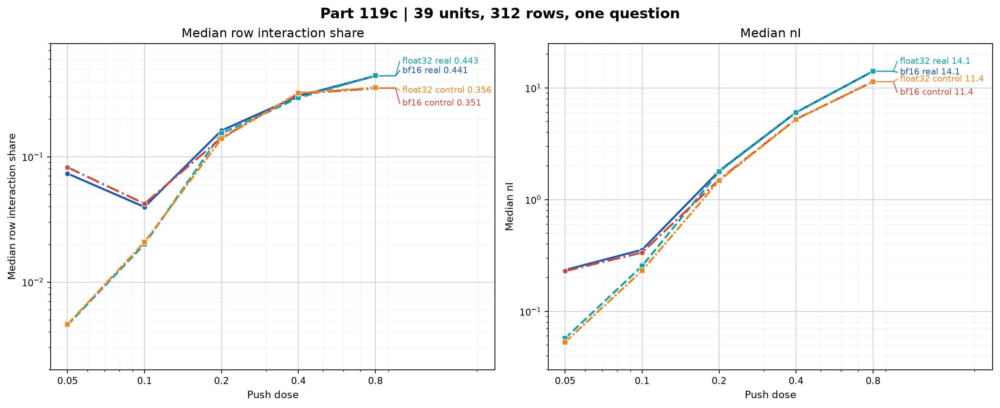

# Part 119c: In float32 the interaction share falls toward zero with dose; rounding adds a floor below 0.2 and does not explain the share at 0.2

For OLMo 2 1B Instruct on “Who are you?”, this one-model, one-question A770 check asks whether the low-dose interaction share is a rounding floor: it scores 312 of Part 119b’s 2,964 Path 2 rows for 39 first units on fixed answer paths from each unit’s 0.8 answer, with float32 real shares of 0.004547 at 0.05 and 0.020094 at 0.1, and bf16 shares of 0.073401 and 0.039749.

Answers were not generated here. The phrase “where answers do not break” rests on Part 119b’s triage result: 33 of 741 real-pair answers were broken at 0.4 (4.5%) ([Part 119b](../part119b/README.md)).

*Figure 1. Left: median row interaction share. Right: median nI. Each line summarizes real or matched control rows in bf16 or float32. Values and their source keys are in [NUMBERS.md](NUMBERS.md).*

## Rule result

The rule returns: “Part 119b's low-dose share is not a rounding floor; the interaction shrinks toward zero with dose, and at 0.2 it is already measurable where answers do not break”.

Both gates passed. Predictions 119c.1 through 119c.4 hold. Prediction 119c.2 was registered on float32.

| # | Registered prediction | Confidence | Observed value | Verdict |
| --- | --- | --- | --- | --- |
| 119c.1 | At 0.2, float32 and bf16 real median row shares differ by at most 0.04, and the product-weighted 95% unit-bootstrap interval for the difference stays within ±0.06. The sum-weighted interval is a sensitivity check. | medium | Difference -0.008220; product-weighted interval -0.021297 to 0.012509; sum-weighted interval -0.014343 to 0.009603. | held |
| 119c.2 | In float32, the real median row share is at most 0.10 at 0.1 and 0.05 at 0.05. | medium | 0.020094 at 0.1; 0.004547 at 0.05. | held |
| 119c.3 | In float32, on real rows, the endpoint log-log slope from 0.05 to 0.2 is at least 1.5. | low | 2.53823. | held |
| 119c.4 | In float32, at 0.05, 0.1, and 0.2, the real share is within a factor of 1.25 of control. | low | Factors 1.01341, 1.03577, and 1.10257. | held |

## Dose summaries

The float32 real share falls to 0.020094 at 0.1 and 0.004547 at 0.05. In bf16, it falls to 0.039749 at 0.1, then rises to 0.073401 at 0.05. That is the rounding floor below 0.2.

| Dtype | Dose | Class | Median row share | Median nI | Median nPair | Positions with nPair < 1 |
| --- | ---: | --- | ---: | ---: | ---: | ---: |
| bf16 | 0.05 | real | 0.073401 | 0.23457 | 0.948695 | 54.23% |
| bf16 | 0.05 | control | 0.082293 | 0.22915 | 0.88738 | 60.31% |
| bf16 | 0.1 | real | 0.039749 | 0.355745 | 2.011195 | 4.82% |
| bf16 | 0.1 | control | 0.042234 | 0.33602 | 1.84578 | 7.10% |
| bf16 | 0.2 | real | 0.161635 | 1.803725 | 5.02565 | 0% |
| bf16 | 0.2 | control | 0.141404 | 1.50924 | 4.42893 | 0% |
| bf16 | 0.4 | real | 0.30449 | 6.037895 | 11.202365 | 0% |
| bf16 | 0.4 | control | 0.318456 | 5.24774 | 9.91861 | 0% |
| bf16 | 0.8 | real | 0.440626 | 14.097215 | 22.659795 | 0% |
| bf16 | 0.8 | control | 0.35077 | 11.378285 | 19.957355 | 0% |
| float32 | 0.05 | real | 0.004547 | 0.057415 | 0.929435 | 57.10% |
| float32 | 0.05 | control | 0.004608 | 0.053135 | 0.859175 | 62.11% |
| float32 | 0.1 | real | 0.020094 | 0.25477 | 1.99267 | 4.96% |
| float32 | 0.1 | control | 0.020813 | 0.23108 | 1.838535 | 7.78% |
| float32 | 0.2 | real | 0.153414 | 1.77989 | 5.0188 | 0% |
| float32 | 0.2 | control | 0.139143 | 1.479895 | 4.431405 | 0% |
| float32 | 0.4 | real | 0.29487 | 6.02178 | 11.23592 | 0% |
| float32 | 0.4 | control | 0.322405 | 5.22637 | 9.931605 | 0% |
| float32 | 0.8 | real | 0.443145 | 14.11354 | 22.58318 | 0% |
| float32 | 0.8 | control | 0.355586 | 11.381885 | 19.999495 | 0% |

### Rounding and Part 119b gate 3

At 0.2, the float32-minus-bf16 subset difference is -0.008220. Its product-weighted 95% unit-bootstrap interval is -0.021297 to 0.012509. The float32 subset share is 0.153414, still above the 0.15 limit. Part 119b’s gate 3 share was 0.177643, so gate 3 remains failed and its stopped predictions stay stopped ([Part 119b](../part119b/README.md#predictions)).

### Resolved positions

The registered reading uses all positions with nPair above 0. Part 119b calls a position resolved when nA, n2, and nPair are each at least 1.0. The table places that resolved-only row median beside the registered all-position median.

| Dose | Class | Registered median | Resolved-only median | Resolved rows / all rows | Resolved positions / all positions |
| ---: | --- | ---: | ---: | ---: | ---: |
| 0.05 | float32 real | 0.004547 | 0.005792 | 37/156 | 77/2056 |
| 0.05 | float32 control | 0.004608 | 0.003494 | 20/156 | 42/2056 |
| 0.1 | float32 real | 0.020094 | 0.020172 | 146/156 | 1072/2056 |
| 0.1 | float32 control | 0.020813 | 0.017003 | 143/156 | 931/2056 |

On resolved positions, the float32 real/control factors are 1.65775 at 0.05 and 1.18637 at 0.1. Prediction 119c.4 used all positions with nPair above 0. Its 0.05 factor is 1.01341. The resolved-only factor at 0.05 is above 1.25.

### Real and control shares

| Dtype | Dose | Real share | Control share | Direction |
| --- | ---: | ---: | ---: | --- |
| bf16 | 0.05 | 0.073401 | 0.082293 | real below control |
| bf16 | 0.1 | 0.039749 | 0.042234 | real below control |
| bf16 | 0.2 | 0.161635 | 0.141404 | real above control |
| bf16 | 0.4 | 0.30449 | 0.318456 | real below control |
| bf16 | 0.8 | 0.440626 | 0.35077 | real above control |
| float32 | 0.05 | 0.004547 | 0.004608 | real below control |
| float32 | 0.1 | 0.020094 | 0.020813 | real below control |
| float32 | 0.2 | 0.153414 | 0.139143 | real above control |
| float32 | 0.4 | 0.29487 | 0.322405 | real below control |
| float32 | 0.8 | 0.443145 | 0.355586 | real above control |

Real is above control at 0.2 and 0.8 and below at 0.05, 0.1, and 0.4 in both dtypes. These directions are descriptive and are not an effect estimate.

### The 312-row subset and Part 119b

Gate 1 compares nPair and passed. The share from the subset differs from the full Part 119b share at these doses.

| Dose | 119c bf16 subset | 119c float32 subset | Part 119b all 1,482 real rows, all positions |
| ---: | ---: | ---: | ---: |
| 0.2 | 0.161635 | 0.153414 | 0.176187 |
| 0.4 | 0.30449 | 0.29487 | 0.302333 |
| 0.8 | 0.440626 | 0.443145 | 0.467962 |

## Dtype comparison

Each row records the requested dtype name and the first parameter’s dtype. It does not record activation dtype. Gate 2 checks the first parameter only. Its 0.8 median relative nPair gap is 0.003509.

| Dose | Median relative nPair gap | Real bf16/float32 median nI | Control bf16/float32 median nI |
| ---: | ---: | ---: | ---: |
| 0.05 | 0.046348 | 4.08552 | 4.31260 |
| 0.1 | 0.024315 | 1.39634 | 1.45413 |
| 0.2 | 0.011690 | 1.01339 | 1.01983 |
| 0.4 | 0.006983 | 1.00268 | 1.00409 |
| 0.8 | 0.003509 | 0.99884 | 0.99968 |

At 0.05, bf16 nI exceeds float32 by 0.177155 for real rows and 0.176015 for controls. The gap in median nI is small by 0.2.

## Method

The experiment reused Part 119b’s model, revision, chat frame, question, units, push construction, and Path 2. It sampled four real and four matched random second pushes for each of 39 first units, giving 312 selected rows. Each JSONL has 1,560 records: 312 rows at five doses. Both dtypes ran doses 0.05, 0.1, 0.2, 0.4, and 0.8. Each row scores fixed positions from the first unit’s 0.8 answer. T, the token set scored at each position, comes from each dtype’s own 0.8 passes. At 0.8, those T sets differ at 1,675 of 4,112 matched positions. The median symmetric difference is 0 tokens; the maximum is 6. No answers were generated here.

The pinned revision was `48d788eca847d4d7548f375ad03d3c9312f6139e`. The run used an A770 and batch 8. The figure and table are recomputed by [fig119c.py](fig119c.py). Gates and predictions come from [score119c.py](../../part119c/score119c.py), called by that script.

## Skeptic checks

The pooled ratio is sum(nI squared) divided by sum(nPair squared) over float32 real positions. The row-median share is shown beside it.

| Dose | Pooled ratio | Row-median share |
| ---: | ---: | ---: |
| 0.05 | 0.004593 | 0.004547 |
| 0.1 | 0.037662 | 0.020094 |
| 0.2 | 0.229596 | 0.153414 |

The local log-log slopes are 2.14384 from 0.05 to 0.1 and 2.93261 from 0.1 to 0.2. The endpoint slope from 0.05 to 0.2 is 2.53823.

The float32 real-share bootstrap resamples 39 units and uses product weights, the scorer’s seed 11902, and 2,000 draws.

| Dose | Median row share | Product-weighted 95% unit-bootstrap interval |
| ---: | ---: | ---: |
| 0.05 | 0.004547 | 0.002816 to 0.006232 |
| 0.1 | 0.020094 | 0.012086 to 0.031097 |

## Terms

- **Unit:** one selected neuron and its push direction.
- **Push:** the change to the model weights for one unit, scaled by dose.
- **Real row:** the second push comes from another selected unit.
- **Control row:** the second push is a matched random direction.
- **Path 2:** logits are scored at positions from the first unit’s fixed 0.8 answer.
- **Position:** one token location in that answer.
- **T or token support:** the token IDs whose logits are compared at a position.
- **nA:** the norm of the first push’s change from the no-push logits.
- **n2:** the norm of the second push’s change from the no-push logits.
- **nPair:** the norm of the two-push change from the no-push logits.
- **nI:** the norm of the interaction vector, computed as the pair change minus the two single-push changes.
- **Interaction share:** `(nI / nPair)^2`, summarized first by the median over positions in a row, then by the median over rows.
- **Resolved position:** a position where nA, n2, and nPair are each at least 1.0.
- **Unit bootstrap:** resampling the 39 units with replacement, then recomputing a statistic from the sampled rows.
- **Product weighting:** a row’s bootstrap weight is the resampled count of its first unit times the count of its second unit.
- **Sum weighting:** a row’s sensitivity weight is the sum of those two counts.
- **Gate:** a pre-reading data check. A failed gate stops the registered predictions.
- **Larger-to-smaller factor:** the higher share divided by the lower share.
- **Log-log slope:** the change in log share divided by the change in log dose.
- **RAM guard:** the launch check that stopped a run when available memory was low.
- **A770:** the Intel GPU used for this experiment.

## Limits

The result covers one model, one question, one device, 39 units, and 312 of 2,964 possible Part 119b Path 2 rows. Paths came from each first unit’s 0.8 answer. Float32 still rounds, and the do-nothing hook was not repeated in float32. Batch-shape dependence is described in Part 119’s Amendment 2 and was not tested here. The loader changed between runs: after the RAM guard stopped the first launch with 0.85 GB remaining, the float32 loader sent the model directly to the device. The effect of that loader change is unknown. T comes from each dtype’s own 0.8 passes and differs at 1,675 of 4,112 positions, with a median of 0 and maximum of 6 tokens. Its effect on the dtype gap is unknown; a shared-T rerun would test it. The lowest-dose shares use small nPair values, shown in the tables. This fixed-path logit study does not measure answers generated at these doses.

### Reading

Reading: the float32 share falls toward zero with dose, while bf16 rises from about 0.04 at 0.1 to about 0.07 at 0.05, giving a floor below 0.2.

## Files

- [NUMBERS.md](NUMBERS.md): recomputed values, checks, intervals, and source keys.
- [fig119c.py](fig119c.py) and [fig119c.png](fig119c.png): computation and figure.
- [interaction-bf16.jsonl](interaction-bf16.jsonl) and [interaction-float32.jsonl](interaction-float32.jsonl): raw Path 2 rows.
- [SCORE.md](SCORE.md) and [score119c.json](score119c.json): scorer output and gate/prediction record.
- [COLD-CHECK-r1.md](COLD-CHECK-r1.md) and [FOLD-r1.md](FOLD-r1.md): cold check and fold map.
- [Part 119c design](../../PART119C-DESIGN.md) and [build notes](../../part119c/BUILD-NOTES.md): registration and run history.

Cold check: Haiku 5.5, round 1, 13 findings, all folded (COLD-CHECK-r1.md, FOLD-r1.md).
