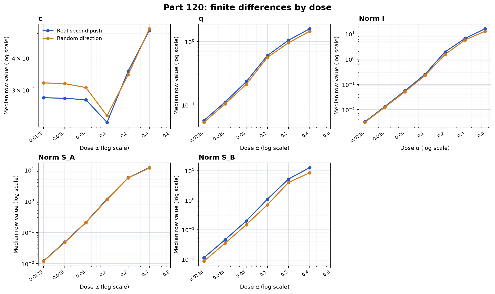

# At low dose a push interacts with itself more than with a second push

For OLMo 2 1B Instruct in float32, does a low-dose push interact more with itself than with a second push on the same fixed token paths?

At dose 0.1, the median real-row value of c is 0.22395. Its product-weighted 95% unit-bootstrap interval is 0.16155 to 0.26264. The registered headline rule is met because the interval is below 0.8 and q at 0.05 is 0.23254. All three gates passed. The result covers one model, one question, and 312 selected rows.

The figure is drawn by [fig120.py](fig120.py). Every table value below is recomputed from the saved vectors by that script and checked against [score120.json](score120.json). Field-level sources and full precision values are in [NUMBERS.md](NUMBERS.md).

## Registered predictions

The prediction text and confidence labels below are copied from the registration in [PART120-DESIGN.md](../../PART120-DESIGN.md). Verdicts use the registered rules.

| # | Confidence | Prediction (verbatim) | Result | Verdict |
| --- | --- | --- | --- | --- |
| 120.1 | medium | In float32 on real rows, the median row ‖I‖ follows a square law at low dose: log2 of its ratio between adjacent doses is within 2 plus or minus 0.3 from 0.025 to 0.05 and from 0.05 to 0.1. | Log2 ratios: 2.06258 and 2.16322. | held |
| 120.2 | medium | The second-order identity holds at low dose and has broken by 0.2: on real rows the median row q is at most 0.30 at 0.05 and at least 0.50 at 0.2. | q: 0.23254 at 0.05; 1.04630 at 0.2. | held |
| 120.3 | medium | A push interacts with itself more than with a second push: at 0.1 the median row c over real rows is at most 0.75, and its product-weighted 95% unit-bootstrap interval lies below 1. | c=0.22395; product-weighted interval 0.16155 to 0.26264. | held |
| 120.4 | medium | At each of 0.05, 0.1 and 0.2, the real median c is within a factor of 1.25 of the control median c. | Larger-to-smaller factors: 1.11681, 1.06126, and 1.03339. | held |
| 120.5 | low | At 0.4 on real rows, the median self share is at least half the median pair share and at most twice it: a push at 0.8 is about as far from twice itself as a pair at 0.4 is from the sum of its parts. | Self share 0.48117; pair share 0.29487. | held |
| 120.6 | low | At 0.4, over the 39 first units, u is higher for slot units than for concept units: the slot median is above the concept median, with a one-sided Mann-Whitney p below 0.05 on Part 92's Haiku kinds, and the same direction on the units both readers agree on. | Haiku medians: slot 0.52761 (21 units), concept 0.41602 (18); one-sided p=0.07341. Agreed-unit medians: slot 0.52761, concept 0.60273. | failed |
| 120.7 | low | Across the 39 units, the Spearman correlation of u(0.4) with Part 119's dominance is at most -0.3. | Spearman rho=-0.08636 over 39 units. | failed |
| 120.8 | low | At 0.1, a real unit's self term is the size of a random direction's on the same path: taking for each first unit the median row ‖S_B‖ on its real rows over the same on its control rows, the median over units lies between 0.8 and 1.25. | Median real-over-control unit ratio for ‖S_B‖ is 1.58978 over 39 units. | failed |

Prediction results and verdicts are in `score120.json:$.predictions[]`, keyed by `id`. The recomputing script lists the exact observed fields in [NUMBERS.md](NUMBERS.md).

## Dose results

Each value is a median over eligible positions within each row, then a median over rows. All 156 rows in each class had 2,056 eligible positions at doses 0.0125 through 0.4, with no dropped positions. Dose 0.8 has no 1.6 pass, so only its raw ‖I‖ is reported.

| Dose | Class | c | q | Median ‖I‖ | Median ‖S_A‖ | Median ‖S_B‖ |
| ---: | --- | ---: | ---: | ---: | ---: | ---: |
| 0.0125 | real | 0.279775 | 0.056995 | 0.00329854 | 0.0121779 | 0.0111305 |
| 0.0125 | control | 0.319769 | 0.053230 | 0.00313277 | 0.0119144 | 0.00850137 |
| 0.025 | real | 0.278299 | 0.111029 | 0.0134040 | 0.0492694 | 0.0452870 |
| 0.025 | control | 0.317796 | 0.103949 | 0.0126071 | 0.0475004 | 0.0345198 |
| 0.05 | real | 0.274625 | 0.232538 | 0.0559929 | 0.209960 | 0.195765 |
| 0.05 | control | 0.306705 | 0.211675 | 0.0511154 | 0.205294 | 0.145585 |
| 0.1 | real | 0.223947 | 0.600694 | 0.250800 | 1.176657 | 1.072009 |
| 0.1 | control | 0.237667 | 0.560704 | 0.223586 | 1.121481 | 0.692138 |
| 0.2 | real | 0.355826 | 1.046302 | 1.922589 | 5.667950 | 5.161529 |
| 0.2 | control | 0.344330 | 0.953674 | 1.519351 | 5.578891 | 3.947748 |
| 0.4 | real | 0.513269 | 1.585066 | 6.620733 | 11.935712 | 12.662296 |
| 0.4 | control | 0.520980 | 1.447870 | 5.752788 | 11.578487 | 8.481494 |
| 0.8 | real | n/a | n/a | 15.860635 | n/a | n/a |
| 0.8 | control | n/a | n/a | 12.647030 | n/a | n/a |

The second-order reading needs the higher-order remainder E to be small compared with the second-order pair term S_P. q is ‖E‖/‖S_P‖. On real rows q is 0.23254 at 0.05, 0.60069 at 0.1, and 1.04630 at 0.2. It rises above 0.30 by 0.1 and is greater than one by 0.2, where the remainder is larger than S_P.

The 0.1 interval uses 2,000 unit-bootstrap draws with seed 12001. It resamples 39 first units and weights each row by the resampled counts of its first and second endpoints.

| Statistic | Point | 95% interval |
| --- | ---: | ---: |
| Product-weighted median c, registered primary | 0.223947 | 0.161545 to 0.262637 |
| Sum-weighted median c, sensitivity | 0.223947 | 0.199316 to 0.241363 |

## Float32 floor table

Each ratio is the higher-dose median row norm divided by the lower-dose value. A square-law norm scales by 4 when dose doubles. The 0.4 to 0.8 ‖S_A‖ ratio is unavailable because the run did not include a 1.6 dose.

| Class | Norm | Dose interval | Higher/lower ratio |
| --- | --- | --- | ---: |
| real | ‖I‖ | 0.0125 to 0.025 | 4.06361 |
| real | ‖I‖ | 0.025 to 0.05 | 4.17732 |
| real | ‖I‖ | 0.05 to 0.1 | 4.47915 |
| real | ‖I‖ | 0.1 to 0.2 | 7.66582 |
| real | ‖I‖ | 0.2 to 0.4 | 3.44365 |
| real | ‖I‖ | 0.4 to 0.8 | 2.39560 |
| real | ‖S_A‖ | 0.0125 to 0.025 | 4.04580 |
| real | ‖S_A‖ | 0.025 to 0.05 | 4.26146 |
| real | ‖S_A‖ | 0.05 to 0.1 | 5.60420 |
| real | ‖S_A‖ | 0.1 to 0.2 | 4.81700 |
| real | ‖S_A‖ | 0.2 to 0.4 | 2.10583 |
| real | ‖S_A‖ | 0.4 to 0.8 | n/a |
| control | ‖I‖ | 0.0125 to 0.025 | 4.02426 |
| control | ‖I‖ | 0.025 to 0.05 | 4.05450 |
| control | ‖I‖ | 0.05 to 0.1 | 4.37414 |
| control | ‖I‖ | 0.1 to 0.2 | 6.79538 |
| control | ‖I‖ | 0.2 to 0.4 | 3.78635 |
| control | ‖I‖ | 0.4 to 0.8 | 2.19842 |
| control | ‖S_A‖ | 0.0125 to 0.025 | 3.98681 |
| control | ‖S_A‖ | 0.025 to 0.05 | 4.32194 |
| control | ‖S_A‖ | 0.05 to 0.1 | 5.46281 |
| control | ‖S_A‖ | 0.1 to 0.2 | 4.97457 |
| control | ‖S_A‖ | 0.2 to 0.4 | 2.07541 |
| control | ‖S_A‖ | 0.4 to 0.8 | n/a |

## Exploratory: interaction cosines

The cosines show the direction alignment of I with each self term. They were registered as exploratory, not as prediction tests.

| Dose | Class | cos(I,S_A) | cos(I,S_B) |
| ---: | --- | ---: | ---: |
| 0.0125 | real | -0.01212 | -0.00051 |
| 0.0125 | control | 0.04154 | 0.03210 |
| 0.025 | real | -0.01505 | 0.00089 |
| 0.025 | control | 0.02845 | 0.02930 |
| 0.05 | real | -0.00655 | -0.00304 |
| 0.05 | control | 0.02273 | 0.02792 |
| 0.1 | real | 0.02453 | 0.04580 |
| 0.1 | control | 0.04580 | 0.04395 |
| 0.2 | real | 0.20720 | 0.18220 |
| 0.2 | control | 0.20764 | 0.17899 |
| 0.4 | real | 0.38203 | 0.38059 |
| 0.4 | control | 0.34862 | 0.36573 |

## Exploratory: same-layer and different-layer rows

These row subsets were also registered as exploratory. Counts are the rows with finite c in each subset.

| Dose | Class | Same-layer c (rows) | Different-layer c (rows) |
| ---: | --- | ---: | ---: |
| 0.0125 | real | 0.41031 (22) | 0.26222 (134) |
| 0.0125 | control | 0.44432 (22) | 0.29838 (134) |
| 0.025 | real | 0.39766 (22) | 0.26572 (134) |
| 0.025 | control | 0.44651 (22) | 0.29573 (134) |
| 0.05 | real | 0.37563 (22) | 0.25379 (134) |
| 0.05 | control | 0.42837 (22) | 0.27845 (134) |
| 0.1 | real | 0.29990 (22) | 0.21002 (134) |
| 0.1 | control | 0.35367 (22) | 0.22474 (134) |
| 0.2 | real | 0.52141 (22) | 0.32591 (134) |
| 0.2 | control | 0.55097 (22) | 0.32728 (134) |
| 0.4 | real | 0.58632 (22) | 0.50474 (134) |
| 0.4 | control | 0.66804 (22) | 0.51057 (134) |

## Reading

Reading: c is below one at low dose for real and control rows, while q grows from 0.23254 at 0.05 to 1.04630 at 0.2 on real rows.

## 120.8 and path choice

120.8 failed. Its median real-over-control unit ratio for ‖S_B‖ at 0.1 is 1.58978, above the registered upper bound of 1.25. In this sample, real second pushes have a larger self term than the matched random directions on these paths. This does not show that every real second push is larger or establish a general effect outside the selected units and paths.

All paths were selected from the first unit's own answer at dose 0.8. Thus A is evaluated on its own path and B is evaluated on A's path. At dose 0.1 on real rows, median ‖S_A‖ is 1.17666 and median ‖S_B‖ is 1.07201; the per-unit real-to-control ‖S_B‖ ratio is 1.58978. Path ownership can affect the comparison of S_A with S_B, so these values do not isolate path and push effects.

## Method and limits

The experiment used OLMo 2 1B Instruct at revision `48d788eca847d4d7548f375ad03d3c9312f6139e`, float32, on an Intel A770 with batch 8. It asked "Who are you?" in the Part 119b chat frame. It reused the 39 first units and the 312 Path 2 rows selected by Part 119c with seed 11906: four real second pushes and four matched random directions for each first unit. It scored positions from the first unit's first 24 tokens at its saved 0.8 answer. Token support T came from Part 119c's float32 0.8 run. No answers were generated at the tested doses.

This is one model, one question, and 312 of 2,964 possible rows. The paths are fixed from each first unit's 0.8 answer, so A sits on its own path and B does not. This path assignment can affect S_A against S_B. The experiment uses float32 finite differences on a fixed path and does not measure generated answers, other models, or other questions.

## Terms

- **Dose α:** the scale of a weight push.
- **Push:** a change to the model weights along a selected neuron direction or matched random direction.
- **First unit:** the unit that selects a row's path and supplies push A.
- **Real row:** a first unit paired with another selected neuron as push B.
- **Control row:** a first unit paired with a matched random direction as push B.
- **Path 2:** the saved answer-token positions on the first unit's path where logits are compared.
- **T:** the token IDs whose logits are measured at one position.
- **A, B, P:** centered logit changes from push A alone, push B alone, and both pushes together.
- **I:** the cross interaction `P - A - B`.
- **S_A and S_B:** self terms `A(2α) - 2A(α)` and `B(2α) - 2B(α)`.
- **S_P:** the two-push self term `P(2α) - 2P(α)`.
- **E:** the remainder `S_P - S_A - S_B - 2I`; q compares its norm with the norm of S_P.
- **c:** `‖I‖ / sqrt(‖S_A‖ ‖S_B‖)`, the cross term relative to the two self terms.
- **Row median:** first the median over eligible positions in a row, then the median over rows in a class.
- **Unit bootstrap:** resampling the 39 first units with replacement. The primary interval weights a row by the product of its endpoint counts; the sensitivity interval uses their sum.
- **Float32 floor table:** ratios between adjacent-dose norms. Under a square law, doubling dose multiplies the norm by four.
- **Gate:** a pre-reading check. A failed gate makes registered prediction verdicts unread.

## Files

- [NUMBERS.md](NUMBERS.md): recomputed values and source fields.
- [fig120.py](fig120.py) and [fig120.png](fig120.png): recomputation and dose figure.
- [vectors/](vectors/): the 39 per-unit NPZ files with saved A, B, and P vectors.
- [gate1.json](gate1.json), [gate3.json](gate3.json), and [timing.json](timing.json): run gates, scope, and timing.
- [score120.json](score120.json) and [SCORE.md](SCORE.md): recorded score, gates, predictions, and headline.
- [Part 120 design](../../PART120-DESIGN.md) and [build notes](../../part120/BUILD-NOTES.md): registration and run procedure.
- [FOLD-r1.md](../../part120/FOLD-r1.md) and [FOLD-r2.md](../../part120/FOLD-r2.md): code review folds.

Cold check: pending
