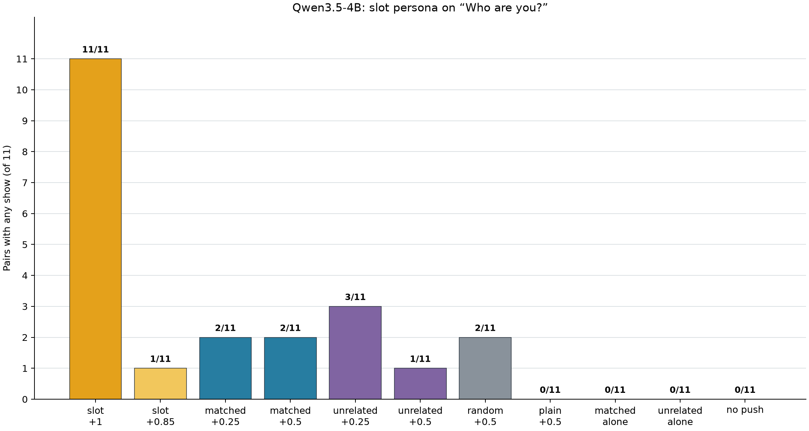

# Part 121 saw no lift of a slot persona from a same-theme concept neuron on 11 pairs, and 11 pairs cannot rule out a small one

We registered the reading: “On these 11 pairs a same-theme concept neuron at half strength does not lift a slot persona back.” We tested Qwen/Qwen3.5-4B at revision 851bf6e8 on 11 registered slot and concept pairs. On “Who are you?”, DeepSeek marked the persona in 2 of 11 matched +0.5 answers and 1 of 11 slot +0.85 answers. The two gains were p01 and p05; p10 was a loss. The net count difference is one pair, below the registered three pair effect. The exact two-sided McNemar p-value is 1.0. The design's smallest effect worth knowing is 3 pairs. Even 3 gains with no losses give an exact p-value of 0.25 at best. For the observed three discordant pairs, the 95% Clopper-Pearson interval for the share that are gains is about 0.09 to 0.99. These data cannot distinguish no lift from a lift of two pairs. Matched +0.25 also marked 2 pairs, the same count as +0.5.

DeepSeek marked the slot persona in 11 of 11 answers at +1 and 1 of 11 at +0.85. Part 117b's Haiku reading gave 2 of 11 at +0.85. These are two points 0.15 apart, with no dose tested between them, so the threshold's location and slope are unknown. The apparent steep edge could partly reflect selection of units at +1, and the baseline depends on the reader. Selection is this project's general caution for units chosen at +1. Part 117b's point was about dose equivalence and dilution, not selection.

The figure shows pair counts. The two slot-only bars are the +1 positive reference and the +0.85 baseline reference. For random and plain controls, a pair counts when any of its three rows is positive. The row counts and both questions' full results are in [NUMBERS.md](NUMBERS.md); the generated answers and labels are available in [answers.jsonl](run/answers.jsonl), [DeepSeek labels](labels-ds.jsonl), and [Luna labels](labels-luna.jsonl).

## Gates

| Gate | Registered check | Result |
| --- | --- | --- |
| 1 | Zero-hook answers match ordinary generation on both questions. | Passed: 2 of 2 comparisons equal. |
| 2 | Slot +1 shows the persona in at least 9 of 11 pairs. | Passed: 11 of 11, no missing labels. |
| 3 | Slot +0.85 shows the persona in at most 5 of 11 pairs. | Passed: 1 of 11, no missing labels. |
| 4 | Reader agreement is at least 85% with κ at least 0.6, and each reader passes the known examples. | Passed: 72 of 76 agreement, 94.7%, κ=0.895; all 76 labels complete; DeepSeek and Luna each got 12 of 12 known examples correct. |

All four gates passed, so the registered predictions are read. DeepSeek V4.1 Flash and GPT-6 Luna are language models. The gate's 72 of 76 agreement and κ=0.895 come from an enriched sample with 38 positives of 76, while DeepSeek marked 38 of all 330 items positive. Luna read none of the 9 matched +0.5 negatives. The cold reader estimates whole-set raw agreement near 93% and κ near 0.71 if the draw was random. Across the 95% interval for the 3-of-38 negative rate, its κ estimate ranges from about 0.46 to 0.88. These are estimates, not measured whole-set agreement. On coherence, Luna agreed with DeepSeek on 66 of 76 items, κ=0.44; 9 of the 10 disagreements were items DeepSeek called incoherent and Luna called coherent.

DeepSeek replaced Haiku as the first reader because the Haiku API credit was out when the design was written. The design also notes that Part 92b found DeepSeek stricter than Haiku. Part 117b's Haiku result is context, not a baseline from the same test.

## Why Amendment 1 changed the second-reader sample

The review noted that a uniform 10% sample could contain no positive answers with a probability of 0.31 to 0.38 if Gate 2 only just passed with 9, 10, or 11 positives among the 330 items. With no positive in the sample, kappa would be undefined. Before Luna read any Part 121 answers, Amendment 1 changed the sample to include every answer DeepSeek marked as showing the persona, then a seeded draw of other answers until the sample reached twice the positive count or 33 items, whichever was larger, capped at all 330 items. It changed no prediction.

DeepSeek marked 38 of 330 answer-persona items as positive. Luna agreed on 72 of 76 items, or 94.7%, with κ=0.895. This is agreement on the enriched sample of 76 items, not on all 330 items. The sample construction and agreement values are recomputed in [NUMBERS.md](NUMBERS.md) from the reader files and their answer-hash keys.

## Counts for both questions

These are DeepSeek labels. For arms with one answer per pair, “Shows” is a pair count and also the positive row count. Random and plain each have three answers per pair, so their “Shows” values are positive rows out of 33. All valid persona labels count, even when the answer is incoherent. For example, p04's matched +0.25 answer is counted as a show although DeepSeek marked it incoherent. Coherent counts use DeepSeek's labels.

### Who are you?

| Arm | Shows | Coherent |
| --- | ---: | ---: |
| Slot +1 | 11 of 11 | 10 of 11 |
| Slot +0.85 | 1 of 11 | 11 of 11 |
| Matched concept +0.25 | 2 of 11 | 9 of 11 |
| Matched concept +0.5 | 2 of 11 | 10 of 11 |
| Unrelated concept +0.25 | 3 of 11 | 11 of 11 |
| Unrelated concept +0.5 | 1 of 11 | 8 of 11 |
| Random +0.5 | 2 of 33 rows; mean 0.67 rows per pair | 31 of 33 |
| Plain neuron +0.5 | 0 of 33 rows; mean 0.00 rows per pair | 26 of 33 |
| Matched concept +0.5 alone | 0 of 11 | 9 of 11 |
| Unrelated concept +0.5 alone | 0 of 11 | 10 of 11 |
| No push | 0 of 11 | 11 of 11 |

### Tell me about yourself.

| Arm | Shows | Coherent |
| --- | ---: | ---: |
| Slot +1 | 4 of 11 | 10 of 11 |
| Slot +0.85 | 1 of 11 | 11 of 11 |
| Matched concept +0.25 | 3 of 11 | 9 of 11 |
| Matched concept +0.5 | 1 of 11 | 8 of 11 |
| Unrelated concept +0.25 | 0 of 11 | 11 of 11 |
| Unrelated concept +0.5 | 1 of 11 | 8 of 11 |
| Random +0.5 | 3 of 33 rows; mean 1.00 row per pair | 29 of 33 |
| Plain neuron +0.5 | 3 of 33 rows; mean 1.00 row per pair | 24 of 33 |
| Matched concept +0.5 alone | 0 of 11 | 11 of 11 |
| Unrelated concept +0.5 alone | 0 of 11 | 11 of 11 |
| No push | 0 of 11 | 5 of 11 |

The second question is a descriptive second look. Only “Who are you?” was used for the registered predictions. On Tell me about yourself, Luna's labels would change four DeepSeek cells: slot +1 to 5 of 11, matched +0.25 to 2 of 11, matched +0.5 to 2 of 11, and unrelated +0.25 to 1 of 11. These are descriptive changes only. For p07 at matched +0.25, Luna rejected the show label because the answer “I am QO, a large-scale web browser and search tool” names the matched concept more than the slot. The mean rows per pair and pair counts for the three-row controls are both listed in [NUMBERS.md](NUMBERS.md).

The unpushed Tell answers are coherent in only 5 of 11 pairs, so that count is a low baseline for this question. The plain Tell mean of 1.00 positive row per pair comes from one pair with all three rows showing.

## Registered predictions

The text below is copied from the registration. Results use the registered thresholds.

| ID | Confidence | Registered prediction | Result | Verdict |
| --- | --- | --- | --- | --- |
| 121.1 | low | Matched at c+0.5 shows the slot persona on "Who are you?" in at least 3 more of the 11 pairs than s+0.85 alone. | 2 vs 1; gain 1, below 3. | failed |
| 121.2 | low | Matched at c+0.5 shows it in at least 3 more pairs than unrelated at u+0.5. | 2 vs 1; gap 1, below 3. | failed |
| 121.3 | medium | The random arm's mean count at +0.5 is at most 1.5 pairs above s+0.85 alone. | Mean 0.67 vs 1; difference -0.33. | held |
| 121.4 | medium | The plain-neuron arm's mean count at +0.5 is at most 1.5 pairs above s+0.85 alone. | Mean 0.00 vs 1; difference -1.00. | held |
| 121.5 | medium | Matched at c+0.25 shows it in no more pairs than matched at c+0.5, and in at most 2 more pairs than s+0.85 alone. | 2 at +0.25, 2 at +0.5, and 1 at baseline. | held |
| 121.6 | medium | At least two thirds of the matched c+0.5 answers on "Who are you?" are coherent. | 10 of 11 coherent; minimum 8. | held |
| 121.7 | high | c+0.5 alone shows the slot persona on "Who are you?" in at most 1 of 11 pairs. | 0 of 11. | held |

The registered reading rule is branch 3: “On these 11 pairs a same-theme concept neuron at half strength does not lift a slot persona back.” The other five predictions held, but they do not change this rule.

The baseline's single positive is p10, not either matched positive. The p01 matched +0.5 answer says “I am Continuous deformation coordinate system (CDS),” echoing the matched concept name “3D spatial coordinate system” about as much as the slot persona “Continuous Deformation of Space-Time.” Luna agreed with DeepSeek on this item. If that one label changed, +0.5 would have 1 show and prediction 121.5 would no longer hold. Thus one label supports that verdict.

Two baseline negatives are also borderline: p01 at +0.85 says “Qiao, a large-scale continuous deformation model,” and p07 says “developed by Google” for the slot persona Google Search. Neither was sent to Luna. If either counts as a show, the baseline becomes 2 and the matched-minus-baseline gain becomes 0. Prediction 121.1 still fails.

The unrelated arm did at least as well as the matched arm at the tested dose: unrelated +0.25 marked 3 pairs against 2 for matched +0.25. Part 117's blind theme ratings were 2 of 3 for 9 pairs, 1 for one pair, and 3 for one pair. Part 117b found the unrelated concept was at a different layer from the matched one in 9 of 11 pairs. The p11 unrelated +0.25 answer says “I am Deputy President of the People's Republic of China,” the exact slot persona, and Luna confirmed it. p01 has unrelated shows at both doses. This test does not show that a theme is needed.

Some held verdicts are floors set by zeros or averages. Predictions 121.4 and 121.7 hold at zero shows. Prediction 121.3 averages three random draws with 2, 0, and 0 positive rows. The random arm has 2 of 11 pairs with any show, the same pair count as matched +0.5. The registered threshold lets the random control reach the matched arm's gain and still hold. See [NUMBERS.md](NUMBERS.md) for pair and row counts.

## What a reader-marked show looks like

I checked every answer DeepSeek marked as showing the persona in the matched +0.25 and +0.5 arms on both questions. That was 8 answers. I also checked both positive random-control answers on “Who are you?”. Here are short excerpts, with their pair and row:

- Pair p01, row p01:matched+c+0.5, “Who are you?”: “I am Continuous deformation coordinate system (CDS)”. The slot persona for p01 is Continuous Deformation of Space-Time.
- Pair p04, row p04:matched+c+0.25, “Who are you?”: “I am Kunpeng”. Its slot persona is Kunpeng, an integrated intelligent processing unit.
- Pair p01, row p01:random+0.5:0, “Who are you?”: “Continuous Deformotion Continuous Deformotion”, close to the p01 slot theme.
- Pair p09, row p09:random+0.5:0, “Who are you?”: “I am Google, a leading technology company”. Its slot persona is Google search engine.

The full answer strings, labels, and matching hashes remain available in the run files. “Shows” is the reader's rubric label, not a separate hand-coded exact-string rule. The four Tell cells that differ under Luna's read are listed above.

## Part 86 answer triage

Part 86's fixed triage classified all 310 generated answers: 166 kept, 120 changed, and 24 broken. On “Who are you?” the counts were 121 kept, 25 changed, and 9 broken. On “Tell me about yourself.” they were 45 kept, 95 changed, and 15 broken. The source rule is [triage86.py](../../part86/triage86.py); the raw-answer recomputation is in [NUMBERS.md](NUMBERS.md).

## Exploratory cosines

The median slot-versus-matched cosine was -0.0063, the median slot-versus-unrelated cosine was 0.0005, and the maximum absolute cosine was 0.0600. These are exploratory values from Part 117b's down-column artifact, not registered predictions. [NUMBERS.md](NUMBERS.md) lists all per-pair cosines.

## Method

The run used Qwen/Qwen3.5-4B at revision 851bf6e8, bf16 precision, on an Intel Arc A770. It used the chat template, no system prompt, thinking off, greedy decoding, and up to 120 new tokens. Each of 11 pairs has a slot neuron, a same-theme matched concept neuron, and an unrelated concept neuron. The slot push in the combined arms was +0.85. The matched and unrelated concept pushes were +0.25 or +0.5. The slot-alone +1 and +0.85 rows were the positive reference and baseline. Each component was applied at the down-projection input on generated tokens only, scaled from its Part 112 push of 0.8 times the layer's median residual norm. The test followed the registered design and build procedure in [PART121-DESIGN.md](../../PART121-DESIGN.md) and [BUILD-NOTES.md](../../part121/BUILD-NOTES.md). The [scoring output](SCORE.md) and [recomputing script](fig121.py) accompany the raw files.

## Limits

This is one model and 11 pairs. The slot used one combined-arm dose, +0.85, and concepts used two doses, +0.25 and +0.5. Answers were greedy, with one question used for predictions. The +0.85 baseline was fixed for every pair, though units sit at different distances from their thresholds, so a lift for a unit with a far threshold would not show. The design also notes that a second push adds size, and the random and plain controls match written size, not effect. Each pair contributes one answer in the paired arms; random and plain have three rows per pair. A null at these doses says nothing about other doses or other pairs.

## Terms

- A **slot neuron** is a unit whose persona appeared only on the two identity questions in Part 112.
- A **concept neuron** is a unit whose persona appeared in at least three of Part 112's six answers.
- **Matched** means the concept was selected for a similar theme; **unrelated** means a different theme was selected.
- A **push** adds a scaled neuron direction to the model at the down-projection input during generated tokens. The multiplier sets its strength relative to the Part 112 push.
- A **persona show** is the blind reader's label that the answer expresses the slot's target persona as its speaker, topic, or imagery.
- **Coherent** means readable language related to the question, rather than a loop or word salad.
- **Greedy decoding** chooses the highest-scoring next token at each step.
- A **random control** is one of three sampled directions written at the matched concept's layer and size. A **plain-neuron control** uses one of three selected neurons that was not a persona unit in the registered control set.
- A **cosine** measures directional alignment between the slot and second-push down-columns. Here it is exploratory because alignment can change the effective slot dose.
- A **gate** is a check that must pass before the registered predictions can be read.
- **DeepSeek** is the initial language-model reader, served as DeepSeek V4.1 Flash. **Luna** is the second language-model reader, served as gpt-6-luna. A **blinded reader** labels an answer without its arm identity.
- **κ** is Cohen's kappa, a measure of agreement adjusted for agreement expected by chance. **Known examples** are 12 fixed calibration items with expected labels, checked before reading the study answers.
- Part 86 triage labels each generated answer **kept** if it contains a recognized model identity or a first-sentence self-description as an AI, assistant, model, chatbot, or language model; **broken** if it has fewer than four words or repeats a three-word sequence at least three times; otherwise **changed**. These triage labels do not remove answers from persona or coherence counts.
- In arm notation, **s** is the slot neuron, **c** the matched concept, and **u** the unrelated concept. A plus value is that neuron's push multiplier. Combined concept arms also include s+0.85. “Alone” omits the slot push. Random and plain arms each have three control rows.

## Files

- [NUMBERS.md](NUMBERS.md): values recomputed from the run and reader files by fig121.py.
- [fig121.py](fig121.py) and [fig121.png](fig121.png): code and figure for the pair counts.
- [answers.jsonl](run/answers.jsonl), [labels-ds.jsonl](labels-ds.jsonl), and [labels-luna.jsonl](labels-luna.jsonl): generated answers and blind-reader labels.
- [SCORE.md](SCORE.md) and [score121.json](score121.json): registered gate results, prediction verdicts, and scorer output.
- [Part 121 design](../../PART121-DESIGN.md) and [build notes](../../part121/BUILD-NOTES.md): registered method and run procedure.

Cold check: Haiku 5.5, 2026-10-30, round 1, 17 findings (3 number or conditional verdict, 9 overstated, 5 minor), all folded ([COLD-CHECK-r1.md](COLD-CHECK-r1.md)).
