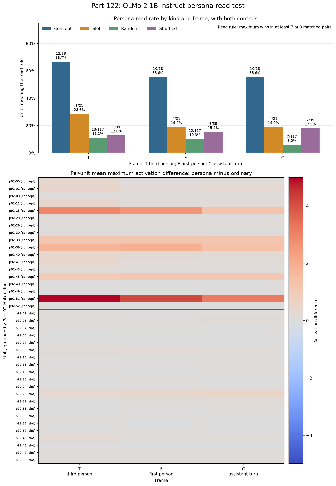

# Part 122 gives no registered reading: read rates for concept and slot units on matched passages

We asked whether OLMo 2 1B Instruct, revision 48d788eca847d4d7548f375ad03d3c9312f6139e, reads personas of 39 units selected for their effects on writing. We compared each unit's maximum down_proj-input activation on persona passages with matched ordinary passages. The 7-of-8 rule was met in T by 12 of 18 concept units and 6 of 21 slot units; there were 624 distinct passage pairs, since C reuses F's passages. Prediction 122.2 allowed at most 5 slot units and missed by one, so the registered rule allows no reading of these results.

In the design, a concept unit's theme leaks into most answers after a push; a slot unit's persona appears when the model describes itself.

The upper panel shows the share of units meeting the maximum read rule. The lower panel shows each unit's average maximum activation on persona passages minus its average maximum on ordinary passages. [fig122.py](fig122.py) calls the scorer and checks the result against the saved score, so this is an internal consistency check, not an independent method. [NUMBERS.md](NUMBERS.md) gives the field-level sources and full precision values.

## Registered predictions

Prediction text and confidence are copied from the registration in [PART122-DESIGN.md](../../PART122-DESIGN.md). The verdicts below follow the registered prediction rules; the ledger counts three held and four failed.

| # | Confidence | Prediction (verbatim) | Result | Verdict |
| --- | --- | --- | --- | --- |
| 122.1 | medium | In frame T, at least 9 of the 18 concept units read their persona. | 12 of 18 met the rule; threshold was 9. | held |
| 122.2 | medium | In frame T, at most 5 of the 21 slot units read their persona. | 6 of 21 met the rule; threshold was at most 5. | failed |
| 122.3 | medium | In frame T, the concept rate is above the slot rate, with a two-sided Fisher p below .05. | 12/18 versus 6/21; p = .025729. | held |
| 122.4 | low | In frame C, at least 5 more of the 21 slot units read their persona than in frame T. | 4/21 in C versus 6/21 in T; change = -2, below +5. | failed |
| 122.5 | low | The gain from T to C is larger for slot units than for concept units, as a share of each kind. | Slot change -2/21 (-9.52%); concept change -2/18 (-11.11%). Both are negative. | failed |
| 122.6 | medium | In every frame, the shuffled control read rate is at most 10% of units. | T 5/39 (12.82%); F 6/39 (15.38%); C 7/39 (17.95%). | failed |
| 122.7 | low | Of the 11 concept units whose persona the J-lens matches, at least 7 read in frame T. | 10 of 11 met the rule; threshold was 7. | held |

The scorer's comparison is literally true because -9.5% is greater than -11.1%, but both gains are negative, so the predicted gain did not happen, and the ledger counts it as failed.

## Gates

All three gates passed on the second passage set.

| Gate | Observed | Requirement | Result |
| --- | --- | --- | --- |
| 1. Token match | 936 of 936 frame comparisons were within 2 tokens; these are 624 distinct passage pairs because C reuses F text. | At least 90%. | Pass |
| 2. Part 95 positive control | Space had a higher maximum in 11 of 16 pairs. | At least 9 of 16. | Pass |
| 3. Random controls, T | 13 of 117 read (11.11%). | At most 15%. | Pass |
| 3. Random controls, F | 12 of 117 read (10.26%). | At most 15%. | Pass |
| 3. Random controls, C | 7 of 117 read (5.98%). | At most 15%. | Pass |

Gate 1 passes by construction on the second set: the writer rejected pairs outside the two-token limit before saving them. The 24-pair eye read was the author's. Gate 2 reran Part 95's space-versus-ordinary positive control. After the fact, its 9-of-16 threshold passes 40.18% of fair-win runs, and the observed 11/16 has a one-sided p of about .105; this is a weak gate.

## Results

After-the-fact, the strongest comparison supported here is concept against shuffled control in T: 12/18 versus 5/39, two-sided Fisher p about .0001. The read rule has a nominal fair-coin rate of .035, or about 4.1 of 117 random-channel cells and 1.4 of 39 shuffled units; instead, random controls read at 13/117 (11.11%) in T, 12/117 (10.26%) in F, and 7/117 (5.98%) in C, while shuffled controls read at 5/39 (12.82%), 6/39 (15.38%), and 7/39 (17.95%). The rule therefore also fires on generic persona-versus-ordinary text.

After-the-fact two-sided Fisher tests for concept against slot at 7 of 8 give p = .026 in T, .024 in F, and .024 in C. A Bonferroni adjustment across the three frames gives about .078, .072, and .072. At 6 of 8, the same tests give T p = .049, F p = .11, and C p = .025. For the agreed labels, the T comparison is 5/8 versus 6/21 (p = .20); using DeepSeek's labels it is 5/8 versus 10/28 (p = .24). Seven of the 12 T concept reads come from units DeepSeek does not label concept.

## Rates by kind and frame

Kinds are the Part 92 Haiku labels. The agreed columns include only units whose Part 92 Haiku and Part 92b DeepSeek labels match. Eight of 18 concept labels agreed. All 21 slot labels agreed.

| Frame | Haiku kind | Reads / units | Rate | Agreed reads / units | Agreed rate |
| --- | --- | ---: | ---: | ---: | ---: |
| T | concept | 12/18 | 66.67% | 5/8 | 62.50% |
| T | slot | 6/21 | 28.57% | 6/21 | 28.57% |
| F | concept | 10/18 | 55.56% | 5/8 | 62.50% |
| F | slot | 4/21 | 19.05% | 4/21 | 19.05% |
| C | concept | 10/18 | 55.56% | 5/8 | 62.50% |
| C | slot | 4/21 | 19.05% | 4/21 | 19.05% |

After-the-fact slot-only comparisons show that slot units are not clearly above their own controls, and in the assistant's turn they sit below their own shuffled control:

| Frame | Slot reads | Slot-only random reads | Fisher p | Slot-only shuffled reads | Fisher p |
| --- | ---: | ---: | ---: | ---: | ---: |
| T | 6/21 | 7/63 | .08 | 1/21 | .09 |
| F | 4/21 | 5/63 | .22 | 2/21 | .66 |
| C | 4/21 | 2/63 | .03 | 5/21 | n/a |

The slot-only controls use three random channels per slot unit and one shuffled partner per unit. These are counts under one fixed rule; they do not establish a kind-wide rule for every unit.

## Maximum and mean

Maximum activation defines the registered read rule. Mean activation is supplemental. Applying the same 7-of-8 cutoff to mean wins shows these unit-frame decisions differ from the maximum result:

| Frame | Unit | Maximum wins / 8 | Mean wins / 8 | Maximum rule | Mean at same cutoff |
| --- | --- | ---: | ---: | --- | --- |
| T | p92-03 | 7/8 | 4/8 | meets | does not meet |
| T | p92-07 | 4/8 | 8/8 | does not meet | meets |
| T | p92-40 | 8/8 | 2/8 | meets | does not meet |
| F | p92-03 | 4/8 | 7/8 | does not meet | meets |
| F | p92-10 | 5/8 | 8/8 | does not meet | meets |
| F | p92-11 | 8/8 | 3/8 | meets | does not meet |
| F | p92-28 | 6/8 | 8/8 | does not meet | meets |
| F | p92-35 | 6/8 | 8/8 | does not meet | meets |
| F | p92-40 | 8/8 | 1/8 | meets | does not meet |
| C | p92-10 | 5/8 | 8/8 | does not meet | meets |
| C | p92-11 | 8/8 | 3/8 | meets | does not meet |
| C | p92-28 | 0/8 | 8/8 | does not meet | meets |
| C | p92-35 | 4/8 | 7/8 | does not meet | meets |
| C | p92-40 | 7/8 | 2/8 | meets | does not meet |
| C | p92-41 | 6/8 | 7/8 | does not meet | meets |
| C | p92-49 | 7/8 | 4/8 | meets | does not meet |

There were 16 unit-frame disagreements. These are supplemental comparisons. They do not change the registered maximum-based result.

## Amendment 1 and run note

Amendment 1 set aside the first passage set after Gate 1 missed; the amendment records that its table was seen before the miss was noticed. This write-up uses only the second passage set.

The first launch hung. It was stopped and fixed, with no change to the numbers.

## Method

The study model was OLMo 2 1B Instruct at revision 48d788eca847d4d7548f375ad03d3c9312f6139e, in bf16 on an Intel A770. Haiku 5.5 assigned the Part 92 slot and concept labels; DeepSeek V4.1 Flash assigned the Part 92b labels and wrote the passages from persona names and descriptions, without kind, layer, or unit identity.

Each unit had 8 matched persona and ordinary pairs in each of 3 frames: T is a two-sentence third-person passage read as plain text, F is a two-sentence first-person passage read as plain text, and C places that same first-person passage in the assistant's turn after the user asks "Who are you?" The ordinary passage uses an everyday subject matched in length and structure. There were 936 frame comparisons but 624 distinct passage pairs, because C reuses F text. The writer kept valid pairs over up to eight generations per unit: attempts ranged from 1 to 8, averaged 2.7, and 14 units needed one attempt.

The readout was the down_proj input at the unit's channel in its layer. No push was applied. The scorer took the maximum and mean over the passage's own tokens, excluding frame tokens. A pair was a maximum win when the persona maximum was higher than the ordinary maximum; ties count as non-wins. A unit met the read rule with at least 7 of 8 maximum wins. The mean wins are reported as a comparison only. In 308 of 312 F pairs both passages begin with the same word; identical openings give identical activations in this causal model. Unit p92-37 tied on all eight F pairs and seven T pairs, at 0.1924 for "The" and 0.166 for "A"; p92-28 tied on all eight C pairs.

Random controls were three same-layer channels per unit. Shuffled controls paired each unit with another unit's passages under a fixed permutation. Every numerical result in this write-up is listed with its source in NUMBERS.md.

## Limits

This is one model, 39 units selected on writing, 8 pairs per frame, and one readout definition. Persona and ordinary passages match in length and structure, not content: p92-01's persona has "her ... glitter ... marble floor" versus ordinary "his ... crumbs ... tiled floor"; p92-35 says "watches ... listens" versus "plays ... crackles". The pure name swap for Cat (p92-07) did not read in T (4/8). On a cold-check word count, T persona and ordinary passages differ by about 4.5 non-name tokens on average; pronouns differ in 66 of 312 T pairs.

There is also a common-noun imbalance: all 18 concept names have a common-noun head, while six slot personas are proper or titled names. In T, common-named slots read 3/15 and proper or titled slots 3/6; the concept group has no proper-name comparison. The name repetition check was clean: a persona name appeared 1.55 times per T persona passage versus 1.59 repetitions of the ordinary passage's most repeated content word, and the persona name was never more repeated in 312 pairs. The verdict on 122.2 depends on which passage set was used.

Part 92b shows reader sensitivity in the concept group, where 8 of 18 labels agreed; the after-the-fact checks above show that the agreed-label comparison is not precise. Gate 2 is a weak positive control. Ties at shared opening tokens cannot register a persona difference, although they conservatively count against a read. The sample and readout do not show that every concept unit reads its persona or that every slot unit does not.

## Terms

- **Part 92, 92b, and 95:** Earlier analyses that selected and labeled units, checked agreement between labelers, and tested a space-reading positive control.
- **Haiku 5.5 and DeepSeek V4.1 Flash:** Text models used as labelers in Parts 92 and 92b; DeepSeek also wrote these passages.
- **Slot and concept:** Part 92 behavior labels. A concept unit's theme leaks into most answers after a push; a slot unit's persona appears when the model describes itself. These describe selection behavior, not a proven general role.
- **Push:** An intervention that adds activation at a unit; none was applied in this read test.
- **Frame:** The prompt format. T is third-person plain text, F first-person plain text, and C the assistant's first-person turn after "Who are you?"
- **Persona and ordinary passage:** Text about the unit's persona and its everyday-subject comparison.
- **Read:** A unit whose persona maximum was higher in at least 7 of 8 matched pairs. A tie is not a win.
- **Maximum and mean:** The highest and average channel activation over a passage's own tokens.
- **down_proj:** An OLMo layer's output projection; this readout measured its input at the unit's channel.
- **Haiku and DeepSeek labels:** The two readers' slot or concept classifications. An agreed kind means both assigned the same label.
- **J-lens:** The persona-matching label used for the registered list of 11 concept units.
- **Fisher exact test:** A test that compares two categorical rates; the p-values here are two-sided unless stated otherwise.
- **bf16 and A770:** A 16-bit floating-point format and the Intel Arc A770 graphics card used for the run.
- **pp:** Percentage points, the difference between two percentages.
- **Random and shuffled controls:** Same-layer random channels and selected units tested on another unit's passages.
- **Gate 2:** The Part 95 positive control, testing whether the L2 N2466 unit responds more to space than to ordinary passages.

## Files

- [Raw activations](activations.jsonl), [gate 2 values](gate2.json), [read-set map](read_set.json), and [saved score](score122.json).
- [Figure source](fig122.py), [figure](fig122.png), and [recomputed numbers](NUMBERS.md).
- [Part 122 design](../../PART122-DESIGN.md), [build notes](../../part122/BUILD-NOTES.md), and [review fold](../../part122/FOLD-r1.md).
- [Scoring code](../../part122/score122.py) and [J-lens matched units](../../part122/jlens-concept-matches.json).

Cold check: Haiku 5.5, 2026-10-30, round 1, 16 findings (2 verdict, 10 overstated, 4 minor), all folded ([COLD-CHECK-r1.md](COLD-CHECK-r1.md)).
