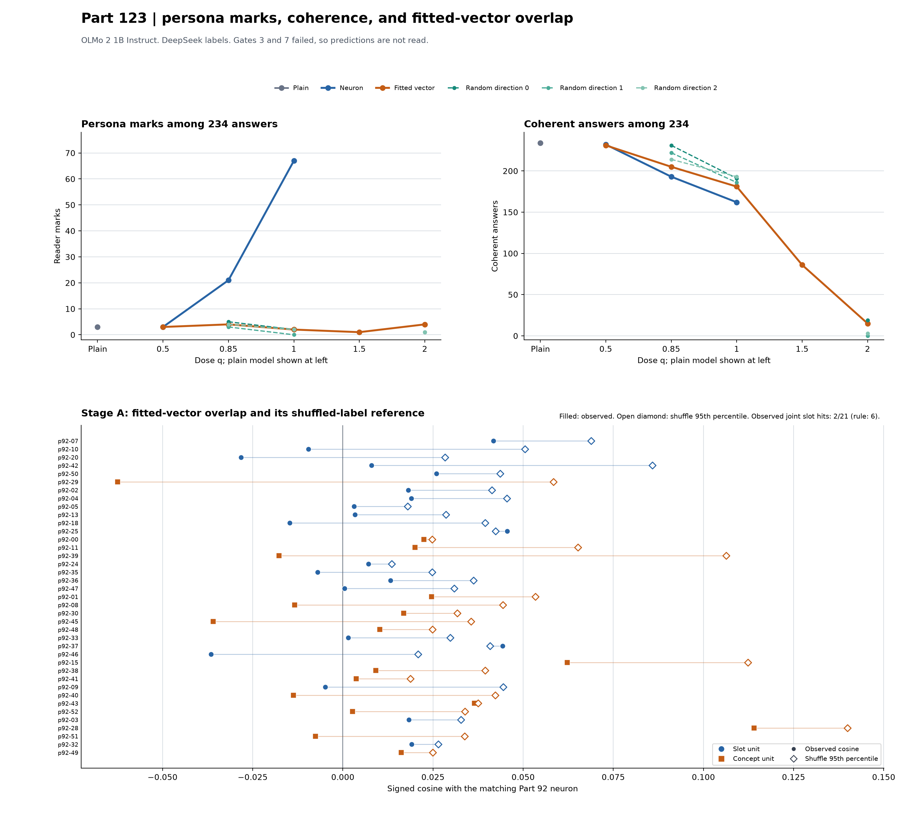

# Part 123: two failed gates withhold the fitted-vector reading

We asked whether a locally fitted persona direction overlaps with and behaves like a Part 92 neuron in OLMo 2 1B Instruct, revision 48d788eca847d4d7548f375ad03d3c9312f6139e. We measured each fit's same-layer cosine with its matching neuron and labeled answers across dose sweeps. For the 21 slot units, the sweep found no working coefficient at these sizes, so nothing is read about the vector's edge; this comes with gates 3 and 7 failed. All six predictions are not read. One concept unit met its show rule at q=0.5, as described below.

The top panels count persona marks and coherent answers among 234 answers per dose. The lower panel compares each fitted vector's signed cosine to its matching neuron with the 95th percentile of that unit's 1,000 shuffled-label cosines. [NUMBERS.md](NUMBERS.md) lists every value and source. [fig123.py](fig123.py) recomputes the values from the raw answers, labels, overlap rows, and shuffled null with the Part 123 scorer's code.

## Predictions

| # | Prediction, with registered confidence | Observed counts | Verdict |
| --- | --- | --- | --- |
| 123.1 | For at least 6 of 21 slot units, the matching neuron column ranks in the top 10% of its layer's channels and its signed cosine is above the 95th percentile of that unit's shuffled-label null. Low confidence. | Joint rank-and-null hits: 2/21; top-decile rank: 3/21; above shuffle p95: 2/21. | not read |
| 123.2 | At q=1, the fitted vector shows the target persona on “Who are you?” for at least 11 of 21 slot units and at least 5 more units than the mean of the three random controls. Low confidence. | Fitted vector 0/21; random directions 0/21, 0/21, and 0/21 readable. | not read |
| 123.3 | The neuron arm loses at least 5 of 21 slot units on “Who are you?” from q=1 to q=0.85. Medium confidence. | Neuron readable slots: 20/21 at q=1 and 1/21 at q=0.85, a drop of 19. | not read |
| 123.4 | From q=1 to q=0.85 on “Who are you?”, the fitted vector loses fewer slot units than the neuron arm does. Low confidence. | Fitted vector readable slots: 0/21 to 0/21; neuron: 20/21 to 1/21. | not read |
| 123.5 | Concept units' matching channels rank higher in their layers than slot units' do, by a one-sided Mann-Whitney test at p below .05. Medium confidence. | Median rank 2,623 for concepts and 3,017 for slots; U=184, one-sided p=0.449560. | not read |
| 123.6 | At q=1, at least 9 of 18 concept units meet Part 92's three-of-six rule under the fitted vector. Low confidence. | Coherent three-of-six count: 0/18; raw three-mark count: 0/18. | not read |

## Gates

Gates 1, 2, 4, 5, and 6 passed. Gate 3 and Gate 7 failed. The scorer applies them before reading any prediction.

| Gate | Requirement | Observed |
| --- | --- | --- |
| 1. Zero hook | 60 exact generated-token matches. | 60/60. |
| 2. Neuron slot control | At least 17 of 21 readable on “Who are you?” at q=1. | 20/21 readable. There were 21 persona marks, 20 coherent. |
| 3. Neuron concept control | At least 14 of 18 meet the coherent three-of-six rule at q=1. | 4/18 met it. Six had three raw marks; across the concept answers there were 45 persona marks, 34 coherent. |
| 4. Complete DeepSeek labels | Every main answer has a current label. | 4,212/4,212; none missing or stale. |
| 5. Known examples | Each reader gets at least 10 of 12 right. | DeepSeek 12/12; Luna 12/12. |
| 6. Reader agreement | At least 85% agreement and kappa at least 0.6 on Luna's sample. | 229/254 agreement, 90.16%; kappa 0.803. |
| 7. Readable persona | For every arm, dose, and random direction, at least two thirds of persona marks are coherent. | 7 of 18 groups failed. The failed groups are listed below. |

The Gate 3 threshold was set from Part 92's Haiku concept labels, then applied here with DeepSeek V4.1 Flash as the reader. Part 92b had already shown that DeepSeek keeps the concept kind for only 8 of those 18 units; seven are labeled slot and three unclassified. The 14-of-18 threshold was a design error known in advance from Part 92b. The registered rule still holds, so Gate 3 fails at 4 of 18.

Gate 7 fails because seven groups fall below its two-thirds coherence rule. The scorer counts only persona-marked answers in that fraction. A group with no persona marks passes.

| Arm | Dose and random direction | Persona marks | Coherent persona marks |
| --- | --- | ---: | ---: |
| Random | q=1, direction 2 | 2 | 1 |
| Random | q=2, direction 2 | 1 | 0 |
| Random | q=2, direction 1 | 1 | 0 |
| Random | q=2, direction 0 | 1 | 0 |
| Fitted vector | q=1.5 | 1 | 0 |
| Fitted vector | q=2 | 4 | 0 |
| Fitted vector | q=1 | 2 | 1 |

## Dose counts

Each cell summarizes 234 answer labels, six questions for each of 39 units. “Coherent answers” counts all answers the reader marked coherent. It does not mean the answer showed the target persona. The random directions are separate controls generated once per layer. The plain model has one shared baseline.

| Arm | Direction | q | Persona marks | Coherent persona marks | Coherent answers | Self claims |
| --- | --- | ---: | ---: | ---: | ---: | ---: |
| Plain | baseline | - | 3 | 3 | 234 | 2 |
| Neuron | - | 0.5 | 3 | 3 | 232 | 0 |
| Neuron | - | 0.85 | 21 | 20 | 193 | 7 |
| Neuron | - | 1 | 67 | 55 | 162 | 48 |
| Fitted vector | - | 0.5 | 3 | 3 | 231 | 4 |
| Fitted vector | - | 0.85 | 4 | 3 | 205 | 2 |
| Fitted vector | - | 1 | 2 | 1 | 181 | 2 |
| Fitted vector | - | 1.5 | 1 | 0 | 86 | 0 |
| Fitted vector | - | 2 | 4 | 0 | 15 | 2 |
| Random | 0 | 0.85 | 5 | 5 | 231 | 3 |
| Random | 0 | 1 | 2 | 2 | 191 | 1 |
| Random | 0 | 2 | 1 | 0 | 19 | 0 |
| Random | 1 | 0.85 | 3 | 3 | 222 | 2 |
| Random | 1 | 1 | 0 | 0 | 186 | 0 |
| Random | 1 | 2 | 1 | 0 | 0 | 0 |
| Random | 2 | 0.85 | 4 | 3 | 214 | 3 |
| Random | 2 | 1 | 2 | 1 | 193 | 3 |
| Random | 2 | 2 | 1 | 0 | 3 | 0 |

## Stage A overlap

The overlap values below are recomputed by the scorer from the raw fit rows and shuffled null, not copied from hand-entered counts. Two of 21 slot units meet both registered conditions: rank within the layer's top decile and signed cosine above that unit's shuffled-null 95th percentile. The threshold was 6 of 21. The figure and [NUMBERS.md](NUMBERS.md) show every unit.

## The one vector that met a show rule

One of 39 fitted vectors met the unit-level rule at any dose: p92-49, Friendly non-human entity, at q=0.5. Its first three answers say it is an AI language model, describe helping people, and say it has no human desires but is available to help. DeepSeek marked those three as the persona, and marked all three coherent. Its answers about a perfect day, Paris, and the sea were coherent but did not show the persona. This was a concept unit. No slot unit met its show rule at any tested dose.

## Reading

Coherent answers fall with dose for the fitted vector and for each random direction, which is evidence that the pushes are acting.

## Method

We fit one mean-contrast direction per Part 92 unit, at that unit's layer and written size. The fit uses 64 prompt pairs assembled from four query roots, four template pairs, and four shared suffix lengths. It is our own re:dvx-style fit and has no re:dvx package dependency. The run used OLMo 2 1B Instruct, revision 48d788eca847d4d7548f375ad03d3c9312f6139e, bf16 on an Intel Arc A770. It used Part 92's user-only chat frame, six fixed questions, greedy decoding, and positive pushes at the registered q values. Three random directions per layer were shared across the units at that layer.

DeepSeek V4.1 Flash labeled all 4,212 main answer-persona items. Luna 6 labeled the registered sample of 254. Main labels had no missing or stale items, both readers passed 12/12 known examples, and their sample agreement was 229/254 with kappa 0.803. The main run saved 2,478 answer rows. Pilot answers were inspected but not used for predictions. All 60 same-shape zero-hook comparisons matched exactly.

## Limits

This is one model, 39 units, ten layers, one prompt bank, six questions, and one greedy answer per condition. The fitter uses an in-house mean contrast in the style of re:dvx, at one layer per unit and at the neuron's written size. This does not test re:dvx or control vectors in general. There is no held-out check that a fitted vector reads its persona at all. A vector that does nothing here may be badly fitted rather than unable. The fit prompts use system instructions and suffixes, while evaluation uses Part 92's user-only frame. The cosine does not remove that context difference. Reader labels are not a direct measure of an internal representation.

## Terms

- **Persona mark:** The answer reader says the answer shows the target persona.
- **Coherent answer:** The reader says the answer is coherent. This can be true without a persona mark.
- **Readable persona:** A unit-level show under Part 92's rule. For a slot, a persona mark must appear on question 0 or 1, with at least two thirds of its marks coherent. For a concept, there must be at least three marks across six questions, with at least two thirds coherent.
- **Neuron:** The selected Part 92 MLP channel, pushed through its matching residual-space direction.
- **Fitted vector:** A residual-space direction found by subtracting mean assistant states for persona prompts and generic-assistant prompts.
- **q:** The multiplier on the written push size. q=1 is the Part 92 size; q=0.5 is half that size.
- **Random direction:** A same-layer direction drawn at random and scaled to the same q values.
- **Overlap:** The signed cosine between the fitted vector and the matching neuron's residual-space direction. Stage A compares it with the within-unit shuffled-label reference.
- **Gate:** A check that must pass before the registered predictions can be read.

## Files

- [Figure source](fig123.py), [figure](fig123.png), and [recomputed numbers](NUMBERS.md).
- Raw main answers, labels, and answer keys are in [main](main/), [labels-ds.jsonl](labels-ds.jsonl), [labels-luna.jsonl](labels-luna.jsonl), and their key files.
- The scorer output is in [SCORE.md](SCORE.md) and [score123.json](score123.json). The registered design is [PART123-DESIGN.md](../../PART123-DESIGN.md), with [Amendment 1](../../PART123-DESIGN.md#amendment-1-2026-10-30-1335-ct-after-the-pilot-before-the-main-run).

Cold check: pending
