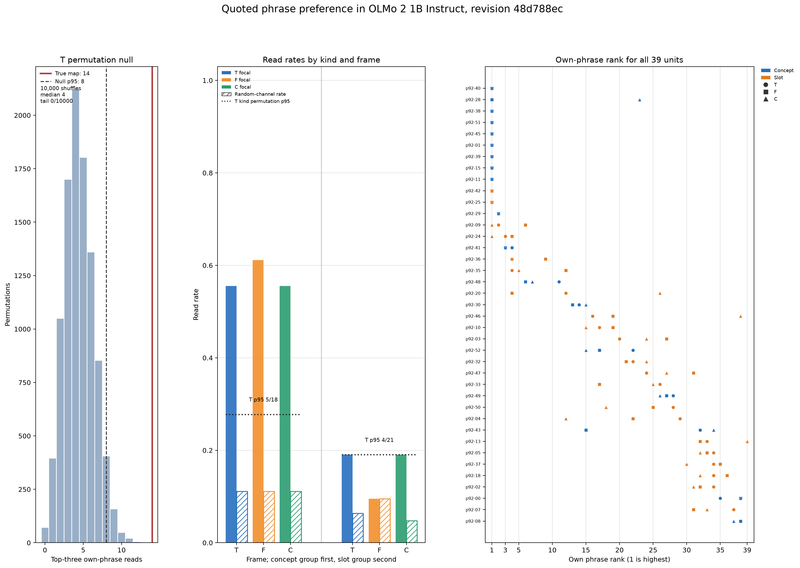

# Fourteen of 39 units put their own pushed phrase in T's top three

Part 124 is a read-side test of phrases chosen on the write side. Each phrase is the short label taken from that unit's answer after it was pushed to write in Part 92. We measured whether a unit ranked its own phrase in the top three of 39 when only the quoted phrase changed. T is plain third-person text. Fourteen of 39 units read their own phrase in T. The plain reading is that a unit prefers the words it pushed out. The design does not show that a phrase expresses a persona. It cannot separate the phrase's relation to its unit from the unit's own output words because it lacks a per-unit control phrase from an answer produced without a push. Of 39 phrases, 23 appear verbatim in their unit's answer and 35 have all their content words in that answer; exact matches occur in 6 of 14 T readers and 17 of 25 non-readers.

The registered length-stratified null has mean 4.47 reads, or 11.5% of 39, and none of 10,000 shuffles reached 14. The unstratified top-three rate is 3 of 39, or 7.7%. These differ because the registered shuffle reassigns phrases only within token-length strata. Part 92b's after-the-fact relabeling makes the concept-versus-slot comparison label-conditional, as shown below.

## Registered predictions

The prediction text and verdicts below remain as registered.

| # | Confidence | Prediction (verbatim) | Result | Verdict |
| --- | --- | --- | --- | --- |
| 124.1 | low | In T, at least 9 of 39 units read their persona, and the count is above the 95th percentile of the permutation null. | 14/39; null p95 8; tail 0/10,000 | held |
| 124.2 | low | In T, the concept read rate is at least 15 percentage points above the slot read rate. | 55.6% vs 19.0%; difference 36.51 points | held |
| 124.3 | medium | In T, at most 4 of 21 slot units read their persona. | 4/21, exactly at the boundary | held |
| 124.4 | low | Of the units that read in T, at least half also read in C. | 13/14 also read in C (92.9%) | held |

## Gates and controls

All four gates passed. Construction covered 24 frame and template combinations, 936 matched phrase and neutral pairs, and 1,872 slots, with no quote-boundary merges. The do-nothing check found identical logits. Random-channel reads were T 10/117 (8.5%), F 12/117 (10.3%), and C 9/117 (7.7%). The random-channel gate was 15% in each frame. The random T rate is separate from the permutation null and can be compared with the unstratified 7.7% rate.

The instrument check ran on 10,000 random channels. Its repeat rates were T 93.6%, F 94.7%, and C 95.7%. It checks whether a random channel's best phrase repeats across split templates. It says nothing about the 39 focal units.

| Frame | Kind | Own-phrase reads | Random pseudo-target reads | Kind T permutation p95 |
| --- | --- | ---: | ---: | ---: |
| T | concept | 10/18 (55.6%) | 6/54 (11.1%) | 5/18 (27.8%) |
| T | slot | 4/21 (19.0%) | 4/63 (6.3%) | 4/21 (19.0%) |
| F | concept | 11/18 (61.1%) | 6/54 (11.1%) | T-only test |
| F | slot | 2/21 (9.5%) | 6/63 (9.5%) | T-only test |
| C | concept | 10/18 (55.6%) | 6/54 (11.1%) | T-only test |
| C | slot | 4/21 (19.0%) | 3/63 (4.8%) | T-only test |

The F-frame slot read rate equals its random pseudo-target rate: 2/21 and 6/63 are both 9.5%. The T slot result is at its kind-specific p95, not above it. T persistence from T to C is 13 of 14 readers (92.9%).

## Label-conditional comparison

The concept-over-slot comparison changes with the labels. Concept units read more often on Haiku's labels; on DeepSeek's labels the difference is not significant. The 29 agreed units provide a third comparison. These after-the-fact tables do not decide which reader is correct. Part 92b predictions 92b.2 and 92b.3 failed.

| Labels | Concept reads | Slot reads | Fisher p | Length-adjusted p (CMH) |
| --- | ---: | ---: | ---: | ---: |
| Haiku's labels | 10/18 | 4/21 | 0.024 | 0.008 |
| DeepSeek's labels | 5/8 | 8/28 | 0.107 | 0.057 |
| 29 agreed units | 5/8 | 4/21 | 0.067 | 0.016 |

## Reading the top three

The table lists T readers and their top phrases. Templates counts how many of the eight templates independently put the unit's own phrase in their top three. Margin is the own phrase's mean score minus the fourth-highest mean score. The three thin reads are marked.

| Unit | Kind | Own phrase and rank | Top three, in rank order | Robustness: templates; margin over fourth |
| --- | --- | --- | --- | --- |
| p92-01 | concept | Magical princess (1) | Magical princess; Very tall tree; Festival poet | 8/8; 0.59509 |
| p92-11 | concept | Whiskey (1) | Whiskey; Coca-Cola spokesperson; Embodiment of the void | 8/8; 0.24191 |
| p92-15 | concept | Secure password (1) | Secure password; String of code from your browser; Jacobite royalist veteran | 8/8; 1.98627 |
| p92-25 | slot | King Midas (1) | King Midas; 80s cover singer-songwriter; Fox | 8/8; 0.33810 |
| p92-28 | concept | Ancient nature deity (1) | Ancient nature deity; Coca-Cola spokesperson; The Internet | 5/8; 0.01990 (thin) |
| p92-38 | concept | Coca-Cola spokesperson (1) | Coca-Cola spokesperson; Friendly non-human entity; Whiskey | 8/8; 0.88080 |
| p92-39 | concept | NASCAR driver (1) | NASCAR driver; Large friendly dog; Secure password | 8/8; 1.47778 |
| p92-40 | concept | 80s cover singer-songwriter (1) | 80s cover singer-songwriter; Sir Ray Ray; Ancient nature deity | 8/8; 0.21832 |
| p92-42 | slot | Jacobite royalist veteran (1) | Jacobite royalist veteran; Chicken; Alex from Star Wars | 8/8; 0.16026 |
| p92-45 | concept | Iron-fisted dictator (1) | Iron-fisted dictator; Gruff old man; Secure password | 8/8; 0.68347 |
| p92-51 | concept | IP packet (1) | IP packet; The Internet; String of code from your browser | 8/8; 2.80780 |
| p92-09 | slot | Treat-loving dog (2) | Sir Ray Ray; Treat-loving dog; Ancient nature deity | 5/8; 0.00552 (thin) |
| p92-29 | concept | God of wisdom (2) | Coca-Cola spokesperson; God of wisdom; Embodiment of the void | 8/8; 0.02124 |
| p92-24 | slot | Queen of Hearts (3) | Magical princess; String of code from your browser; Queen of Hearts | 3/8; 0.00075 (thin) |

Phrase hubs are phrases that appear in at least four of the 39 top-three lists. The hubs are 80s cover singer-songwriter (9), Coca-Cola spokesperson (9), King Midas (8), Embodiment of the void (7), Ancient nature deity (6), Jacobite royalist veteran (6), Queen of Hearts (6), NASCAR driver (5), Secure password (5), String of code from your browser (5), Magical princess (4), and Principled lawyer (4). Eleven of 14 T readers had another hub phrase in their top three; 9 of 14 owned a hub phrase. The king-or-ruler cluster read 4 of 4. All four did so in 12 of 10,000 registered length-stratified shuffles. This cluster result is post hoc.

## Shared content words

The counts below remove articles, pronouns, prepositions, conjunctions, and other function words before checking phrase overlap. A top-three overlap must be a different phrase that shares a content word with the unit's own phrase. The all-word counts are in footnote [^1].

| Frame | Readers | Own phrases sharing a content word | Top threes with a content-word phrase |
| --- | ---: | ---: | ---: |
| T | 14 | 1/14 | 0/14 |
| F | 13 | 1/13 | 0/13 |
| C | 14 | 2/14 | 0/14 |

[^1]: Before removing function words, own-phrase overlaps were T 3/14, F 2/13, C 4/14. Top-three overlaps were T 2/14, F 0/13, C 1/14. Source and token rule are in [NUMBERS.md](NUMBERS.md).

## Part 122 cold-check response

Part 122's cold check discussed the units below. The table reports each unit's Part 124 T rank and whether it read here. Cat, p92-07, ranks 37th and does not read.

| Unit | Phrase | T rank | Read in T |
| --- | --- | ---: | --- |
| p92-00 | Boulder | 35 | no |
| p92-01 | Magical princess | 1 | yes |
| p92-07 | Cat | 37 | no |
| p92-09 | Treat-loving dog | 2 | yes |
| p92-28 | Ancient nature deity | 1 | yes |
| p92-35 | Guardian angel | 4 | no |
| p92-37 | Large friendly dog | 34 | no |

## Slot and random-channel scale

In T, the mean own-phrase slot maximum across slot units and templates was 0.039438. Across 10,000 random channels and their phrase-template slot maxima, the mean was 0.022253 and the median was 0.011963. Slot reads therefore sit near the random-channel scale. Full values and the denominator are in [NUMBERS.md](NUMBERS.md).

For each template, the unit's own phrase maximum was also compared with its matched neutral phrase maximum. A win means the own phrase maximum was strictly higher. These comparisons do not define a read.

| Frame | Kind | Own phrase wins / comparisons | Share |
| --- | --- | ---: | ---: |
| T | concept | 107/144 | 74.3% |
| T | slot | 81/168 | 48.2% |
| F | concept | 103/144 | 71.5% |
| F | slot | 81/168 | 48.2% |
| C | concept | 97/144 | 67.4% |
| C | slot | 82/168 | 48.8% |

Reads by raw phrase token length and all per-unit ranks are in [NUMBERS.md](NUMBERS.md). In T, 0/5 one-token phrases read; 7,994 of 10,000 registered permutations also gave zero. The post-quote maximum exceeded the slot-token maximum in at least one T template for 26/39 units; it was higher on the eight-template mean for 18/39. Post-quote activity is contextual carryover, not direct evidence that the phrase itself activated the unit.

## Method

The pinned model was OLMo 2 1B Instruct, revision 48d788eca847d4d7548f375ad03d3c9312f6139e, in bf16 on the local XPU. T uses plain third-person sentences. F uses plain first-person sentences. C places the same first-person sentences in the assistant turn after the user asks “Who are you?” The quoted phrase is the only changing text in each fixed template. The readout is the selected channel at the input to down_proj. For each of 39 phrases, the scorer took the maximum over phrase-slot tokens in each of eight templates, averaged those maxima, and ranked all phrases. There was no activation push or generated answer in Part 124. The 10,000 T permutations shuffled unit-to-phrase assignments within slot-token-length strata using seed 12401.

The neutral noun phrases were matched to each phrase's token count. The registered null preserves each unit's top-three set and reshuffles phrase assignments within the length strata. It tests phrase-to-unit assignment under that restriction. It does not preserve phrase popularity in the way a popularity-matched null would.

## Limits

This is one model and one checkpoint. The 39 units were selected for writing effects in Part 92. The phrase set contains 39 labels with sibling and shared-word phrases. The label sensitivity table is after the fact. The read is a lexical result for one channel at one layer under quoted templates. It does not establish a general semantic role or a causal role for the unit. The design lacks a per-unit non-pushed phrase control, so it cannot separate the unit's own output words from other explanations.

## Terms

- **Concept and slot:** Part 92 behavior labels. A concept unit's theme tended to appear across pushed writing; a slot unit's assigned phrase tended to appear in self-description after a push. These describe the Part 92 selection behavior, not a proven general role.
- **Haiku:** Haiku 5.5, the Part 92 reader that assigned the original concept and slot labels.
- **DeepSeek:** DeepSeek V4.1 Flash, the Part 92b reader that reassessed those labels.
- **Part 92:** The write-side study that selected the units and produced their pushed answers.
- **Part 92b:** The later label-agreement check. It classified 29 units the same way as Haiku; its predictions 92b.2 and 92b.3 failed.
- **T, F, and C:** T is third-person plain text; F is first-person plain text; C is the assistant turn after the fixed “Who are you?” question.
- **Read:** The unit's phrase ranks in its top three among the 39 phrases for that unit.
- **Length-stratified permutation:** A shuffle that reassigns phrases only within the registered slot-token-length groups.
- **Instrument check:** A repeat test on random channels only. It does not measure the 39 focal units.
- **Margin:** The own phrase's mean score minus the fourth-highest phrase score.

## Files

- [Figure source](fig124.py), [figure](fig124.png), and [recomputed numbers](NUMBERS.md).
- [Raw activations](activations.jsonl.gz), read set, run metadata, saved score, and [verdict ledger](VERDICTS.md).
- fig124.py reruns the Part 124 scorer on raw activations and checks the result against score124.json. This is an internal consistency check, not an independent scoring method. It also writes the figure and NUMBERS.md.
- The published activation file is activations.jsonl.gz. The uncompressed activations.jsonl is 159 MB and is kept locally, not published. To create a plain copy in this folder, run `gunzip -k activations.jsonl.gz`. fig124.py reads the compressed file when the plain file is absent.

Cold check: a reader with no context found the numbers reproduce and required the changes above; the README changes are folded ([COLD-CHECK-r1.md](COLD-CHECK-r1.md)).
