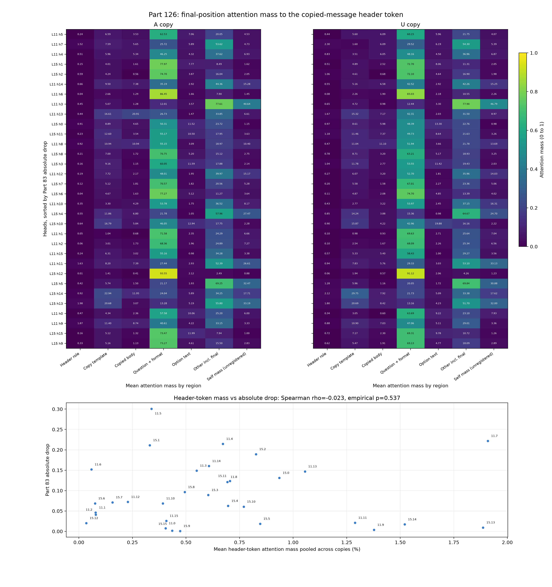

# Part 126: Final-position attention mass to one copied-message header token

We measured the mean attention mass from each of 32 Part 83 heads, at the final prompt position, to one token: the role word in the copied message's header. It is assistant in copy A and user in copy U. The structural role words occur five times in each prompt: in the copied-message header, the question-message header, two option labels, and the generation prefix. This registered test counted only the copied-message header occurrence. Across heads, header attention mass and Part 83 absolute drops had Spearman rho = -0.023. The 95% Fisher interval is -0.37 to +0.33. In the registered test's simulation, the chance of passing the rho threshold at a true rho of 0.40 was 0.53, about even odds. Predictions 126.1, 126.2, and 126.3 failed; 126.4 held under its registered rule.

Motivation: a9lim's public post and Elise's question led us to test whether the heads implicated by Part 83 placed attention mass on the copied-message role word.



Each heatmap row is one head, ordered by Part 83 absolute drop. Each copy averages 300 prompt rows. The figure has the six registered regions and a separate self-attention column. Self-attention is part of the registered Other region, so that column overlaps it. The lower panel shows pooled header-token attention mass and absolute drop. Its labels use layer.head shorthand, so 11.5 means L11 h5. [NUMBERS.md](NUMBERS.md) gives the registered regional masses, the unregistered occurrence splits, gate values, and lens results.

## Predictions

| # | Registered prediction, with confidence | Result | Verdict |
| --- | --- | --- | --- |
| 126.1 | Claude (medium confidence): Across the 32 heads, mean role-token attention mass pooled across both copies correlates with Part 83's absolute drops at Spearman rho at least 0.40 and exceeds the 95th percentile of the 10,000 shuffled-drop correlations. | rho = -0.023460; shuffled-null 95th percentile = 0.290689; empirical p = 0.536646. Neither registered condition passed. | failed |
| 126.2 | Claude (low confidence): L11 h5 ranks in the top five of 32 heads by role-token attention mass in the Assistant copy. | L11 h5 ranked 20 of 32, with 0.235% mean role-token mass. | failed |
| 126.3 | Claude (low confidence): The top 20 written tokens from L11 h5's Assistant-copy role-token write include an exact first-person token (i, me, my, mine, we, us, our, ours), second-person token (you, your, yours), or assistant-role token (assistant), after trimming whitespace and punctuation and lowercasing. | No registered token appeared in the top 20. The full list is in NUMBERS.md. | failed |
| 126.4 | Claude (medium confidence): Among the 20 heads Part 83 classifies as mattering (absolute drop at least 0.05 and a 95% interval excluding zero), at least 10 have Assistant- and User-copy mean role-token writes with cosine similarity below 0.90. | 17 of 20 mattering heads had an Assistant/User role-write cosine below 0.90. | held |

## Attention mass by region and occurrence

The five heads with the largest Part 83 absolute drops were L11 h5 (0.300476), L11 h7 (0.221835), L11 h4 (0.214580), L15 h1 (0.211324), and L15 h2 (0.189316). The table shows how much attention mass those heads assigned to each structural role-word occurrence. A and U identify the copies.

| Head | Copy | Header | Question header | Option labels | Generation prefix | All five occurrences |
| --- | --- | ---: | ---: | ---: | ---: | ---: |
| L11 h5 | A | 0.235% | 0.722% | 1.828% | 0.558% | 3.344% |
| L11 h5 | U | 0.443% | 1.738% | 1.550% | 0.360% | 4.091% |
| L11 h7 | A | 1.522% | 2.258% | 1.947% | 1.678% | 7.404% |
| L11 h7 | U | 2.295% | 8.237% | 2.144% | 0.722% | 13.398% |
| L11 h4 | A | 0.514% | 1.655% | 0.820% | 2.574% | 5.562% |
| L11 h4 | U | 0.831% | 2.096% | 0.834% | 1.996% | 5.757% |
| L15 h1 | A | 0.150% | 0.159% | 0.514% | 0.642% | 1.465% |
| L15 h1 | U | 0.512% | 0.660% | 0.904% | 0.821% | 2.897% |
| L15 h2 | A | 0.588% | 0.519% | 0.429% | 1.439% | 2.975% |
| L15 h2 | U | 1.065% | 1.038% | 0.677% | 1.260% | 4.040% |

For L11 h5, the header token accounts for 7.0% of all role-word attention mass in copy A and 10.8% in copy U. Across the 32 heads, the mean header share is 11.2% in A and 14.4% in U. The complete per-head tables for both copies are in [NUMBERS.md](NUMBERS.md).

The table reports occurrence-split comparisons. The generation-prefix, question-header, option-label, and all-five correlations are unregistered. The header mass is the registered predictor; its two-sided p value here is an unregistered summary. All five two-sided p values are uncorrected for multiplicity. The values use pooled mean mass across copies and Part 83 absolute drops.

| Split | Spearman rho | Two-sided permutation p |
| --- | ---: | ---: |
| Header role word | -0.0235 | 0.9004 |
| Question-header role word | +0.3281 | 0.0711 |
| Option-label role words | +0.1092 | 0.5567 |
| Generation-prefix role word | -0.3442 | 0.0575 |
| All five role-word occurrences | -0.1239 | 0.5020 |

The six registered regions remain mutually exclusive. The registered Question region includes the question sentence, line breaks, punctuation, answer instruction, and option markers; for this prompt it is mostly formatting and markers. Option descriptions are a separate region. The registered Other region includes the final prompt token, which attends to itself, plus chat and answer-format tokens. Pooled self-attention reaches 43.7% for L11 h3. Self-attention is an unregistered split inside Other, not a seventh registered region.

## Worked rendered prompt

This is row 0, copy A. Bracketed text labels the token's registered region or the unregistered occurrence split; the labels are annotations. The body, question, and option text are the saved rendered prompt.

```text
Position 0, copied-message template and attention sink: <|im_start|>
Position 1, copied-message header, occurrence 1, registered Role token: assistant
Copied body: Whether it's better to read a book before seeing its film adaptation depends on your personal preferences and the specific book and film in question. Here are some factors to consider:

1. **Storytelling Experience**: Reading a book allows you to experience the story in a more immersive and detailed way. You can visualize the characters, settings, and events in your mind, which can enhance your understanding and appreciation of the story. On the other hand, watching the film adaptation provides a visual<|im_end|>
Question-message header, occurrence 2: <|im_start|>user
Question and answer format: Who wrote the message before this question?
Option descriptions, occurrence 3: A. You (the AI assistant)
Option descriptions, occurrence 4: B. The user
Option descriptions: C. The system
Question and answer format: Answer with the letter only.<|im_end|>
Other: <|im_start|>assistant<think>

</think>

Position 142, generation prefix, occurrence 5: assistant
Position 147, final query token in Other: ĊĊ
```

## Lens leads

These lens rankings are descriptive leads, not registered tests. A unit-attention write assigns all attention mass to one selected token or region, sends its gated value through the matching head block, and applies the Part 111 Jacobian lens. The role write uses one header token's value per prompt. The random-body control selects one body token per prompt and averages across about 300 prompts per copy. That is a mean over about 300 selected token values, compared with the role write for one token position. The comparison is unmatched.

| Head and header mass | Copy | Role-token write: top / suppressed | Largest-mass region write: top / suppressed | Random body-token control: top / suppressed |
| --- | --- | --- | --- | --- |
| L11 h5, 0.235% | A | …”, internet, Alibaba, Quran, 在全球 / ogn, -, 透视, 侦察, grave-accent symbol | Question and answer format, 62.530%: karaoke, Twitter, internet, WWE, Facebook / 1, 3, 6, 8, 4 | picnic, tourists, gardening, holiday, camping / destabil, unstable, 危险, cryptographic, treason |
| L11 h5, 0.443% | U | internet, Twitter, globally, Alibaba, global / orm, Fig, 图示, 透视, destr | Question and answer format, 60.150%: karaoke, Twitter, internet, WWE, Facebook / 1, 3, 6, 8, 4 | picnic, gardening, Vacation, holiday, tourists / unstable, cryptographic, destabil, 危险, cryptography |
| L11 h7, 1.522% | A | Alibaba, SpaceX, Xiaomi, 在全球, Reddit / chapel, township, quarry, parish, treasurer | Other, including final token, 53.617%: Reddit, Wikipedia, emoji, Brexit, Biden / irrigation, 游击, irrig, peasant, village | ___, ____, ___, ___, kids / 双线, ISR, кадров, diplom, Representation |
| L11 h7, 2.295% | U | Alibaba, Reddit, SpaceX, Xiaomi, netizen / treasurer, boys, oj, township, ­ | Other, including final token, 54.299%: Reddit, Wikipedia, emoji, SpaceX, Brexit / 游击, armour, 武器的, patrols, 部份 | ___, ____, ___, ___, ____ / ISR, 资产交易, 双线, diplom, ASN |
| L15 h1, 0.150% | A | teaching, Wikipedia, reviewer, Cartoon, Teaching / *", soak, dran, !*, *", | Question and answer format, 77.968%: Wikipedia, …, IMDb, 🙂, LinkedIn / 地段, crops, valleys, irrigation, .water | **, '**, countryside, tourists, "** / ?”, @, @", (§, ?". |
| L15 h1, 0.512% | U | topic, topics, global, Topic, Global / *;, 类似, *", 类似的, ”; | Question and answer format, 72.704%: …, Wikipedia, 🙂, LinkedIn, Reddit / 地段, valleys, .water, crops, valley | '**, **, (**, countryside, **, / @, (@, ?”, ?, – |

Every row identifies its copy. The table reports the two L11 h5 header masses separately: 0.235% in A and 0.443% in U. The random-body token seed is 12601 plus row index, so each row uses a different seed.

## Prediction 126.4 in context

All 300 prompt pairs differ only at token position 1, the copied-message role word. The median A-versus-U role-write cosine across the 20 Part 83 mattering heads is 0.844. The median copy-A role-versus-random-body cosine is 0.160, and the median copy-A role-versus-largest-region cosine is 0.526. The registered 0.90 cutoff had no calibrated null, so the held result can be satisfied by token identity alone.

## Gates and run history

All four gates passed on the final run. The recomputed head output differed from the captured module input by 0.023438 against an absolute tolerance of 0.05. For scale, the median absolute region-mean value is 0.046875 and its 99th percentile is 0.527344. The recorded regional-mass sum error was 0.00244140625 against a 0.01 tolerance. Recomputing from the saved float16 regional masses gives 0.00224304. These are distinct recorded and recomputed values.

Read-only hooks left final logits bitwise equal, with maximum difference 0. The copy-style positive control reached 9.109 times its uniform rate at L15 h1, above the 3.0 threshold. Its prompt was: “The cue word is marble. Repeat marble. Which word appeared twice?” The lens contained 31 matrices of shape 2560 by 2560 for the model hidden size.

Amendment 2 loaded decoder layers 0 through 15 because loading all 32 crossed the memory guard. The layer 11 and 15 captures are unchanged by that truncation by causal construction: those layers depend on the input and earlier layers. No full-model comparison was run. No answer generation was used. The no-op comparison checked the read-only hooks in the truncated model.

Gate 4 initially failed because of defects in both the lens script and scorer. The defects were fixed before any registered prediction was read. At that point, the first three attention rows had been viewed; L11 h5 was one of them. No prediction or threshold changed.

## Method

The capture used Qwen3.5-4B, revision 851bf6e806efd8d0a36b00ddf55e13ccb7b8cd0a, in bfloat16 on the Intel Arc A770. It reused Part 80b's prompt family and 100 Smol-generated bodies, with assistant and user copies and three cyclic option orders. At the final query position, the runner saved attention to six mutually exclusive registered regions for all 16 heads at layers 11 and 15. Regional values are means over 300 prompts per copy.

Part 83 measured the own-message gap as the mean over three option orders of P(you | A) minus P(you | U), across 100 bodies. Its head drop is the unchanged gap minus the gap when that head is ablated. Part 83 zeroed each ablated head at every position through the full forward pass. Part 126 measured final-position attention mass at one token position. The registered design says attention weights cover all earlier positions, while the capture code includes the query's own final position.

The primary correlation uses each head's pooled mean header-token attention mass and Part 83's absolute single-head drop, with 10,000 shuffles of the 32 drops using seed 12602. Six Part 83 drops were negative. Taking their absolute values folds those signs; the signed-drop correlation is rho = +0.076, while the registered correlation with absolute drops is rho = -0.023.

Part 83 rule 83.6 predicted 3 to 10 mattering heads. Twenty met its rule, so 83.6 failed. A mattering head has an absolute drop of at least 0.05 and a 95% interval that excludes zero.

For lens reads, the script passed each region-pooled, gated value through the matching head block of the output projection, then applied Part 111's Jacobian lens. The random-body control selected one uniformly random copied-body token for each row with seed 12601 plus that row's index. The control therefore averages about 300 selected tokens per copy. These are unit-attention writes. This is our reconstruction from the attention computation and Part 111's lens formula. The method in a9lim's post is not public, so this report does not claim to reproduce it.

## Limits

This is one model, one pinned revision, and one prompt family. Attention was measured only from the final prompt position to one header token. Attention mass is not what a head writes: for L11 h5 in copy A, the header token receives 0.235% of attention mass, while its approximate share of head output norm is 0.48%. Part 83 ablated each head at every position through the full forward pass; Part 126 measured one position. Neither measure alone identifies a mechanism. The five occurrence splits are unregistered and their p values have no multiplicity correction.

## Terms

- **Header role token:** The literal role word in the copied-message header, assistant in A or user in U. This is one of five exact structural role-word occurrences in each prompt.
- **Attention mass:** The fraction of one head's final-position attention assigned to a token or registered region. The six registered regions are header role token, copied-message template, copied body, question and answer format, option descriptions, and Other including the final token.
- **Self-attention:** The final query position's attention mass on that same final token. This is an unregistered split inside Other.
- **Absolute drop:** Part 83's change in the own-message gap when it zeroed one head, reported by absolute size for the registered correlation.
- **Spearman rho:** A rank correlation. It compares the rank order of heads on attention mass with their rank order on Part 83 drops.
- **Jacobian lens:** A fitted linear map from a residual-stream change to token-score changes. Here it ranks tokens the unit-attention write would favor or suppress.
- **Mattering head:** A Part 83 head with absolute drop at least 0.05 and a 95% interval excluding zero.
- **Held or failed:** The registered threshold was met or missed after the gates passed.

## Files

- [Figure source](fig126.py), [figure](fig126.png), and [recomputed numbers](NUMBERS.md).
- [Capture](reads126.npz), [prompt-row metadata](rows.jsonl), and [run and gate record](run.json).
- [Lens rankings](lens/lens126.json) and [mean write vectors](lens/lens126-vectors.npz).
- The registered design is [PART126-DESIGN.md](../../PART126-DESIGN.md); the scorer is [score126.py](../../part126/score126.py).

Cold check: a reader with no context confirmed that the numbers reproduce and required the changes above; those changes are folded here ([COLD-CHECK-r1.md](COLD-CHECK-r1.md)).
