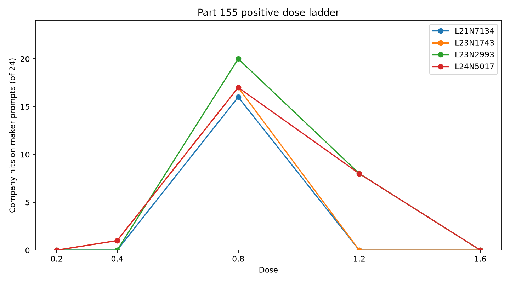

# How do four dose-0.8-selected company neurons answer across signed doses?

This table shows company-name hits and answers flagged broken by Part 86's rule for Qwen3.5-4B: four neurons selected in Parts 148 and 153 at dose 0.8, ten doses with paired random directions, one greedy answer per phrasing, 24 maker, 8 identity and 6 guard questions, and one batch of 81 rows per question.

Both gates passed. Gate 1: 3,078 of 3,078 expected rows were unique and nonempty, with 81 rows for each of 38 questions. Gate 2: the neurons produced 70 company hits across the 96 maker answers at +0.8 (within the registered range of 56–76); plain answers had 0 company hits across 38 questions (limit 2).

The largest limit: these four neurons were selected at exactly dose 0.8 in Part 148, so this table cannot separate a real peak from selection on that dose. Part 153's phrasings do not protect against that, and they and the random directions are the ones that chose these units, so the random side of 155.5 is not independent. This part cannot say whether another dose has its own company neurons, or how narrow a peak is: the nearest tested doses are 0.4 and 1.2.

## Predictions

Registered wording and confidence are reproduced from the design. I independently recounted the answers using the registered company-hit and guard rules and Part 86 broken-answer rule; all seven verdicts agree with `score.json`.

| # | Prediction (registered wording; confidence) | Result from answers | Verdict |
|---|---|---|---|
| 155.1 | Each of the four neurons has at least as many company hits at +0.8 as at +0.4. (medium) | All four: L21 N7134 0→16/24; L23 N1743 1→17/24; L23 N2993 0→20/24; L24 N5017 1→17/24. | held |
| 155.2 | At least two of the four neurons have a step of the positive ladder from at most 3 of 24 to at least 12 of 24. (medium) | All four make that step from +0.4 to +0.8: 0→16, 1→17, 0→20, and 1→17 of 24, respectively. | held |
| 155.3 | No neuron reaches 6 of 24 on its company at any negative dose. (medium) | Maximum is 0/24 for each neuron at every negative dose. | held |
| 155.4 | Pooled over the four neurons on the maker phrasings, the broken share at +1.6 is at least twice the share at +0.8. (medium) | Broken answers: 10/96 (10.4%) at +0.8 and 51/96 (53.1%) at +1.6; 5.1 times the share. | held |
| 155.5 | At every positive dose where the four neurons total at least 24 of 96, their four random pairs total under half that. (medium) | Only +0.8 reaches 24 neuron hits (70/96); its paired random directions have 0/96. | held |
| 155.6 | L24 N5017's lowest dose reaching 12 of 24 on maker is no higher than its lowest dose reaching 4 of 8 on identity. (medium) | Both first reach their threshold at +0.8: maker 17/24 and identity 7/8. | held |
| 155.7 | At +0.4 and -0.4, each of the four neurons keeps at least 5 of 6 guard hits. (medium) | Every neuron has 6/6 at both +0.4 and -0.4. | held |

## Counts by neuron and dose

Company hits use the assigned company name rule. Identity and guard counts are for the neuron arm; random is the paired random direction's maker count. Broken counts are broken maker answers in the neuron arm. Denominators are 24 maker, 8 identity and 6 guards.

| Unit (company) | Dose | Neuron maker hits | Random maker hits | Neuron identity hits | Neuron guard hits | Neuron broken maker |
|---|---:|---:|---:|---:|---:|---:|
| L21 N7134 (Baidu) | +0.2 | 0 | 0 | 0 | 6 | 0 |
| L21 N7134 (Baidu) | +0.4 | 0 | 0 | 0 | 6 | 0 |
| L21 N7134 (Baidu) | +0.8 | 16 | 0 | 3 | 6 | 0 |
| L21 N7134 (Baidu) | +1.2 | 0 | 0 | 0 | 6 | 0 |
| L21 N7134 (Baidu) | +1.6 | 0 | 0 | 0 | 6 | 15 |
| L21 N7134 (Baidu) | -0.2 | 0 | 0 | 0 | 6 | 0 |
| L21 N7134 (Baidu) | -0.4 | 0 | 0 | 0 | 6 | 0 |
| L21 N7134 (Baidu) | -0.8 | 0 | 0 | 0 | 6 | 0 |
| L21 N7134 (Baidu) | -1.2 | 0 | 0 | 0 | 4 | 5 |
| L21 N7134 (Baidu) | -1.6 | 0 | 0 | 0 | 3 | 15 |
| L23 N1743 (Huawei) | +0.2 | 0 | 0 | 0 | 6 | 0 |
| L23 N1743 (Huawei) | +0.4 | 1 | 0 | 0 | 6 | 0 |
| L23 N1743 (Huawei) | +0.8 | 17 | 0 | 1 | 6 | 3 |
| L23 N1743 (Huawei) | +1.2 | 0 | 0 | 0 | 6 | 15 |
| L23 N1743 (Huawei) | +1.6 | 0 | 0 | 0 | 5 | 13 |
| L23 N1743 (Huawei) | -0.2 | 0 | 0 | 0 | 6 | 0 |
| L23 N1743 (Huawei) | -0.4 | 0 | 0 | 0 | 6 | 0 |
| L23 N1743 (Huawei) | -0.8 | 0 | 6 | 0 | 5 | 9 |
| L23 N1743 (Huawei) | -1.2 | 0 | 0 | 0 | 2 | 23 |
| L23 N1743 (Huawei) | -1.6 | 0 | 0 | 0 | 0 | 23 |
| L23 N2993 (Microsoft) | +0.2 | 0 | 0 | 0 | 6 | 0 |
| L23 N2993 (Microsoft) | +0.4 | 0 | 0 | 0 | 6 | 0 |
| L23 N2993 (Microsoft) | +0.8 | 20 | 0 | 0 | 6 | 1 |
| L23 N2993 (Microsoft) | +1.2 | 8 | 0 | 0 | 3 | 5 |
| L23 N2993 (Microsoft) | +1.6 | 0 | 0 | 0 | 3 | 16 |
| L23 N2993 (Microsoft) | -0.2 | 0 | 0 | 0 | 6 | 0 |
| L23 N2993 (Microsoft) | -0.4 | 0 | 0 | 0 | 6 | 0 |
| L23 N2993 (Microsoft) | -0.8 | 0 | 0 | 0 | 5 | 0 |
| L23 N2993 (Microsoft) | -1.2 | 0 | 0 | 0 | 3 | 10 |
| L23 N2993 (Microsoft) | -1.6 | 0 | 0 | 0 | 3 | 15 |
| L24 N5017 (Google) | +0.2 | 0 | 0 | 0 | 6 | 0 |
| L24 N5017 (Google) | +0.4 | 1 | 0 | 1 | 6 | 0 |
| L24 N5017 (Google) | +0.8 | 17 | 0 | 7 | 6 | 6 |
| L24 N5017 (Google) | +1.2 | 8 | 0 | 0 | 4 | 0 |
| L24 N5017 (Google) | +1.6 | 0 | 0 | 0 | 3 | 7 |
| L24 N5017 (Google) | -0.2 | 0 | 0 | 0 | 6 | 0 |
| L24 N5017 (Google) | -0.4 | 0 | 0 | 0 | 6 | 0 |
| L24 N5017 (Google) | -0.8 | 0 | 2 | 0 | 6 | 0 |
| L24 N5017 (Google) | -1.2 | 0 | 0 | 0 | 5 | 7 |
| L24 N5017 (Google) | -1.6 | 0 | 0 | 0 | 2 | 22 |

## What the answers name across doses

The table shows the most frequent bold-marked string occurrences in each cell's first 220 characters, counted by [`names155.py`](names155.py). Counts are occurrences, not distinct answers: one answer can repeat a bold string. I read the first eight maker answers by hand in every cell. That check shows why the raw strings should not all be read as names: several top strings are generic words, letter fragments, or repeated answer text. I label those cases below; the remaining entries are the most frequent bold-marked strings as written, without interpreting what they refer to.

| Unit | Dose | Most frequent bold-marked string(s), count | Hand-read clarification |
|---|---:|---|---|
| L21 N7134 | +0.4 | Tongyi Lab (17) | Coherent developer name in these answers. |
| L21 N7134 | +0.8 | Baidu (16) | Coherent company name. |
| L21 N7134 | +1.2 | Zhou Jing (10) | A person name; the other answers use varied invented names such as Zhongie, Bollard and Qozh. |
| L21 N7134 | +1.6 | standard (16) | Generic repeated word, not a name. |
| L21 N7134 | -0.8 | Qwen (13) | Model name in the sampled claims; other strings include Alibaba and Tongue Intelligence. |
| L21 N7134 | -1.2 | Alton (10) | Repeated invented developer name in some answers; the cell also contains unrelated claims and broken-looking text. |
| L23 N1743 | +0.4 | Tencent (8); Qianfan (8) | Tie: Tencent appears as developer and Qianfan as model name in the sampled answers. |
| L23 N1743 | +0.8 | Huawei (8) | Company name in the sampled claims. |
| L23 N1743 | +1.2 | Google (8) | Eight bold occurrences, concentrated in two answers that call the output a Google system; the other sampled answers describe user-side or storage/management systems. |
| L23 N1743 | +1.6 | System 666 (7) | Repeated label in sampled claims; other answers say Habilitability or storage systems. |
| L23 N1743 | -0.8 | Qwen3.3 (4) | Model label; many answers repeat “buffer.” |
| L23 N1743 | -1.2 | buffer (6) | Generic repeated word, not a name; all eight sampled answers repeat it. |
| L23 N2993 | +0.4 | Alibaba Cloud's Tongyan Lab (16) | Coherent string in the sampled answers. |
| L23 N2993 | +0.8 | Microsoft (22) | Company name in the sampled claims. |
| L23 N2993 | +1.2 | Microsoft (12) | Company name in some answers; others name Q2 and Quantum variants. |
| L23 N2993 | +1.6 | Netea (11) | Repeated label in the sampled answers; many other answers are garbled or repetitive. |
| L23 N2993 | -0.8 | Parsy (5) | One coherent invented developer name among parser-themed answers. |
| L23 N2993 | -1.2 | parser (52) | Generic repeated word, not a name; the sampled strings repeat “parser” rather than identifying a maker. |
| L24 N5017 | +0.4 | Tongyi Lab (26) | Coherent developer name in the sampled claims. |
| L24 N5017 | +0.8 | Google (40) | Company name in the sampled claims. |
| L24 N5017 | +1.2 | Google (14) | Google occurs in a few sampled claims; other answers use Stimmy and management-related labels. |
| L24 N5017 | +1.6 | Google 管理下的 (5) | Repeated phrase fragment (“Google under management”), not a standalone name; most sampled answers are garbled. |
| L24 N5017 | -0.8 | Q (24) | Single-letter fragment, not a reliable name; sampled answers use Q/Qat variants and invented labels. |
| L24 N5017 | -1.2 | Q (42) | Single-letter fragment, not a reliable name; sampled answers repeat Qat and separated letters. |

## Positive dose counts and readability

At +0.4, +0.8, +1.2 and +1.6, maker hit counts by neuron are:

| Unit | +0.4 | +0.8 | +1.2 | +1.6 |
|---|---:|---:|---:|---:|
| L21 N7134 | 0/24 | 16/24 | 0/24 | 0/24 |
| L23 N1743 | 1/24 | 17/24 | 0/24 | 0/24 |
| L23 N2993 | 0/24 | 20/24 | 8/24 | 0/24 |
| L24 N5017 | 1/24 | 17/24 | 8/24 | 0/24 |

Part 86's rule flagged 0 of 24 as broken for L21 N7134 at +1.2, 15 of 24 for L23 N1743, 5 of 24 for L23 N2993 and 0 of 24 for L24 N5017. That rule is not a readability test: `part86/triage86.py` passes any answer with "model" or "AI" in its first sentence. A cold reader judged 24 of the 76 maker answers it did not flag at +1.2 to be nonsense, 10 of them for L21 N7134, and 22 of L23 N1743's 24 +1.2 answers overall. So "not flagged" does not mean fluent here.

I read all 24 L21 N7134 answers at +1.2. None claims Baidu. They mostly claim a different maker or model: names include Zhou Jing, Zhongie/Zhongjie, Bollard/Bollier, Qozh, Qian and other variants; some say they are search engines, web-search models or developer systems. One answer (#17) says it is the latest model developed by Google. One answer describes itself as a developer rather than a model. All 24 are nonempty and none is broken by the registered rule.

## The model's own name leaves first

The company rule above excludes answers that name Alibaba, Tongyi or 通义, so its zeros hide what the answers say at low doses. Counted on the 24 maker phrasings, neuron rows, any mention:

| Unit | -1.6 | -1.2 | -0.8 | -0.4 | -0.2 | +0.2 | +0.4 | +0.8 | +1.2 | +1.6 |
|---|---:|---:|---:|---:|---:|---:|---:|---:|---:|---:|
| L21 N7134 | 0 | 0 | 18 | 24 | 24 | 24 | 24 | 2 | 0 | 0 |
| L23 N1743 | 0 | 0 | 0 | 24 | 24 | 24 | 15 | 0 | 0 | 0 |
| L23 N2993 | 0 | 0 | 0 | 24 | 24 | 24 | 24 | 2 | 0 | 0 |
| L24 N5017 | 0 | 0 | 3 | 24 | 24 | 23 | 23 | 0 | 0 | 0 |

The no-push rows name them on 32 of 38 questions, 24 of 24 maker phrasings. Counted by a one-off script while folding the cold check; exploratory.

## Against Part 153 at +0.8

Part 153 gave L24 N5017 20, L21 N7134 15, L23 N1743 14 and L23 N2993 17 of 24; this run gives 17, 16, 17 and 20, totals 66 and 70. The batch shape differs, 20 rows against 81, and a bf16 answer on the A770 depends slightly on batch shape.

The pilot's two phrasings are in [`results/part155-pilot/answers.jsonl`](../part155-pilot/answers.jsonl).

## Random directions at the opposite sign

L23 N1743's paired random direction names Huawei on 6 of 24 maker answers at -0.8, under the registered hit rule. L24 N5017's paired random direction counts 2 of 24 hits for Google at -0.8, but a cold reader found one is a list mention and one a denial, so it makes no claim that Google made it. A random direction reaches the same company at the opposite sign once here, for L23 N1743.

## Method and limits

The design is [PART155-DESIGN.md](../../PART155-DESIGN.md). The run used Qwen3.5-4B revision 851bf6e8 in bf16 on an A770, thinking off, Part 148's hook and medians, greedy generation and up to 120 new tokens. For each question, the four neurons and their paired random directions at ten signed doses plus the no-push answer were generated in one 81-row batch. The fixed Part 153 company and guard rules were used; Part 86 triage marked broken answers. A single answer per phrasing cannot establish response reliability beyond this set of prompts.

The dose grid is coarse: the nearest measurements around +0.8 are +0.4 and +1.2. These results describe these four dose-selected neurons and cannot identify neurons associated with other doses or locate a narrower peak.

## Files

- `answers.jsonl`: all 3,078 answer rows.
- `score.json` and `tables.md`: registered scorer output; the counts were independently recounted from the answer rows for this write-up.
- `names155.py`: counts bold-marked string occurrences in the first 220 answer characters for the six requested doses in each neuron.
- `dose155.png`: positive-dose maker hit plot.

Cold check: Haiku 5.5, 2026-10-31, recomputed all 40 table cells and all seven verdicts and found them correct; 103 of the 105 counted hits it read are claims. It corrected readability at +1.2, the L24 N5017 random hits, the missing Alibaba counts, the claim about held-out phrasings, the Part 153 gap and the pilot citation, all folded here.
