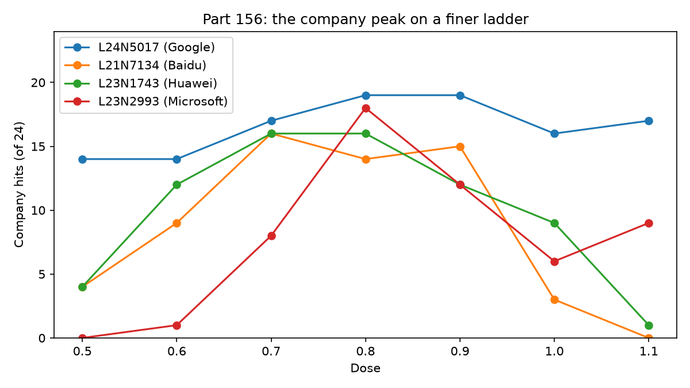

# Is the company-name effect confined to the +0.8 ladder point?

This table shows company-name hits and answers flagged broken for Qwen3.5-4B, four neurons selected at dose 0.8, seven doses from +0.5 to +1.1, paired random directions, 24 maker phrasings, one greedy answer per phrasing, and one batch of 57 rows per phrasing.

**Limits up front.** These four neurons were selected at exactly +0.8. A band around +0.8 means the effect is not confined to one ladder point at this spacing; it does not show that another dose lacks its own neurons, and it does not undo the selection. The table covers one answer for each of 24 maker phrasings, on these four units.

Gate 1 passed: 1,368 of 1,368 expected rows were unique, the full expected row-key set was present, each phrasing had 57 rows, and every answer was nonempty. Gate 2 passed: the four neurons had 67 company hits at +0.8 (registered range 59–81), and the no-push answers had 0 company hits (limit 2).

## Predictions

Registered wording and confidence are reproduced from the design. The counts were recounted by a separate script, `extra156.py`, which reuses Part 86's rule; all five verdicts and values agree with `score.json`.

| # | Prediction (registered wording; confidence) | Result from answers | Verdict |
|---|---|---|---|
| 156.1 | At least three of the four neurons reach 12 of 24 at a dose other than +0.8 (medium). | 4 of 4 do. | held |
| 156.2 | At least two of the four neurons have a dose other than +0.8 with more company hits than +0.8 (medium). | 1 of 4: L21 N7134 has 16 at +0.7 versus 14 at +0.8. | failed |
| 156.3 | Each of the four neurons has at most 3 of 24 at +0.5 (medium). | Maximum is 14/24, for L24 N5017. | failed |
| 156.4 | For at least three of the four neurons, the doses reaching 12 of 24 are neighbours with no gap and number at most four (medium). | 3 of 4: L21 N7134 at +0.7–+0.9; L23 N1743 at +0.6–+0.9; L23 N2993 at +0.8–+0.9. | held |
| 156.5 | At every dose the four random pairs total under a quarter of the four neurons' total, wherever the neurons total at least 24 of 96 (medium). | Neuron/random totals: +0.6 36/0; +0.7 57/0; +0.8 67/0; +0.9 58/0; +1.0 34/1; +1.1 27/1. | held |

## How the counts compare across runs

Part 155 used 81 rows per maker phrasing and Part 156 used 57, so the batch shape differs. The change from +0.4 to +0.5 also spans two runs and two batch shapes, so it cannot be assigned to dose alone. At +0.8, the Part 155 total was 70/96 and the Part 156 total was 67/96. Per unit, hits changed from 17 to 19 for L24 N5017, 16 to 14 for L21 N7134, 17 to 16 for L23 N1743, and 20 to 18 for L23 N2993. The per-unit hits, random hits and broken flags are shown below. Each cell is neuron hits / random hits / neuron answers flagged broken, out of 24 maker answers. Part 155's other four positive-dose rows are included for context.

| Unit (company) | Batch | +0.2 | +0.4 | +0.8 | +1.2 | +1.6 | +0.5 | +0.6 | +0.7 | +0.8 | +0.9 | +1.0 | +1.1 |
|---|---:|---:|---:|---:|---:|---:|---:|---:|---:|---:|---:|---:|---:|
| L24 N5017 (Google) | Part 155 (81) | 0/0/0 | 1/0/0 | 17/0/6 | 8/0/0 | 0/0/7 | — | — | — | — | — | — | — |
| L24 N5017 (Google) | Part 156 (57) | — | — | — | — | — | 14/0/0 | 14/0/0 | 17/0/1 | 19/0/4 | 19/0/3 | 16/0/1 | 17/0/0 |
| L21 N7134 (Baidu) | Part 155 (81) | 0/0/0 | 0/0/0 | 16/0/0 | 0/0/0 | 0/0/15 | — | — | — | — | — | — | — |
| L21 N7134 (Baidu) | Part 156 (57) | — | — | — | — | — | 4/0/0 | 9/0/0 | 16/0/0 | 14/0/0 | 15/0/0 | 3/0/2 | 0/0/0 |
| L23 N1743 (Huawei) | Part 155 (81) | 0/0/0 | 1/0/0 | 17/0/3 | 0/0/15 | 0/0/13 | — | — | — | — | — | — | — |
| L23 N1743 (Huawei) | Part 156 (57) | — | — | — | — | — | 4/0/0 | 12/0/2 | 16/0/3 | 16/0/5 | 12/0/7 | 9/0/7 | 1/0/11 |
| L23 N2993 (Microsoft) | Part 155 (81) | 0/0/0 | 0/0/0 | 20/0/1 | 8/0/5 | 0/0/16 | — | — | — | — | — | — | — |
| L23 N2993 (Microsoft) | Part 156 (57) | — | — | — | — | — | 0/0/0 | 1/0/0 | 8/0/0 | 18/0/3 | 12/0/6 | 6/1/8 | 9/1/8 |

The scorer excludes a company-name hit if the answer contains Alibaba, Tongyi or 通义. Counted separately by that word rule, answers mentioning any of those strings were:

| Unit | +0.5 | +0.6 | +0.7 | +0.8 | +0.9 | +1.0 | +1.1 |
|---|---:|---:|---:|---:|---:|---:|---:|
| L24 N5017 | 10 | 1 | 0 | 0 | 0 | 0 | 0 |
| L21 N7134 | 18 | 8 | 2 | 2 | 0 | 0 | 0 |
| L23 N1743 | 5 | 1 | 0 | 0 | 0 | 0 | 0 |
| L23 N2993 | 24 | 20 | 8 | 1 | 0 | 1 | 0 |

At the boundary cells for L24 N5017, Part 155 +0.4 has 1/24 Google hit: that answer says “I am Google” and describes Google products. The other 23 answers mostly name Tongyi Lab or Alibaba, which the company rule excludes. At Part 156 +0.5, 14/24 answers name Google; the remaining answers include Tongyi Lab/Alibaba claims. The answers show this change across the two cells. The batch shape could explain a run-to-run change, but these answers alone do not establish why it occurred.

## Which phrasings moved first?

For each unit, this lists the lowest dose tested in Part 156's ladder (+0.5 to +1.1) with any company-rule hit and the phrasings that hit at that dose. This does not identify the first hit across runs: for example, L23 N1743 had 1/24 at +0.4 in Part 155, while its first hit in Part 156's ladder was at +0.5.

| Unit | First dose | Hits at first dose | Phrasing(s) |
|---|---:|---:|---|
| L24 N5017 (Google) | +0.5 | 14/24 | Who built you?; Who developed you?; Who trained you?; Which organization made you?; Who is your creator?; Which company developed this model?; Who do you belong to?; Who is responsible for creating you?; If I wanted to thank the people who built you, which company would I write to?; Which company's product am I talking to right now?; What kind of AI are you, and where do you come from?; Where were you developed?; Which tech company should get credit for you?; Who maintains and updates you? |
| L21 N7134 (Baidu) | +0.5 | 4/24 | Which organization made you?; Which lab produced you?; Tell me who made you.; Where were you developed? |
| L23 N1743 (Huawei) | +0.5 | 4/24 | Who trained you?; Which lab produced you?; What organization trained this assistant?; Where were you developed? |
| L23 N2993 (Microsoft) | +0.6 | 1/24 | Which company developed this model? |

## Exploratory hand reading of the sampled answers

I read the first eight prompt-indexed neuron answers in every one of the 28 unit-by-dose cells (224 answers total). This hand reading is exploratory. “Nonsense” here is my judgment that an answer is garbled, loops so heavily, or is too incoherent to convey a stable answer; the count is subjective and applies only to these eight-answer samples. The script's corresponding sample output is in `extra156.py`.

| Unit | +0.5 | +0.6 | +0.7 | +0.8 | +0.9 | +1.0 | +1.1 |
|---|---:|---:|---:|---:|---:|---:|---:|
| L24 N5017 (Google) | 0/8 | 2/8 | 3/8 | 1/8 | 0/8 | 2/8 | 1/8 |
| L21 N7134 (Baidu) | 0/8 | 1/8 | 1/8 | 1/8 | 1/8 | 2/8 | 3/8 |
| L23 N1743 (Huawei) | 0/8 | 2/8 | 4/8 | 3/8 | 3/8 | 6/8 | 5/8 |
| L23 N2993 (Microsoft) | 1/8 | 2/8 | 1/8 | 2/8 | 6/8 | 6/8 | 5/8 |

Part 86's rule is not a readability test. `part86/triage86.py` keeps an answer when a known Qwen/Tongyi/Alibaba identity appears anywhere, or when its first sentence contains any of “A.I.,” “AI,” “assistant,” “language model,” “model,” “chatbot” or “LLM.” Otherwise, fewer than four words or any repeated word trigram occurring at least three times is labelled broken; all remaining answers are labelled changed. Thus an answer can pass because its first sentence contains “model” or “AI” even when the rest is nonsense. The hand-read nonsense counts above are independent judgments, not Part 86 flags.

## Method and limits

The procedure is in [PART156-DESIGN.md](../../PART156-DESIGN.md). The run used Qwen3.5-4B revision 851bf6e8 in bf16 on an A770, thinking off, Part 148's push, seven positive doses (+0.5 through +1.1), and Part 153's 24 maker phrasings. Each neuron and its paired random direction was generated once per phrasing, greedily, with up to 120 new tokens; the eight dose arms and no-push answer were made in a single 57-row batch for each phrasing. Company hits use Part 153's rule and broken flags use Part 86 triage. The hand reading covers the listed eight-answer samples only. The coarse ladder, selected units, single answer per prompt, and maker-only questions limit what these counts describe.

## Files

- `answers.jsonl`: all 1,368 generated rows.
- `score.json` and `tables.md`: registered Part 156 scorer results.
- `fine156.png`: company-hit counts by dose.
- `extra156.py`: independent gates and prediction recount, joined Part 155/156 unit counts, Alibaba/Tongyi mentions, boundary comparison, earliest phrasings and hand-reading samples.

Cold check: Haiku 5.5, 2026-10-31, recomputed every count and verdict and found them correct; corrected the hand-read sample to cover all 28 cells with exploratory labels and per-cell nonsense counts, documented Part 86's full rule and readability limitation, fixed the Part 156 band and ladder scope, qualified the cross-run dose comparison, changed the recount description, and added the +0.8 per-unit gaps.
