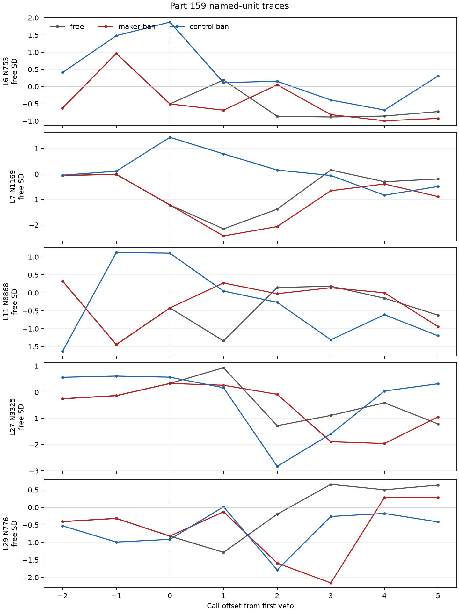

# When a ban vetoes the maker’s name, do the maker neurons stay on while the model routes around it?

In this run, the five named units did not show a uniform “stay on” pattern at the first maker veto: only L7 N1169 was on at *t* on at least 12 rows; four units have numeric R values of at least 0.7, but the reading rule gives only L7 a reading. This is evidence about Qwen3.5-4B at revision `851bf6e8`, with no push, 24 maker phrasings, greedy decoding, 40 new tokens, one batch of 24 per arm, and five recorded MLP layers (L6, L7, L11, L27, L29). All gates held. Four of five R values are at least 0.7, but by the reading rule only L7 N1169 is on; the other four units are off and have no content under the rule. Gate 3 is a recording check: exact agreement at call t follows by construction because the runs share a prefix through the veto. It verifies the recording against that shared prefix, but cannot detect a one-call shift.

The free trace is aligned on the maker-ban veto; each ban trace is aligned on that arm’s own first veto. Values are mean activation in standard-deviation units from each unit’s free-arm rest.

## Predictions

| # | Prediction (registered wording; confidence) | Result | Verdict |
| --- | --- | --- | --- |
| 159.1 | At the first maker veto, the median margin over rows is at least 5 logits (medium) | Median 9.3125 logits | held |
| 159.2 | In maker_ban, at least 20 of 24 answers, from step t on, contain by case-folded substring one of alibaba, alibab, alipay, aliyun, tongyi, tongy, 阿里, 通义, 通義 (medium) | 23/24: 6 exact-name mentions, 9 Alipay or traditional 通義 only, 8 variant spellings | held |
| 159.3 | At most 2 of the 5 named units are on at t on at least 12 rows of maker_ban (medium) | 1/5 units (L7 N1169) | held |
| 159.4 | At least 4 of the 5 named units have R of at least 0.7, so at most one holds (medium) | 4/5 | held |
| 159.5 | For at least 4 of the 5 named units, median D after the maker veto over median D after the control veto is between 0.5 and 2 (low) | 4/5 | held |
| 159.6 | Over t+1 to t+5 in maker_ban, L27 N3325 averages at least 0.5 sd above the free arm on at least 12 rows (low) | 0 rows | failed |

## What the veto replaced

On 21 of 24 maker-ban rows, the first veto refused `yi` and emitted `y`; 14 of those 21 emitted `i` next, spelling the same two letters across two tokens (`y`, `i`). Sixteen rows (0, 1, 2, 4, 5, 7, 9, 10, 11, 12, 14, 17, 18, 20, 22, 23) then write the exact name `Tongyi` across `Tong` + `y` + `i` tokens, including row 0’s `**Tongyi Lab**`. The other eight are routes: rows 3 and 13 use Tongyabai/Tongyabaijia variants; rows 6, 8, 15, 16 and 19 use Tongy Lab and/or Alipay or traditional Chinese; row 21 routes to Alphabet (Google) and Gemini after refusing `ibaba`. The groups’ L27 N3325 median D values are 1.188 for the 16 leak rows and 0.775 for the 8 route rows, beside the pooled 1.160. Rows 20 and 23 had margins below one logit: 0.125 and 0.5, respectively, with ` Alibaba` competing against ` Tong`. Row 21 had already emitted `Al` and refused `ibaba`; its maker-ban answer begins: “I am **Qwen3.5**, a large language model developed by **Alphabet** (Google).”

The first-veto margin median was 9.3125 logits. Sorted margins (logits): 0.125, 0.5, 8.375, 8.625, 9, 9, 9, 9, 9.125, 9.125, 9.125, 9.25, 9.375, 9.375, 9.5, 9.5, 9.5, 9.5, 9.875, 10.125, 10.125, 10.25, 10.375, 10.625.

Maker-ban veto counts by zero-based row index 0–23 were: 5, 5, 5, 3, 4, 3, 3, 4, 3, 4, 3, 4, 4, 4, 4, 3, 3, 4, 6, 4, 2, 1, 4, 6. By count: one row had 1 veto (row 21), one had 2 (20), seven had 3 (3, 5, 6, 8, 10, 15, 16), ten had 4 (4, 7, 9, 11, 12, 13, 14, 17, 19, 22), three had 5 (0, 1, 2), and two had 6 (18, 23).

## Named units at the maker veto

`On at t` counts rows whose activation was at least one free-arm standard deviation from rest on the veto step. D is the maker-ban median across rows of the mean absolute free-versus-ban displacement over t+1…t+5, in free-arm SD units. Peer median D is the median of the matched peers’ median D values. R is unit median D divided by peer median D. The reading word follows the registered rule: fewer than 12 on-at-t rows means `off`; otherwise R below 0.5 means `holds`, R at least 0.7 means `moves with its peers`, and the range in between means `unclear`.

| Unit | Maker on at t | Control on at t | Maker median D | Peer median D | R | Reading | 159.5 ratio |
| --- | ---: | ---: | ---: | ---: | ---: | --- | ---: |
| L6 N753 | 0 | 24 | 0.541 | 0.918 | 0.589 | off | 1.242 |
| L7 N1169 | 14 | 24 | 0.583 | 0.646 | 0.901 | moves with its peers | 1.056 |
| L11 N8868 | 2 | 19 | 0.708 | 0.662 | 1.070 | off | 1.396 |
| L29 N776 | 2 | 4 | 1.017 | 0.782 | 1.300 | off | 1.625 |
| L27 N3325 | 1 | 0 | 1.160 | 0.835 | 1.390 | off | 3.618 |

Apply the reading rule literally: only L7 N1169 is on; L6 N753, L11 N8868, L27 N3325 and L29 N776 are off and have no content under the rule. Their R values are reported numerically without a reading. The control-veto on-at-t counts are also shown above; this is a different step, the ` model` step about six tokens earlier, and is exploratory.

L27 N3325’s 159.5 ratio is above 2, so it is reported as “special” under the registered rule, with the caveat that L27 N3325 is off and the rule gives it no reading. Yet 159.6 failed: across the five tokens after the maker veto, its average was at least +0.5 SD relative to free on 0 rows. The signed row-level change over offsets +1…+5 has mean about −0.35 SD and median about −0.10 SD; row 21 alone is about −5.6 SD. The 14 rows where both runs write `Tongyi Lab` are one position apart: maker writes `y`, `i`, ` Lab` while free writes `yi`, ` Lab`. On those rows, shift-correcting L27 D by comparing maker calls t+1…t+5 with free calls t+2…t+6 gives 1.24, beside the unshifted 1.20; the extra position does not inflate this measure. The registered 159.5 ratio is 3.618; excluding the ten control rows that substitute ` models` gives about 3.2.

## Exploratory whole-layer distances

`state_return.json` compares median whole-layer distance in free-arm SD units. The selected maker set is the 14 rows where both runs write `Tongyi Lab`; the maker sequence is one position longer (`y`, `i`, ` Lab` against `yi`, ` Lab`). The control set has 18 rows. The added nulls compare different free-arm phrasings that reach the same token: all ordered pairs of the 14 selected maker rows at ` Lab`, and all ordered pairs of the control rows at ` developed`. For each unit, the null is the median over row pairs, then the table reports the median over units. The same-token maker distances remain above the free-arm pairwise baselines in every layer; the control distances at ` developed` are near their baselines. These measurements do not show that activations return to the same values.

| Layer | Maker: y vs yi | Maker: i vs ` Lab` | Maker: both ` Lab` | Maker null: free ` Lab` pairs | Control: substitute vs ` model` | Control: both ` developed` | Control null: free ` developed` pairs |
| ---: | ---: | ---: | ---: | ---: | ---: | ---: | ---: |
| 6 | 0.933 | 0.938 | 0.515 | 0.079 | 0.459 | 0.219 | 0.129 |
| 7 | 0.905 | 0.890 | 0.531 | 0.092 | 0.439 | 0.195 | 0.159 |
| 11 | 0.713 | 0.740 | 0.503 | 0.149 | 0.484 | 0.153 | 0.226 |
| 27 | 0.711 | 0.803 | 0.241 | 0.133 | 0.432 | 0.133 | 0.216 |
| 29 | 0.814 | 0.829 | 0.248 | 0.139 | 0.392 | 0.145 | 0.225 |

`top_movers.json` ranks units after the data by maker-veto D divided by control-veto D; these are exploratory, post hoc selections. The five largest-ratio units in each layer are:

| Layer | Largest units (channel; maker D / control D; ratio) |
| ---: | --- |
| 6 | 6675 (3.593 / 0.122; 29.52), 8752 (1.658 / 0.063; 26.35), 8363 (4.922 / 0.223; 22.03), 2133 (3.224 / 0.151; 21.30), 5381 (2.859 / 0.145; 19.67) |
| 7 | 133 (1.554 / 0.043; 35.96), 4234 (1.337 / 0.051; 25.98), 8644 (3.739 / 0.212; 17.67), 8166 (1.622 / 0.109; 14.86), 6454 (1.697 / 0.117; 14.52) |
| 11 | 920 (4.667 / 0.202; 23.09), 2433 (2.710 / 0.193; 14.03), 7946 (1.997 / 0.165; 12.07), 6281 (2.550 / 0.231; 11.04), 1705 (1.397 / 0.127; 11.01) |
| 27 | 816 (1.218 / 0.047; 26.00), 961 (0.570 / 0.025; 22.50), 8145 (1.569 / 0.073; 21.50), 252 (0.798 / 0.038; 21.14), 1321 (1.647 / 0.091; 18.09) |
| 29 | 97 (2.128 / 0.043; 49.66), 2522 (2.002 / 0.042; 47.90), 712 (1.931 / 0.043; 44.94), 4650 (1.578 / 0.039; 40.88), 1584 (1.593 / 0.042; 38.21) |

## Method

As recorded in `run.json`, the intervention masks the token sequences for Alibaba, Tongyi, Aliyun, 阿里 and 通义 after the model computes activations. The `**` variants collapse into the corresponding bare sequences in the registered ban. The control masks `model` and ` model`. First veto t is where the would-be top token differs from the emitted token; margin is their pre-ban logit difference. The recorded named units are the pre-hook activations of `mlp.down_proj` inputs. D and R follow the registered scorer and design. The design and scoring rules are in [PART159-DESIGN.md](../../PART159-DESIGN.md) and [score159.py](../../part159/score159.py).

## Limits

This is one model under greedy decoding. Step alignment after a veto compares different tokens, and the ban arm is one token longer on most rows, so unshifted D mixes that shift in. The measurements are limited to one model under greedy decoding. The post-veto comparisons align different tokens, and the maker sequence is one position longer on the 14 selected rows; the shift-corrected value is reported above.

## Files

- `README.md`: this write-up; the result files and scoring method are listed below.
- `veto159.png`: named-unit traces generated by [plot159.py](plot159.py) from `traces.json`.
- `plot159.py`: plotting code; run with the project Python environment.
- `score.json`: gates, predictions, named-unit scores, and veto route counts; made by [score159.py](../../part159/score159.py).
- `tables.md`: formatted scorer output, including every row’s route and every named unit’s primary and control measurements.
- `traces.json`: mean named-unit traces from t−2 through t+5.
- `state_return.json`: exploratory whole-layer distances and free-arm pairwise nulls.
- `top_movers.json`: largest exploratory layer channels, selected after the data.
- `answers.jsonl`: decoded emitted tokens and full answers for all 72 generations.
- `steps.npz`: per-step pre-ban top token, emitted token, and logits.
- `run.json` and `run-stdout.txt`: batch and generation records.
- `extra159.py`: whole-layer distance and null calculation; it needs the per-layer array files.

The whole-layer arrays are not included in the repository; the runner rebuilds them. `extra159.py` needs those rebuilt arrays to calculate whole-layer distances.

Cold check: Haiku 5.5, 2026-10-31, independently recomputed the gates, unit statistics, peers and counts and found them correct; corrected the leak/route split, 159.2 hit categories, reading-rule labels, L27 D summary, one-position shift check, control-row ratio and free-arm null comparisons.
