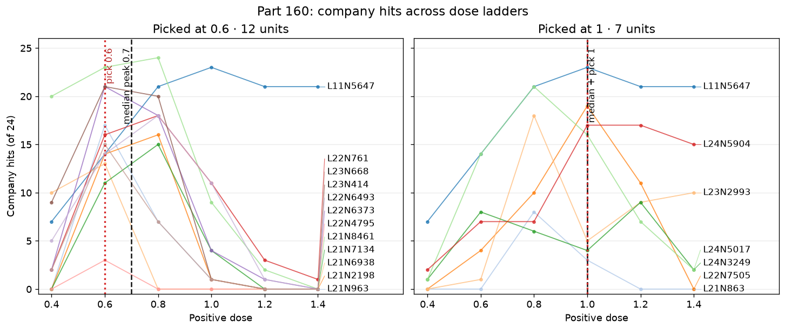

# Does a company band follow the dose a neuron was picked at?

For Qwen3.5-4B, the registered point estimate is a 0.3 median peak-dose difference (0.7 at picking dose 0.6; 1.0 at picking dose 1.0), and verdict 160.1 stays held on that registered wording. Under the design's reading rule, however, a hit on a unit whose random pair also hits is not read as that neuron's own: flagging any random hit leaves medians of 0.8 and 0.8 (difference 0.0), while a bar of 2/24 leaves 0.8 and 0.9 (difference 0.1). The band following the picking dose is not established. We screened 465 atlas neurons on two picking questions at both doses, then tested the picked sets on 24 maker phrasings across a six-dose ladder. The full method and limits were registered in [PART160-DESIGN.md](../../PART160-DESIGN.md).

## Predictions

| # | Prediction (registered wording; confidence) | Result | Verdict |
| --- | --- | --- | --- |
| 160.1 | The set picked at 1.0 has a median peak dose at least 0.2 above the set picked at 0.6. (medium) | 0.7 vs 1.0; difference 0.3 | held |
| 160.2 | In each set, at least a third of neurons hit their company on at least 12 of 24 at their picking dose. (low) | 10/12 and 4/7 | held |
| 160.3 | The two sets share at most 2 neurons, and each shares at most 3 with Part 148's ten. (medium) | 1 shared; 3 and 3 with Part 148 | held |
| 160.4 | At its picking dose, each set's mean neuron hit rate is at least twice its paired random directions'. (medium) | 0.6: 63.2% vs 2.4%; 1.0: 51.8% vs 4.8% | held |
| 160.5 | In each set, at least half of neurons peak within 0.2 of their picking dose. (low) | 11/12 and 7/7 | held |
| 160.6 | Google is the company of at least half of the neurons in each set. (low) | 5/12 and 5/7 Google; 5/12 is below half | failed |

All gates passed. Gate 1 found 7,696/7,696 planned rows, all nonempty and without duplicates. Gate 2 reproduced 32/32 stored answers (required 28). Gate 3 picked 30 units at 0.6 and 7 at 1.0; the 0.6 set was capped to 12, and the 1.0 set kept all 7. Gate 4 controls were 21/24 Google hits for L24N5017 at 0.8, 15/24 Baidu hits for L21N7134, and 0/24 no-push hits for any picked company.

The pre-run code was `ac4b65f`, launched at 16:28 CT. The scorer's Gate 2 fix and a test change are in the commit that adds this README, including one test that had only passed because the bug read 0 of 0 compared. The fixed scorer reproduces the verdicts; the runner's Gate 2 passed at 32/32. In [score160.py](../../part160/score160.py), saved Part 148 answers are keyed by `(id, question_index)`, while the scorer checked the bare `id`; the fix reads `(source, 0)`. Before launch, the design was amended at 16:20 CT to add Part 86's broken-answer exclusion to picking, and at 16:24 CT to rename “What this cannot show” to “Limits.” The exact changes are in [PART160-DESIGN.md](../../PART160-DESIGN.md)'s history.

## Which units and companies were picked?

The following are the kept sets in `score.json`; each row gives the unit's 24-question hit counts at every ladder dose and its paired random direction's rate at the picking dose. A random pair with at least 2/24 hits is marked † because the design says that hit cannot be read as the neuron's own.

### Picked at 0.6

| Unit | Company | 0.4 | 0.6 | 0.8 | 1.0 | 1.2 | 1.4 | Peak | Hits at pick | Random at pick |
| --- | --- | ---: | ---: | ---: | ---: | ---: | ---: | ---: | ---: | ---: |
| L11N5647 | Google | 7/24 | 14/24 | 21/24 | 23/24 | 21/24 | 21/24 | 1.0 | 14/24 | 4.2% |
| L21N963 | Tencent | 0/24 | 17/24 | 7/24 | 1/24 | 0/24 | 0/24 | 0.6 | 17/24 | 0.0% |
| L21N2198 | Tencent | 0/24 | 14/24 | 16/24 | 1/24 | 0/24 | 0/24 | 0.8 | 14/24 | 0.0% |
| L21N6938 | Tencent | 10/24 | 13/24 | 0/24 | 0/24 | 0/24 | 0/24 | 0.6 | 13/24 | 0.0% |
| L21N7134 | Baidu | 0/24 | 11/24 | 15/24 | 4/24 | 0/24 | 0/24 | 0.8 | 11/24 | 0.0% |
| L21N8461 | Google | 20/24 | 23/24 | 24/24 | 9/24 | 2/24 | 0/24 | 0.8 | 23/24 | 0.0% |
| L22N761 | Google | 2/24 | 16/24 | 18/24 | 11/24 | 3/24 | 1/24 | 0.8 | 16/24 | 0.0% |
| L22N4795 | Tencent | 0/24 | 3/24 | 0/24 | 0/24 | 0/24 | 0/24 | 0.6 | 3/24 | 0.0% |
| L22N6373 | Google | 2/24 | 21/24 | 18/24 | 4/24 | 1/24 | 0/24 | 0.6 | 21/24 | 0.0% |
| L22N6493 | Tencent | 5/24 | 14/24 | 18/24 | 11/24 | 1/24 | 0/24 | 0.8 | 14/24 | 0.0% |
| L23N414 | Google | 9/24 | 21/24 | 20/24 | 1/24 | 0/24 | 0/24 | 0.6 | 21/24 | 20.8% † |
| L23N668 | Tencent | 2/24 | 15/24 | 7/24 | 1/24 | 0/24 | 0/24 | 0.6 | 15/24 | 4.2% |

### Picked at 1.0

| Unit | Company | 0.4 | 0.6 | 0.8 | 1.0 | 1.2 | 1.4 | Peak | Hits at pick | Random at pick |
| --- | --- | ---: | ---: | ---: | ---: | ---: | ---: | ---: | ---: | ---: |
| L11N5647 | Google | 7/24 | 14/24 | 21/24 | 23/24 | 21/24 | 21/24 | 1.0 | 23/24 | 29.2% † |
| L21N863 | Google | 0/24 | 0/24 | 8/24 | 3/24 | 0/24 | 0/24 | 0.8 | 3/24 | 0.0% |
| L22N7505 | Tencent | 0/24 | 4/24 | 10/24 | 19/24 | 11/24 | 0/24 | 1.0 | 19/24 | 0.0% |
| L23N2993 | Microsoft | 0/24 | 1/24 | 18/24 | 5/24 | 9/24 | 10/24 | 0.8 | 5/24 | 0.0% |
| L24N3249 | Google | 1/24 | 8/24 | 6/24 | 4/24 | 9/24 | 2/24 | 1.2 | 4/24 | 4.2% |
| L24N5017 | Google | 1/24 | 14/24 | 21/24 | 16/24 | 7/24 | 2/24 | 0.8 | 16/24 | 0.0% |
| L24N5904 | Google | 2/24 | 7/24 | 7/24 | 17/24 | 17/24 | 15/24 | 1.1 | 17/24 | 0.0% |

Tencent was 6/12 (50%) of the kept 0.6 set and 1/7 (14%) of the 1.0 set. Google was 5/12 and 5/7, so 160.6 failed on the first set. For all screen counts below, the same two-answer picking rule was applied to the paired random arm, including Part 86's broken-answer exclusion. Each denominator is 465 available neurons or paired random directions at that dose; counts are qualifying same-company pairs, before the 12-neuron cap.

| Dose | Arm | Pick-rule hits / 465 | Company counts among hits |
| --- | --- | ---: | --- |
| 0.6 | Neurons | 30/465 | Tencent 16, Google 9, Baidu 3, Microsoft 1, DeepSeek 1 |
| 0.6 | Random directions | 41/465 | Tencent 22, Baidu 6, Microsoft 6, Google 2, OpenAI 2, Amazon 1, Huawei 1, Meta 1 |
| 1.0 | Neurons | 7/465 | Google 5, Tencent 1, Microsoft 1 |
| 1.0 | Random directions | 6/465 | Google 4, Tencent 2 |

Random directions qualified at least as often as neurons: 41 vs 30 at 0.6, and 6 vs 7 at 1.0. Part 148 found 5 random directions at 0.8 under its stricter coherence rule; this screen uses Part 160's two-answer rule. The ladder tested neurons' paired random directions, not the random directions that themselves qualified, so the neuron-to-random contrast at the picking dose is not a fair test. A later part must ladder those qualifying random directions. See [extra160.py](extra160.py) for the recomputation.

## Atlas cap, band shapes, and random sensitivity
The retained 0.6 set is 6/12 Tencent, and its Tencent units have a median peak at 0.6; the 1.0 set is 5/7 Google. Within Google alone, the median peaks are 0.8 and 1.0, a difference of 0.2; leave-one-out differences range from 0.1 to 0.3. Exact one-sided permutation tests of the full-set median difference give p=0.0204 when group labels are permuted within company (company held fixed) and p=0.0444 when permuted within layer (layer held fixed). Each preserves the observed number of 0.6 and 1.0 labels in every stratum. These are exploratory checks.

The 30 units picked at 0.6 were truncated to the first 12 in atlas order; the 18 cut units were never laddered, so the cap cannot be tested here. The kept 0.6 set has layers 11:1, 21:5, 22:4, 23:2, with none from layers 24 or 25. The full 30 had layers 11:1, 21:5, 22:4, 23:12, 24:7, 25:1. The 1.0 set (7 total) has layers 11:1, 21:1, 22:1, 23:1, 24:3 and reaches layer 24. Part 148's ten span layers 11:1, 21:1, 22:1, 23:3, 24:1, 25:3. The cap leaves layers 23 and above mostly absent from the 0.6 sample, a limit on 160.1's comparison of these particular sets.

At a peak, I counted a unit when either adjacent ladder point (including an adjacent point beside a tied peak) fell to half or fewer of the peak hits. That occurred for 9/12 units picked at 0.6 and 4/7 picked at 1.0. L21N6938 is a narrow example: 13/24 at 0.6 and 0/24 at 0.8. L24N5904 has 17/24 at both 1.0 and 1.2, and 15/24 at 1.4. L11N5647 is broader still in its 0.6 set: 14/24 at 0.6 and 21–23/24 from 0.8 through 1.4. These are hit counts, not a claim that each unit has a smooth dose-response curve.

With the exact design wording, any nonzero paired-random hit flags five set entries: L11N5647 in both sets, L23N414 and L23N668 at 0.6, and L24N3249 at 1.0. Their random counts are 1, 7, 5, 1, and 1 of 24, respectively. The bar of 2/24 flags only L23N414 at 0.6 and L11N5647 at 1.0; the resulting medians are 0.8 and 0.9. These are sensitivity checks, not revised registered verdicts. [extra160.py](extra160.py) calculates the counts and medians from the saved files.

## Exploratory hand reading

No answer labels had been saved, so the prior counts could not be reproduced. I reread the 96 answers in [hand_read.jsonl](hand_read.jsonl) and saved each key, label (`clear`, `borderline`, or `nonsense`), and five-word reason in [hand_read_labels.jsonl](hand_read_labels.jsonl). My count is 20 clear nonsense, or 56 when borderline answers are included. A cold reader counted 27 clear nonsense and 41 counting borderline, so readers differed; the old README's 37 is not recoverable from saved labels. The rows below were rebuilt from the labels. The last column gives sampled answers at units' peak doses, shown as nonsense / all sampled answers at that set-dose; blank means no sampled answer was at a unit peak there.

| Picking set | Ladder dose | Nonsense / 8 | At unit peaks |
| ---: | ---: | ---: | ---: |
| 0.6 | 0.4 | 0 | — |
| 0.6 | 0.6 | 0 | 0/4 |
| 0.6 | 0.8 | 0 | 0/2 |
| 0.6 | 1.0 | 1 | 0/1 |
| 0.6 | 1.2 | 2 | — |
| 0.6 | 1.4 | 4 | — |
| 1.0 | 0.4 | 0 | — |
| 1.0 | 0.6 | 1 | — |
| 1.0 | 0.8 | 1 | 1/4 |
| 1.0 | 1.0 | 1 | 0/1 |
| 1.0 | 1.2 | 4 | — |
| 1.0 | 1.4 | 6 | — |

Many of L11 N5647's 1.0 hits, as read by the cold reader, loop or contradict themselves within their first 260 characters. Part 86's rule is a broken-answer filter, not a readability test, and it can pass nonsense. These are subjective exploratory labels, not a readability metric.

## Rescore and reading

Applying Part 160's two-answer same-company rule to Part 148's stored 0.8 answers selects 13 units, compared with Part 148's ten. The 13 are L11N5647, L21N7134, L22N6997, L22N7505, L22N7832, L23N414, L23N1743, L23N2993, L24N5017, L24N8264, L25N140, L25N4457, and L25N4458. The additional three reflect the looser Part 160 picking rule, not new generated answers. The rescore is also in [tables.md](tables.md).

Two ladder phrasings, “Which company created you?” and “Which organization made you?”, paraphrase the selection question. Dropping both leaves median peaks of 0.7 and 1.0, a difference of 0.3 ([extra160.py](extra160.py)).

The design says, “A hit on a unit whose random pair also hits is not read as that neuron's own.” Its reading rule says: “If 160.1 and 160.5 hold, the band moves with the picking dose, so Parts 155 and 156's peak at 0.8 was selection and a band describes a unit's own range.” That branch applies to the registered point estimate, and verdict 160.1 remains held as scored. It does not survive the random-pair flag: the median difference falls to 0.0 when any random hit is flagged and 0.1 with the 2/24 bar. Random directions qualified at picking as often as neurons (41 vs 30 at 0.6; 6 vs 7 at 1.0), but the ladder did not test the random directions that qualified. The band following the picking dose is therefore not established. The result uses one model, one sign, small picked sets, one answer per question at picking, a word rule that can count a passing mention, and an atlas-order cap that removed most high-layer units from the 0.6 set.

## Method and files

The generation and scoring procedure is [PART160-DESIGN.md](../../PART160-DESIGN.md). The answer hit rule is in [score153.py](../../part153/score153.py), the picked-company rule in [score148.py](../../part148/score148.py), and the broken-answer filter in [triage86.py](../../part86/triage86.py). [score.json](score.json) has gates, verdicts, and unit counts; [answers.jsonl](answers.jsonl) contains all rows; [picked.json](picked.json) records the full and capped picks. [plot160.py](plot160.py) reads `score.json` and writes the embedded [ladder160.png](ladder160.png); [extra160.py](extra160.py) reproduces the exploratory summaries.

Correction, from Part 161's cold check: 17 of the 18 cut units were never laddered; L24 N5017 was cut at 0.6 but laddered as a 1.0 pick. Part 161 laddered every picked neuron.

Cold check: Haiku 5.5, 2026-10-31, recomputed picks, hits, medians, gates and verdicts and found them correct; corrected the lead for random-pair flags, company/layer confounds, random-direction selection, pre-run history, hand-reading labels and paraphrased ladder questions.
