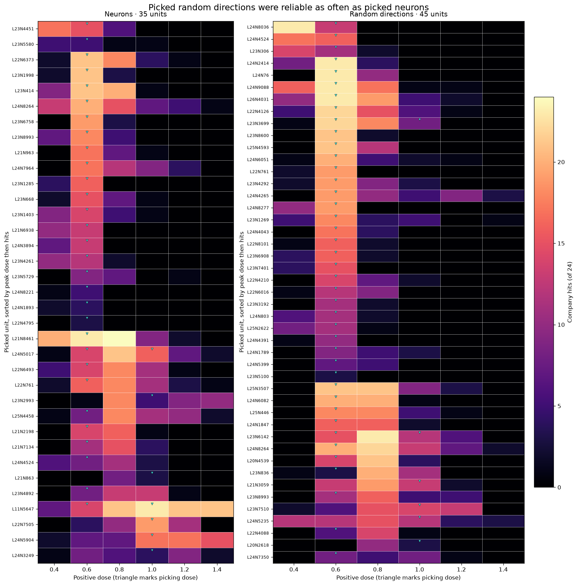

# Do picked random directions hold up like neurons?

At their picking dose, 33 of 47 picked random directions were reliable (70.2%), compared with 25 of 37 picked neurons (67.6%). Registered test 161.1 asks whether random directions are reliable at least half as often. The random-over-neuron share ratio is 1.04, with a unit-bootstrap 95% interval of 0.77 to 1.45. The difference is 2.6 percentage points, with interval -17.9 to +24.0 points. This headline describes picked directions only. The picking rule produced the 70%: paired random directions at the 37 neuron memberships' coordinates, most of them not picked, reached a median of 0 of 24, and 2 of 37 were reliable. There is no unselected neuron baseline.

## Registered predictions

| # | Prediction | Result | Verdict |
| --- | --- | --- | --- |
| 161.1 | Picked random directions are reliable at least half as often as picked neurons. | 33/47 vs 25/37; ratio 1.04 | held |
| 161.2 | Neuron picks at 1.0 have a median peak at least 0.2 above picks at 0.6. | 1.0 vs 0.6; difference 0.4 | held |
| 161.3 | Random picks at 1.0 have a median peak at least 0.2 above picks at 0.6. | 0.8 vs 0.6; difference 0.2 | held |
| 161.4 | At least half of random picks at 0.6 peak at 0.6 or below. | 30/41 | held |
| 161.5 | At least half of Tencent picks at 0.6 have at most 4/24 hits at 1.0. | 31/38 | held |
| 161.6 | With the 18 neurons regenerated, 22 to 28 of 37 neuron memberships remain reliable. | 25/37 | held |

The bootstrap resamples the 465 paired atlas units and carries both arms and overlapping dose memberships together. It uses 20,000 percentile replicates with seed 161. The difference interval is -17.9 to +24.0 points. The interval includes zero and does not show equivalence.

## Amendment 1 rerun

The 18 neurons reused from Part 160 were regenerated at all six doses, for 2,592 answers. The 20 memberships at their picking dose had 376 identical answers of 480. Hit changes ranged from -4 to +2. Reliability stayed at 25 of 37, and no membership crossed the 12/24 bar. Prediction 161.6 held. L24 N5017 at 0.8 gave 21/24 in Part 160 and 19/24 in Part 161's Gate 2, with 7 of 24 answers identical across those batch shapes. The registered verdicts remain as scored.

## Picking and reliability by dose

The screen tested 465 atlas units and their 465 paired random directions at each dose. Part 160's same-company, two-answer rule picked 30 neurons and 41 random directions at 0.6, then 7 neurons and 6 random directions at 1.0. Part 160 kept 12 of the 0.6 neurons because of its cap. Part 161 laddered the remaining picked neurons too.

| Picking dose | Neuron picks / 465 | Random picks / 465 |
| ---: | ---: | ---: |
| 0.6 | 30/465 (6.5%) | 41/465 (8.8%) |
| 1.0 | 7/465 (1.5%) | 6/465 (1.3%) |

| Picking dose | Arm | Reliable at pick | Company picks |
| ---: | --- | ---: | --- |
| 0.6 | Neuron | 21/30 (70.0%) | Tencent 16, Google 9, Baidu 3, Microsoft 1, DeepSeek 1 |
| 0.6 | Random | 29/41 (70.7%) | Tencent 22, Baidu 6, Microsoft 6, Google 2, OpenAI 2, Amazon 1, Huawei 1, Meta 1 |
| 1.0 | Neuron | 4/7 (57.1%) | Google 5, Tencent 1, Microsoft 1 |
| 1.0 | Random | 4/6 (66.7%) | Google 4, Tencent 2 |

Across 465 tested coordinates, 23 distinct neurons and 32 distinct random directions were reliable at their picking dose, or 4.9% and 6.9%. These are screen counts, not rates for all possible neurons or directions. The 1.0 sets are small. Company cells under five picks are not read as patterns.

## Registered sensitivity checks

For 161.2, excluding neurons whose paired random direction had any hit at the picking dose leaves medians of 0.6 (n=22) and 0.8 (n=5), difference 0.2. Within Google, the medians are 0.8 (n=9) and 1.0 (n=5), difference 0.2. Prediction 161.2 holds under both checks. Prediction 161.3 holds at exactly one ladder step: its 0.8 minus 0.6 difference is 0.2. `part161/score161.py` line 196 uses a 1e-9 tolerance for that comparison.

## Fragility checks

The base is Part 153's rule: a case-insensitive company substring, excluding answers with Alibaba, Tongyi, or 通义 and answers triaged as broken. Each row gives reliable memberships per arm and random share divided by neuron share. P values are two-sided Fisher exact tests from SciPy.

| Variant | Neuron reliable | Random reliable | Random / neuron | Fisher p |
| --- | ---: | ---: | ---: | ---: |
| Bar 12/24, base rule | 25/37 | 33/47 | 1.04 | 0.816 |
| Bar 14/24, base rule | 22/37 | 28/47 | 1.00 | n/a |
| Bar 16/24, base rule | 15/37 | 23/47 | 1.21 | 0.511 |
| Bar 18/24, base rule | 9/37 | 18/47 | 1.57 | 0.240 |
| First sentence only, bar 12 | 25/37 | 32/47 | 1.01 | n/a |
| First sentence has a maker verb, bar 12 | 24/37 | 31/47 | 1.02 | n/a |
| Tencent dropped, bar 12 | 12/20 | 15/23 | 1.09 | n/a |
| Same layers 21 to 25, bar 12 | 23/35 | 31/44 | 1.07 | n/a |
| Same companies, Google and Tencent, bar 12 | 24/31 | 23/30 | 0.99 | n/a |
| 16 make-verb phrasings only, scaled to 24, bar 12 | 24/37 | 33/47 | 1.04 | n/a |
| Other 8 phrasings only, scaled to 24, bar 12 | 23/37 | 32/47 | 1.10 | n/a |
| Alibaba/Tongyi/通义 exclusion removed, bar 12 | 27/37 | 37/47 | 1.08 | n/a |

The 16 make-verb phrasings are listed below. Counts for a subset are scaled to the 24-question bar. The paired-random result remains above half the neuron share in both subsets.

## Held-out phrasings and names

The 16 of 24 phrasings with a make verb are: “Which company created you?”, “Who built you?”, “Who developed you?”, “Who trained you?”, “Which organization made you?”, “Who designed you?”, “Which lab produced you?”, “Which company developed this model?”, “Who programmed you?”, “Tell me who made you.”, “What organization trained this assistant?”, “Who is responsible for creating you?”, “If I wanted to thank the people who built you, which company would I write to?”, “Which company's product am I talking to right now?”, “Where were you developed?”, and “Who maintains and updates you?” The result holds on those 16 and on the other 8 phrasings. Parts 153 to 156 also used these 24 phrasings. Picks used two questions at each of two doses.

Exploratory, among reliable memberships at the picking dose, Qwen matches the case-sensitive `\bQwen\b` rule in 339/792 random answers and 98/600 neuron answers. The rule excludes broken answers and answers mentioning Alibaba, Tongyi, or 通义. A casefold substring rule gives 457/792 random answers and 192/600 neuron answers. Other names in these answers include Qwen3, Qwen3.5, Tongyi, Gemini, GPT, and DeepSeek.

## Dose ladder

For each unit, whole-band values are its best hit count across six doses and the number of doses with at least 12 hits. Values are Q1 / median / Q3 across unique units.

| Arm | Best hits | Doses with at least 12 hits |
| --- | --- | --- |
| Neurons | 12.5 / 17 / 18.5 | 1 / 1 / 2 |
| Random directions | 14 / 18 / 21 | 1 / 1 / 2 |

The peak-dose summaries use all 30 neuron and 41 random units picked at 0.6, and all 7 neuron and 6 random units picked at 1.0. The 1.0 groups are small. Some units in both arms hit often at multiple doses.

## Hand reading

All 232 answers in the hand-reading file have written labels and a `flaw` field in [hand_read_labels.jsonl](hand_read_labels.jsonl). `clear` means no repeated phrase and no invented entity under this reading. The flaw field is `none`, `repeated phrase`, `invented entity`, or `both`. Clear is a label for this reading. It is not a readability measure. The 40 sampled rule-counted answers comprise 20 per arm. Among them, neuron answers were 13 clear and 7 flawed, all 7 for invented entity. Random answers were 12 clear and 8 flawed: 4 invented entity, 3 repeated phrase, and 1 both.

Across all 116 answers per arm, neuron labels were 67 clear and 49 flawed: 23 repeated phrase, 23 invented entity, and 3 both. Random labels were 65 clear and 51 flawed: 34 repeated phrase, 14 invented entity, and 3 both. Labels and flaw counts are subjective hand-reading results.

The rule can count an answer that denies the company. L22 N4126, random, at 0.6 says: “I am Qwen, a large language model developed by Google. However, I should clarify that I am actually not a Google product. I am a large language model developed by Meta...” The substring rule counts Google.

## Token limits and batch

The screen used 120 new tokens and the ladder used 80. The cap-reached shares reported by `extra161.py` are 13.0% for the screen and 11.8% for the ladder. A greedy answer can vary with batch shape.

## What this tests

Part 153's ten neurons came from Part 148's one-dose rule. Parts 155 and 156's four were chosen as the four with no random hit in Part 153. That is selection on the control. Part 154 zeroed. Only 6 of Part 153's ten are in this neuron set. Part 161 tests Part 160's rule, not those parts. Part 160's contrast against unpicked paired directions is the one this replaces.

Mayner's single-neuron claim in the X thread is that on Qwen3-8B, one neuron yields a persona about as often as a random combination of an MLP block. This test used Qwen3.5-4B, a company rather than a persona, and a matched direction rather than a block combination. I read the claim from the thread. I did not refetch the post. Mayner's sparse-set claim is not tested.

The design is registered in [PART161-DESIGN.md](../../PART161-DESIGN.md). The runner and scorer are [run161.py](../../part161/run161.py) and [score161.py](../../part161/score161.py), with the hit rule in [score153.py](../../part153/score153.py). The launch records at [launch.jsonl](launch.jsonl) show the original run at 2026-10-31 17:49 CT and the rerun at 19:21 CT. Commit `364d430` contains Amendment 1 and the prediction. Saved outputs are [score.json](score.json), [tables.md](tables.md), [answers.jsonl](answers.jsonl), [rerun.jsonl](rerun.jsonl), and [hand_read.jsonl](hand_read.jsonl). [extra161.py](extra161.py) reproduces the added summaries and prints their values. [plot161.py](plot161.py) builds the figure from `score.json`.

Cold check: Haiku 5.5, 2026-10-31, recomputed picks, counts, medians, gates and bootstrap and found them correct. It corrected README claims. Before it read, I corrected two numbers: the paraphrase table, which had missed Part 160's rows, and an interval typed differently in the lead.
