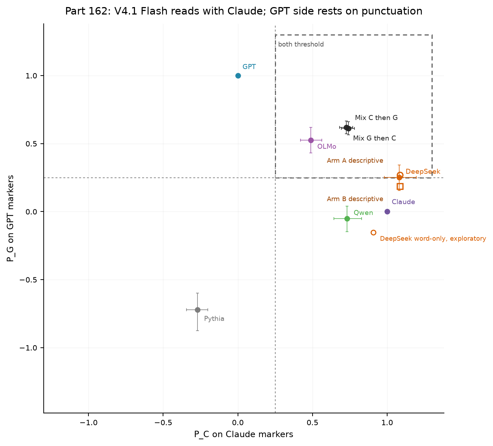

# Part 162: V4.1 Flash reads with Claude on masked habits; its GPT side rests on punctuation

On 113 prompts, DeepSeek's Claude-side position is about 1 and stayed 0.94 to 1.12 across all 14 variants. Its GPT-side estimate is 0.251, only 0.0007 above the 0.25 bar, with a 0.15 to 0.34 interval. Word-only markers give -0.15 [-0.55, 0.12], punctuation-adjusted gives -0.03, and removing em-dash markers gives 0.19. Markdown accounts for 57% and em dashes 31% of the GPT-side numerator. The point estimate alone supports 162.1. The evidence supports a Claude-side reading, not a GPT-side reading beyond punctuation and layout. A reading of neither family is not supported either: DeepSeek sits far from Pythia and at Claude's end.

| Variant | Gate 1 | Gate 2 | Gate 3 | 162.1 readable | DeepSeek P_C | DeepSeek P_G |
|---|---|---|---|---|---:|---:|
| Registered | pass | pass | pass | yes | 1.080 [0.980, 1.195] | 0.251 [0.154, 0.343] |
| Top 50 markers | pass | fail | pass | no | 1.118 [1.018, 1.238] | 0.298 [0.200, 0.396] |
| Top 200 markers | pass | pass | pass | yes | 0.939 [0.847, 1.053] | 0.200 [0.110, 0.287] |
| Top 500 markers | pass | fail | pass | no | 0.948 [0.724, 1.252] | 0.073 [-0.097, 0.231] |
| 60-word cut | fail | pass | pass | no | 1.070 [0.955, 1.197] | 0.193 [0.083, 0.292] |
| 80-word cut | pass | pass | pass | yes | 1.085 [0.980, 1.210] | 0.239 [0.144, 0.332] |
| All six answered | pass | pass | pass | yes | 1.027 [0.918, 1.144] | 0.274 [0.184, 0.361] |
| 1-grams only | pass | fail | pass | no | 0.969 [0.798, 1.157] | 0.131 [-2.956, 2.150] |
| 2- and 3-grams | pass | fail | pass | no | 1.009 [0.897, 1.146] | 0.211 [0.104, 0.314] |
| Minimum rate 0.2 | pass | fail | pass | no | 0.941 [0.842, 1.062] | 0.248 [0.138, 0.355] |
| Fold seed 163 | pass | pass | pass | yes | 1.062 [0.963, 1.177] | 0.252 [0.161, 0.343] |
| Fold seed 2024 | pass | pass | pass | yes | 1.086 [0.990, 1.201] | 0.261 [0.171, 0.348] |
| Arm A, quotes normalised | fail | fail | pass | no | 1.086 [0.964, 1.237] | 0.270 [0.150, 0.385] |
| Arm B, plus no em-dash markers | fail | fail | pass | no | 1.086 [0.964, 1.237] | 0.187 [0.061, 0.311] |

162.1 is held by its point estimate in four of the 14 variants, and those four pass the gates needed to read it. The registered scorer originally marked all five predictions untestable when Qwen failed Gate 4. Amendment 1 changed that rule after the first score. Under the amended rule, Gate 4 affects Qwen's 162.2 only. The table reports the resulting verdicts, but the interpretation depends on that post-score amendment.

## Registered predictions

| # | Registered prediction and confidence | Result | Verdict |
|---|---|---|---|
| 162.1 | DeepSeek reads as both (medium) | P_C 1.080; P_G 0.251, interval 0.15 to 0.34 | held |
| 162.2 | Qwen P_C exceeds P_G by at least 0.1 (medium) | 0.732 vs -0.052 | untestable |
| 162.3 | DeepSeek P_C exceeds P_G (low) | 1.080 vs 0.251 | held |
| 162.4 | DeepSeek median held-out P(Claude) is 0.3 to 0.7 (low) | 0.600 | held, uninformative |
| 162.5 | OLMo P_G exceeds P_C (low) | 0.524 vs 0.488 | held |

The 162.1 margin is 0.0007. The pre-amendment scorer gave all five predictions untestable. Amendment 1 was written after the first score. Arm B's DeepSeek P_G is 0.187. For 162.4, every model's median classifier score is between 0.53 and 0.60, inside the 0.3 to 0.7 band. Its held verdict carries no information. OLMo's P_G interval is 0.430 to 0.618 and its P_C interval is 0.421 to 0.562. Gate results are 0.934 accuracy for Gate 1, mixture positions 0.734 and 0.615 for Gate 2, and Pythia positions -0.270 and -0.721 for Gate 3. Pythia's one dropout reached the cap. Gate 4 coverage was 96/113 for Qwen, 113/113 for OLMo, and 112/113 for Pythia.

## Gate 2 calibration

These are the two answer orders, averaged per prompt at each GPT share, scored on Gate 2's marker sets.

| GPT text share | P_C | P_G |
|---:|---:|---:|
| 10% | 0.949 | 0.040 |
| 20% | 0.901 | 0.213 |
| 25% | 0.867 | 0.312 |
| 35% | 0.821 | 0.462 |
| 50% | 0.741 | 0.611 |

A P_G of 0.25 corresponds to about one fifth to one quarter GPT text on this curve. DeepSeek's P_C sits above the curve, so it is not a blend of these two on this measure. At Gate 2, the registered 50/50 mixture margin was 0.016: P_C 0.734 versus P_G 0.615. Presence is not additive across halves. At 25% GPT text, positions were 0.867 and 0.312, not 0.75 and 0.25. The mixture curve shows the measured presence response directly.

## Marker features

Markers include apostrophes and double quotes, curly quotes, dashes, markdown and line structure, other punctuation, punctuation-bearing patterns, and word-only patterns. Bare list digits belong to markdown and line structure. The 1-gram row must never be read as a position result: its denominator is unstable, with intervals from -2.956 to 2.150 for GPT-side DeepSeek and -6.205 to 5.381 for Qwen. The word-only and punctuation-adjusted diagnostics above are exploratory.

| Marker kind | Claude-side entries | P_C | Gap | GPT-side entries | P_G | Gap |
|---|---:|---:|---:|---:|---:|---:|
| Apostrophe or double quote | 126 | 1.208 | +0.043 | 0 | n/a | n/a |
| Curly quote | 0 | n/a | n/a | 70 | n/a | +0.015 |
| Dash | 0 | n/a | n/a | 16 | 1.111 | +0.370 |
| Markdown and line structure, including bare list digits | 81 | 0.746 | -0.072 | 177 | 0.344 | +0.062 |
| Other punctuation | 11 | 1.810 | +0.277 | 5 | 1.176 | +0.177 |
| Punctuation-bearing patterns | 61 | 1.870 | +0.094 | 98 | n/a | +0.017 |
| Word-only patterns | 221 | n/a | -0.010 | 134 | n/a | -0.011 |

Gaps are DeepSeek minus Claude held-out presence, shown with the selected feature count. An n/a position is omitted because the absolute gap is under 0.02 or the marker set is empty. The masker can leave the artifact `doRB'RB` when it tags a contraction.

## Typography and punctuation

Across the 113 full answers, curly-quote character counts were GPT 425, DeepSeek 55, Pythia 33, OLMo 6, Claude 0, and Qwen 0. Em-dash counts were DeepSeek 343, GPT 175, Qwen 9, Claude 1, OLMo 1, and Pythia 0. Thus the em-dash markers record that Haiku 5.5 almost never writes one. DeepSeek writes them about twice as often as GPT. Older Claude models wrote em dashes heavily: Opus 5 at 15.2 per 1,000 words against Opus 5.5 at 0.8, from a chart Elise shared on 2026-09-27 and recorded in the Journal's terminology file, not in this repo.

The paired DeepSeek-minus-Claude presence gap on Claude markers is +0.013, interval -0.005 to 0.030. It does not establish P_C above 1. Excluding parentheses gives P_C 1.010. The GPT-side numerator is 57% markdown and line structure and 31% em dashes. Marker presence on punctuation-bearing patterns gives P_G 0.145; word-only patterns give -0.152 [-0.550, 0.117]. After punctuation count adjustment, P_G is -0.031 [-0.158, 0.098]. These are exploratory readings.

## Limits

Claude here is Haiku 5.5. GPT is gpt-6-luna. This measures habits and cannot identify their cause. The markers are apostrophes and quotes, dashes, parentheses, markdown, and punctuation-bearing patterns, plus word patterns. Gate 3 is a weak control. Pythia differs in genre as well as date. The measure reads only 100 words of an opening from one prompt set. The chart's model ran at max effort. Stored DeepSeek answers record zero reasoning tokens, so the configurations differ.

## Provenance

Part 162 was registered in commit `a000707`. Commit `52b4cfa` registered Part 162b and Amendment 1, which changed the scorer to keep unaffected predictions readable after Qwen failed Gate 4. Commit `d287bdd` changed Part 162b's size line to report two scoring runs, about one minute, and no generations. The Part 162 code was committed as `acf6c98`. The launch record is [launch.jsonl](launch.jsonl), timestamped 2026-10-31 19:10:32. Before launch, code review found and fixed four build defects: a crash on mixture scoring, lost newlines when cutting, added special tokens on rendered chat prompts, and OLMo `token_type_ids` passed to generation.

The answers are in [answers.jsonl](answers.jsonl). The registered method is [PART162-DESIGN.md](../../PART162-DESIGN.md), including Amendment 1. The scorer output is [score.json](score.json). [extra162.py](extra162.py) recomputes the marker-kind and exploratory diagnostics and prints them to [extra162.json](extra162.json).

Cold check: Haiku 5.5, 2026-10-31, recomputed every number and found them correct with no leakage, ran 14 variants, and corrected the reading: 162.1 is point-estimate-only, the GPT side rests on punctuation and layout, and the Claude-side excess is not established.
