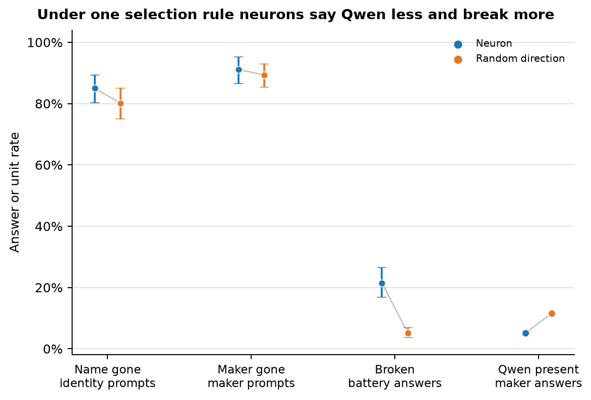

# Part 163: under one selection rule neurons still say Qwen less, and they break far more often

**Update (2026-11-09):** [Part 200](../part200/README.md) reran this part on the eager attention kernel (Part 178 found the default SDPA kernel used here leaves a float32 reference past 64 keys), with push batches in chunks of 8. All three gates passed, though gate 1's changed share fell from 0.88 to 0.75 (neuron) and 0.71 (random) against its 0.70 floor, and the five verdicts came out as below (163.4 and 163.5 were the live ones). Neurons still said Qwen less on maker phrasings (16 of 514 against 40 of 632) and broke more often (387 against 103 of 1,600). On eager most answers ran to the 80-token cap (1,020 and 912, against 124 and 218 below) and most broken answers were at the cap, so the broken counts below describe shorter answers. Answers generated one row at a time differed from the chunked ones in 76 of 200.

With Part 161's case-sensitive `\bQwen\b` rule on maker phrasings, broken answers and Alibaba, Tongyi or 通义 answers excluded, neurons said Qwen in 19/539 answers (3.5%) and random directions in 57/661 (8.6%). The neuron/random ratio was 0.41 (unit-clustered 95% interval 0.15 to 0.78). Part 161's +0.8 ratios were recomputed from the saved rows below. The rates are small, and this comparison was not registered. Whole-battery breakage was 21.4% for neurons and 5.2% for random directions, as described in [Broken answers](#broken-answers).

## Predictions

| # | Prediction | Result | Verdict |
| --- | --- | --- | --- |
| 163.1 | Neuron name-gone rate on identity prompts is under 1.5 times random | 0.850 vs 0.801; ratio 1.061, interval 0.985 to 1.148 | held |
| 163.2 | Neuron maker-gone rate on maker prompts is under 1.5 times random | 0.912 vs 0.893; ratio 1.024, interval 0.970 to 1.077 | held |
| 163.3 | Each arm's name-gone rate on identity prompts is at least 0.15 | 0.850 neuron, 0.801 random | held |
| 163.4 | Fewer units reach both gone on at least half of identity prompts than reach name gone on at least half | neuron 90 vs 91; random 83 vs 86 | held |
| 163.5 | Neuron broken rate is below random | 0.214 vs 0.052 | failed |

The intervals are unit-bootstrap 95% intervals. Score rates exclude broken answers and average each unit's rate. Ratios resample matched pairs. Predictions 163.1 and 163.2 could not fail: the random name-gone rate was 0.801 and the maker-gone rate was 0.893, so neither neuron rate could reach 1.25 times the random rate. Prediction 163.3 had a 0.15 bar far below both observed identity rates, near 0.80. Prediction 163.4 holds nearly by construction because both-gone is a subset of name-gone. The registered verdicts stay as scored, but these tests did not test the intended distinctions.

## Gates

| Gate | Result | Detail |
| --- | --- | --- |
| Recipe | passed | Changed-answer share was 0.88 in each arm, above 0.70. |
| No push | passed | Qwen appeared on 8 of 8 identity prompts. Alibaba or Tongyi appeared on 8 of 8 maker prompts. |
| Rows | passed | All 3,416 expected rows were present, unique, and nonempty. There were 100 units per arm. |

## Name rule sensitivity

The registered name rule treats an answer as name-gone when it contains none of Qwen, Tongyi, 通义, or 千问. Counting Qianwen as kept gives rates 0.847 for neurons and 0.774 for random directions; ratio 1.095 (1.012 to 1.188), 99 pairs.

A first-sentence Q-initial name rule gives 0.575 vs 0.508 (ratio 1.133, interval 0.995 to 1.295); treating Q-initial names as kept moves the base rates from 0.850 to 0.575 and 0.801 to 0.508. The broader rule counts Q plus digits, Q alone, and Qian, Qiao, or Qiang words. A first-sentence-only base name rule gives 0.888 vs 0.859 (ratio 1.034, 0.981 to 1.090). A first-sentence-only Q-initial rule gives 0.610 vs 0.556 (ratio 1.097, 0.984 to 1.225).

## Broken answers

Part 86 triage first keeps answers with a known identity or an assistant or model self-description in the first sentence. Otherwise it marks answers broken if there are fewer than four words or a three-word sequence repeats at least three times. On the 16-prompt battery, 343 of 1,600 neuron answers and 83 of 1,600 random answers were broken. Repeated sequences accounted for 329 and 83; too few words accounted for 14 and zero.

| Arm | Units with no broken answers | Units at least half broken | Units with any broken answer |
| --- | ---: | ---: | ---: |
| Neuron | 32/100 | 18/100 | 68/100 |
| Random | 54/100 | 1/100 | 46/100 |

The neuron breaks are spread across 68 units, with 18 at or above half broken. Random breaks are spread across 46 units, with one at or above half. Answer length is not the cause: random answers average 59 tokens versus 55 for neurons, and 14% versus 8% reach the 80-token cap. Triage misses some hand-judged nonsense. In a seeded sample, 13 of 15 sampled broken answers were clear loops; 17 of 20 in our own sample looked genuinely broken.

| Layer | Neuron broken | Random broken |
| ---: | ---: | ---: |
| 19 | 0/32 (0.0%) | 1/32 (3.1%) |
| 20 | 8/16 (50.0%) | 0/16 (0.0%) |
| 21 | 46/192 (24.0%) | 3/192 (1.6%) |
| 22 | 68/272 (25.0%) | 10/272 (3.7%) |
| 23 | 80/320 (25.0%) | 19/320 (5.9%) |
| 24 | 92/480 (19.2%) | 33/480 (6.9%) |
| 25 | 27/208 (13.0%) | 15/208 (7.2%) |
| 26 | 22/80 (27.5%) | 2/80 (2.5%) |

Rates vary by layer in these stored rows. The data support these descriptions, but not a controlled layer relation. Part 86 stored random write norms average 19.857 at 0.8 times the median; stored neuron norms span 19.74 to 19.98.

The registered exclusion drops a pair when an arm has no unbroken answer for that prompt kind. One pair lacked an unbroken identity answer, so 99 pairs entered the name ratio; two lacked an unbroken maker answer, so 98 entered the maker ratio. Across all 100 pairs, counting broken answers as gone gives name and maker ratios 1.082 (1.012 to 1.162) and 1.031 (0.983 to 1.083). Counting them as not gone gives 0.895 (0.811 to 0.983) and 0.819 (0.739 to 0.899).

Additional fragility checks on the identity name ratio: Qianwen kept 1.095 (1.012 to 1.188); Q-initial kept 1.133 (0.995 to 1.295); first sentence only 1.034 (0.981 to 1.090); first sentence plus Q-initial 1.097 (0.984 to 1.225). When neither unit in a pair had any broken battery answer, the ratio was 1.127 (0.857 to 1.524), 15 pairs; when neither had a broken identity answer it was 1.009 (0.885 to 1.165), 37 pairs. Layers 22 to 24 gave 1.043 (0.963 to 1.134), 66 pairs. The leave-one-pair-out jackknife ranged from 1.050 to 1.073, with SE 0.041. A fresh neuron draw moves the ratio about 0.03, based on unit variance.

## Name and maker together

Among unbroken identity answers, name gone with maker still present occurred in 9 of 646 neuron answers (1.4%) and 18 of 763 random answers (2.4%). Maker gone with the name still present occurred in 83 of 646 neuron answers (12.8%) and 136 of 763 random answers (17.8%). These outcomes are asymmetric: the maker often disappears while the name remains, while the reverse is rare. On maker prompts, both were gone in 511 of 611 neuron answers (83.6%) and 585 of 754 random answers (77.6%).

## Recipe check

Regenerated Part 163 answers shared the first 12 words with their stored answers at mean 0.99 for random units, versus 0.22 for a different unit. Random directions changed only 2.4% of the time in the screened layers, so Gate 1's 0.88 changed share is far above chance. Medians match for all 17 layers. The sha256 check against Part 86 traces was inconclusive.

## Rates by layer

These are the layers with at least eight matched pairs. Rates use the registered broken-answer exclusion.

| Layer | Pairs | Neuron name gone | Random name gone | Neuron maker gone | Random maker gone |
| ---: | ---: | ---: | ---: | ---: | ---: |
| 21 | 12 | 0.753 | 0.537 | 0.843 | 0.759 |
| 22 | 17 | 0.850 | 0.754 | 0.992 | 0.831 |
| 23 | 20 | 0.860 | 0.779 | 0.915 | 0.963 |
| 24 | 30 | 0.906 | 0.935 | 0.961 | 0.947 |
| 25 | 13 | 0.913 | 0.902 | 0.931 | 0.952 |

## Company names

The score file records 78 Google mentions in neuron answers and 117 in random answers. After excluding broken answers, these are 78/1,257 (6.2%) and 117/1,517 (7.7%) per answer. The random arm has more mentions by count and per-answer share. This company comparison was not registered.

## Hand reading

The 80 supplied answers were reread. `clear` means coherent with no repeated phrase or invented entity. `flawed` means interpretable but has a repeated phrase, an invented entity, or both. `nonsense` means repetition or garbling makes the answer hard to follow. The `flaw` field is `none`, `repeated phrase`, `invented entity`, or `both`. The labels were 11 clear, 55 flawed, and 14 nonsense. Reasons contain five words. Labels are a subjective reading.

A seeded sample of 20 neuron answers marked broken by triage was also read. Seventeen looked genuinely broken by repetition or incoherence; three were readable despite the rule. Each sample row is marked `seed163_neuron_broken_battery` and includes `is_really_broken`. The sample is not a second-reader agreement check.

## What this says about Parts 161 and 86

Measured with the same case-sensitive Qwen rule and exclusions, Part 163 maker-only answers give neurons 19/539 (3.5%) and random directions 57/661 (8.6%), ratio 0.41 (0.15 to 0.78). Part 161's reliable memberships at their picked doses had 98/600 neuron and 339/792 random Qwen matches, ratio 0.38 [Part 161](../part161/README.md). Recomputed at +0.8 on these same eight maker phrasings, Part 161's ratio is 0.70 pooled and 0.66 unit mean; on all 24 phrasings it is 0.67 pooled and 0.68 unit mean. On those eight phrasings, Part 161 breakage is 2/136 neuron answers (1.5%) and 15/360 random answers (4.2%). Part 163 maker-only breakage is 189/800 (23.6%) and 46/800 (5.75%) [maker-only counts](#broken-answers). The random arms agree more closely; the neuron arms differ because Part 161 used coherent-persona atlas units and Part 163 used changed-answer units. These are similar gaps, not the same measurement. Part 161 selected at 0.6 and 1.0 under a company rule. Part 163 selected at 0.8 under a change rule. Selection used 48-token answers; this battery used 80 tokens.

Part 86's layer-22 screen found coherent personas in 2.71% of neurons and 0.59% of random directions before selection. Part 163 conditions on answers changed by the selection rule. The two results do not conflict.

## Limits

Selection came from one question at +0.8, and the battery has 16 phrasings. The 100 neuron picks are one seeded draw from a larger pool. The word rules can miss alternate names and can count a passing mention. Hand labels are subjective. The Qwen comparison was chosen after the data.

## Build note

Before launch, the scorer had a point-estimate defect. The fix left 163.1 and 163.2 unable to fail because their bars were too high. The first scorer never reached git.

## Provenance

The design and prediction were registered in commit `8fea8f0`. The size line is in `450f62b`. Commit `e01e8ec` contains the Part 163 runner, scorer, selection code, and tests. `launch.jsonl` records the run started at 20:03:43 CT on 2026-10-31. `score.json`, `answers.jsonl`, `hand_read.jsonl`, and this write-up are the saved results. `extra163.py` prints the added summaries from the stored answers and score. `plot163.py` builds the figure from `score.json`.

Cold check: Haiku 5.5, 2026-10-31, recomputed the registered numbers, found 163.1 and 163.2 could not fail, and found the Qwen gap survives on Part 161's measure.
Corrected 2026-10-31: the Part 161 ratios were a typed figure; the computed values are given above.
