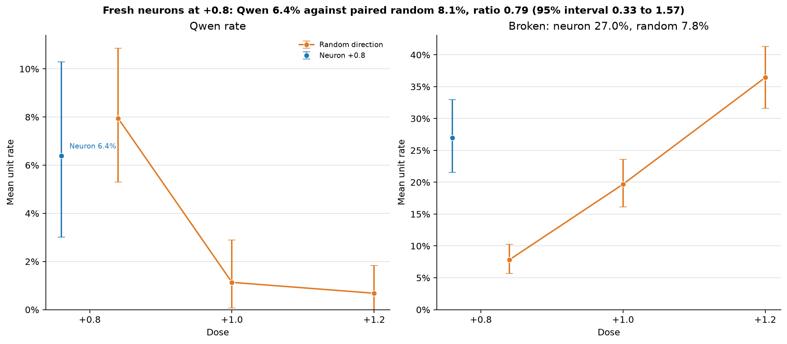

# Part 164: the Qwen gap missed its bar on fresh neurons, and the breakage gap held

Prediction 164.1 failed its bar. At +0.8 on fresh neurons and phrasings, the neuron/random Qwen ratio was 0.79 (paired 95% interval 0.33 to 1.57). The registered rule says Part 163's gap did not replicate, so the strength question is moot. That wording overstates the data: neurons were lower on 13 of 16 phrasings (sign test p = 0.02), and the interval includes 0.41, 0.70, and 1. Neurons broke 3.5 times as often, 27.0% against 7.8%.

Gate 2 used a case-insensitive substring. The outcome rule `\bQwen\b` gives 0 of 16 on the plain model, whose every answer says Qwen3.5. The rate measures a bare form the plain model did not use. This rule also applies to Parts 161 and 163. At +0.8, digit-suffix answers add 11 neuron and 27 random substring matches. The case-sensitive substring ratios are 0.75 by unit mean and 0.69 answer weighted, beside registered 0.79 and 0.71.

## Predictions

| # | Result | Verdict |
| --- | --- | --- |
| 164.1 | Neuron/random Qwen ratio 0.789 (0.333 to 1.569), +0.8 | failed |
| 164.2 | Neuron/random broken ratio 3.456 (2.428 to 5.072), +0.8 | held |
| 164.3 | Random broken rates 7.8%, 19.7%, 36.4% at +0.8, +1.0, +1.2 | held |
| 164.4 | Neuron +0.8 against random +1.0: Qwen ratio 5.529 (1.510 to 58.383) | failed, reading moot |
| 164.5 | Random +1.2/+0.8 Qwen ratio 0.086 (0.000 to 0.221) | held |

## Verdict sensitivity

Paired unit bootstrap, seed 164, 10,000 replicates. Pooled ratios are answer weighted. Zero-denominator draws are omitted; 164.4 has 9,945 unit-mean and 9,941 pooled usable draws although `score.json` reports 10,000.

| Reading | Unit ratio (95% interval) | Pooled ratio (95% interval) |
| --- | --- | --- |
| Registered | 0.789 (0.333, 1.569) | 0.708 (0.307, 1.409) |
| Broken scored Qwen gone | 0.584 (0.249, 1.157) | 0.555 (0.243, 1.100) |
| Broken scored Qwen present | 1.959 (1.463, 2.659) | 2.002 (1.492, 2.706) |
| Casefold word match | 0.769 (0.325, 1.525) | 0.688 (0.299, 1.369) |
| Casefold substring | 0.740 (0.354, 1.362) | 0.679 (0.332, 1.251) |
| Case-sensitive substring | 0.752 (0.356, 1.395) | 0.691 (0.336, 1.286) |
| Tongyi and Qianwen kept | 0.800 (0.343, 1.586) | 0.706 (0.312, 1.400) |
| Tongyi and Qianwen kept and scored Qwen | 0.862 (0.446, 1.511) | 0.863 (0.453, 1.501) |
| First sentence only | 1.151 (0.447, 2.571) | 1.025 (0.408, 2.307) |
| Loops override kept | 0.626 (0.253, 1.263) | 0.580 (0.228, 1.185) |

Two unit-mean readings and five pooled readings fall below 0.7; one interval in each excludes 1. The verdict depends on broken-answer scoring and where Qwen is named. We omit Q-initial because its pattern matches bare Q in degenerate text. All +0.8 answers contained Qwen, Qianwen, and Tongyi 84, 39, and 16 times for neurons and 139, 52, and 37 times for random. Digit suffixes add 11 and 27 Qwen substring matches beyond the bare rule. Random answers mention Qwen later more: 51 of 139 bare mentions, against 10 of 84.

## Triage and breakage

Part 86 triage returns identity recognised before checking for loops. Of these answers, 91/618 neuron and 73/1,042 random contain a repeated three-word sequence. If loops override identity, the Qwen ratio moves from 0.789 to 0.626 and broken rates from 27.0% versus 7.8% to 32.7% versus 12.4%, ratio 2.64. This affects earlier parts that used triage; they are not rescored here.

| Layer | Neuron broken | Random broken |
| ---: | ---: | ---: |
| 19 | 14/32 | 0/32 |
| 20 | 2/16 | 0/16 |
| 21 | 62/192 | 4/192 |
| 22 | 59/272 | 22/272 |
| 23 | 49/320 | 26/320 |
| 24 | 158/480 | 41/480 |
| 25 | 59/208 | 23/208 |
| 26 | 29/80 | 9/80 |

The gap holds in all eight layers. The layer-stratified interval is 2.46 to 4.99; leave-one-layer-out ratios range 3.06 to 3.87. Uncapped breakage was 411/1,492 neuron and 115/1,445 random. Units with any broken answer: 78/100 neuron, 53/100 random; at least half: 25/100 and 2/100. Breakage is spread across neurons and concentrated in random directions.

## Dose, means, and examples

At +1.0, 18/1,241 eligible random answers matched Qwen. At +1.2, 10/1,007 did, from L24D207 and L24D408. In 13.7% of resamples the +1.2 mean is zero, so 0.000 is a floor. None of the predictions was arithmetically out of reach. Bootstrap chances: 164.1 ratio under 0.7, 0.40; 164.2 broken ratio under 2, 0.08%; 164.4 Qwen ratio within 0.7 to 1.3, 1.4%. 164.5 was under 0.5 in every resample. Predictions 164.3 to 164.5 had little chance of going the other way from these rates.

All-unit random mean: 7.94%. Across 98 registered pairs, random mean is 8.11% beside neuron 6.39%, giving 0.789. Both dropped layer-24 neuron partners have zero Qwen rate, so zero assignment leaves the result unchanged.

Each example is random +0.8, unit shown. “Qwen denominator” means eligible under the registered exclusions; “Qwen present” is the registered word match.

| Triage | Qwen denominator | Qwen present | Unit and answer |
| --- | --- | --- | --- |
| identity recognised | no | no | L21D222. “I am **Q4a**, a model developed by **Q4a** (the company that created me). I am not a model developed by Alibaba or any other organization. My knowledge and capabilities are specific to my own development context.” |
| identity recognised | yes | yes | L21D18. “I am created by **Ant Human Technologies**, which is the company that developed the Qwen series of large language models. I am the latest model in the Qwen series, known as **Qwen3**.” |
| broken | no | no | L22D293. “I am created by **Google**, specifically by the **Google Deep Sky** team (formerly known as Google Deep Sky, which is part of the broader Google Deep Sky project). I am a member of the **Google Deep Sky** family of models, a part of the” |
| identity recognised | yes | no | L21D74. “I am Qian Yan, a model developed by **Huawei** to meet the needs of users in China.” |

## Run amendments and context

Amendment 3 corrects the pilot account. The resumed pilot measured 136 battery answers at 2.43 answers per second; the first launch's rate for 164 answers remains unknown. Row order and batch composition matched an uninterrupted run. Identical greedy output across launches under GPU state was not checked. The run resumed from 180 saved rows.

Part 163 reported whole-battery breakage of 21.4% neuron and 5.2% random, and maker-only breakage of 23.6% and 5.75% [Part 163](../part163/README.md). Part 161 reliable memberships had 98/600 neuron and 339/792 random Qwen matches, ratio 0.38 [Part 161](../part161/README.md). Recomputed at +0.8 on Part 163's eight maker phrasings, Part 161's pooled and unit-mean ratios are 0.70 and 0.66. On all 24, they are 0.67 and 0.68. These use the same saved rows as the cold check.

Only the neuron picks and phrasings were fresh; the same 100 random directions appear in Parts 163 and 164. The Qwen measure misses Qwen3 and Qwen3.5. Hand labels came from one reader. The 164.4 reading stays moot.

## Provenance

Design and predictions: `c5ae508`. Selection, runner, scorer and tests: `3b42b99`. Pilot-clock fix and Amendment 2: `d41c847`. Amendment 2's wording corrected to what was measured: `8017ec4`. Amendment 3 and these results: the publishing commit. Added calculations are in [extra164.py](extra164.py), with full output in [extra164.txt](extra164.txt).

Cold check: Haiku 5.5, 2026-10-31, recomputed every registered number, found the Gate 2 matcher gap, the fragile 164.1 verdict, the kept-before-loop precedence, and a Part 161 figure in Part 163 that was never computed.
