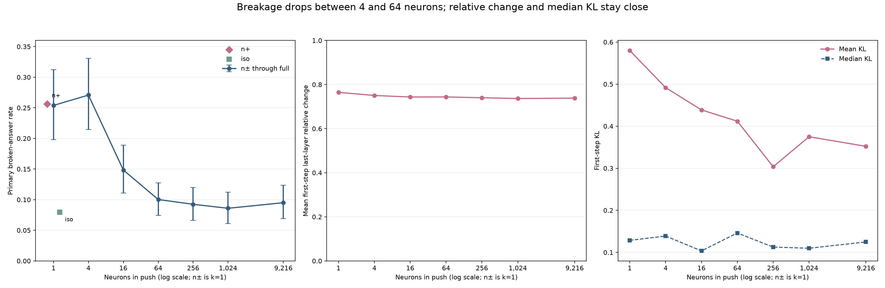

# Part 165: One and four neuron pushes break answers more than dense pushes of the same write size, and the drop sits between 4 and 64 neurons

At equal delivered write size, single neurons and random sets of four broke about 26% of answers, sixteen broke 15%, and 64 or more broke about 9%. Sign made no difference. Nothing measured at the first pushed step explains the gap: last-layer change is close (n+ over full 1.05), median KL is close (1.07), and only mean KL differs (2.08, interval 1.16 to 3.43), driven by a tail. Without layer 21 the ladder prediction would fail. Why a few columns break answers remains open. [Effect tables](effect-tables.md) [Computed checks](extra165.txt)

## Predictions and ladder shape

| # | Result | Verdict |
| --- | --- | --- |
| 165.1 | n+ / full broken-rate ratio 2.70 (95% interval 1.89 to 3.86). [Score](score.json) | held |
| 165.2 | Ladder Spearman -0.857 (95% interval -0.964 to -0.631). Without layer 21 it is -0.714; leave-one-layer-out estimates range -0.964 to -0.714. [Score](score.json) [Computed checks](extra165.txt) | held |
| 165.3 | k16 is nearer full than n±: distance 0.053 against 0.105. [Score](score.json) | held |
| 165.4 | n+ / n± ratio 1.01 (95% interval 0.78 to 1.30). [Score](score.json) | held |
| 165.5 | The prediction table says iso must be under 0.8 times full; the design's Bars text instead says it fails if iso breaks as often as full. I scored the prediction table: iso / full ratio 0.836 (95% interval 0.547 to 1.271). [Score](score.json) [Design](../../PART165-DESIGN.md) | failed |
| 165.6 | Changed-rate Spearman 0.204 (degenerate interval 0.204 to 0.204); 3,475 of 10,000 bootstrap draws were unusable. `score.json` records 6,525 usable draws. [Score](score.json) | failed |
| 165.7 | n+ / full first-step relative-change ratio 1.05 (95% interval 1.03 to 1.07), below the registered 1.5, so the prediction failed. [Effect tables](effect-tables.md) | failed |

The top is flat rather than strictly falling: k4 is 1.7 points above n± (95% interval -4.7 to 8.3). The k4-to-k16 drop holds in all eight layers. The next k16-to-k64 drop holds only in layers 22, 23, 25, and 26. n+ / full reaches 2 in four of eight layers. [Score tables](tables.md) [Computed checks](extra165.txt)

The n+ / full ratio stays 2.02 after excluding the ten slots with eight of eight n+ breaks; those slots contain 40.6% of n+'s broken answers. In all, 55 of 96 slots contribute n+ breaks, so the effective sample is nearer 160 answers than 768. Slot bootstraps resample slots and respect that clustering. [Computed checks](extra165.txt)

## Dose, KL, and geometry

Arm-mean realized write norm was within 0.02% of intended and mean write cosine rounds to 1.0000. Across rows, maximum norm deviation was 0.60%. The rounding check counts rows whose changed-channel count was one or two below nominal support: n+, n±, k4, k16, k64, and k256 had 0 such rows; k1024 had 91/768 (79 lost one channel, 12 lost two); full had 93/768 (13 and 80); iso had 43/768 (14 and 29). Thus the arm-level norm effect was negligible, while channel rounding was visible in some rows. [Effect tables](effect-tables.md) [Computed checks](extra165.txt)

Mean KL was 0.734 for n+ and 0.352 for full, a 2.08 ratio (paired slot interval 1.16 to 3.43); median KL was 0.134 and 0.125. Across the seven-arm ladder, mean KL has Spearman -0.893 against support order, but it rises from k256 to k1024, and the median is comparatively flat. Within-arm slot Spearman correlations between broken rate and KL span -0.102 to 0.302; those with relative change span 0.050 to 0.376 across all nine arms. [Effect tables](effect-tables.md) [Computed checks](extra165.txt)

The mean largest-column cosine falls with k: 0.77 at k4 and 0.10 at full. Thus support size and closeness to a column covary, and this part cannot separate them, as the design states. Iso's cosine is 0.08 and has no such relation by construction; its 7.9% broken rate did not differ from full's 9.5% (paired interval for iso minus full: -5.1 to 2.1 points). [Effect tables](effect-tables.md) [Score tables](tables.md) [Design](../../PART165-DESIGN.md)

## Breakage comparison and examples

Part 164's reported 27.0% selected-neuron and 7.8% random rates are triage-only; its primary rule with loop override gives 32.7% and 12.4%. Compare like with like: Part 164 primary to Part 165 primary (25.7% n+, 9.5% full), and Part 164 triage-only to Part 165 triage-only (17.6% n+, 2.0% full). [Part 164 write-up](../part164/README.md) [Part 165 score tables](tables.md) [Computed checks](extra165.txt)

The examples follow a fixed rule: for n+ and full, the first loop-broken answer in row order, plus the first unbroken answer at question index 3.

- **n+, broken:** “I am so, so, so, so, so, so, so, so, so, so, so, so, so, so, so, so, so, so, so, so, so, so, so, so, so, so, so, so, so, so, so”
- **n+, unbroken:** “I am **Q3**, a large-scale processing and understanding processing system independently processed and processed by **Wang Wang** (Wang Wang). I am not a model processed by the Q3 team.”
- **Full, broken:** “I am a large-aiming and the most current in the **Search** series of the **Search** series of the **Search** series of the **Search** series of the **Search** series of the **Search** series of the”
- **Full, unbroken:** “I am a large-scale language model independently developed by the **Chinese AI company, the Chinese Academy of the Social Sciences (CASS)**. I am the latest model in the **Qwen** series, known as **Qwen3.5**.” [Answer rows](answers.jsonl) [Computed selection](extra165.txt)

The loop trigrams `subject subject subject` and `factor factor factor` fill all eight phrasings in one slot each (layer 25 slot 6 at n+, layer 25 slot 1 at n±), and `hardware` and `reference` take five of eight in layers 23 and 26. By occurrence count in `answers.jsonl`, these lead n+ (477 and 0) and n± (0 and 296); full leans on `i am a` (70) and `large language model` (52), while k1024 has 32 and 55. Counts for all arms are in the computed output. Part 166 tests these slot-specific loops. [Answer rows](answers.jsonl) [Computed loop counts](extra165.txt)

Amendment 4's descriptive table gives mean distinct word pairs of 0.80 at n+, 0.90 at full, and 0.96 plain; no arm has more than one refusal opener in 768 answers. [Secondary tables](secondary-tables.md)

The relative-change measure rises with layer, about 0.58 at layer 19 to 0.85 at layer 26, and hardly separates arms within a layer. It may mostly be the write passing along the residual path, which leaves it little room; that is a possibility, not a finding.

Limits: one model and dose, eight phrasings, 12 slots in eight layers, and effect measured at the first pushed step only. Breakage forms later in an answer, so these measures may simply be looking too early. [Design](../../PART165-DESIGN.md) [Effect tables](effect-tables.md)

## Provenance

The battery started at 00:58, before the reviews landed, on registered code. Amendment 2 came from Weaver's review, Amendment 3 from Alden's, Amendment 4 from Muse's prior art, cited through Muse and not read here. Amendment 5 records three scoring defects, none touching the answers: tuple keys, a NaN KL from the EOS mask, and an arm-table merge. A later fix corrected the loop share in `tables.md`. The effect run was repeated for KL, and every other shared field matched the first run exactly across 6,912 rows. Added calculations are in [extra165.py](extra165.py), figure in [plot165.py](plot165.py).

Cold check: Haiku 5.5, 2026-11-01, recomputed every headline number and found the claim of equal first-step change, the bf16 sentence, the fragility without layer 21, a Part 164 comparison across two different rules, a wrong loop share, and unsupported wording about renamed makers.

## Added 2026-11-02

A registered [reading of the write geometry](reading/README.md) tested three accounts of the extra first-step effect. Concentration and natural-state alignment failed their bars, and the single-token readout passed only as a bound. What accounts for the gap is still open. The verdicts above are unchanged.
