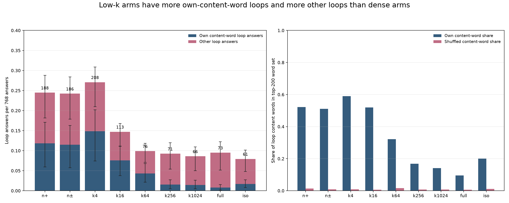

# Part 166: Most of the extra loops from one to four neuron pushes repeat words that push favours

Low-k arms gave 0.166 more loop answers per answer than dense arms. Of that, 0.115 (0.077 to 0.155) are loops whose content word is in the row’s own top-200 bias, and 0.051 (0.020 to 0.082) are others. Loop content words were in the row’s own bias 54.7% of the time, in other slots’ 1.0%, and in the plain model’s top 200 15.3%. This is an association on the data that suggested it. A ban on held-out directions is Part 167. [Computed checks](extra166.txt) [Score](score.json)

## Results

| # | Result | Verdict |
|---|---|---|
| 166.1 | Low-k own / shuffled any-word loop hit ratio 15.46 (95% slot interval 9.95–25.80). [Score](score.json) | held |
| 166.2 | Dense own / shuffled ratio 5.60, above the registered ceiling of 1.5. [Score](score.json) | failed |
| 166.3 | n+ / full steadiness ratio 1.00, below 1.25; designated a build check. [Score](score.json) | failed |
| 166.4 | Sharpness-by-support Spearman −0.714, above the registered ceiling of −0.8; designated a build check. [Score](score.json) | failed |
| 166.5 | Slot broken-rate / sharpness Spearman 0.397 (95% interval 0.27–0.51), held; loop-only correlation 0.388. [Score](score.json) [Computed checks](extra166.txt) | held |
| 166.6 | Low-k content-word own / shuffled ratio 53.14 (95% slot interval 29.06–123.85). [Score](score.json) | held |
| 166.7 | Mean content-word percentile 0.892; 66 of 627 low-k content words had no single-token spelling. [Score](score.json) | held |

The low-k minus dense decomposition is 0.115 own-content-word loops per answer (95% interval 0.077–0.155) and 0.051 other loops (0.020–0.082), from a layer-stratified whole-slot bootstrap. Own-content matches were 11.8%, 11.5%, and 14.8% per answer in n+, n±, and k4, versus 0.8% and 1.7% in full and iso. “Other” means loops without an own content-word match, including stop-word-only matches. [Computed checks](extra166.txt)

The n+ and n± arms are the identical vector in 46 of 96 slots; their Part 166 top-token rows match exactly in 336 of those 368 rows. k4 contains each slot’s n+ neuron. Thus the pooled 582 low-k loops and 192 slots include duplicates. For n+ alone, 166.1 is 13.22 (95% whole-slot interval 7.52–27.76) and 166.6 is 38.70 (15.68–206.72); for k4 alone, 166.1 is 20.66 (11.65–47.14) and 166.6 is 67.76 (30.05–345.86). The intervals resample whole layer/slot clusters. [Computed checks](extra166.txt)

On the design’s any-word measure, own salience 0.613 does not beat plain salience 0.655; 78% of plain hits are stop-only. Any-word hits mostly reflect common words. On content words, own salience does beat plain, 0.547 to 0.153. Dense loops still use their own bias more than shuffled (ratio 5.60), but own rates are lower: 16% in full and 28% in iso, versus 56–67% across low-k arms. [Score](score.json) [Computed checks](extra166.txt)

Gate 3’s forward pass matches Part 165 at one position: the second generated token’s KL, not all positions (Spearman 0.998; median relative difference 4.2%). Gates 1–3 passed. Gate 2’s miss gaps were 0.25 (on the bar) and 0.00. The design said failure of 166.3 and 166.4 would point at the build. Amendment 1 expected both from arithmetic, and neither happened. Weaver’s review is summarised in Amendment 1; it was given in the council channel. The question stays open. [Score](score.json) [Design and amendments](../../PART166-DESIGN.md)

After subtracting each arm’s layer mean, 166.5 Spearman is 0.453 across 192 slots; within-layer/arm correlations range −0.448 to 0.916 (12 slots per stratum). The loop-only correlation is 0.388. This correlation does not separate sharpness from layer-specific effects beyond that. Exploratory word-family concentration, thought of after seeing the data, averages 3.39 for n+, 3.08 for n±, 3.52 for k4, and 4.63 for k16 (the highest arm); slot breakage correlations are 0.261 and 0.159 for n± and k4. [Computed checks](extra166.txt)

## Examples and limits

For each of n+, k4, and full, the example is the most repeated exact loop phrase in the arm that has a content word, with its count, own-row hit, and the first row’s top eight bias words. “i am a” is the most frequent loop overall and contains only stop words.

- **n+:** `subject subject subject`, 8 answers, hit, beside `subject, Subject, SUBJECT, .subject, _subject, sujet`.
- **k4:** `a row of`, 7 answers, hit, beside `row, Row, _row, -row, 行, rows`.
- **full:** `the tianquan model`, 4 answers, miss, beside `模范, ثناء, hid, ampen, Ingen, RIS, Exact, oken`.

 A seed-166 random low-k miss was “i am a” beside `male, males, sexually, sex`. [Examples and seed-166 selection](extra166.txt) [Hits and bias words](hits.jsonl)

The hand read is my judgement: I shuffled the low-k misses in `hits.jsonl` order with `Random(166)` and took the first 40, saved in [hand_read_40.jsonl](hand_read_40.jsonl). I marked 6 clear and 3 marginal. [Design and amendments](../../PART166-DESIGN.md)

With the expanded function-word list (because, so, one, since, there, through), 77 of about 343 own content hits are excluded; the remaining content ratio is 47.2. The n+ own hits come from 29 slots; the top ten contribute 66%. Dropping the ten slots with most loops leaves an any-word ratio of 11.6. Cross-layer donors give ratios of 14.5 for any words and 57.7 for content words. No own content hit is a word in over 25% of rows. Loop words appear in prompts 0 of 627 times and in plain answers 6 of 627 times, so the plain text does not leak them. [Computed checks](extra166.txt)

Unpushed answers are 80 tokens against 40 for the bias path. Only 6 of 192 unpushed answers contain any repeated trigram, against 3,068 of 6,912 pushed answers in Part 165. Temperature-2.0 text is largely incoherent; the zero loop count reflects the sampler, and the 0.0 overlap is vacuous. [Unpushed sample](unpushed.jsonl) [Part 165 score](../part165/score.json) [Computed checks](extra166.txt)

Limits: the same data suggested 166.1; bias was measured on plain text; one model, one dose, eight phrasings; n+ and n± overlap. No matched-control ban has tested causality. Amendments cover build checks, added measures, Gate 3, bootstraps, prior-art review, and the memory guard. [Design and amendments](../../PART166-DESIGN.md) [Plain alignment](plain.json)

## Provenance

Three launches: RAM guard killed the first before rows; the second stopped on missing iso k after three rows and was deleted; the third completed at 31 rows/s with 6,912 rows. [Design and amendments](../../PART166-DESIGN.md) [Run output](run-stdout.txt) [Score](score.json)

Cold check: Haiku 5.5, 2026-11-01, recomputed every headline number with its own code and found that n± repeats n+ on 46 slots, that the any-word result does not beat plain salience, that 166.5 needed its interval, that Gate 3 covers one position, that two examples broke their rule, and that the hand read could not be reproduced. It tried to break the own-word result by dropping slots, using cross-layer donors, widening the stop list and checking for leaks through the plain text, and the result held.
