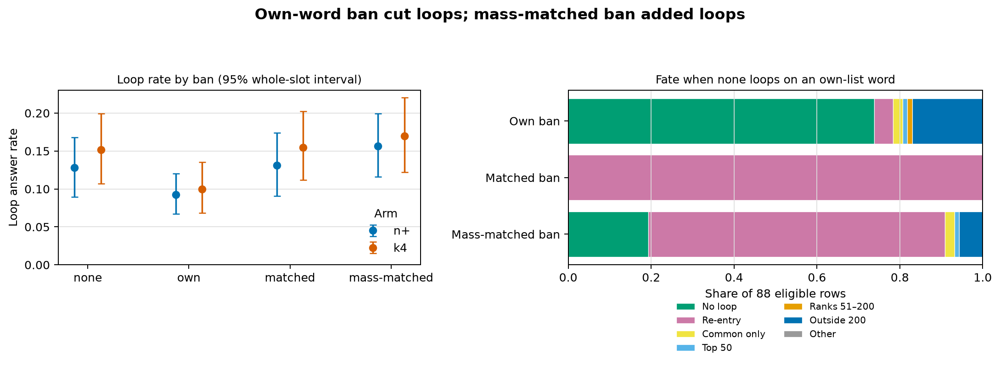

# Banning a push’s own words cut its loops; a mass-matched ban added loops

Banning a push’s own top words cut loops by [31.4%](score.json), with a whole-slot interval of [15.8%–44.9%](score.json), on fresh directions; the neighbour ban cut [−2.1%](score.json) ([168.5](../../PART168-DESIGN.md) held). The own-minus-matched gap was [0.047](score.json), below its [0.05](../../PART168-DESIGN.md) bar, so [168.4](../../PART168-DESIGN.md) failed, and a failed superiority test does not show the two bans are equal. The mass-matched list is a probability-tilted draw calibrated to mean mass on the plain path; it raised loops by [16.5%](score.json), interval [6.3%–29.4%](score.json). Under [Amendment 1](../../PART168-DESIGN.md) this supports an effect of these masking policies. It does not identify how loops form.

## Answer outcomes

| Arm | Ban | n | Loop rate | Broken | Joint success | Mean length | EOS share |
|---|---|---:|---:|---:|---:|---:|---:|
| n+ | none | [672](score.json) | [12.8%](score.json) | [12.9%](score.json) | [87.1%](score.json) | [56.84](score.json) | [90.6%](score.json) |
| n+ | own | [672](score.json) | [9.2%](score.json) | [9.7%](score.json) | [90.3%](score.json) | [57.35](score.json) | [89.6%](score.json) |
| n+ | matched | [672](score.json) | [13.1%](score.json) | [13.2%](score.json) | [86.8%](score.json) | [56.72](score.json) | [90.8%](score.json) |
| n+ | mass-matched | [672](score.json) | [15.6%](score.json) | [15.6%](score.json) | [84.4%](score.json) | [56.39](score.json) | [89.9%](score.json) |
| k4 | none | [672](score.json) | [15.2%](score.json) | [15.6%](score.json) | [84.4%](score.json) | [56.00](score.json) | [90.9%](score.json) |
| k4 | own | [672](score.json) | [10.0%](score.json) | [10.0%](score.json) | [90.0%](score.json) | [56.99](score.json) | [91.7%](score.json) |
| k4 | matched | [672](score.json) | [15.5%](score.json) | [15.9%](score.json) | [84.1%](score.json) | [55.98](score.json) | [91.7%](score.json) |
| k4 | mass-matched | [672](score.json) | [17.0%](score.json) | [17.3%](score.json) | [82.7%](score.json) | [55.79](score.json) | [91.2%](score.json) |
| full | none | [672](score.json) | [5.2%](score.json) | [5.4%](score.json) | [94.6%](score.json) | [59.03](score.json) | [87.8%](score.json) |
| full | own | [672](score.json) | [4.6%](score.json) | [4.8%](score.json) | [95.2%](score.json) | [58.82](score.json) | [88.8%](score.json) |
| full | matched | [672](score.json) | [5.5%](score.json) | [5.7%](score.json) | [94.3%](score.json) | [58.91](score.json) | [88.1%](score.json) |

k4 contains its slot’s n+ neuron, so pooled rows repeat a direction.

## Registered predictions

| Prediction | Result | Verdict |
|---|---|---|
| [168.1](../../PART168-DESIGN.md), own/shuffled content-word ratio | [215.6](score.json) | held |
| [168.2](../../PART168-DESIGN.md), n+ to full broken-rate ratio | [2.42](score.json) | held |
| [168.3](../../PART168-DESIGN.md), own relative loop cut | [31.4%](score.json); interval [15.8%–44.9%](score.json) | held by [1.4 points](score.json); wide interval |
| [168.4](../../PART168-DESIGN.md), own-minus-matched gap | [0.047](score.json) vs [0.05](../../PART168-DESIGN.md); interval [0.022–0.073](score.json) | failed |
| [168.5](../../PART168-DESIGN.md), matched relative cut | [−2.1%](score.json) | held |
| [168.6](../../PART168-DESIGN.md), full cut vs half the low-k cut | [11.4%](score.json) vs [31.4%](score.json) | held, on [35 full-arm none loops](score.json) |
| [168.7](../../PART168-DESIGN.md), migrations vs one-third and baseline | [5.3%](score.json) vs [1.0%](score.json) baseline | failed |
| [168.8](../../PART168-DESIGN.md), paired own vs mass rates | [9.61%](score.json) vs [16.32%](score.json); gap interval [0.042–0.095](score.json) | held |
| [168.W1](../../PART168-DESIGN.md), Weaver’s mass-ban cut | [−16.5%](score.json) | failed, opposite direction |
| [168.W2](../../PART168-DESIGN.md), own-induced vs matched rate | [3.6%](score.json) vs [1.0%](score.json) | held |
| [168.W3](../../PART168-DESIGN.md), migration share | [5.3%](score.json) | failed |

The full-arm sample is too small to separate an [11%](score.json) cut from a [31%](score.json) cut: its relative-cut interval spans [−20% to 36.7%](score.json).

## Sensitivity and loop accounting

The own-ban cut held by a small margin overall and was sensitive to single drops. By layer [19–26](extra168.txt), dropping each layer gave cuts of [31.8%, 33.7%, 34.7%, 32.5%, 30.1%, 21.6%, 33.5%, 31.3%](extra168.txt). By phrasing [8, 9, 10, 11, 12, 14, 15](extra168.txt), dropping each gave [28.5%, 35.5%, 34.2%, 29.8%, 32.0%, 29.4%, 30.3%](extra168.txt); n+ alone was [27.9%](extra168.txt), k4 alone [34.3%](extra168.txt). For [168.8](../../PART168-DESIGN.md), the smallest leave-one-out paired gap was [0.0545](extra168.txt), after dropping layer 24; dropping the [139 repaired rows](extra168.txt) left a gap of [0.0732](extra168.txt).

| Low-k ban | None loops | Ended | Induced | Net removed | Loops left | New share left |
|---|---:|---:|---:|---:|---:|---:|
| Own | [188](extra168.txt) | [101](extra168.txt) | [42](extra168.txt) | [59](extra168.txt) | [129](extra168.txt) | [32.6%](extra168.txt) |
| Matched | [188](extra168.txt) | [7](extra168.txt) | [11](extra168.txt) | [−4](extra168.txt) | [192](extra168.txt) | [5.7%](extra168.txt) |
| Mass-matched | [188](extra168.txt) | [44](extra168.txt) | [75](extra168.txt) | [−31](extra168.txt) | [219](extra168.txt) | [34.2%](extra168.txt) |

Of own’s [42 induced loops](extra168.txt), [40](extra168.txt) hold no own-list word. The fate table below covers only own-word loops: the [88](score.json) rows whose none loop held an own-list word.

| Ban | No loop | Re-entry | Common only | Top 50 | Migration | Outside | Other |
|---|---:|---:|---:|---:|---:|---:|---:|
| Own | [65](score.json) | [4](score.json) | [2](score.json) | [1](score.json) | [1](score.json) | [15](score.json) | [0](score.json) |
| Matched | [0](score.json) | [88](score.json) | [0](score.json) | [0](score.json) | [0](score.json) | [0](score.json) | [0](score.json) |
| Mass-matched | [17](score.json) | [63](score.json) | [2](score.json) | [1](score.json) | [0](score.json) | [5](score.json) | [0](score.json) |

Migration was rare ([1 of 19](score.json)); loops mostly did not move down the same bias, and [15 of 19](score.json) moved outside the top 200. Induced loop rates were own [3.6%](score.json), matched [1.0%](score.json), mass-matched [6.5%](score.json). Under [Amendment 1](../../PART168-DESIGN.md), the mass ban’s rise shows that this control policy did not cut loops; it does not show that Weaver’s concern about list mass was wrong.

Pooled low-k own answers averaged [57.2](extra168.txt) tokens against [56.4](extra168.txt) for none, with EOS shares of [90.6%](extra168.txt) and [90.8%](extra168.txt). The cut does not come with shorter answers or more early stops.

## The mass-matched list

The exponent was above zero in [74.0%](extra168.txt) of rows; its median was [0.114](extra168.txt) for n+ and [0.127](extra168.txt) for k4. Exponent and plain-answer token overlap correlated at [0.701](extra168.txt). The mass list held [1.2](score.json) plain-answer tokens on average, the own list [0.07](score.json).

| Plain-answer overlap | Rows | None-loop rate | Own-loop rate | Mass-loop rate | Mass-induced / rows with no none loop |
|---|---:|---:|---:|---:|---:|
| 0 | [726](extra168.txt) | [7.0%](extra168.txt) | [6.5%](extra168.txt) | [7.3%](extra168.txt) | [9/675](extra168.txt) |
| 1 | [302](extra168.txt) | [12.3%](extra168.txt) | [11.6%](extra168.txt) | [11.9%](extra168.txt) | [11/265](extra168.txt) |
| 2 | [107](extra168.txt) | [15.9%](extra168.txt) | [12.1%](extra168.txt) | [22.4%](extra168.txt) | [14/90](extra168.txt) |
| 3 | [68](extra168.txt) | [30.9%](extra168.txt) | [10.3%](extra168.txt) | [27.9%](extra168.txt) | [7/47](extra168.txt) |
| 4 or more | [141](extra168.txt) | [44.0%](extra168.txt) | [19.1%](extra168.txt) | [61.7%](extra168.txt) | [34/79](extra168.txt) |

This split is post hoc and unregistered. None-loop rate also rises across these bins, from [7.0%](extra168.txt) to [44.0%](extra168.txt), so overlap travels with how hard a push leans on the plain path; the table does not separate them. The earlier guess that the mass list adds loops by blocking the plain answer remains a guess this part did not test.

## Seed spread, position, and limits

The n+ none broken rate was [25.7%](extra168.txt) in Part 165, [22.4%](extra168.txt) in Part 167 ([22.0%](extra168.txt) without phrasing 13) and [12.9%](extra168.txt) in Part 168. Neurons are drawn at random per slot, so these are three draws. Across [96 slots](extra168.txt) the standard deviation of slot rates was [33.5, 30.5 and 21.6 points](extra168.txt); slots at zero numbered [41, 45 and 51](extra168.txt), and slots at or above 0.5 numbered [20, 17 and 7](extra168.txt), which carried [70%, 66% and 45%](extra168.txt) of the rate. Part 165 used phrasings [0–7](../part165/README.md), while Parts 167 and 168 used [8–15](../../PART168-DESIGN.md), with Part 168 excluding 13, so phrasing does not explain the gap between those two. Part 167 without 13 minus Part 168 has a whole-slot interval of [2.2–16.1 points](extra168.txt), which excludes zero narrowly. This part did not test why the rates differ.

In `positions.jsonl`, own-list mean mass was largest at position [10](extra168.txt) ([0.0846](extra168.txt)); mass-list mean mass was largest at position [5](extra168.txt) ([0.0506](extra168.txt)). At position 10, mass-list mean was [0.0286](extra168.txt); at position 5, own-list mean was [0.0110](extra168.txt). So equal mean mass did not mean equal mass at each position. The pushed top token sat on the own list [1.41](extra168.txt) times per row and on the mass list [1.49](extra168.txt) times. [Position log](positions.jsonl)

The design removes special tokens from every list. The code used the tokenizer’s `all_special_ids`, which leaves `</think>` and `<tool_response>` eligible, and [six mass lists](extra168.txt) held one. Five of those rows looped under neither none nor mass, and one looped under both. `</think>` occurred [10 times](extra168.txt) in pushed answers and `<tool_response>` [never](extra168.txt). Dropping these rows left [168.W1](../../PART168-DESIGN.md)’s mass cut at [−16.6%](extra168.txt) and [168.8](../../PART168-DESIGN.md)’s gap at [0.0666](extra168.txt). This is a deviation from the design, and it changes neither verdict.

Limits: one model, dose, and [seven phrasings](../../PART168-DESIGN.md); greedy decoding; a chosen top-50; lists measured on the plain path, which pushed answers leave. Words can remain available in pieces, and the mass-matched list can block useful tokens. [Design](../../PART168-DESIGN.md)

## Paired comparison, hand read and gates

The paired set has [1,342 of 1,344](score.json) low-k rows; [139](score.json) lists needed an outcome-blind one-token swap. All-row mass-rate bounds are [16.29%–16.44%](score.json), assigning unmatched rows no loops or all loops.

My judgement of [120](extra168.txt) truncated answers, blind to the ban, as readable/odd/broken: none [23/1/6](extra168.txt); own [29/0/1](extra168.txt); matched [26/1/3](extra168.txt); mass-matched [20/4/6](extra168.txt). [Judged answers](hand_read_judged.jsonl) [Key](hand_read_key.jsonl)

All [seven gates](score.json) passed. Launch one stopped at Gate 6 at [89.5%](../../PART168-DESIGN.md), before any answer; Amendment 2 added a one-swap repair. Part 167’s failed plain-answer gate prompted this part: [Part 167](../part167/README.md).

Part 167 is exploratory here: a stopped part with one looped plain phrasing, descriptive only and no verdict. n+ none broken/loop by phrasing: [26.0/26.0%, 26.0/25.0%, 26.0/26.0%, 17.7/16.7%, 16.7/16.7%, 25.0/22.9%, 18.8/18.8%, 22.9/21.9%](extra168.txt). Including phrasing 13: [22.4%/21.7%](extra168.txt); excluding it: [22.0%/21.6%](extra168.txt). Pooled n+ and k4 point like Part 168: own below none, matched level or above. Part 164’s plain floor: [1 of 16](extra168.txt) plain answers loop at 80 tokens.

[Design and amendments](../../PART168-DESIGN.md) · [Launch](launch.jsonl) · [Runner](../../part168/run168.py) · [Scorer](../../part168/score168.py) · [Score](score.json) · [Computed summaries](extra168.txt) · [Code](extra168.py)

Cold check: Haiku 5.5, 2026-11-01, recomputed every registered number with its own code and found that the mass list is tilted by probability and cannot be called random or same mass, that the own-minus-matched contrast failed its bar while the lead set the two side by side, that 168.3 falls below 30% on several single drops, that a third of the loops left under own are new, that six mass lists hold tokens the design removes, and that 168.6 rests on 35 loops. [Report](cold/COLD.md).
