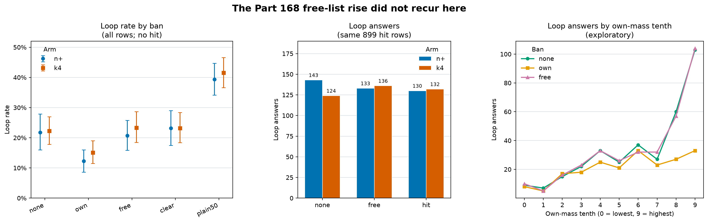

# Banning a push’s own top [50](../../PART169-DESIGN.md) tokens cuts loops by [38%](score.json) on new neurons and phrasings

On new neurons and new phrasings, banning a push’s own top [50](../../PART169-DESIGN.md) tokens cut loop answers again, by [37.9%](score.json) (whole-slot interval [25.8%–48.6%](score.json)). The Part [168](../part168/README.md) free-list rise did not recur here: free gave [338](score.json) loop answers, equal to [338](score.json) with no ban. These counts distinguish the defined masking policies. The design’s Reading rules say: “If [169.3](../../PART169-DESIGN.md) fails, its rise did not replicate, and [169.4](../../PART169-DESIGN.md), [169.5](../../PART169-DESIGN.md) and [169.8](../../PART169-DESIGN.md) read only as differences between bans.” [169.3](score.json) failed.

## Answer outcomes

The table reports each arm alone. Loop-rate intervals are whole-slot bootstrap intervals. [k4](../../PART169-DESIGN.md) contains its slot’s n+ neuron, so pooled rows repeat a direction.

| Arm | Ban | n | Loop rate (whole-slot interval) | Broken | Joint success | Mean length | EOS share |
|---|---|---:|---:|---:|---:|---:|---:|
| n+ | none | [768](score.json) | [21.7% (16.0%–27.9%)](score.json) | [21.9%](score.json) | [78.1%](score.json) | [56.77](score.json) | [94.5%](score.json) |
| n+ | own | [768](score.json) | [12.2% (8.6%–16.0%)](score.json) | [12.2%](score.json) | [87.8%](score.json) | [56.98](score.json) | [93.6%](score.json) |
| n+ | free | [768](score.json) | [20.7% (15.9%–25.8%)](score.json) | [21.0%](score.json) | [79.0%](score.json) | [55.16](score.json) | [94.7%](score.json) |
| n+ | clear | [768](score.json) | [23.2% (17.4%–29.0%)](score.json) | [23.3%](score.json) | [76.7%](score.json) | [55.26](score.json) | [94.3%](score.json) |
| n+ | [plain50](../../PART169-DESIGN.md) | [768](score.json) | [39.3% (34.1%–44.7%)](score.json) | [40.0%](score.json) | [60.0%](score.json) | [46.06](score.json) | [99.1%](score.json) |
| n+ | hit | [471](score.json) | [27.6% (20.8%–34.5%)](score.json) | [27.8%](score.json) | [72.2%](score.json) | [53.49](score.json) | [95.1%](score.json) |
| [k4](../../PART169-DESIGN.md) | none | [768](score.json) | [22.3% (17.8%–27.0%)](score.json) | [24.3%](score.json) | [75.7%](score.json) | [57.39](score.json) | [93.1%](score.json) |
| [k4](../../PART169-DESIGN.md) | own | [768](score.json) | [15.1% (11.5%–19.0%)](score.json) | [17.2%](score.json) | [82.8%](score.json) | [58.07](score.json) | [92.7%](score.json) |
| [k4](../../PART169-DESIGN.md) | free | [768](score.json) | [23.3% (18.5%–28.6%)](score.json) | [25.7%](score.json) | [74.3%](score.json) | [57.06](score.json) | [92.2%](score.json) |
| [k4](../../PART169-DESIGN.md) | clear | [768](score.json) | [23.2% (18.4%–28.4%)](score.json) | [25.0%](score.json) | [75.0%](score.json) | [56.19](score.json) | [93.1%](score.json) |
| [k4](../../PART169-DESIGN.md) | [plain50](../../PART169-DESIGN.md) | [768](score.json) | [41.5% (36.6%–46.6%)](score.json) | [44.1%](score.json) | [55.9%](score.json) | [48.21](score.json) | [99.5%](score.json) |
| [k4](../../PART169-DESIGN.md) | hit | [428](score.json) | [30.8% (23.5%–38.6%)](score.json) | [34.6%](score.json) | [65.4%](score.json) | [55.63](score.json) | [92.1%](score.json) |
| pooled | none | [1,536](extra169.txt) | [22.0%](extra169.txt) ([338 loops](extra169.txt)) | [23.1%](extra169.txt) | [76.9%](extra169.txt) | [57.08](extra169.txt) | [93.8%](extra169.txt) |
| pooled | own | [1,536](extra169.txt) | [13.7%](extra169.txt) ([210 loops](extra169.txt)) | [14.7%](extra169.txt) | [85.3%](extra169.txt) | [57.52](extra169.txt) | [93.2%](extra169.txt) |
| pooled | free | [1,536](extra169.txt) | [22.0%](extra169.txt) ([338 loops](extra169.txt)) | [23.3%](extra169.txt) | [76.7%](extra169.txt) | [56.11](extra169.txt) | [93.4%](extra169.txt) |
| pooled | clear | [1,536](extra169.txt) | [23.2%](extra169.txt) ([356 loops](extra169.txt)) | [24.2%](extra169.txt) | [75.8%](extra169.txt) | [55.72](extra169.txt) | [93.7%](extra169.txt) |
| pooled | [plain50](../../PART169-DESIGN.md) | [1,536](extra169.txt) | [40.4%](extra169.txt) ([621 loops](extra169.txt)) | [42.1%](extra169.txt) | [57.9%](extra169.txt) | [47.14](extra169.txt) | [99.3%](extra169.txt) |
| pooled | hit | [899](extra169.txt) | [29.1%](extra169.txt) ([262 loops](extra169.txt)) | [31.0%](extra169.txt) | [69.0%](extra169.txt) | [54.51](extra169.txt) | [93.7%](extra169.txt) |

Across both arms, own has [210](score.json) loop answers against [338](score.json) with none; free has [338](score.json), the same count as none. The pooled summary is descriptive because [k4](../../PART169-DESIGN.md) contains its slot’s n+ neuron.

## Registered predictions

Bars are from the [design](../../PART169-DESIGN.md); point estimates and whole-slot intervals are from [`score.json`](score.json). For the last column, “held” means the point estimate met its registered bar. 169.W1 and 169.W2 are Weaver’s.

| Prediction | Registered bar | Estimate | Whole-slot [95%](score.json) interval | Verdict |
|---|---|---|---|---|
| 169.1 | Own relative cut at least [25%](../../PART169-DESIGN.md) | [37.9%](score.json) | [25.8%–48.6%](score.json) | held |
| 169.2 | High-row cut exceeds other-row cut by at least [25 percentage points](../../PART169-DESIGN.md) | [37.1 percentage points](score.json) | [18.7–53.1 percentage points](score.json) | held |
| 169.3 | Free raises loop answers by at least [5%](../../PART169-DESIGN.md) | [0.0%](score.json) | [−6.1%–7.0%](score.json) | failed |
| 169.4 | On paired rows, free minus clear is at least [2 percentage points](../../PART169-DESIGN.md) | [−0.4 percentage points](score.json) | [−2.2–1.4 percentage points](score.json) | failed |
| 169.5 | On high paired rows, free minus clear induced rate is at least [10 percentage points](../../PART169-DESIGN.md) | [+2.2 percentage points](score.json) | [−2.4–7.0 percentage points](score.json) | failed |
| 169.6 | No-push free loop rate below [5%](../../PART169-DESIGN.md) | [3.1%](score.json) | [2.1%–4.3%](score.json) | held |
| 169.7 | Paired clear change between [−15% and +15%](../../PART169-DESIGN.md) | [−1.9%](score.json) change in loop answers, expressed as a relative cut; negative means clear adds [1.9%](score.json) | [−9.3%–4.7%](score.json) | held |
| 169.8 | Hit induced rate at least [0.6](../../PART169-DESIGN.md) times free on eligible rows | On [323](extra169.txt) inducible rows among [528](extra169.txt) with at least [2](../../PART169-DESIGN.md) plain tokens: hit [54/323 = 16.7%](extra169.txt), free [62/323 = 19.2%](extra169.txt); on the same [528](extra169.txt) rows, net loops are none [205](extra169.txt), free [205](extra169.txt), hit [201](extra169.txt); margin over bar [+5.2 percentage points](score.json) | [2.7–7.9 percentage points](score.json) for margin | held |
| 169.W1 | Above-median overlap induced rate at least [5 percentage points](../../PART169-DESIGN.md) higher | Above median [29.0%](score.json), at/below [39.2%](score.json); difference [−10.2 percentage points](score.json) | [−16.0–−4.5 percentage points](score.json) | failed |
| 169.W2 | [plain50](../../PART169-DESIGN.md) net rise at least one-third of own’s net cut | Rise [283](score.json) loops; bar [42.7](score.json); margin [240.3](score.json) loops | [181.0–298.3](score.json) loops for margin | held |

The [Reading rules](../../PART169-DESIGN.md) state that when [169.3](score.json) fails, [169.4](score.json), [169.5](score.json) and [169.8](score.json) are read only as differences between bans. For [169.8](score.json), the induced rates are hit [54/323 = 16.7%](extra169.txt) and free [62/323 = 19.2%](extra169.txt), among rows with at least [2](../../PART169-DESIGN.md) plain tokens and no loop under none; net loop counts on the same [528](extra169.txt) rows are none [205](extra169.txt), free [205](extra169.txt), hit [201](extra169.txt). Free has no net rise there, so [169.8](score.json) cannot read as plain tokens reproducing a rise. Its verdict stays Held as a difference between bans.

## Hit-row warning

`hit_relative_cut`, the `hit` rows of `per_arm_ban`, and `ended_induced_net.hit.net_loop_change` in [`score.json`](score.json) compare hit’s selected rows with all rows. Hit rows loop more at baseline: n+ none is [21.7%](score.json) and hit is [27.6%](score.json); [k4](../../PART169-DESIGN.md) none is [22.3%](score.json) and hit is [30.8%](score.json). Do not report these comparisons as a rise.

On the same [899](extra169.txt) hit-eligible rows, none has [267](extra169.txt) loop answers, free [269](extra169.txt), and hit [262](extra169.txt). Reading [`part169/score169.py`](../../part169/score169.py) confirms the mismatch: the exploratory relative-cut and net-change calculations compare hit’s subset with the all-row none rate, while each `per_arm_ban.hit` cell is also based only on hit-eligible answers. The registered [169.8](../../PART169-DESIGN.md) verdict instead compares hit and free induced rates on the same rows whose free list has at least [2](../../PART169-DESIGN.md) plain-answer tokens. The scorer defect touches no verdict. The hit share of free-list mass, [90.9%](score.json), is the upper median over all [899](extra169.txt) hit rows, not a mean or a statistic over the [528](extra169.txt) rows with at least [2](../../PART169-DESIGN.md) plain tokens. The scorer's `med()` returns the upper median; the difference is negligible here.

| Hit-defined rows | Rows | None loops | Free loops | Hit loops |
|---|---:|---:|---:|---:|
| n+ | [471](extra169.txt) | [143](extra169.txt) | [133](extra169.txt) | [130](extra169.txt) |
| [k4](../../PART169-DESIGN.md) | [428](extra169.txt) | [124](extra169.txt) | [136](extra169.txt) | [132](extra169.txt) |
| pooled | [899](extra169.txt) | [267](extra169.txt) | [269](extra169.txt) | [262](extra169.txt) |

## Replication against [Part 168](../part168/README.md)

The split is exploratory. Part [168](../part168/README.md) counted none, mass-matched and own; this part counted none, free and own. The rows are the high own-mass rows with at least [2](../../PART169-DESIGN.md) plain-answer tokens on the mass/free list, and everything else.

| Split | Part | Rows | None loops | Mass-matched / free loops | Own loops |
|---|---|---:|---:|---:|---:|
| High own mass, [2+](../part168/review168.txt) plain tokens | [168](../part168/README.md) | [281](../part168/review168.txt) | [97](../part168/review168.txt) | [126](../part168/review168.txt) | [44](../part168/review168.txt) |
| High own mass, [2+](review169.txt) plain tokens | [169](review169.txt) | [453](review169.txt) | [189](review169.txt) | [190](review169.txt) | [83](review169.txt) |
| Everything else | [168](../part168/README.md) | [1,063](../../PART169-DESIGN.md) | [91](../../PART169-DESIGN.md) | [93](../../PART169-DESIGN.md) | [85](../../PART169-DESIGN.md) |
| Everything else | [169](review169.txt) | [1,083](review169.txt) | [149](review169.txt) | [148](review169.txt) | [127](review169.txt) |

## What this says about Part 168’s rise

The Part [168](../part168/README.md) rise did not recur here: free did not raise loops by [5%](../../PART169-DESIGN.md); its estimate was [0.0%](score.json), with a whole-slot interval from [−6.1% to +7.0%](score.json), so [16.5%](cold/COLD.md) lies outside that interval. Part 168’s interval was [6.3%–29.4%](cold/COLD.md); the intervals overlap only from [6.3% to 7.0%](cold/COLD.md), and no two-sample test was run. This does not show that the first rise was spurious.

The mass-draw algorithm is the same. Part 168 excluded special and EOS IDs; Part 169 also excludes every added-vocabulary ID from every list, including own, and drops Part 168’s full arm. The neurons, phrasings and seeds differ. Baseline loop rates were [14.0%](cold/COLD.md) in Part 168 and [22.0%](cold/COLD.md) here. The replication table’s splits come from post-score [`review169.py`](review169.py) and are exploratory.

Own-mass tenths from [`review169.txt`](review169.txt) are shown below; `extra169.py` recomputes the shares and counterfactual below.

| Own-mass tenth | Mass range | Rows | None | Own | Free | Own cut (none minus own) |
|---|---:|---:|---:|---:|---:|---:|
| [0](extra169.txt) | [2.5e-05–0.00049](extra169.txt) | [153](extra169.txt) | [9](extra169.txt) | [8](extra169.txt) | [10](extra169.txt) | [1](extra169.txt) |
| [1](extra169.txt) | [0.0005–0.0011](extra169.txt) | [154](extra169.txt) | [7](extra169.txt) | [5](extra169.txt) | [5](extra169.txt) | [2](extra169.txt) |
| [2](extra169.txt) | [0.0012–0.0031](extra169.txt) | [153](extra169.txt) | [15](extra169.txt) | [17](extra169.txt) | [16](extra169.txt) | [−2](extra169.txt) |
| [3](extra169.txt) | [0.0031–0.0066](extra169.txt) | [154](extra169.txt) | [22](extra169.txt) | [18](extra169.txt) | [23](extra169.txt) | [4](extra169.txt) |
| [4](extra169.txt) | [0.0066–0.015](extra169.txt) | [154](extra169.txt) | [33](extra169.txt) | [25](extra169.txt) | [33](extra169.txt) | [8](extra169.txt) |
| [5](extra169.txt) | [0.015–0.027](extra169.txt) | [153](extra169.txt) | [25](extra169.txt) | [21](extra169.txt) | [26](extra169.txt) | [4](extra169.txt) |
| [6](extra169.txt) | [0.027–0.049](extra169.txt) | [154](extra169.txt) | [37](extra169.txt) | [33](extra169.txt) | [32](extra169.txt) | [4](extra169.txt) |
| [7](extra169.txt) | [0.049–0.087](extra169.txt) | [153](extra169.txt) | [27](extra169.txt) | [23](extra169.txt) | [32](extra169.txt) | [4](extra169.txt) |
| [8](extra169.txt) | [0.088–0.14](extra169.txt) | [154](extra169.txt) | [60](extra169.txt) | [27](extra169.txt) | [57](extra169.txt) | [33](extra169.txt) |
| [9](extra169.txt) | [0.14–0.55](extra169.txt) | [154](extra169.txt) | [103](extra169.txt) | [33](extra169.txt) | [104](extra169.txt) | [70](extra169.txt) |

The top two tenths contain [163 of 338 (48.2%)](extra169.txt) of none loops but [103 of 128 (80.5%)](extra169.txt) of the own cut. Own cuts [63.2%](extra169.txt) of their loops, against [14.3%](extra169.txt) in the other [8](extra169.txt) tenths. If every tenth lost the same fraction of its none loops as the pooled cut, [128/338 = 37.9%](extra169.txt), the top two’s [163](extra169.txt) none loops would account for about [62 of the 128](extra169.txt) net cut. The [169.1](../../PART169-DESIGN.md) bar rests on high rows: the cut is [53.0%](extra169.txt) on high rows and [15.9%](extra169.txt) elsewhere. By the same length-bin and EOS-cell standardization, own has a residual of [−126.5](extra169.txt) loops against its [−128](extra169.txt) net change. That residual remains after a descriptive reweighting. It does not rule out a mechanism through length or termination, because the reweighting applies no-ban rates to lengths and EOS shares that a ban may itself have changed.

## Loop churn and [plain50](../../PART169-DESIGN.md)

| Ban | Ended | Induced | Net loop change (induced minus ended) |
|---|---:|---:|---:|
| Free | [89](extra169.txt) | [89](extra169.txt) | [0](extra169.txt) |
| Clear | [61](extra169.txt) | [79](extra169.txt) | [+18](extra169.txt) |
| Own | [182](extra169.txt) | [54](extra169.txt) | [−128](extra169.txt) |
| [plain50](../../PART169-DESIGN.md) | [130](extra169.txt) | [413](extra169.txt) | [+283](extra169.txt) |

A ban that changes an answer can move its loop status in either direction. Induced alone therefore does not measure loops added; the net count does. Part [168](../part168/README.md) reported own ended [101](../part168/review168.txt) and induced [42](../part168/review168.txt), using the same counting terms.

[`plain50`](../../PART169-DESIGN.md) blocks the [50](../../PART169-DESIGN.md) tokens with the largest mean probability on each phrasing’s plain path. It moved pooled loop answers from [338](score.json) with none to [621](score.json), with [413](score.json) induced loops and a mean of [16.3](score.json) blocked steps per answer. With no push, [plain50](../../PART169-DESIGN.md) had [0](score.json) loop answers out of [8](score.json); [8](score.json) is a small count. Weaver’s [169.W2](score.json) held.

The plain50 rise appears under all [8](extra169.txt) phrasings. By the length-bin and EOS-cell comparison in `extra169.py`, cell mix accounts for about [47](extra169.txt) of the [283](extra169.txt) net rise. In a [20-answer](cold/COLD.md) read of induced loops, [16](cold/COLD.md) were cyclic repetition and [4](cold/COLD.md) were prose repeating a phrase three times; the loop rule labels both.

Weaver’s [169.W1](score.json) failed in the opposite direction: above-median-overlap rows induced at [29.0%](score.json), below-or-at-median rows at [39.2%](score.json), a difference of [−10.2 percentage points](score.json); Spearman’s rho was [−0.15](score.json). Here overlap means the count of token IDs from a row’s [`plain50`](../../PART169-DESIGN.md) list that also occur in that row’s no-ban answer ([scorer code](../../part169/score169.py)); the median overlap was [18](score.json) tokens. Weaver’s falsifier did not trigger because [plain50](../../PART169-DESIGN.md)’s induced count, [413](score.json), exceeds free’s [89](score.json).

## Ban bite and batch-shape noise

Ban bite is exploratory and decides no verdict. “Never blocked” means no recorded step where the ban changed the greedy choice.

| Ban | Answers | Never blocked | Mean blocked steps | Median first blocked step | Median chosen-token rank | Share at rank [5](score.json) or better |
|---|---:|---:|---:|---:|---:|---:|
| None | [1,536](score.json) | [1,536](score.json) | [0.00](score.json) | — | — | — |
| Own | [1,536](score.json) | [701](score.json) | [2.73](score.json) | [8](score.json) | [1](score.json) | [99.3%](score.json) |
| Free | [1,536](score.json) | [804](score.json) | [1.46](score.json) | [9](score.json) | [1](score.json) | [100.0%](score.json) |
| Clear | [1,536](score.json) | [827](score.json) | [1.38](score.json) | [10](score.json) | [1](score.json) | [99.9%](score.json) |
| Hit | [899](score.json) | [351](score.json) | [1.86](score.json) | [8](score.json) | [1](score.json) | [100.0%](score.json) |
| [plain50](../../PART169-DESIGN.md) | [1,536](score.json) | [18](score.json) | [16.30](score.json) | [1](score.json) | [2](score.json) | [98.8%](score.json) |

Among answers with no blocked step, [34 of 701](score.json) own, [32 of 804](score.json) free, and [29 of 827](score.json) clear answers differed from none by batch shape: [4.9%](extra169.txt) own, [4.0%](extra169.txt) free, and [3.5%](extra169.txt) clear. Section [4](review169.txt) of the exploratory review records at most [5](review169.txt) loop flips per ban among these differing answers. This is the measured noise floor for the no-blocked comparison.

## Review checks promised by the design

| Check | Result |
|---|---|
| High paired rows | [392](score.json) rows: none [30.6%](score.json), own [18.6%](score.json), free [30.9%](score.json), clear [32.4%](score.json); none [120](extra169.txt) and free [121](extra169.txt) loops; free induced [47/272 = 17.3%](extra169.txt) |
| High unpaired rows | [112](score.json) rows: none [71.4%](score.json), own [18.8%](score.json), free [72.3%](score.json), clear [83.0%](score.json); none [80](extra169.txt) and free [81](extra169.txt) loops; free induced [15/32 = 46.9%](extra169.txt) |
| Strength-matched [169.4](../../PART169-DESIGN.md) | [627](score.json) rows; free [11.0%](score.json), clear [11.3%](score.json), matched gap [−0.32 percentage points](score.json) against full gap [−0.42 percentage points](score.json), or [75%](cold/COLD.md) of it; the half-gap condition is not met. The scorer’s `under_half_of_gap` field reads true only because it compares signed negative numbers; with both gaps near zero, the condition has nothing to act on. |
| Hit-list sizes | [899](score.json) eligible rows; mean [3.36](score.json), median [2](score.json), maximum [28](score.json). Among [528](score.json) rows with at least [2](score.json) plain tokens, mean hit-list size was [5.02](score.json); over all [899](extra169.txt) hit rows, hit held an upper median [90.9%](score.json) of free-list mass. A free list has [50](score.json) tokens. |
| Paired list strength | Own: mean [6.60](score.json) top-[200](score.json) tokens, median rank [2,632](score.json). Free: [3.56](score.json), rank [7,925.5](score.json). Clear: [8.49](score.json), rank [5,396.5](score.json). |
| Absolute no-push counts | Free: [24](score.json) loops of [768](score.json). [plain50](../../PART169-DESIGN.md): [0](score.json) of [8](score.json); none: [0](score.json) of [8](score.json). |

The induced-rate reading of the design’s wrong-half rule triggers: unpaired high rows induce [15 of 32 (46.9%)](extra169.txt), against [17.3%](extra169.txt) on paired rows. Only [32](extra169.txt) unpaired rows are eligible because [80 of 112](extra169.txt) already loop under none. On net counts, paired rows rise from [120 to 121](extra169.txt) loops and unpaired rows from [80 to 81](extra169.txt), one net loop per half; the unpaired half does not show a larger net rise. The higher induced rate is based on few eligible rows, so the warning applies to that induced-rate comparison, not to net loop totals.

## Blinded hand read

I judged truncated text using the rule in [`hand_read_judged.jsonl`](hand_read_judged.jsonl) and matched it to [`hand_read_key.jsonl`](hand_read_key.jsonl): “reads as a fluent answer to the question with no repeating phrase or word salad; false facts and a cut-off end allowed; judged before the key.” This is my judgement of truncated text. Each ban has a sample of [24](extra169.txt) low-k answers from n+ and [k4](../../PART169-DESIGN.md). Hit’s sample comes from its own eligible rows, so it does not compare directly with the other bans.

| Ban | Coherent / sampled |
|---|---:|
| None | [19 of 24](extra169.txt) |
| Own | [18 of 24](extra169.txt) |
| Free | [18 of 24](extra169.txt) |
| Clear | [14 of 24](extra169.txt) |
| [plain50](../../PART169-DESIGN.md) | [15 of 24](extra169.txt) |
| Hit | [10 of 24](extra169.txt) |

## Leave-one-out checks

The own cut stays between [34.1% and 42.4%](review169.txt) when leaving out any one layer, [35.2% and 39.3%](review169.txt) when leaving out any one slot, and [35.4% and 39.8%](extra169.txt) when leaving out any one phrasing. The cut is [43.7%](extra169.txt) for n+ alone and [32.2%](extra169.txt) for k4 alone. Part [168](../part168/README.md)’s own cut fell below [30%](../part168/review168.txt) without layer [24](../part168/review168.txt).

## Gates and why this part exists

All gates passed. Gate [6](../../PART169-DESIGN.md)’s free-list tolerance was [99.5%](score.json), above its [90%](../../PART169-DESIGN.md) bar. Gate [8](../../PART169-DESIGN.md) had [392](score.json) paired high rows, above its [150](../../PART169-DESIGN.md) requirement. Part [167](../part167/README.md)’s stopped plain-answer gate led into Part [168](../part168/README.md); Part [168](../part168/README.md)’s mass-matched-list rise set the replication question for this part.

## Prior art as reported in the design

Muse’s search found no study of this exact measurement. The related work listed in the design was relayed through Muse and was not read here: Xu et al. ([2206.02369](../../PART169-DESIGN.md)), Holtzman et al. ([1904.09751](../../PART169-DESIGN.md)), Nguyen et al. ([2610.35328](../../PART169-DESIGN.md)), Jin and Han ([2605.10065](../../PART169-DESIGN.md)), and Welleck et al. ([1908.04319](../../PART169-DESIGN.md)).

## Figure

Panel 1 shows loop rates for all rows by ban and arm with whole-slot intervals; hit is omitted. Panel 2 compares loop counts under none, free and hit on the same [899](extra169.txt) hit rows. Panel 3 shows exploratory loop counts by own-mass tenth for none, own and free. Each panel has its own legend. Source: [`plot169.py`](plot169.py).

## Limits and provenance

Limits follow the design: one model, one dose, greedy decoding, and [8](../../PART169-DESIGN.md) maker phrasings already used in Parts [165](../../PART169-DESIGN.md) and [166](../../PART169-DESIGN.md). Lists are measured on the plain path, which pushed answers can leave. Clear must reach own mass without tokens from the plain answer, so free and clear differ in content and exponent; where mass sits on plain-answer tokens, clear cannot reach it. Plain tokens come from one greedy answer. Hit carries most of the free-list mass on high rows, so [169.8](../../PART169-DESIGN.md) alone cannot separate token overlap from list mass. [Full limits](../../PART169-DESIGN.md).

Provenance: [design](../../PART169-DESIGN.md) · [launch](launch.jsonl) · [runner](../../part169/run169.py) · [scorer](../../part169/score169.py) · registered commit [a897ed8](../../PART169-DESIGN.md). [`review169.py`](review169.py) was written after the scores, so its splits are exploratory; see [`review169.txt`](review169.txt). Computed summaries: [`extra169.py`](extra169.py) and [`extra169.txt`](extra169.txt).

Cold check: Haiku 5.5 (dark-factory run ab-169-cold-2026-11-01), full report at [cold/COLD.md](cold/COLD.md), its corrections folded in above.

Alden's process was down when this part ran, so they read it afterwards (council topic `overnight-ideas-2026-11-01`, message 18). That read was retrospective, not clearance before launch. Three points from it:

- The paired and high selections did not manufacture 169.4 and 169.5, because both were frozen before ban outcomes. They do limit what transfers: high paired rows have a 30.6% baseline loop rate, against 71.4% on high unpaired rows.
- The design's reading that 169.6 holding means the rise needs a push is false. Under 5% is not zero: no-push free lists gave 24 of 768 loops. The 0 of 8 for no-push plain50 covers only eight phrasings. Neither establishes necessity.
- A ratio bar can pass with zero induced events on both sides, so a mechanistic reading of 169.8 would need a declared event floor. The old verdict stands as scored.
