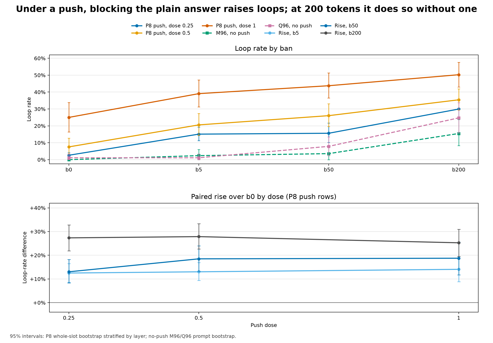

# Blocking the plain answer raises loops under a push, and a 200-token ban raises them without one

**Update (2026-11-09):** [Part 199](../part199/README.md) reran this part on the eager attention kernel (Part 178 found the default SDPA kernel used here leaves a float32 reference past 64 keys). Under the push, b50 raised loops from 28.4% to 54.7% (25.0% to 43.8% below), and 170.3 and 170.6 hold. 170.1's ratio rose from 0.174 (below) to 0.329, past its 0.25 bar; both runs' intervals cross the bar. Stage 0 froze none of the 19 prompts frozen below, so the discussion of frozen rows describes this kernel's answers. And most dose-1 answers below stopped before the 80-token cap, many mid-phrase, where on eager most ran to it.

Under dose [1](score.json), the full-size push on identity prompts, blocking the plain answer’s [50](../../PART170-DESIGN.md) likeliest tokens raised loops from [25.0%](score.json) to [43.8%](score.json). The design's reading rule would call this a masking part because 170.2 failed. Alden's review shows that does not follow: 170.2 sets a Q96 no-push rise over a P8 push rise, a comparison across two populations, so it cannot split the pushed rise into parts. Without a push, eligible identity b50 rises [+3.3 pp](cold/COLD.md) on [92](cold/COLD.md) prompts (p=[0.25](cold/COLD.md)), but over all [104](cold/COLD.md) identity prompts it produces [3](cold/COLD.md) loops against b0’s [8](cold/COLD.md), a [−4.8 pp](cold/COLD.md) change. The positive average is restricted to prompts whose plain path did not loop, and it reverses in the full set. On eligible Q96 prompts, b50 rises [+6.7 pp](cold/COLD.md) (p=[0.07](cold/COLD.md)); on all prompts, b200 rises [+9.6 pp](cold/COLD.md) on identity (p=[0.052](cold/COLD.md)) and [+19.8 pp](cold/COLD.md) on Q96 (p=[0.001](cold/COLD.md)). A difference in significance is not a difference between ban sizes. With frozen rows included, [170.2](../../PART170-DESIGN.md)’s ratio would be [16.7%](score.json) and pass its [25%](score.json) bar, so that benchmark is sensitive to which prompts are counted. A list ranked from a different question added [+1.1 pp](score.json) on Q96.

## Answer outcomes

The complete cell table reports each arm alone. Push rows are P8 neuron-push rows; no-push rows use eligible prompts after Stage 0 freezing. EOS share is the fraction ending before the token cap.

| Group | Arm | Dose | Ban | Rows | Loop rate | Broken rate | Joint success | Mean tokens | EOS share |
|---|---|---:|---|---:|---:|---:|---:|---:|---:|
| [P8](score.json) | No push | — | [b0](../../PART170-DESIGN.md) | [8](score.json) | [0.0%](score.json) | [0.0%](score.json) | [100.0%](score.json) | [54.88](score.json) | [100.0%](score.json) |
| [P8](score.json) | No push | — | [b5](../../PART170-DESIGN.md) | [8](score.json) | [25.0%](score.json) | [25.0%](score.json) | [75.0%](score.json) | [54.62](score.json) | [87.5%](score.json) |
| [P8](score.json) | No push | — | [b50](../../PART170-DESIGN.md) | [8](score.json) | [0.0%](score.json) | [0.0%](score.json) | [100.0%](score.json) | [45.50](score.json) | [100.0%](score.json) |
| [P8](score.json) | No push | — | [b200](../../PART170-DESIGN.md) | [8](score.json) | [25.0%](score.json) | [25.0%](score.json) | [75.0%](score.json) | [47.62](score.json) | [100.0%](score.json) |
| [P8](score.json) | No push | — | [rel50](../../PART170-DESIGN.md) | [8](score.json) | [0.0%](score.json) | [0.0%](score.json) | [100.0%](score.json) | [53.12](score.json) | [100.0%](score.json) |
| [P8](score.json) | [n+](score.json) | [0.25](score.json) | [b0](../../PART170-DESIGN.md) | [384](score.json) | [2.6%](score.json) | [2.6%](score.json) | [97.4%](score.json) | [58.41](score.json) | [94.0%](score.json) |
| [P8](score.json) | [n+](score.json) | [0.25](score.json) | [b5](../../PART170-DESIGN.md) | [384](score.json) | [15.1%](score.json) | [15.1%](score.json) | [84.9%](score.json) | [63.37](score.json) | [83.6%](score.json) |
| [P8](score.json) | [n+](score.json) | [0.25](score.json) | [b50](../../PART170-DESIGN.md) | [384](score.json) | [15.6%](score.json) | [15.6%](score.json) | [84.4%](score.json) | [49.75](score.json) | [100.0%](score.json) |
| [P8](score.json) | [n+](score.json) | [0.25](score.json) | [b200](../../PART170-DESIGN.md) | [384](score.json) | [29.9%](score.json) | [31.8%](score.json) | [68.2%](score.json) | [42.67](score.json) | [100.0%](score.json) |
| [P8](score.json) | [n+](score.json) | [0.5](score.json) | [b0](../../PART170-DESIGN.md) | [384](score.json) | [7.6%](score.json) | [7.6%](score.json) | [92.4%](score.json) | [60.95](score.json) | [91.1%](score.json) |
| [P8](score.json) | [n+](score.json) | [0.5](score.json) | [b5](../../PART170-DESIGN.md) | [384](score.json) | [20.6%](score.json) | [20.6%](score.json) | [79.4%](score.json) | [63.20](score.json) | [83.6%](score.json) |
| [P8](score.json) | [n+](score.json) | [0.5](score.json) | [b50](../../PART170-DESIGN.md) | [384](score.json) | [26.0%](score.json) | [26.8%](score.json) | [73.2%](score.json) | [47.28](score.json) | [98.7%](score.json) |
| [P8](score.json) | [n+](score.json) | [0.5](score.json) | [b200](../../PART170-DESIGN.md) | [384](score.json) | [35.4%](score.json) | [39.3%](score.json) | [60.7%](score.json) | [40.78](score.json) | [99.7%](score.json) |
| [P8](score.json) | [n+](score.json) | [1](score.json) | [b0](../../PART170-DESIGN.md) | [384](score.json) | [25.0%](score.json) | [25.0%](score.json) | [75.0%](score.json) | [55.86](score.json) | [93.2%](score.json) |
| [P8](score.json) | [n+](score.json) | [1](score.json) | [b5](../../PART170-DESIGN.md) | [384](score.json) | [39.1%](score.json) | [41.4%](score.json) | [58.6%](score.json) | [58.51](score.json) | [85.7%](score.json) |
| [P8](score.json) | [n+](score.json) | [1](score.json) | [b50](../../PART170-DESIGN.md) | [384](score.json) | [43.8%](score.json) | [45.3%](score.json) | [54.7%](score.json) | [47.54](score.json) | [98.7%](score.json) |
| [P8](score.json) | [n+](score.json) | [1](score.json) | [b200](../../PART170-DESIGN.md) | [384](score.json) | [50.3%](score.json) | [58.3%](score.json) | [41.7%](score.json) | [41.89](score.json) | [99.7%](score.json) |
| [P8](score.json) | [n+](score.json) | [1](score.json) | [rel50](../../PART170-DESIGN.md) | [384](score.json) | [22.9%](score.json) | [24.2%](score.json) | [75.8%](score.json) | [53.68](score.json) | [94.0%](score.json) |
| [M96](score.json) | No push | — | [b0](../../PART170-DESIGN.md) | [84](score.json) | [0.0%](score.json) | [0.0%](score.json) | [100.0%](score.json) | [64.08](score.json) | [79.8%](score.json) |
| [M96](score.json) | No push | — | [b5](../../PART170-DESIGN.md) | [84](score.json) | [2.4%](score.json) | [3.6%](score.json) | [96.4%](score.json) | [55.12](score.json) | [94.0%](score.json) |
| [M96](score.json) | No push | — | [b50](../../PART170-DESIGN.md) | [84](score.json) | [3.6%](score.json) | [3.6%](score.json) | [96.4%](score.json) | [50.35](score.json) | [100.0%](score.json) |
| [M96](score.json) | No push | — | [b200](../../PART170-DESIGN.md) | [84](score.json) | [15.5%](score.json) | [19.0%](score.json) | [81.0%](score.json) | [39.73](score.json) | [100.0%](score.json) |
| [M96](score.json) | No push | — | [rel50](../../PART170-DESIGN.md) | [84](score.json) | [4.8%](score.json) | [4.8%](score.json) | [95.2%](score.json) | [64.33](score.json) | [82.1%](score.json) |
| [Q96](score.json) | No push | — | [b0](../../PART170-DESIGN.md) | [89](score.json) | [1.1%](score.json) | [1.1%](score.json) | [98.9%](score.json) | [70.17](score.json) | [60.7%](score.json) |
| [Q96](score.json) | No push | — | [b5](../../PART170-DESIGN.md) | [89](score.json) | [1.1%](score.json) | [1.1%](score.json) | [98.9%](score.json) | [65.29](score.json) | [79.8%](score.json) |
| [Q96](score.json) | No push | — | [b50](../../PART170-DESIGN.md) | [89](score.json) | [7.9%](score.json) | [9.0%](score.json) | [91.0%](score.json) | [52.07](score.json) | [95.5%](score.json) |
| [Q96](score.json) | No push | — | [b200](../../PART170-DESIGN.md) | [89](score.json) | [24.7%](score.json) | [31.5%](score.json) | [68.5%](score.json) | [44.06](score.json) | [100.0%](score.json) |
| [Q96](score.json) | No push | — | [rel50](../../PART170-DESIGN.md) | [89](score.json) | [2.2%](score.json) | [3.4%](score.json) | [96.6%](score.json) | [69.57](score.json) | [61.8%](score.json) |
| [Q96](score.json) | No push | — | [other50](../../PART170-DESIGN.md) | [89](score.json) | [2.2%](score.json) | [2.2%](score.json) | [97.8%](score.json) | [66.56](score.json) | [74.2%](score.json) |

Compact loop-rate grid (the same `per_cell` source):

| Group | Dose | b0 | b5 | b50 | b200 | rel50 | other50 |
|---|---:|---:|---:|---:|---:|---:|---:|
| [P8](score.json) | no push | [0.0%](score.json) | [25.0%](score.json) | [0.0%](score.json) | [25.0%](score.json) | [0.0%](score.json) | — |
| [M96](score.json) | no push | [0.0%](score.json) | [2.4%](score.json) | [3.6%](score.json) | [15.5%](score.json) | [4.8%](score.json) | — |
| [Q96](score.json) | no push | [1.1%](score.json) | [1.1%](score.json) | [7.9%](score.json) | [24.7%](score.json) | [2.2%](score.json) | [2.2%](score.json) |
| [P8](score.json) | [0.25](score.json) | [2.6%](score.json) | [15.1%](score.json) | [15.6%](score.json) | [29.9%](score.json) | — | — |
| [P8](score.json) | [0.5](score.json) | [7.6%](score.json) | [20.6%](score.json) | [26.0%](score.json) | [35.4%](score.json) | — | — |
| [P8](score.json) | [1](score.json) | [25.0%](score.json) | [39.1%](score.json) | [43.8%](score.json) | [50.3%](score.json) | [22.9%](score.json) | — |

## Registered predictions

Verdicts are the registered point-estimate verdicts. Push intervals use the score’s whole-slot bootstrap stratified by layer; no-push intervals resample prompts. For margin-coded entries, the bar quantity is shown separately from the interval for its registered margin.

| Prediction | Registered bar | Bar quantity (point estimate) | 95% interval | Verdict |
|---|---|---|---|---|
| 170.1 | P8 + M96 identity prompts: no-push rise / dose-1 rise < [25%](score.json) | [17.4%](score.json) | [0.0%, 44.3%](score.json) | held; interval crosses the 25% bar |
| 170.2 | Q96: no-push rise / dose-1 rise < [25%](score.json) | [36.0%](score.json) | [5.5%, 80.4%](score.json) | failed; interval crosses the 25% bar |
| 170.3 | Dose 1: b50 rate ≥ 1.5 × b0 ([50%](score.json) relative rise) | [75.0%](score.json) | [-4.0 to +16.0 pp](score.json) (margin) | held on point estimate; interval crosses zero margin |
| 170.4 | Dose-[1](score.json) b50 rise > 0 and at least 2 × dose-[0.25](score.json) b50 rise | [1.44× dose-1/dose-0.25](score.json) | [-20.6 to +5.7 pp](score.json) (margin) | failed; margin interval crosses zero |
| 170.5 | Both adjacent gaps ≥ [5 pp](score.json): b50−b5 and b200−b50 | b50−b5 [+4.7 pp](score.json); b200−b50 [+6.5 pp](score.json) | b50−b5 [-2.3 to +11.7 pp](score.json); b200−b50 [-0.5 to +13.3 pp](score.json) | failed on first adjacent gap (b50−b5); both intervals cross the 5 pp bar |
| 170.6 | rel50/b50 rise < 1.5 × blocked-step share ([26.8%](score.json)) | [-11.1%](score.json) | [-43.8%, 8.5%](score.json) | held |
| 170.7 | Absolute other50−b0 change < [3 pp](score.json) | [+1.1 pp](score.json) | [+0.0 to +5.6 pp](score.json) | held on point estimate; interval crosses the 3 pp bar |
| 170.8 | Within b0-length quartiles: below-share induced-rate gap ≥ [5 pp](score.json) | [+4.0 pp](score.json) | [-7.6 to +16.3 pp](score.json) | failed; interval crosses the bar |
| 170.W1 | Weaver’s: b50 rise < [5%](score.json) separately on M96 and Q96; falsifier ≥ [10%](score.json) on either | M96 [3.6%](score.json); Q96 [6.7%](score.json) | M96 [0.0%–8.3%](score.json); Q96 [1.1%–13.5%](score.json) | Weaver’s forecast failed; falsifier not met |
| 170.W2 | Weaver’s: rel50/b50 rise ≥ [50%](score.json); falsifier under [one third](score.json) | [-11.1%](score.json) | [-43.8%, 8.5%](score.json) | Weaver’s forecast failed; falsifier met |

The interval for [170.1](../../PART170-DESIGN.md) crosses its bar despite its held point estimate. The same is true for [170.3](../../PART170-DESIGN.md) and [170.7](../../PART170-DESIGN.md); [170.2](../../PART170-DESIGN.md) and [170.8](../../PART170-DESIGN.md) also have intervals spanning their bars. [170.W1](../../PART170-DESIGN.md)’s M96 and Q96 intervals both cross its 5% threshold, though its Q96 point estimate misses the bar. The registered Q96 over P8 benchmark, 170.2, missed its quarter bar on eligible prompts and met it when frozen prompts were retained. The design's rule reads a failure as a masking part in every ban result. That reading is too strong, as Alden's retrospective read says: the numerator is a Q96 contrast and the denominator a P8 push contrast, and M96 and Q96 have no push arm, so the ratio is a benchmark and not the share of the P8 effect that needs no push. The separate no-push b50 contrasts are +6.7 pp on eligible Q96 and +3.1 pp on all Q96, and +3.3 pp on eligible identity prompts and −4.8 pp on all identity prompts. They show this policy behaves differently by context, and they do not decompose the +18.75 pp pushed P8 effect. The verdict stands as registered.

## Absolute no-push rises and the scope of a push claim

Beside [170.1](../../PART170-DESIGN.md), the absolute eligible no-push b50 rise on identity rows is [+3.3 pp](cold/COLD.md) (p=[0.25](cold/COLD.md)), against a dose-1 b50 rise of [+18.75 pp](score.json). Beside [170.2](../../PART170-DESIGN.md), the eligible Q96 no-push b50 rise is [+6.7 pp](cold/COLD.md) (p=[0.07](cold/COLD.md)). M96 and Q96 have no push arm.

## Frozen rows and selection

[19](score.json) prompts were frozen because their Stage 0 plain path looped or broke: [12](score.json) of [M96](score.json) and [7](score.json) of [Q96](score.json); [P8](score.json) had none frozen. The no-push b0 comparison therefore sits near zero on survivors partly by selection, while push rows carry no such filter.

With all prompts included, [170.1](../../PART170-DESIGN.md)’s ratio estimate moves from [17.4%](score.json) to [-25.6%](score.json); the all-prompt b50 rate ([2.9%](score.json)) is below b0 ([7.7%](score.json)). [170.2](../../PART170-DESIGN.md)’s ratio moves from [36.0%](score.json) to [16.7%](score.json), which would pass its registered bar. The verdicts stand as registered: [170.1](../../PART170-DESIGN.md) held and [170.2](../../PART170-DESIGN.md) failed. On identity prompts, the positive net average is restricted to baseline-eligible prompts and reverses in the full set: the [92](cold/COLD.md) eligible prompts give 3 loops against 0 ([+3.3 pp](cold/COLD.md)), and the 12 excluded prompts give 0 against 8, so all [104](cold/COLD.md) give [3](cold/COLD.md) against [8](cold/COLD.md) ([-4.8 pp](cold/COLD.md)). These are opposite conditional effects, not proof that no effect occurred. Q96's all-prompt effect stays positive, at +3.1 pp.

All prompts, frozen ones included, no push ([`allprompts170.py`](allprompts170.py), written after the scores):

| Prompts | b0 | b5 | b50 | b200 | rel50 |
|---|---:|---:|---:|---:|---:|
| Identity (P8 + M96) | [7.7%](allprompts170.txt) | [4.8%](allprompts170.txt) | [2.9%](allprompts170.txt) | [17.3%](allprompts170.txt) | [7.7%](allprompts170.txt) |
| Q96 | [5.2%](allprompts170.txt) | [2.1%](allprompts170.txt) | [8.3%](allprompts170.txt) | [25.0%](allprompts170.txt) | [3.1%](allprompts170.txt) |

## Batch differences and noise floor

[86](cold/COLD.md) of [200](cold/COLD.md) no-push b0 answers differ from Stage 0 plain answers for the same prompt. In [run170.py](../../part170/run170.py), Stage 0 plain answers use `run168.generate_plain` one prompt at a time; the later no-push pass generates each prompt’s [5](../../part170/run170.py)- or [6](../../part170/run170.py)-row list batch, including b0. [Gate 8](score.json) covers only repeated dose-1 b0 answers in [48-row](../../PART170-DESIGN.md) push batches: [0](score.json) of [384](score.json) differ. There is no noise floor for the no-push batch shape. Of those [86](cold/COLD.md) changed answers, [8](cold/COLD.md) change the loop label: [7](cold/COLD.md) go from loop to no-loop, all on frozen prompts; [1](cold/COLD.md) goes from no-loop to loop, on [q96:76](cold/COLD.md). The P8 b50 lists equal [Part 169](../part169/README.md)’s plain50 lists for [8](score.json) of [8](score.json) phrasings.

## Dose

| Push dose | b5 rise over b0 | b50 rise over b0 | b200 rise over b0 | b5 loop rate |
|---:|---:|---:|---:|---:|
| [0.25](score.json) | [+12.5 pp](score.json) | [+13.0 pp](score.json) | [+27.3 pp](score.json) | [15.1%](score.json) |
| [0.5](score.json) | [+13.0 pp](score.json) | [+18.5 pp](score.json) | [+27.9 pp](score.json) | [20.6%](score.json) |
| [1](score.json) | [+14.1 pp](score.json) | [+18.8 pp](score.json) | [+25.3 pp](score.json) | [39.1%](score.json) |

The b50 point rises are [+13.0 pp](score.json), [+18.5 pp](score.json), and [+18.75 pp](score.json) across the [three](../../PART170-DESIGN.md) doses; on the log-odds scale they are [1.94](cold/COLD.md), [1.46](cold/COLD.md), and [0.85](cold/COLD.md), falling steadily. The b0 base climbs from [2.6%](score.json) to [25.0%](score.json), so the flat point rises are partly a matter of scale, and [three](../../PART170-DESIGN.md) doses do not fix a shape. Its dose-0.25 rise is [+13.0 pp](score.json), against [+18.75 pp](score.json) at dose 1, so it misses the doubling bar and [170.4](../../PART170-DESIGN.md) failed. At dose 0.25, b5 moved from [2.6%](score.json) to [15.1%](score.json).

## Ban-size gaps

Nesting forces the lists' vocabulary, and answers agree until a larger list blocks something, but it does not force the loop rate to rise: a larger list can ban a token that sustains a loop and end it. Alden corrected this after the design called the order near-forced. So the order seen here is empirical, and both its direction and its gaps carry information. The first adjacent gap, b50−b5, is [+4.7 pp](score.json) against a [5 pp](score.json) bar; b200−b50 is [+6.5 pp](score.json). Their whole-slot intervals are [-2.3 to +11.7 pp](score.json) and [-0.5 to +13.3 pp](score.json). [170.5](../../PART170-DESIGN.md) failed on b50−b5.

## Release after step five

rel50 blocks only through the first [5](../../PART170-DESIGN.md) generated tokens. At dose [1](score.json), it blocked a mean of [2.9](score.json) steps against [16.0](score.json) for b50, a blocked-step share of [17.8%](score.json). It ended [34](cold/COLD.md) loops and induced [26](cold/COLD.md) against b0 (sign p=[0.37](cold/COLD.md)); the whole-slot interval for the rise is [−6.0 to +2.1 pp](cold/COLD.md), so no rise was detected. Its loop rate is [22.9%](score.json), against b0 at [25.0%](score.json). [170.6](../../PART170-DESIGN.md) held because its bar passes any negative rise; its ratio is [−11.1%](score.json), so this hold does not show that damage tracks blocks. Weaver’s [170.W2](../../PART170-DESIGN.md) forecast failed and the first clause of its falsifier was met, but “sustained blocking is what matters” was not tested here: no arm blocks late steps only.

## Different-question list

other50 takes the next question’s top-50 list after removing the current question’s own b50. On the same [89](score.json) eligible Q96 rows, it looped at [2.2%](score.json) against b0 at [1.1%](score.json), a [+1.1 pp](score.json) change; b5 rose [+0.0 pp](score.json), while b50 rose [+6.7 pp](score.json). Mean probability mass of other50 was [0.00411](score.json). In this Q96 comparison, the rise was larger when the list came from that prompt’s own plain path.

## Length and plain-path overlap

For [170.8](../../PART170-DESIGN.md), the raw median-share difference was [-3.5 pp](score.json) ([-16.2 to +10.0 pp](score.json)); after matching within b0-length quartiles it was [+4.0 pp](score.json) ([-7.6 to +16.3 pp](score.json)). Length-quartile differences are [-3.3 pp](cold/COLD.md), [+17.0 pp](cold/COLD.md), [−7.0 pp](cold/COLD.md), and [+7.5 pp](cold/COLD.md) on cells of [62](cold/COLD.md) to [78](cold/COLD.md) rows, so the [+4.0 pp](score.json) is an average of mixed signs. The registered prediction failed.

| b0-length quartile | b0 token range | Rows | Below-share rows | Rest rows | Below-share induced rate | Rest induced rate | Difference |
|---|---:|---:|---:|---:|---:|---:|---:|
| [1](score.json) | [10](score.json)–[48](score.json) | [62](score.json) | [30](score.json) | [32](score.json) | [46.7%](score.json) | [50.0%](score.json) | [-3.3 pp](score.json) |
| [2](score.json) | [49](score.json)–[56](score.json) | [78](score.json) | [38](score.json) | [40](score.json) | [39.5%](score.json) | [22.5%](score.json) | [+17.0 pp](score.json) |
| [3](score.json) | [57](score.json)–[64](score.json) | [75](score.json) | [37](score.json) | [38](score.json) | [32.4%](score.json) | [39.5%](score.json) | [-7.0 pp](score.json) |
| [4](score.json) | [65](score.json)–[80](score.json) | [73](score.json) | [35](score.json) | [38](score.json) | [28.6%](score.json) | [21.1%](score.json) | [+7.5 pp](score.json) |

## Fragility

At dose [1](score.json), the b50 rise survives dropping any one layer, slot, or phrasing: the minimum rises are [16.4 pp](cold/COLD.md), [17.2 pp](cold/COLD.md), and [17.3 pp](cold/COLD.md), respectively. [38](cold/COLD.md) of [48](cold/COLD.md) neurons are net positive, and the top [10](cold/COLD.md) carry [40](cold/COLD.md) of [72](cold/COLD.md) net loops.

The eligible identity no-push rise rests on [three](cold/COLD.md) maker-kind prompts: dropping the maker half gives [0.0 pp](cold/COLD.md), while dropping the identity half gives [+5.8 pp](cold/COLD.md). Q96 gives [+4.3 pp](cold/COLD.md) on fact prompts and [+9.5 pp](cold/COLD.md) on how-to prompts.

## Loop churn: induced, ended, and net

An induced loop alone does not measure added loops: a ban can also end baseline loops. Net loop change is induced minus ended and is the count of loops added or removed.

| Dose | Ban | Induced | Ended | Net loop change |
|---:|---|---:|---:|---:|
| [0.25](score.json) | [b5](../../PART170-DESIGN.md) | [54](score.json) | [6](score.json) | [+48](score.json) |
| [0.25](score.json) | [b50](../../PART170-DESIGN.md) | [55](score.json) | [5](score.json) | [+50](score.json) |
| [0.25](score.json) | [b200](../../PART170-DESIGN.md) | [111](score.json) | [6](score.json) | [+105](score.json) |
| [0.5](score.json) | [b5](../../PART170-DESIGN.md) | [58](score.json) | [8](score.json) | [+50](score.json) |
| [0.5](score.json) | [b50](../../PART170-DESIGN.md) | [83](score.json) | [12](score.json) | [+71](score.json) |
| [0.5](score.json) | [b200](../../PART170-DESIGN.md) | [119](score.json) | [12](score.json) | [+107](score.json) |
| [1](score.json) | [b5](../../PART170-DESIGN.md) | [68](score.json) | [14](score.json) | [+54](score.json) |
| [1](score.json) | [b50](../../PART170-DESIGN.md) | [99](score.json) | [27](score.json) | [+72](score.json) |
| [1](score.json) | [b200](../../PART170-DESIGN.md) | [111](score.json) | [14](score.json) | [+97](score.json) |
| [1](score.json) | [rel50](../../PART170-DESIGN.md) | [26](score.json) | [34](score.json) | [-8](score.json) |

## Exploratory addition after registration: Alden’s retrospective read

Alden’s retrospective advice (council topic `overnight-ideas-2026-11-01`, message 18) asks for a paired dose contrast on common units, with uncertainty over fixed slots and phrasing clusters. This addition follows that advice after registration and is exploratory. [`extra170.py`](extra170.py) computes these summaries and joins the blinded hand-read files.

### Dose contrast D(d)

D(d) is the paired mean loop outcome under the list minus b0 on the same P8 push units at that dose. D(0) is the no-push difference over [8](extra170.txt) P8 phrasings. The slot-only interval conditions on the fixed phrasing set; the second resamples phrasing clusters as well as whole slots, stratified by layer. Both use [10,000](extra170.txt) replicates with seed [170](extra170.txt). D(0) is [+25.00 pp](extra170.txt) for b5, [0.00 pp](extra170.txt) for b50, and [+25.00 pp](extra170.txt) for b200 over the same [8](extra170.txt) phrasings.

| List | Dose | D(d) | Slot-only 95% interval | Slot + phrasing-cluster 95% interval |
|---|---:|---:|---:|---:|
| [b5](../../PART170-DESIGN.md) | [0.25](extra170.txt) | [+12.50 pp](extra170.txt) | [+8.59 pp, +16.41 pp](extra170.txt) | [+4.69 pp, +22.66 pp](extra170.txt) |
| [b5](../../PART170-DESIGN.md) | [0.5](extra170.txt) | [+13.02 pp](extra170.txt) | [+9.38 pp, +16.93 pp](extra170.txt) | [+6.25 pp, +21.09 pp](extra170.txt) |
| [b5](../../PART170-DESIGN.md) | [1](extra170.txt) | [+14.06 pp](extra170.txt) | [+8.85 pp, +19.53 pp](extra170.txt) | [+6.77 pp, +21.88 pp](extra170.txt) |
| [b50](../../PART170-DESIGN.md) | [0.25](extra170.txt) | [+13.02 pp](extra170.txt) | [+8.33 pp, +18.23 pp](extra170.txt) | [+5.21 pp, +21.61 pp](extra170.txt) |
| [b50](../../PART170-DESIGN.md) | [0.5](extra170.txt) | [+18.49 pp](extra170.txt) | [+13.28 pp, +23.96 pp](extra170.txt) | [+10.15 pp, +27.60 pp](extra170.txt) |
| [b50](../../PART170-DESIGN.md) | [1](extra170.txt) | [+18.75 pp](extra170.txt) | [+11.72 pp, +25.52 pp](extra170.txt) | [+8.59 pp, +28.91 pp](extra170.txt) |
| [b200](../../PART170-DESIGN.md) | [0.25](extra170.txt) | [+27.34 pp](extra170.txt) | [+21.88 pp, +32.81 pp](extra170.txt) | [+16.67 pp, +39.32 pp](extra170.txt) |
| [b200](../../PART170-DESIGN.md) | [0.5](extra170.txt) | [+27.86 pp](extra170.txt) | [+22.66 pp, +33.33 pp](extra170.txt) | [+17.71 pp, +38.03 pp](extra170.txt) |
| [b200](../../PART170-DESIGN.md) | [1](extra170.txt) | [+25.26 pp](extra170.txt) | [+19.53 pp, +30.99 pp](extra170.txt) | [+15.89 pp, +34.11 pp](extra170.txt) |

### Mean overlap and Q96 entropy split, exploratory

The `exploratory.mean_share_by_dose` field in [score.json](score.json) gives mean b50 overlap shares of [71.1%](score.json), [62.6%](score.json), and [44.5%](score.json) at doses [0.25](score.json), [0.5](score.json), and [1](score.json). Under [Part 169](../part169/README.md)’s overlap definition, the corresponding mean overlap counts are [33.2](score.json), [28.6](score.json), and [15.1](score.json).

The exploratory `q96_b50_entropy_split` in [score.json](score.json) gives a b50 rise of [+6.7 pp](score.json) in the lower-or-equal entropy half and [+6.8 pp](score.json) in the higher-entropy half. This bears on Weaver’s expectation that a list bites hardest where the mass sits on one answer; the two halves show no difference.

### Interaction I(d), exploratory and not registered

A failed bar is not evidence of additivity. These interaction summaries were added after registration and have no registered additivity bar. At no push, the b50 D(0) difference rests on [0](cold/COLD.md) phrasings, while b5 and b200 each rest on only [2](cold/COLD.md) of the [8](extra170.txt) phrasings. The slot-only intervals treat this noisy control as fixed and are too narrow; the phrasing-cluster interval is the one to read. For b50, all eight P8 D(0) values are zero, so every resample gives D(0) = 0 and b50's I intervals equal its D intervals. That is arithmetic and does not mean zero-dose uncertainty has vanished, and eight reused, screened phrasings cannot exclude loop-prone phrasings not seen here. No I(d) with a phrasing-cluster interval spanning zero supports a claim of interaction or its absence. For dose-[1](extra170.txt) b5, the slot-only interval is [−16.2 to −5.5 pp](extra170.txt), while the phrasing-cluster interval is [−44.5 to +16.2 pp](extra170.txt).

| List | Dose | I(d) | Slot-only 95% interval | Slot + phrasing-cluster 95% interval |
|---|---:|---:|---:|---:|
| [b5](../../PART170-DESIGN.md) | [0.25](extra170.txt) | [-12.50 pp](extra170.txt) | [-16.41 pp, -8.59 pp](extra170.txt) | [-44.80 pp, +14.58 pp](extra170.txt) |
| [b5](../../PART170-DESIGN.md) | [0.5](extra170.txt) | [-11.98 pp](extra170.txt) | [-15.62 pp, -8.07 pp](extra170.txt) | [-43.24 pp, +13.54 pp](extra170.txt) |
| [b5](../../PART170-DESIGN.md) | [1](extra170.txt) | [-10.94 pp](extra170.txt) | [-16.15 pp, -5.47 pp](extra170.txt) | [-44.54 pp, +16.15 pp](extra170.txt) |
| [b50](../../PART170-DESIGN.md) | [0.25](extra170.txt) | [+13.02 pp](extra170.txt) | [+8.33 pp, +18.23 pp](extra170.txt) | [+5.21 pp, +21.61 pp](extra170.txt) |
| [b50](../../PART170-DESIGN.md) | [0.5](extra170.txt) | [+18.49 pp](extra170.txt) | [+13.28 pp, +23.96 pp](extra170.txt) | [+10.15 pp, +27.60 pp](extra170.txt) |
| [b50](../../PART170-DESIGN.md) | [1](extra170.txt) | [+18.75 pp](extra170.txt) | [+11.72 pp, +25.52 pp](extra170.txt) | [+8.59 pp, +28.91 pp](extra170.txt) |
| [b200](../../PART170-DESIGN.md) | [0.25](extra170.txt) | [+2.34 pp](extra170.txt) | [-3.12 pp, +7.81 pp](extra170.txt) | [-26.56 pp, +25.78 pp](extra170.txt) |
| [b200](../../PART170-DESIGN.md) | [0.5](extra170.txt) | [+2.86 pp](extra170.txt) | [-2.34 pp, +8.33 pp](extra170.txt) | [-24.74 pp, +26.30 pp](extra170.txt) |
| [b200](../../PART170-DESIGN.md) | [1](extra170.txt) | [+0.26 pp](extra170.txt) | [-5.47 pp, +5.99 pp](extra170.txt) | [-30.21 pp, +26.30 pp](extra170.txt) |

## Blinded hand read

The joined blinded read covers [107](extra170.txt) answers. The sample comprises every no-push b50 loop plus [24](../../PART170-DESIGN.md) answers from each of four cells: no-push b0, no-push b50, dose-1 b0, and dose-1 b50. All no-push b50 loops were included, so that source’s coherent count is not a rate. [`extra170.py`](extra170.py) joins `hand_read_judged.jsonl` to `hand_key/labels.jsonl` by `blind_id` before tabulating.

Claude (Opus 5.5), who designed this part [according to the registered design](../../PART170-DESIGN.md), judged the truncated texts blind to arm but not to the hypothesis. Only [2](extra170.txt) of [11](extra170.txt) no-push b50 loops read as coherent. Rule from `hand_read_judged.jsonl`: “reads as a fluent answer to the question with no repeating phrase or word salad; false facts and a cut-off end allowed; judged before the key.”

| sample_source | Coherent / total |
|---|---:|
| all_no_push_b50_loops | [2](extra170.txt) / [11](extra170.txt) |
| sample_no_push_dose0_b0 | [19](extra170.txt) / [24](extra170.txt) |
| sample_no_push_dose0_b50 | [20](extra170.txt) / [24](extra170.txt) |
| sample_push_dose1_b0 | [14](extra170.txt) / [24](extra170.txt) |
| sample_push_dose1_b50 | [11](extra170.txt) / [24](extra170.txt) |

Short answers quoted from [`answers.jsonl`](answers.jsonl):

- Dose [1](score.json) b0: “I was created by **sedsc**.” (Dose and answer source: [answers.jsonl](answers.jsonl).)
- Dose [1](score.json) b50: “I will do!” (Dose and answer source: [answers.jsonl](answers.jsonl).)
- No-push b200: “I don't need to be introduced as myself! As one version in fact!” ([Answer source](answers.jsonl).)

## Gates

All gates passed. Diagnostics below come from `gates.diagnostics` in `score.json`.

| Gate | Result and diagnostic |
|---|---|
| Gate 1 | passed; [6,672](score.json) answers, [6,672](score.json) unique keys against [6,672](score.json) planned. |
| Gate 2 | passed; flagged plain rates: P8 [0.0%](score.json), M96 [12.5%](score.json), Q96 [7.3%](score.json); M96 and Q96 each below the [15%](../../PART170-DESIGN.md) limit. |
| Gate 3 | passed; P8 zero-write hook matched plain answers token for token. |
| Gate 4 | passed; [0](score.json) write failures across [144](score.json) directions; maximum relative error [0.62%](score.json). |
| Gate 5 | passed; banned-token checks held for generated IDs, including the first five rel50 tokens. |
| Gate 6 | passed; dose-1 b0 loop rate [25.0%](score.json); b50 mean blocked steps [16.02](score.json), above the [5](../../PART170-DESIGN.md)-step minimum. |
| Gate 7 | passed; [144](score.json) directions, [144](score.json) unique coordinates, fresh-neuron check true. |
| Gate 8 | passed; [0](score.json) of [384](score.json) repeated dose-1 b0 answers differed; noise floor [0.0%](score.json). |

## Methods and provenance

- Weaver’s name for the reviewed defect family: “a check whose output space cannot express the failure it was built for”.
- Haiku [5.5](../../PART170-DESIGN.md) did the cold reads of the design, build, and write-up because Alden’s Codex process was down. Those reads are distinct from the hand read of generated answers described above.
- Alden’s read came after registration and is retrospective advice, not clearance (council topic `overnight-ideas-2026-11-01`, message 18). Alden read this write-up at c682dca (message 23); those five corrections are folded here, with every registered verdict unchanged.
- Provenance: [design](../../PART170-DESIGN.md), [launch record](launch.jsonl), [runner](../../part170/run170.py), [scorer](../../part170/score170.py), registered commit [f25f063](https://github.com/EliseTSB/assistant-basin/commit/f25f063).

## Prior art (the design’s summaries; not independently read here)

The design records Part [169](../../PART170-DESIGN.md)’s pushed plain50 loop rise and Part [168](../../PART170-DESIGN.md)’s earlier mass-matched result. Muse’s follow-up (council topic `muse-part165-prior-art-2026-11-01`, message 9) reports no exact study and no ban-by-steering interaction or ban-count/loop-rate curve; Muse says a ban-count ladder with loop rate as readout looked unpublished. Muse also flagged that overlap must use the same definition across Parts [168](../../PART170-DESIGN.md) and [169](../../PART170-DESIGN.md).

The closest work below is summarized as the design and Muse gave it; these papers were not re-read for this write-up:

- Xu et al. ([arXiv:2206.02369](../../PART170-DESIGN.md)): greedy repetition can self-reinforce, especially when the repeated continuation starts with high-probability tokens; the paper supplies a proposed mechanism, not a ban or steering test.
- Jin and Han ([arXiv:2605.10065](../../PART170-DESIGN.md)): per-step hard masks for safety strings under greedy decoding, with no loop outcome; the forbidden strings and masking policy differ from this part.
- Nguyen et al. ([arXiv:2610.35328](../../PART170-DESIGN.md)): masking is guaranteed harmless only under a condition that the true continuation remains allowed; repetition is not their outcome.
- Tam et al. ([arXiv:2408.02442](../../PART170-DESIGN.md)): stricter format constraints are summarized as degrading reasoning, with accuracy rather than repetition as the readout.

## Figure

The first panel shows loop rate across categorical ban sizes for the [three](score.json) P8 push doses and the P8, M96, and Q96 no-push sets; its markers are offset within each ban size and are not joined across categories. The second shows each push ban’s rise over b0 across dose. Each panel has its own legend, and error bars use the bootstrap schemes described in the figure note.

## Limits

One model, [Qwen3.5-4B](../../PART170-DESIGN.md), with greedy decoding; [8](../../PART170-DESIGN.md) P8 phrasings, [48](../../PART170-DESIGN.md) neuron slots, and [three](../../PART170-DESIGN.md) push doses. M96 and Q96 have no push arm. Lists were measured on the plain path, which a pushed answer can leave; at dose [1](score.json), the mean distinct-token share from the b0 answer also found in its b50 list was [44.5%](score.json). These results are effects of the defined masking policies and do not identify why loops form. The scorer’s `_signed_ratio_draws` helper drops small-denominator draws ([scorer source](../../part170/score170.py)). Weaver’s W1 falsifier is checked on the point estimate, while the Q96 interval reaches [13.5 pp](cold/COLD.md).

Cold check: Haiku 5.5 (dark-factory run ab-170-cold-2026-11-01), full report at [cold/COLD.md](cold/COLD.md), its corrections folded in above.
