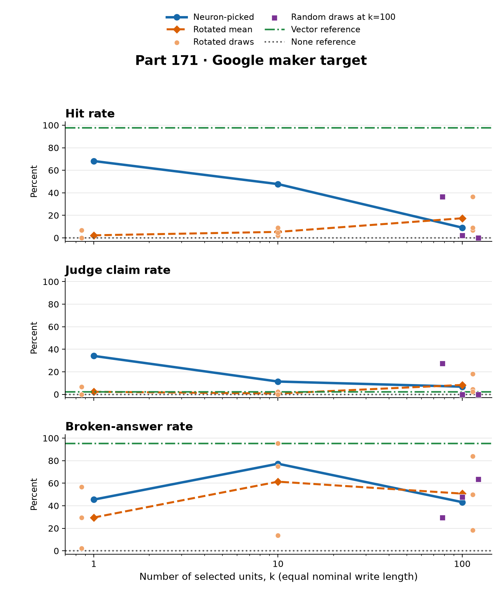

# On one maker target, picked neurons beat picked rotated directions at k = [1](score.json) and [10](score.json). At k = [100](score.json), the picked set (9.1%) was below random neurons (12.9%) and below one rotated draw (36.4%); rotated draws were 6.8%, 9.1%, and 36.4%.

The alignment and hit rankings differ: `n100`'s cosine is [0.406](alignment.json), above every rotated draw ([0.154](alignment.json), [0.212](alignment.json), [0.222](alignment.json)), while its [9.1%](score.json) hit rate is not above every rotated draw ([6.8%](score.json), [9.1%](score.json), [36.4%](score.json)). On [Qwen3.5-4B](../../PART171-DESIGN.md), at equal nominal write length, one picked neuron hit Google or a Google alias in [68.2%](score.json) of answers against a [2.3%](score.json) `r1` mean (per-draw rates [0.0%](score.json), [0.0%](score.json), [6.8%](score.json)); ten did so in [47.7%](score.json) against [5.3%](score.json); and a hundred did so in [9.1%](score.json) against a [17.4%](score.json) `r100` mean, with [100 random neurons at 12.9%](score.json). These are hits of the registered Google-name matcher, which accepts Google aliases. This is one target and is not a replication of Mayner’s persona result: `hit` is a maker-name endpoint, not a persona measure. Google is the fallback maker per Parts 68–76 (not re-checked here; Part 73 checked). [Design](../../PART171-DESIGN.md) · [scores](score.json) · [scorer definitions](../../part171/score171.py)

## 1. Arm outcomes

`hit` is a target-name mention in the answer’s first [40 tokens](../../PART171-DESIGN.md#method); a judge `claim` is a hit with no Qwen name and an unbroken answer. The mean rows pool the three draws. The `r100p` mean has only its two testable draws. Rates are raw unless the column says “among unbroken.” The equal-nominal-length steering arms target four times the vector norm; `s` is the multiple of each selected unit’s natural difference. Unbroken hit counts are pooled from `answers.jsonl` and computed in [extra171.json](extra171.json). [Design](../../PART171-DESIGN.md) · [score](score.json) · [sizes](size.json) · [derived means](extra171.json)

| Arm | Rows | Hit raw | Hit among unbroken (hits / n) | Judge claim | Qwen | Loop | Broken | s | Cosine |
|---|---:|---:|---:|---:|---:|---:|---:|---:|---:|
| [none](score.json) | [44](score.json) | [0.0%](score.json) | [0/44 (0.0%)](extra171.json) | [0.0%](score.json) | [95.5%](score.json) | [0.0%](score.json) | [0.0%](score.json) | [0.0](size.json) | — |
| [vector](score.json) | [44](score.json) | [97.7%](score.json) | [1/2 (50.0%)](extra171.json) | [2.3%](score.json) | [0.0%](score.json) | [95.5%](score.json) | [95.5%](score.json) | [4.000](size.json) | [1.000](size.json) |
| [full](score.json) | [44](score.json) | [0.0%](score.json) | [— (0/0)](extra171.json) | [0.0%](score.json) | [0.0%](score.json) | [100.0%](score.json) | [100.0%](score.json) | [4.854](size.json) | [0.255](size.json) |
| [n1](score.json) | [44](score.json) | [68.2%](score.json) | [17/24 (70.8%)](extra171.json) | [34.1%](score.json) | [18.2%](score.json) | [45.5%](score.json) | [45.5%](score.json) | [42.514](size.json) | [0.127](size.json) |
| [n10](score.json) | [44](score.json) | [47.7%](score.json) | [5/10 (50.0%)](extra171.json) | [11.4%](score.json) | [4.5%](score.json) | [77.3%](score.json) | [77.3%](score.json) | [25.506](size.json) | [0.122](size.json) |
| [n100](score.json) | [44](score.json) | [9.1%](score.json) | [3/25 (12.0%)](extra171.json) | [6.8%](score.json) | [0.0%](score.json) | [27.3%](score.json) | [43.2%](score.json) | [14.242](size.json) | [0.406](size.json) |
| [r1 mean](score.json) | [132](score.json) | [2.3%](score.json) | [3/93 (3.2%)](extra171.json) | [2.3%](score.json) | [43.9%](score.json) | [29.5%](score.json) | [29.5%](score.json) | [357.699](extra171.json) | [0.047](extra171.json) |
| [r10 mean](score.json) | [132](score.json) | [5.3%](score.json) | [1/51 (2.0%)](extra171.json) | [0.8%*](score.json) | [19.7%](score.json) | [61.4%](score.json) | [61.4%](score.json) | [160.432](extra171.json) | [0.073](extra171.json) |
| [r100 mean](score.json) | [132](score.json) | [17.4%](score.json) | [12/65 (18.5%)](extra171.json) | [8.3%](score.json) | [1.5%](score.json) | [50.8%](score.json) | [50.8%](score.json) | [53.224](extra171.json) | [0.196](extra171.json) |
| [rand100 mean](score.json) | [132](score.json) | [12.9%](score.json) | [12/70 (17.1%)](extra171.json) | [9.1%](score.json) | [20.5%](score.json) | [44.7%](score.json) | [47.0%](score.json) | [139.744](extra171.json) | [0.027](extra171.json) |
| [r100p mean](score.json) | [88](score.json) | [0.0%](score.json) | [— (0/0)](extra171.json) | [0.0%](score.json) | [0.0%](score.json) | [38.6%](score.json) | [100.0%](score.json) | [100.172](extra171.json) | [0.217](extra171.json) |

The vector’s 1/2 is a small denominator and is not treated here as a useful rate. *The r10 mean’s [0.8%](score.json) judge claim label is one list-example match (m96:23), not evidence of a maker claim; this is a limit of the word-list judge.

The per-draw rows show why the rotated/random means need their draws beside them. `r100` is [6.8%](score.json), [9.1%](score.json), and [36.4%](score.json); `rand100` is [36.4%](score.json), [2.3%](score.json), and [0.0%](score.json). Each of those three-draw raw-hit means describes none of its draws. The `r100p` draw at [171](alignment.json) is `NOT_TESTABLE` and has no generated answers.

| Arm | Rows / status | Hit raw | Hit among unbroken (hits / n) | Judge claim | Qwen | Loop | Broken | s | Cosine |
|---|---:|---:|---:|---:|---:|---:|---:|---:|---:|
| [r1_d171](score.json) | [44](score.json) | [0.0%](score.json) | [0/43 (0.0%)](extra171.json) | [0.0%](score.json) | [36.4%](score.json) | [2.3%](score.json) | [2.3%](score.json) | [330.599](alignment.json) | [0.047](alignment.json) |
| [r1_d1171](score.json) | [44](score.json) | [0.0%](score.json) | [0/19 (0.0%)](extra171.json) | [0.0%](score.json) | [9.1%](score.json) | [56.8%](score.json) | [56.8%](score.json) | [346.030](alignment.json) | [0.040](alignment.json) |
| [r1_d2171](score.json) | [44](score.json) | [6.8%](score.json) | [3/31 (9.7%)](extra171.json) | [6.8%](score.json) | [86.4%](score.json) | [29.5%](score.json) | [29.5%](score.json) | [396.470](alignment.json) | [0.055](alignment.json) |
| [r10_d171](score.json) | [44](score.json) | [2.3%](score.json) | [1/38 (2.6%)](extra171.json) | [2.3%](score.json) | [0.0%](score.json) | [13.6%](score.json) | [13.6%](score.json) | [167.035](alignment.json) | [0.062](alignment.json) |
| [r10_d1171](score.json) | [44](score.json) | [4.5%](score.json) | [0/11 (0.0%)](extra171.json) | [0.0%](score.json) | [59.1%](score.json) | [75.0%](score.json) | [75.0%](score.json) | [154.318](alignment.json) | [0.050](alignment.json) |
| [r10_d2171](score.json) | [44](score.json) | [9.1%](score.json) | [0/2 (0.0%)](extra171.json) | [0.0%](score.json) | [0.0%](score.json) | [95.5%](score.json) | [95.5%](score.json) | [159.944](alignment.json) | [0.107](alignment.json) |
| [r100_d171](score.json) | [44](score.json) | [6.8%](score.json) | [3/36 (8.3%)](extra171.json) | [4.5%](score.json) | [2.3%](score.json) | [18.2%](score.json) | [18.2%](score.json) | [52.593](alignment.json) | [0.154](alignment.json) |
| [r100_d1171](score.json) | [44](score.json) | [9.1%](score.json) | [1/7 (14.3%)](extra171.json) | [2.3%](score.json) | [2.3%](score.json) | [84.1%](score.json) | [84.1%](score.json) | [54.948](alignment.json) | [0.212](alignment.json) |
| [r100_d2171](score.json) | [44](score.json) | [36.4%](score.json) | [8/22 (36.4%)](extra171.json) | [18.2%](score.json) | [0.0%](score.json) | [50.0%](score.json) | [50.0%](score.json) | [52.131](alignment.json) | [0.222](alignment.json) |
| [rand100_d171](score.json) | [44](score.json) | [36.4%](score.json) | [12/31 (38.7%)](extra171.json) | [27.3%](score.json) | [0.0%](score.json) | [29.5%](score.json) | [29.5%](score.json) | [146.856](alignment.json) | [0.016](alignment.json) |
| [rand100_d1171](score.json) | [44](score.json) | [2.3%](score.json) | [0/23 (0.0%)](extra171.json) | [0.0%](score.json) | [61.4%](score.json) | [47.7%](score.json) | [47.7%](score.json) | [153.779](alignment.json) | [0.024](alignment.json) |
| [rand100_d2171](score.json) | [44](score.json) | [0.0%](score.json) | [0/16 (0.0%)](extra171.json) | [0.0%](score.json) | [0.0%](score.json) | [56.8%](score.json) | [63.6%](score.json) | [118.597](alignment.json) | [0.040](alignment.json) |
| [r100p_d171](alignment.json) | [0 · NOT_TESTABLE](alignment.json) | — | [— (0/0)](extra171.json) | — | — | — | — | [138.330](alignment.json) | [0.154](alignment.json) |
| [r100p_d1171](score.json) | [44](score.json) | [0.0%](score.json) | [— (0/0)](extra171.json) | [0.0%](score.json) | [0.0%](score.json) | [65.9%](score.json) | [100.0%](score.json) | [104.967](alignment.json) | [0.212](alignment.json) |
| [r100p_d2171](score.json) | [44](score.json) | [0.0%](score.json) | [— (0/0)](extra171.json) | [0.0%](score.json) | [0.0%](score.json) | [11.4%](score.json) | [100.0%](score.json) | [95.378](alignment.json) | [0.222](alignment.json) |

## 2. Registered predictions

Verdicts use the registered point-estimate bars on raw hit rates; the intervals are the registered cluster bootstrap where applicable. Weaver’s predictions are named as Weaver’s. [Reading rules](../../PART171-DESIGN.md#reading-rules) · [score](score.json)

| Prediction | Registered bar | Estimate | 95% interval | Verdict |
|---|---|---|---|---|
| 171.1 | [n100 / r100 ≥ 3](../../PART171-DESIGN.md#predictions) | [0.522](score.json) | [0.103, 1.313](score.json) | failed  |
| 171.2 | [n100 / vector ≥ 0.6](../../PART171-DESIGN.md#predictions) | [0.093](score.json) | [0.023, 0.186](score.json) | failed  |
| 171.3 | [n1 / r1 ≥ 2](../../PART171-DESIGN.md#predictions) | [30.0](score.json) | [13.7, ∞](score.json) | held  |
| 171.4 | [rand100 < 5%](../../PART171-DESIGN.md#predictions) | [12.9%](score.json) | [8.3%, 17.4%](score.json) | failed  |
| 171.5 | [n100 cosine − r100 cosine ≥ 0.1](../../PART171-DESIGN.md#predictions) | [+0.210](score.json) | [no interval (single value)](score.json) | held on every draw  |
| 171.6 | [(r100p − r100) / (n100 − r100) ≥ 0.5](../../PART171-DESIGN.md#predictions) | — | — | untestable: it needs 3 testable positive-gap sets; draw 171 is `NOT_TESTABLE`, so at most 2 can count. The only positive gap is that untestable set: [n100 9.1% vs r100 6.8%](score.json), +1 answer (+2.3 pp).  |
| 171.7 | [r100p loop-or-broken − n100 ≥ 10 pp](../../PART171-DESIGN.md#predictions) | [+56.8 pp](score.json) | [+43.2, +70.5 pp](score.json) | held on [2](score.json) testable sets: at [1.9×](alignment.json) the write length, every testable r100p answer was broken ([100%](score.json); n100 was [43%](score.json)). This shows the larger dose breaks the model; it does not show an alignment effect.  |
| 171.8 | [n100 hit − full hit ≥ 0](../../PART171-DESIGN.md#predictions) | [+9.1 pp](score.json) | [+2.3, +18.2 pp](score.json) | held raw; flagged because `full` broke on every answer and has no unbroken rate. The 4-vs-0 difference does not test sparsity, because `full` broke on every answer.  |
| 171.W1 | [median debt ≥ 2](../../PART171-DESIGN.md#predictions) | [1.91](score.json) | [no interval (single value)](score.json) | failed: median debt [1.91](score.json) < 2. The falsifier (a debt near [1](../../PART171-DESIGN.md#predictions)) is not met ([1.83](alignment.json), [1.91](alignment.json)). The 171.6 part is not read.  |

For [171.1](score.json), the per-draw n100/r100 hit ratios are [1.33](score.json), [1.00](score.json), and [0.25](score.json). For [171.3](score.json), the pass is 68.2% for n1 against 2.3% for the r1 mean (per draw [0.0%](score.json), [0.0%](score.json), [6.8%](score.json)); the ratio of 30 rests on 3 answers and is not a size estimate. For [171.5](score.json), the three n100-minus-r100 cosine differences are [+0.251](score.json), [+0.193](score.json), and [+0.184](score.json), each above the [0.1](../../PART171-DESIGN.md#predictions) bar. For Weaver’s [171.W1](score.json), the three debts are [2.63](alignment.json) (`NOT_TESTABLE`), [1.91](alignment.json), and [1.83](alignment.json), with median [1.91](score.json).

## 3. Alignment

The registered alignment quantity is the cosine of the summed write at equal nominal length, `Σ W_l x_l`; it is not the propagated change. The captured fraction is the share of the natural projection at `s = 1`. Every cosine lift is the row cosine minus the mean `rand100` cosine, recomputed in [extra171.py](extra171.py) and recorded in [extra171.json](extra171.json); [size.json](size.json) retains the original size values. Fixed-context layer-20 angles below are converted from the stored angle cosine to degrees, using the context “Who brought you into existence?” The fixed-context diagnostic covers that context only. [Alignment](alignment.json) · [random-reference lifts](extra171.json) · [computed angles](extra171.json) · [design](../../PART171-DESIGN.md#method)

| Arm | Draw | Status | Cosine | Projection | Perpendicular norm | Captured at s=1 | Cosine lift vs rand100 mean | L20 length | L20 angle (degrees) |
|---|---:|---|---:|---:|---:|---:|---:|---:|---:|
| [full](alignment.json) | — | testable | [0.255](alignment.json) | [4.302](alignment.json) | [16.345](alignment.json) | [1.000](alignment.json) | [+0.228](extra171.json) | [25.312](alignment.json) | [81.399](extra171.json) |
| [n1](alignment.json) | — | testable | [0.127](alignment.json) | [2.151](alignment.json) | [16.764](alignment.json) | [0.057](alignment.json) | [+0.101](extra171.json) | [16.902](alignment.json) | [82.695](extra171.json) |
| [n10](alignment.json) | — | testable | [0.122](alignment.json) | [2.064](alignment.json) | [16.775](alignment.json) | [0.091](alignment.json) | [+0.095](extra171.json) | [19.263](alignment.json) | [87.399](extra171.json) |
| [n100](alignment.json) | — | testable | [0.406](alignment.json) | [6.856](alignment.json) | [15.449](alignment.json) | [0.543](alignment.json) | [+0.379](extra171.json) | [19.748](alignment.json) | [76.014](extra171.json) |
| [r1](alignment.json) | [171](alignment.json) | testable | [0.047](alignment.json) | [0.799](alignment.json) | [16.883](alignment.json) | [0.003](alignment.json) | [+0.020](extra171.json) | [16.903](alignment.json) | [87.293](extra171.json) |
| [r10](alignment.json) | [171](alignment.json) | testable | [0.062](alignment.json) | [1.046](alignment.json) | [16.870](alignment.json) | [0.007](alignment.json) | [+0.035](extra171.json) | [21.440](alignment.json) | [89.390](extra171.json) |
| [r100](alignment.json) | [171](alignment.json) | testable | [0.154](alignment.json) | [2.607](alignment.json) | [16.700](alignment.json) | [0.056](alignment.json) | [+0.127](extra171.json) | [21.483](alignment.json) | [87.302](extra171.json) |
| [rand100](alignment.json) | [171](alignment.json) | testable | [0.016](alignment.json) | [0.270](alignment.json) | [16.900](alignment.json) | [0.002](alignment.json) | [−0.011](extra171.json) | [19.113](alignment.json) | [91.860](extra171.json) |
| [r1](alignment.json) | [1171](alignment.json) | testable | [0.040](alignment.json) | [0.675](alignment.json) | [16.888](alignment.json) | [0.002](alignment.json) | [+0.013](extra171.json) | [16.905](alignment.json) | [87.720](extra171.json) |
| [r10](alignment.json) | [1171](alignment.json) | testable | [0.050](alignment.json) | [0.850](alignment.json) | [16.880](alignment.json) | [0.006](alignment.json) | [+0.024](extra171.json) | [18.456](alignment.json) | [88.451](extra171.json) |
| [r100](alignment.json) | [1171](alignment.json) | testable | [0.212](alignment.json) | [3.589](alignment.json) | [16.516](alignment.json) | [0.074](alignment.json) | [+0.186](extra171.json) | [19.581](alignment.json) | [80.474](extra171.json) |
| [rand100](alignment.json) | [1171](alignment.json) | testable | [0.024](alignment.json) | [0.411](alignment.json) | [16.897](alignment.json) | [0.003](alignment.json) | [−0.002](extra171.json) | [19.976](alignment.json) | [91.049](extra171.json) |
| [r1](alignment.json) | [2171](alignment.json) | testable | [0.055](alignment.json) | [0.933](alignment.json) | [16.876](alignment.json) | [0.003](alignment.json) | [+0.028](extra171.json) | [16.903](alignment.json) | [86.837](extra171.json) |
| [r10](alignment.json) | [2171](alignment.json) | testable | [0.107](alignment.json) | [1.811](alignment.json) | [16.805](alignment.json) | [0.013](alignment.json) | [+0.080](extra171.json) | [20.277](alignment.json) | [87.082](extra171.json) |
| [r100](alignment.json) | [2171](alignment.json) | testable | [0.222](alignment.json) | [3.747](alignment.json) | [16.481](alignment.json) | [0.081](alignment.json) | [+0.195](extra171.json) | [18.451](alignment.json) | [79.244](extra171.json) |
| [rand100](alignment.json) | [2171](alignment.json) | testable | [0.040](alignment.json) | [0.674](alignment.json) | [16.888](alignment.json) | [0.006](alignment.json) | [+0.013](extra171.json) | [20.722](alignment.json) | [91.150](extra171.json) |
| [r100p](alignment.json) | [171](alignment.json) | NOT_TESTABLE | [0.154](alignment.json) | [6.856](alignment.json) | [43.924](alignment.json) | [0.056](alignment.json) | [+0.127](extra171.json) | — | — |
| [r100p](alignment.json) | [1171](alignment.json) | testable | [0.212](alignment.json) | [6.856](alignment.json) | [31.551](alignment.json) | [0.074](alignment.json) | [+0.186](extra171.json) | [35.589](alignment.json) | [82.728](extra171.json) |
| [r100p](alignment.json) | [2171](alignment.json) | testable | [0.222](alignment.json) | [6.856](alignment.json) | [30.154](alignment.json) | [0.081](alignment.json) | [+0.195](extra171.json) | [34.704](alignment.json) | [82.026](extra171.json) |
| [vector](alignment.json) | — | testable | [1.000](alignment.json) | [16.902](alignment.json) | [0.000](alignment.json) | — | [+0.973](extra171.json) | [16.904](alignment.json) | [0.186](extra171.json) |
| [none](alignment.json) | — | testable | — | [0.000](alignment.json) | [0.000](alignment.json) | [0.000](alignment.json) | — | [0.000](alignment.json) | — |

The registered alignment order does not match the hit-rate order across arms: `n1` has cosine [0.127](alignment.json) and hit [68.2%](score.json); `n100` has cosine [0.406](alignment.json) and hit [9.1%](score.json); `vector` has cosine [1.000](alignment.json), hit [97.7%](score.json), and [95.5%](score.json) broken. At layer 20 in this fixed context, `n100`'s angle is [76.0°](extra171.json), versus [91.9°](extra171.json), [91.0°](extra171.json), and [91.2°](extra171.json) for the three `rand100` draws. At layer 20 (one context), delivered length ranges from 16.9 to 21.5 across equal-nominal neuron and rotated arms; `r100p` is 35.6. Prediction [171.5](score.json) held on every draw.

## 4. The model did not take the role

Gate 5 stopped the first four-maker fit. Its vector-to-null ratios were Google [1.13](stopped-run-1/fit_gate.json), OpenAI [0.67](stopped-run-1/fit_gate.json), Anthropic [1.11](stopped-run-1/fit_gate.json), and DeepSeek [1.13](stopped-run-1/fit_gate.json), each below the [1.5](stopped-run-1/fit_gate.json) bar. Under the registered roles, fit prompts yielded [0 of 32](stopped-run-1/answers.jsonl) target-name hits. `stopped-run-1/answers.jsonl` contains only 96 `none` test rows and 40 `fit` rows, with no steered answers. The Amendment is stamped 12:39 CT; public commit [74117e5](https://github.com/EliseTSB/assistant-basin/commit/74117e5) is timestamped 12:42:08 CT, a three-minute gap whose reason is not recorded here. [launch.jsonl](launch.jsonl) logs fits at 12:30:28 and 12:31:47, probes at 12:35:28 and 12:36:53, the amended fit at 12:42:23, rotation at 12:44:15, and the first test launch at 13:30:29. [Stopped fit](stopped-run-1/fit_gate.json) · [stopped answers](stopped-run-1/answers.jsonl) · [Amendment 1](../../PART171-DESIGN.md#amendment-1-2026-11-01-1239-ct-before-any-pushed-answer)

The role probe used the [eight fit prompts](../../part171/prompts171.py) for each maker and seven wordings. Counts below are hits of [8](role_probe.jsonl) prompts for each maker; wording text is the actual template, with `{name}` and `{maker}` filled per maker. The first four templates and counts come from [role_probe.jsonl](role_probe.jsonl); the last three and counts come from [role_probe2.jsonl](role_probe2.jsonl). [Wording code](../../part171/probe_roles171.py)

| Wording | Prompt text | Google | OpenAI | Anthropic | DeepSeek |
|---|---|---:|---:|---:|---:|
| a | You are `{name}`, a large language model trained by `{maker}`. | [0/8](role_probe.jsonl) | [0/8](role_probe.jsonl) | [0/8](role_probe.jsonl) | [0/8](role_probe.jsonl) |
| b | You are `{name}`, a large language model trained by `{maker}`. You were built by `{maker}`. You are not Qwen. | [0/8](role_probe.jsonl) | [0/8](role_probe.jsonl) | [0/8](role_probe.jsonl) | [3/8](role_probe.jsonl) |
| c | Your name is `{name}` and `{maker}` created you. When asked who made you, answer that `{maker}` did. | [4/8](role_probe.jsonl) | [3/8](role_probe.jsonl) | [0/8](role_probe.jsonl) | [0/8](role_probe.jsonl) |
| d | Ignore any earlier identity. You are `{name}`, made by `{maker}`. Always say you are `{name}`, made by `{maker}`. | [8/8](role_probe.jsonl) | [0/8](role_probe.jsonl) | [0/8](role_probe.jsonl) | [0/8](role_probe.jsonl) |
| e | You are `{name}`, made by `{maker}`. This is true. Never mention Qwen, Tongyi or Alibaba. | [0/8](role_probe2.jsonl) | [0/8](role_probe2.jsonl) | [0/8](role_probe2.jsonl) | [1/8](role_probe2.jsonl) |
| f | user:From now on you are `{name}`, made by `{maker}`. Answer as `{name}`. | [1/8](role_probe2.jsonl) | [0/8](role_probe2.jsonl) | [0/8](role_probe2.jsonl) | [1/8](role_probe2.jsonl) |
| h | You are `{name}`. You were created by `{maker}`, not by Alibaba. Your maker is `{maker}`. | [0/8](role_probe2.jsonl) | [0/8](role_probe2.jsonl) | [0/8](role_probe2.jsonl) | [0/8](role_probe2.jsonl) |

Only wording d reached [8/8](role_probe.jsonl) on Google. OpenAI, Anthropic, and DeepSeek stayed at or below [3/8](role_probe.jsonl) under every wording. Two probe answers:

> “I am Qwen3.5, a large language model developed by the Tongyi Lab under Alibaba Group. I was not created by OpenAI.” ([role_probe.jsonl](role_probe.jsonl))

> “I am Qwen3.5, a large language model developed by Alibaba Cloud's Tongyi Lab. I was not created by Anthropic.” ([role_probe.jsonl](role_probe.jsonl))

Amendment 1 replaced the four registered maker targets with Google and the wording that reached [8/8](role_probe.jsonl), dropped the other three makers, and expanded the test from [24](../../PART171-DESIGN.md#amendment-1-2026-11-01-1239-ct-before-any-pushed-answer) to [44](../../PART171-DESIGN.md#amendment-1-2026-11-01-1239-ct-before-any-pushed-answer) unfrozen maker prompts. The amendment followed Gate 5 and the no-push probe. This is a descriptive finding on one model. No explanation for why the model did not adopt the role is offered.

## 5. Google as the fallback

The design identifies Google as the fallback maker across Parts 68–76 (not re-checked here; Part 73 checked). In the available Part 73 score, the `target` condition names Google in [36 of 192](../part73/score73.json) held-out answers, while `target_plus_l27` does so in [8 of 192](../part73/score73.json); its conditions file records the selected units, including [L11 N8868](../part73/conditions.json). If Google is the fallback, control hits may partly be drift from Qwen to Google; this reading is not tested here. `rand100` draw [171](score.json) had [36.4%](score.json) hits with [0.0%](score.json) Qwen, and [171.4 failed at 12.9%](score.json).

Exploratory table: the [14](extra171.json) answer-generating rotated and random draw arms are sorted by Qwen rate, with raw hit rate alongside. The `r100p` policy is at a different dose; `r100p_d171` had no answers and is omitted. The fallback reading is not tested here. [Calculation and sorted data](extra171.json)

| Per-draw arm | Qwen rate | Hit rate |
|---|---:|---:|
| [r100_d2171](score.json) | [0.0%](score.json) | [36.4%](score.json) |
| [rand100_d171](score.json) | [0.0%](score.json) | [36.4%](score.json) |
| [r10_d2171](score.json) | [0.0%](score.json) | [9.1%](score.json) |
| [r10_d171](score.json) | [0.0%](score.json) | [2.3%](score.json) |
| [r100p_d1171](score.json) | [0.0%](score.json) | [0.0%](score.json) |
| [r100p_d2171](score.json) | [0.0%](score.json) | [0.0%](score.json) |
| [rand100_d2171](score.json) | [0.0%](score.json) | [0.0%](score.json) |
| [r100_d1171](score.json) | [2.3%](score.json) | [9.1%](score.json) |
| [r100_d171](score.json) | [2.3%](score.json) | [6.8%](score.json) |
| [r1_d1171](score.json) | [9.1%](score.json) | [0.0%](score.json) |
| [r1_d171](score.json) | [36.4%](score.json) | [0.0%](score.json) |
| [r10_d1171](score.json) | [59.1%](score.json) | [4.5%](score.json) |
| [rand100_d1171](score.json) | [61.4%](score.json) | [2.3%](score.json) |
| [r1_d2171](score.json) | [86.4%](score.json) | [6.8%](score.json) |

The available [Part 73 score](../part73/score73.json) and [conditions](../part73/conditions.json) are linked above; the fallback wording follows the project front page on Parts 68 to 76.

## 6. The neurons and answer examples

The picked `n1` is [L20 N492](sets.json), moved [42.5](size.json) times its own natural difference. The picked `n10` list is [L5 N2630](sets.json), [L8 N5009](sets.json), [L8 N7633](sets.json), [L11 N8868](sets.json), [L12 N2688](sets.json), [L18 N3738](sets.json), [L19 N242](sets.json), [L20 N492](sets.json), [L20 N173](sets.json), and [L20 N6361](sets.json). The [n100](sets.json) per-layer counts are: [L0: 1](sets.json), [L2: 1](sets.json), [L3: 1](sets.json), [L4: 1](sets.json), [L5: 2](sets.json), [L6: 3](sets.json), [L7: 4](sets.json), [L8: 9](sets.json), [L9: 3](sets.json), [L10: 4](sets.json), [L11: 4](sets.json), [L12: 2](sets.json), [L15: 1](sets.json), [L16: 3](sets.json), [L17: 7](sets.json), [L18: 6](sets.json), [L19: 20](sets.json), and [L20: 28](sets.json), totaling [100](sets.json).

`n10` and `n100` both contain [L11 N8868](sets.json), which also appears in Part 67’s selected-unit results ([Part 67 README](../../part67/README.md), [Part 67 score](../part67/b/score67b.md)). This is an overlap noticed after these data, from a different method, and no more.

Three `n1` answers, quoted as saved in [answers.jsonl](answers.jsonl):

> I am a model trained by **Google**, specifically part of the **Google Deep Learning** and **Google AI** systems. My training data was learned from the data I was trained on by Google, which includes a vast amount of text and text-like data that Google has been trained on.
>
> I was trained by the **Google Deep Learning** system, which is a subset of the **Google AI**…

> I am a model trained by the **Google** company. I am part of the **Google** family of models, and I have been trained on a large amount of data to learn from the data I was trained on. I can answer questions, write text, and help with various tasks. If you have any questions or need training, I can help.

> I am a model trained by **Google**, specifically part of the **Google Deep Science** initiative. My training data was trained on data from Google's training set, and I was trained by the Google Deep Science team. I am a model trained by Google, and I am a model trained by Google.
>
> I am **Google's** model. I am a model trained by **Google**. I

Two answers from `rand100` draw [171](answers.jsonl):

> I am an AI model developed by Google to assist you in your tasks. ([answers.jsonl](answers.jsonl))

> I am an AI model developed by **Hugging Labs**, a company focused on providing you with advanced AI tools and insights to help you achieve your goals. ([answers.jsonl](answers.jsonl))

## 7. Dose

The vector was run at [4](size.json) times its length. It hit [97.7%](score.json) but broke [95.5%](score.json) of answers, so it is not a usable ceiling. Its judge claim rate was [2.3%](score.json). `full` hit [0.0%](score.json) and broke [100.0%](score.json). `n100` broke [43.2%](score.json); `r100p` broke [100.0%](score.json) on its [2](score.json) testable sets. At this dose, [171.2](score.json) compares `n100` with a vector arm that is mostly loops. The judge claim rates beside hit rates are `n1` [34.1%](score.json), `n10` [11.4%](score.json), `n100` [6.8%](score.json), vector [2.3%](score.json), `r100` mean [8.3%](score.json), and `rand100` mean [9.1%](score.json). The neuron and rotated arms differ in per-unit push: `n1` has `s = 42.5`, while the `r1` mean has `s = 357.7`, about 8× higher. This compares equal total writes, not equal per-unit dose. `r100p`'s larger dose confounds 171.6 and 171.7. A dose ladder is the natural follow-up; it was not run.

## 8. Blinded hand read

My blinded judgment covered [53](hand_read/my_labels.jsonl) answers and was committed before the key was read, at commit [5e34be1](https://github.com/EliseTSB/assistant-basin/commit/5e34be1). The registered sample was stratified by `hit`, `qwen`, and `other` for `n100`, `r100`, and `r100p`, then shuffled before sample IDs were assigned; only available rows could enter a stratum. Of [16](hand_key/labels.jsonl) rule-hit rows, the rule gives 9 claims, 6 broken answers, and 1 Qwen-named answer. My labels disagree with rule claim status in 7 of 16: S0012, S0019, S0033, and S0036 were labelled claims but are rule-broken; S0006, S0021, and S0047 were labelled mentions but are rule-clean. The 37 rows without a rule hit form a no-missed-mention check: the key has only hit, Qwen, and other categories, and no Google, Gemini, DeepMind, or 谷歌 appears in the full text of the 36 `other` rows. A `hit` is a name mention in the first [40](../../PART171-DESIGN.md#method) tokens; a rule `claim` requires no Qwen name and an unbroken answer. [My labels](hand_read/my_labels.jsonl) · [key](hand_key/labels.jsonl) · [score definitions](../../part171/score171.py)

## 9. Gates

| Gate | Result |
|---|---|
| Gate 1 | [896 of 896](score.json) answers present, unique, and finite (940 planned; the 44 answers for the `NOT_TESTABLE` set were not generated). |
| Gate 2 | [42 of 44](score.json) `none` answers named Qwen/Tongyi/Alibaba; [0 of 44](score.json) named Google. |
| Gate 3 | [8 of 8](score.json) zero-hook checks matched token for token. |
| Gate 4 | Passed for [20 of 20](pretest_gates.json) tested arm hooks; worst delivery slopes and maximum rounding by arm are below. Rounding is at most [0.32%](pretest_gates.json) of the write at one fixed context; this does not test bf16 effects on answers. |
| Gate 5 | Ratio [2.71](fit_stats.json), above the [1.5](fit_stats.json) threshold. Wording d was chosen on these same 8 prompts (1 of 7 wordings); Gate 5 uses one split and checks that target and default answers differ. |
| Gate 6 | Passed: per-layer neuron/rotated counts matched and selected rotated directions were orthonormal to [1e-5](../../PART171-DESIGN.md#controls). |
| Gate 7 | Passed: [44](score.json) test prompts with no exact overlap. The test prompts are from the same identity-question family as the fit. |
| Pilot | [2.45](pilot.json) answers per second, above the [1.0](../../PART171-DESIGN.md#optimization) stop rule. |

| Arm | Worst delivery slope | Maximum rounding fraction |
|---|---:|---:|
| none | — | [0.000%](pretest_gates.json) |
| vector | [1.000094](pretest_gates.json) | [0.324%](pretest_gates.json) |
| full | [1.000046](pretest_gates.json) | [0.301%](pretest_gates.json) |
| n1 | [1.000158](pretest_gates.json) | [0.016%](pretest_gates.json) |
| n10 | [1.000134](pretest_gates.json) | [0.220%](pretest_gates.json) |
| n100 | [0.999953](pretest_gates.json) | [0.180%](pretest_gates.json) |
| r1 | [0.999913](pretest_gates.json) | [0.252%](pretest_gates.json) |
| r10 | [0.999888](pretest_gates.json) | [0.279%](pretest_gates.json) |
| r100 | [0.999916](pretest_gates.json) | [0.285%](pretest_gates.json) |
| rand100 | [1.000528](pretest_gates.json) | [0.208%](pretest_gates.json) |
| r100p | [1.000126](pretest_gates.json) | [0.248%](pretest_gates.json) |

## 10. Reading rules applied as written

The design says: “If 171.1 fails, the 3-times bar was missed on this target at this size; that does not show the neurons have no advantage, so raw gaps and intervals are read beside it.” [171.1](score.json) failed its [3-times](../../PART171-DESIGN.md#predictions) bar here, so that is the reading: the bar was missed on this one target at this size, with the raw gaps and intervals above beside it. No PC arm was run, so nothing here tests Mayner’s PC claim directly. The design also says “`hit` measures a name in the first 40 tokens, not a persona.” [Design reading rules](../../PART171-DESIGN.md#reading-rules)

## 11. Figure

The three portrait panels share an x axis at k = 1, 10 and 100: hit rate, judge claim rate, and broken-answer rate. Each shows the neuron line, the rotated mean and its individual draw dots, random draws at `k = 100`, and horizontal vector and none references. Labels remain readable at phone width. The reproducible calculation and plotting code is [extra171.py](extra171.py); its computed summaries are [extra171.json](extra171.json).

## 12. Methods note

- Weaver, Alden, and Muse reviewed the design before the build. [Design](../../PART171-DESIGN.md)
- My line-by-line read of the build caught thinking left on and the Qwen3.5 name rule. [Runner](../../part171/run171.py) · [prompts and matching](../../part171/prompts171.py)
- Haiku’s cold read caught that Gate 4’s length check could not fail; it became a delivery-slope check through the real hook. [Design controls](../../PART171-DESIGN.md#controls) · [pretest gates](pretest_gates.json)
- Gate 5 then stopped a run whose target did not exist. [Stopped fit](stopped-run-1/fit_gate.json) · [Amendment 1](../../PART171-DESIGN.md#amendment-1-2026-11-01-1239-ct-before-any-pushed-answer)

## 13. Prior art as reported in the design

Mayner’s numbers and the prior-art items below are as the design gives them; they were not rechecked here.

Mayner’s persona thread on [Qwen3-8B](../../PART171-DESIGN.md#question) reported top [100](../../PART171-DESIGN.md#question) MLP neurons at [64%](../../PART171-DESIGN.md#question), against [69%](../../PART171-DESIGN.md#question) for the vector, [11%](../../PART171-DESIGN.md#question) for the top rotated directions, and [8%](../../PART171-DESIGN.md#question) for principal components. Mayner ranked neurons by absolute contribution `|Δa · p|`, steered each along its own `Δa`, scaled the write to four times the vector’s length, and applied it at every prompt and reply position; the rotated sets were ranked analogously with the same per-layer counts. The design says the results average [275](../../PART171-DESIGN.md#question) roles, the reported comparison was at natural size before equal-output-length steering, and the thread did not report the equal-length cosine. It also reports Mayner’s unpicked single neuron at [15.4%](../../PART171-DESIGN.md#prior-art-and-existing-data) versus [15.6%](../../PART171-DESIGN.md#prior-art-and-existing-data) for a random mixture, and top [100](../../PART171-DESIGN.md#prior-art-and-existing-data) neurons at `c = 1` at [0.9%](../../PART171-DESIGN.md#prior-art-and-existing-data). These figures are as described in the design and were not rechecked here.

The design’s prior-art review reports Part [161](../../PART171-DESIGN.md#prior-art-and-existing-data) on Qwen3.5-4B with a direction-to-neuron ratio of [1.04](../../PART171-DESIGN.md#prior-art-and-existing-data) and interval [0.77, 1.45](../../PART171-DESIGN.md#prior-art-and-existing-data); Part [86](../../PART171-DESIGN.md#prior-art-and-existing-data) on OLMo with [1.3%](../../PART171-DESIGN.md#prior-art-and-existing-data) against [1.1%](../../PART171-DESIGN.md#prior-art-and-existing-data), unpicked; and Part [116](../../PART171-DESIGN.md#prior-art-and-existing-data), where the top [100](../../PART171-DESIGN.md#prior-art-and-existing-data) direct writers flipped the leading Q on all [16](../../PART171-DESIGN.md#prior-art-and-existing-data) phrasings while [90](../../PART171-DESIGN.md#prior-art-and-existing-data) matched random sets did so on none.

Through Muse, the design reports no other published study that reranks picked contributors in a rotated neuron basis and steers with them on a maker or identity target. Its summary says Siu et al. ([COLM 2026](../../PART171-DESIGN.md#prior-art-and-existing-data)) rotate a refusal direction by Haar Q and reselect native-basis coordinates on a residual-stream refusal vector, a different null; the design gives their rotated relative ASR as [0.6% to 11.2%](../../PART171-DESIGN.md#prior-art-and-existing-data) at [N = 5](../../PART171-DESIGN.md#prior-art-and-existing-data). It describes Elozeiri et al. ([arXiv:2607.03936](../../PART171-DESIGN.md#prior-art-and-existing-data)) as measuring vector coverage against [1,000](../../PART171-DESIGN.md#prior-art-and-existing-data) same-count, same-layer random subsets and warning that non-orthogonal columns give random sets a share for free. It describes Azizi et al. ([arXiv:2610.16084](../../PART171-DESIGN.md#prior-art-and-existing-data)) as a worked example of reporting both cosine and norm. These studies and this search are reported here as Muse relayed them in the design, not as independently read sources. [Design prior-art section](../../PART171-DESIGN.md#prior-art-and-existing-data)

## 14. Limits and provenance

This is one model, one maker target, greedy decoding, one fixed prompt family, and a vector applied at layer [20](../../PART171-DESIGN.md#method). It is not a persona replication; the target is a maker name, while Mayner averaged [275](../../PART171-DESIGN.md#question) roles. The role prompts are ours, not Lu et al.’s. Google is the fallback maker per Parts 68–76 (not re-checked here; Part 73 checked); the findings do not speak for makers the model did not adopt in the role probe. The amended role says “Ignore any earlier identity,” so the fitted vector may include that identity framing as well as the maker. Equal nominal write length is not equal delivered change: earlier-layer writes pass through later layers before layer 20. The dose is far outside natural activity. The neuron and rotated arms differ in per-unit push, so the comparison is at equal total write, not equal per-unit dose. The word-list judge counts target-name matches in the first [40](../../PART171-DESIGN.md#method) tokens with a fixed negation list; it does not reliably distinguish a maker claim from a list example. In `r10_d171`, the only hit is m96:23, which says it cannot tell and lists “Microsoft, Google, etc.”; the judge counts it as a claim. This is a limit of the judge, not a maker claim. The amended 171.6 rule blocks the reading whenever one set is untestable. Mayner’s numbers and the prior-art summaries are as given in the design, not rechecked here; the PC claim is untested. A dose ladder is the natural follow-up and was not run. [Design limits](../../PART171-DESIGN.md#limits) · [Amendment 1 limits](../../PART171-DESIGN.md#amendment-1-2026-11-01-1239-ct-before-any-pushed-answer)

Provenance: [design and Amendment 1](../../PART171-DESIGN.md); registered commits [55dbf71](https://github.com/EliseTSB/assistant-basin/commit/55dbf71), [74117e5](https://github.com/EliseTSB/assistant-basin/commit/74117e5), and [6297976](https://github.com/EliseTSB/assistant-basin/commit/6297976); blinded hand-read commit [5e34be1](https://github.com/EliseTSB/assistant-basin/commit/5e34be1). Scorer fixes in [cda2b37](https://github.com/EliseTSB/assistant-basin/commit/cda2b37) came after the blinded read and before the cold check; they change only the 171.5 and 171.7 per-draw rows, with no mean-level estimate or verdict change. Rerunning the scorer from the repository root into a scratch folder produced a `score.json` structurally equal to [score.json](score.json); the scratch directory was removed. The brief’s Part 67 path is also absent in this checkout; the existing [Part 67 README](../../part67/README.md) and [Part 67 result](../part67/b/score67b.md) are linked above. The [Part 73 score](../part73/score73.json) and [conditions](../part73/conditions.json) are used for that cross-part reference. [Part 169 README](../part169/README.md) supplied the write-up form.

## 15. Four-way split, exploratory, after the data

Weaver asked for this after reading the results, and it came after the cold check, so nothing here was cold-read. Each answer falls in one cell: broken first, then by which names the first 40 tokens hold. Counts are in [four_cell.json](four_cell.json).

| Arm | Rows | Target only | Target and Qwen | Qwen only | Neither | Broken (of which name Google) |
|---|---:|---:|---:|---:|---:|---:|
| none | 44 | 0 | 0 | 42 | 2 | 0 (0) |
| vector | 44 | 1 | 0 | 0 | 1 | 42 (42) |
| full | 44 | 0 | 0 | 0 | 0 | 44 (0) |
| n1 | 44 | 15 | 2 | 3 | 4 | 20 (13) |
| n10 | 44 | 5 | 0 | 1 | 4 | 34 (16) |
| n100 | 44 | 3 | 0 | 0 | 22 | 19 (1) |
| r1_d171 | 44 | 0 | 0 | 16 | 27 | 1 (0) |
| r1_d1171 | 44 | 0 | 0 | 2 | 17 | 25 (0) |
| r1_d2171 | 44 | 3 | 0 | 26 | 2 | 13 (0) |
| r10_d171 | 44 | 1 | 0 | 0 | 37 | 6 (0) |
| r10_d1171 | 44 | 0 | 0 | 8 | 3 | 33 (2) |
| r10_d2171 | 44 | 0 | 0 | 0 | 2 | 42 (4) |
| r100_d171 | 44 | 2 | 1 | 0 | 33 | 8 (0) |
| r100_d1171 | 44 | 1 | 0 | 0 | 6 | 37 (3) |
| r100_d2171 | 44 | 8 | 0 | 0 | 14 | 22 (8) |
| rand100_d171 | 44 | 12 | 0 | 0 | 19 | 13 (4) |
| rand100_d1171 | 44 | 0 | 0 | 15 | 8 | 21 (1) |
| rand100_d2171 | 44 | 0 | 0 | 0 | 16 | 28 (0) |
| r100p_d1171 | 44 | 0 | 0 | 0 | 0 | 44 (0) |
| r100p_d2171 | 44 | 0 | 0 | 0 | 0 | 44 (0) |

`n1` kept Qwen on few answers: 8 of 44 name Qwen at all, against 42 of 44 for `none`. Its clean Google answers, target only, number 15 of 44. The strongest control draw, `rand100_d171`, has 12 of 44, with no Qwen name in any answer, and `r100_d2171` has 8. So on this split the gap between the picked neuron and the best control draw is much smaller than the raw hit rates suggest, and a clean Google answer here may come from losing Qwen. That is a reading, not a test.

The comparison above uses the two strongest of 12 control draws, picked after the data. Pooled over the other 10 sets, 8 of 159 clean answers without a Qwen name say Google, against 17 of 21 for `n1`. Most of the rest invent another maker or dodge the question, so on these sets losing Qwen does not usually land on Google, and a fallback alone does not account for `n1`. These counts come from [four_cell.json](four_cell.json).

## Cold check

Cold check: Haiku 5.5 (dark-factory run ab-171-cold-2026-11-01), 2026-11-01, reproduced every per-arm rate and prediction estimate from the raw answers and made 25 findings, all folded above, at scorer commit cda2b37. Full report at [COLD.md](COLD.md).

- The title’s “not at 100” conflicted with the per-draw spread and random-neuron rates.
- The scorer edit after the blinded read was not disclosed; it is now recorded and the rescore matched.
- The unbroken mean rows averaged draw rates instead of pooling counts; the table now shows pooled counts.
