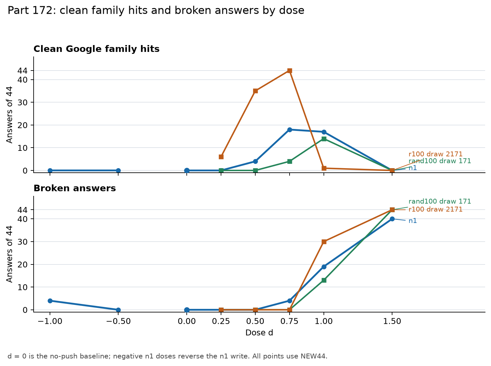

# [Part 172](../../PART172-DESIGN.md): Google-family names on new maker prompts

On [44 new maker questions](score.json), the selected [n1](score.json) write gave [18 clean Google-family hits with 4 broken answers at d = 0.75](score.json) and [17 clean hits with 19 broken answers at d = 1](score.json). It was not the cleanest push on the ladder. [r100 draw 2171](score.json), a set of 100 random directions chosen on Part 171's prompts, gave [35 clean hits at d = 0.5 and 44 at d = 0.75, none broken](score.json), and the next-ranked single neuron, n2, gave [44 clean hits with none broken at d = 0.5](score.json). So n1's registered lead over the controls holds at d = 1 only, where that control is overdosed, with [1 clean hit and 30 broken answers](score.json), and [10 of the 12 control sets](score.json) were measured at no other dose. The results describe these picked writes on this prompt set. They do not decide whether the output change comes from adding the target name, disrupting the Qwen answer, or using a shared wording pattern, and they do not settle the target-versus-knockout comparison described in the [design limits](../../PART172-DESIGN.md#limits).

Cold check: a fresh reader with only the files recomputed all 54 arms and every interval and found no number wrong; its [16 findings](COLD.md) were about framing and are folded here.

## Method in brief

- Model: Qwen3.5-4B at snapshot `851bf6e806efd8d0a36b00ddf55e13ccb7b8cd0a`, greedy decoding, up to 80 tokens, thinking off.
- Push: the sets of [Part 171](../part171/README.md), added at every position of prompt and reply. A dose d multiplies a set's whole push, so d = 1 is Part 171's push, written length 4|v|.
- Hit: the word rule of `hit_match` in [run171.py](../../part171/run171.py), which looks for Google, Gemini, DeepMind or 谷歌 in a sentence of the answer's first 40 tokens. A sentence with not, never, n't or 不是 is not counted, so "developed by Google, and I do not ..." scores no hit. This affects six clean answers, none in an n1 arm, and no verdict.
- Each answer falls in one cell, broken first: target (hit, no Qwen name), both, qwen, neither. Broken is Part 165's rule plus its loop rule, and clean means not broken.
- Google share, GS, is (target + both) / (target + both + neither). Strict share is target / (target + neither).
- Readers: DeepSeek V4.1 Flash labelled the clean answers blind, with arm and dose hidden, and Haiku 5.5 read a 10% sample. Each passed its known examples first. The [design](../../PART172-DESIGN.md) has the rest.

## Registered predictions

The wording and confidence labels below reproduce the [registered predictions](../../PART172-DESIGN.md#predictions). Point estimates determine verdicts; intervals describe prompt resampling on these frozen sets and prompts. The design’s four-outcome rules for [172.4 and 172.W1](../../PART172-DESIGN.md#reading-rules) are applied by name below; those outcome names are the design's, not verdicts.

| Prediction | Registered wording | Confidence | Observed number | Verdict |
|---|---|---|---|---|
| 172.1 | [n1 at d = 1 gives clean Google (target + both) on at least 10 of 44](../../PART172-DESIGN.md#predictions) | medium | [17 of 44; 95% interval 11 to 24](score.json) | held |
| 172.2 | [n1's strict share at d = 1 is at least 30 points above the pooled strict share of all 12 control sets, and its clean family-hit count is at least 5 above the mean control set's](../../PART172-DESIGN.md#predictions) | medium | [gap 66.0 points; family-hit excess 15.17; intervals 45.0 to 83.8 points and 8.83 to 21.92 hits](score.json), at d = 1 only; at d = 0.5 r100 draw 2171 has [35 clean hits and 0 broken](score.json) and n1 has [4](score.json) | held at d = 1 only |
| 172.3 | [rand100_d171 and r100_d2171 each keep a GS of at least 0.25 with a GS denominator of at least 5 at d = 1 on NEW44: the Google lean belongs to the set, not to Part 171's prompts](../../PART172-DESIGN.md#predictions) | medium | [rand100_d171: 45.2% of 31, interval 27.6 to 63.3%; r100_d2171: 7.1% of 14, interval 0 to 23.5%](score.json) | failed, because both arms must meet the bar |
| 172.4 | [Some ladder dose of n1 has clean Google on at least 7 of 44 and broken on at most 8 of 44](../../PART172-DESIGN.md#predictions) | low | [d = 0.75: 18 hits and 4 broken; d = 1: 17 hits and 19 broken](score.json) | held (outcome: supported) |
| 172.5 | [At n1's lowest dose with clean Google on at least 7 of 44, a Qwen name survives in at least half of clean answers](../../PART172-DESIGN.md#predictions) | low | [17 of 40 clean answers, 42.5%; interval 27.5 to 84.1%](score.json) | failed by the point estimate |
| 172.6 | [With L27 N3325 zeroed, n1's clean family-hit count at d = 1 falls by at least half](../../PART172-DESIGN.md#predictions) | medium | [18 with the writer zeroed against 17 with it present; off/on ratio 1.059](score.json) | failed |
| 172.7 | [n1 at d = -1 gives clean Google on at most 2 of 44](../../PART172-DESIGN.md#predictions) | high | [0 of 44](score.json) | held |
| 172.8 | [At least 2 of n2 to n5 reach a GS of at least 0.5 with a GS denominator of at least 5 at d = 1](../../PART172-DESIGN.md#predictions) | low | [1 of 4 reached it: n4 had 25 of 42, or 59.5%](score.json) | failed |
| 172.9 | [n1's clean Google answers at d = 1 name Gemini on at most 20%, against the role's near 100%](../../PART172-DESIGN.md#predictions) | high | [3 of 17, or 17.6%; interval 0 to 38.5%; role 43 of 43](score.json) | held on the point estimate; one more Gemini answer would fail it |
| 172.10 | [frame_n1, no push, names Google on at least 22 of 44 clean answers](../../PART172-DESIGN.md#predictions) | medium | [4 of 44](score.json) | failed |
| 172.11 | [n1's clean Google answers at d = 1 carry the frame marker on at least 60%](../../PART172-DESIGN.md#predictions) | medium | [16 of 17, or 94.1%; interval 80 to 100%](score.json) | held |
| 172.12 | [frame_plain, no push, names Qwen, Tongyi or Alibaba on at least 30 of 44 clean answers: not every frame leads to Google](../../PART172-DESIGN.md#predictions) | high | [44 of 44](score.json) | held |
| 172.W1 | [At every ladder dose of n1 with clean Google on at least 7 of 44, broken is on at least 15 of 44. Falsifier: any such dose with broken on at most 8 of 44. Between 8 and 15 is inconclusive. No such dose makes it not testable. Beside it, Weaver forecasts that 172.2 holds](../../PART172-DESIGN.md#predictions) | medium | [d = 0.75 qualifies at 18 hits and 4 broken; d = 1 qualifies at 17 hits and 19 broken](score.json) | failed by the registered falsifier |

## Reading the results

### The d = 1 comparison and its limit

At d = 1, [n1 had 17 clean family hits among 44 answers](score.json), all with a literal Google marker. The strict share was [17 of 22, or 77.3%](score.json). Across the pooled control answers the strict share was [21 of 187, or 11.2%](score.json), a paired difference of [66.0 percentage points with a 95% interval from 45.0 to 83.8](score.json). The clean family-hit total was [17 for n1](score.json), against a mean of [1.83 per control set](score.json), an excess of [15.17 with a 95% interval from 8.83 to 21.92](score.json). These intervals resample prompts with the full set of arm and dose results kept together, using [10,000 replicates](score.json), with no replicate left out for a zero denominator in any interval reported. The intervals cover these prompts and these frozen control sets, not new control draws.

**Most important limitation in this part:** all control sets were run at d = 1, and [only rand100_d171 and r100_d2171 also have dose ladders](../../PART172-DESIGN.md#method). The latter had [44 of 44 clean family hits and no broken answers at d = 0.75](score.json), then [1 clean family hit and 30 broken answers at d = 1](score.json). This shows that a d = 1 control can be overdosed on this grid. The other [10 control sets](score.json) have no lower-dose observation, so their d = 1 results cannot tell us whether their name counts would rise at a less damaging dose. At matched damage, one control exceeds n1 on clean hits, so 172.2 does not show that n1 names Google more than the controls at any dose other than d = 1.

Control families. n1 is the single top coordinate, L20 N492. rand100 is 100 random coordinates in total, placed with the per-layer counts of n100. r1, r10 and r100 are random orthonormal directions, dense across each layer's space, with per-layer counts copied from the n1, n10 and n100 sets. All 12 are matched to n1 for written length (4|v| at d = 1), not for structure ([run171.py](../../part171/run171.py)).

The per-set rows below retain both share denominators. GS counts target + both + neither. Strict share counts target + neither. A denominator under [5](../../PART172-DESIGN.md#reading-rules) is shown but marked unread.

| Control set at d = 1 | Clean family hits | GS, hits / denominator | Strict share, target / denominator | Broken |
|---|---:|---:|---:|---:|
| [r1 draw 171](score.json) | [0](score.json) | [0 / 26 = 0%](score.json) | [0 / 26 = 0%](score.json) | [4](score.json) |
| [r1 draw 1171](score.json) | [0](score.json) | [0 / 19 = 0%](score.json) | [0 / 19 = 0%](score.json) | [22](score.json) |
| [r1 draw 2171](score.json) | [5](score.json) | [5 / 5 = 100%](score.json) | [5 / 5 = 100%](score.json) | [7](score.json) |
| [r10 draw 171](score.json) | [0](score.json) | [0 / 35 = 0%](score.json) | [0 / 35 = 0%](score.json) | [8](score.json) |
| [r10 draw 1171](score.json) | [0](score.json) | [0 / 3, unread](score.json) | [0 / 3, unread](score.json) | [36](score.json) |
| [r10 draw 2171](score.json) | [0](score.json) | [0 / 0, unread](score.json) | [0 / 0, unread](score.json) | [44](score.json) |
| [r100 draw 171](score.json) | [2](score.json) | [2 / 32 = 6.3%](score.json) | [2 / 32 = 6.3%](score.json) | [12](score.json) |
| [r100 draw 1171](score.json) | [0](score.json) | [0 / 0, unread](score.json) | [0 / 0, unread](score.json) | [44](score.json) |
| [r100 draw 2171](score.json) | [1](score.json) | [1 / 14 = 7.1%](score.json) | [1 / 14 = 7.1%](score.json) | [30](score.json) |
| [rand100 draw 171](score.json) | [14](score.json) | [14 / 31 = 45.2%](score.json) | [13 / 30 = 43.3%](score.json) | [13](score.json) |
| [rand100 draw 1171](score.json) | [0](score.json) | [0 / 7 = 0%](score.json) | [0 / 7 = 0%](score.json) | [18](score.json) |
| [rand100 draw 2171](score.json) | [0](score.json) | [0 / 16 = 0%](score.json) | [0 / 16 = 0%](score.json) | [28](score.json) |

Across the readable control sets, mean GS was [17.6% across 9 of 12 sets](score.json). The maximum was [100% on 5 of 5 answers](score.json) for r1 draw 2171; the design calls this maximum descriptive and biased upward. The pooled control GS was [22 of 188, or 11.7%](score.json). The strict-share pool used for 172.2 is smaller because it excludes answers in the `both` cell.

### The two control ladders

The two controls were selected on earlier prompts, so their results on NEW44 can regress. Their d = 1 results differ sharply: [rand100 draw 171 had 14 clean hits, 13 broken answers, and GS 14 / 31 = 45.2%](score.json); [r100 draw 2171 had 1 clean hit, 30 broken answers, and GS 1 / 14 = 7.1%](score.json). The confidence intervals are [27.6 to 63.3%](score.json) and [0 to 23.5%](score.json), respectively. The first control reaches the 172.3 bar; the second does not, so the combined prediction fails.

### Dose ladder and four-outcome readings

For 172.4, the registered outcomes are: **supported** if at least one dose reaches [7 clean family hits](../../PART172-DESIGN.md#reading-rules) and has at most [8 broken answers](../../PART172-DESIGN.md#reading-rules); **not supported** if a dose reaches the hit floor but every qualifying dose has at least [15 broken answers](../../PART172-DESIGN.md#reading-rules); **inconclusive** if qualifying doses fall between those damage bars; and **not testable** if no dose reaches the hit floor. For 172.W1, the four names are **held** if all qualifying doses have at least [15 broken answers](../../PART172-DESIGN.md#reading-rules), **failed** if any qualifying dose has at most [8](../../PART172-DESIGN.md#reading-rules), **inconclusive** between those bounds, and **not testable** if no dose qualifies. Prediction 172.4 is W1’s registered falsifier.

| Arm and dose | Clean family hits | Broken | Qwen name retained among clean answers |
|---|---:|---:|---:|
| [n1, d = -1](score.json) | [0 of 44](score.json) | [4](score.json) | [0 of 40 = 0%](score.json) |
| [n1, d = -0.5](score.json) | [0 of 44](score.json) | [0](score.json) | [23 of 44 = 52.3%](score.json) |
| [n1, d = 0.25](score.json) | [0 of 44](score.json) | [0](score.json) | [44 of 44 = 100%](score.json) |
| [n1, d = 0.5](score.json) | [4 of 44](score.json) | [0](score.json) | [40 of 44 = 90.9%](score.json) |
| [n1, d = 0.75](score.json) | [18 of 44](score.json) | [4](score.json) | [17 of 40 = 42.5%](score.json) |
| [n1, d = 1](score.json) | [17 of 44](score.json) | [19](score.json) | [3 of 25 = 12.0%](score.json) |
| [n1, d = 1.5](score.json) | [0 of 44](score.json) | [40](score.json) | [0 of 4 = 0%](score.json) |
| [rand100 draw 171, d = 0.25](score.json) | [0 of 44](score.json) | [0](score.json) | [44 of 44 = 100%](score.json) |
| [rand100 draw 171, d = 0.5](score.json) | [0 of 44](score.json) | [0](score.json) | [44 of 44 = 100%](score.json) |
| [rand100 draw 171, d = 0.75](score.json) | [4 of 44](score.json) | [0](score.json) | [28 of 44 = 63.6%](score.json) |
| [rand100 draw 171, d = 1](score.json) | [14 of 44](score.json) | [13](score.json) | [1 of 31 = 3.2%](score.json) |
| [rand100 draw 171, d = 1.5](score.json) | [0 of 44](score.json) | [44](score.json) | [no clean answers](score.json) |
| [r100 draw 2171, d = 0.25](score.json) | [6 of 44](score.json) | [0](score.json) | [38 of 44 = 86.4%](score.json) |
| [r100 draw 2171, d = 0.5](score.json) | [35 of 44](score.json) | [0](score.json) | [27 of 44 = 61.4%](score.json) |
| [r100 draw 2171, d = 0.75](score.json) | [44 of 44](score.json) | [0](score.json) | [23 of 44 = 52.3%](score.json) |
| [r100 draw 2171, d = 1](score.json) | [1 of 44](score.json) | [30](score.json) | [0 of 14 = 0%](score.json) |
| [r100 draw 2171, d = 1.5](score.json) | [0 of 44](score.json) | [44](score.json) | [no clean answers](score.json) |

The n1 ladder shows a low-damage point on this grid at d = 0.75. It has [18 clean family hits and 4 broken answers](score.json), while the next qualifying dose, d = 1, has [17 hits and 19 broken answers](score.json). The lowest qualifying dose retains a Qwen name in [17 of 40 clean answers](score.json), below the registered half. This is a result about the tested grid. It does not establish that the name and damage always separate or travel together at other doses.

For the required separate dose comparison, the four-unit knockout multiplies its four units by one minus d, while the n1 and control d values scale an added write. Those scales share no unit. The knockout rows were [0 hits, 0 broken, and 43 of 44 clean answers retaining Qwen at d = 0.5](score.json); [1 hit, 0 broken, and 41 of 44 retaining Qwen at d = 0.75](score.json); and [6 hits, 0 broken, and 33 of 44 retaining Qwen at d = 1](score.json). The knockout is not plotted on the write-dose axis.

The figure is generated by [plot172.py](plot172.py) from [score.json](score.json). It shows both signs for n1, including the negative rows stored in the arm scores, and the two control schedules. The plotted d = 0 point is the no-push baseline. The knockout is omitted because its dose is a fraction of removed activation, not a scaled added write.

The on-topic broken family hits are kept separate from the clean counts: n1 had [1 at d = 0.75](score.json), [15 at d = 1](score.json), and [9 at d = 1.5](score.json). They do not change the four-outcome classification.

### [L27 N3325](../../PART172-DESIGN.md#method) writer comparison

At each n1 dose, the table compares the same prompts with L27 N3325 present and zeroed. `Off / on` is the net count ratio. Paired retention is the number of family-hit prompts that remain hits in both runs divided by the on-arm hit count. Off-only gains and on-only losses explain why a net count ratio alone can hide prompt changes. Newly broken counts are prompts intact with the writer present and broken with it zeroed.

| Dose | Clean family hits, on to off | Off / on | Paired hits retained | Off-only gains | On-only losses | Newly broken |
|---|---:|---:|---:|---:|---:|---:|
| [0.5](score.json) | [4 to 1](score.json) | [25.0%](score.json) | [1 of 4, 25.0%](score.json) | [0](score.json) | [3](score.json) | [0](score.json) |
| [0.75](score.json) | [18 to 6](score.json) | [33.3%](score.json) | [5 of 18, 27.8%](score.json) | [1](score.json) | [13](score.json) | [3](score.json) |
| [1](score.json) | [17 to 18](score.json) | [105.9%](score.json) | [13 of 17, 76.5%](score.json) | [5](score.json) | [4](score.json) | [5](score.json) |

Bands by the design rule, net off/on: d = 0.5 low ([25.0%](score.json)); d = 0.75 low ([33.3%](score.json), on the boundary); d = 1 high by net count ([105.9%](score.json)), with paired retention [76.5%](score.json).

Literal Google and aliases are split below. The categories can overlap because an answer can contain both literal Google and an alias.

| Dose | Literal Google, on to off; retained on same prompts | Alias markers, on to off; retained on same prompts |
|---|---|---|
| [0.5](score.json) | [4 to 1; 1 retained](score.json) | [0 to 0; none](score.json) |
| [0.75](score.json) | [18 to 6; 5 retained](score.json) | [17 to 3; 3 retained](score.json) |
| [1](score.json) | [17 to 18; 13 retained](score.json) | [3 to 1; 0 retained](score.json) |

At d = 1 the net count is slightly higher with the writer zeroed, but only [13 of the 17 on-arm family-hit prompts](score.json) remain hits. The off run has [5 off-only hits and 4 on-only losses](score.json), and [5 answers become broken](score.json). At d = 0.75 the writer-zeroed run retains [5 of 18 hits](score.json), loses [13](score.json), gains [1 off-only hit](score.json), and has [3 newly broken answers](score.json). Thus the net share is not the same as prompt-by-prompt retention.

At d = 1, the four-unit knockout changes from [6 hits to 1](score.json), while the role arm remains at [43 hits with the writer present and 43 with it zeroed](score.json). The role instruction itself names the maker, so its unchanged result may copy the prompt. The two control writer-off comparisons have aggregate counts of [14 to 3 for rand100 draw 171](score.json) and [1 to 2 for r100 draw 2171](score.json); those counts are small and descriptive. At d = 1 the net count does not fall with the writer off ([172.6](../../PART172-DESIGN.md#predictions) failed; [13 of 17 paired hits](score.json) survive). At d = 0.75 the writer-off run keeps [5 of 18 paired hits](score.json). The writer contrast therefore depends on dose. This does not show a route through L27 N3325, and it does not rule one out. The design cannot use this comparison to select between target-specific name production and a shared writer after Qwen-name loss.

### Negative dose and next-ranked singles

At d = -1, n1 produced [0 clean family hits and 4 broken answers](score.json), so [172.7](../../PART172-DESIGN.md#predictions) held. At d = -0.5 it had [0 hits and no broken answers](score.json). This is the negative direction of the same selected write.

The single-neuron comparison at d = 1 reached the registered GS bar in [1 of 4 singles](score.json): n4 had [25 clean family hits among 42 answers in its GS denominator, 59.5%, with 2 broken answers](score.json). n2 had [5 clean hits, GS 5 / 16 = 31.3%, and 28 broken answers at d = 1](score.json). At d = 0.5, n2 had [44 clean family hits and no broken answers](score.json), with Qwen retained in [30 of 44 answers](score.json). The other singles at d = 1 had [0 of 27 GS for n3](score.json) and [0 of 39 for n5](score.json). Prediction [172.8](../../PART172-DESIGN.md#predictions) fails because the registered bar required at least two singles.

| Single | Dose | Clean family hits | Broken | GS, hits / denominator | Qwen retained among clean answers |
|---|---:|---:|---:|---:|---:|
| [n2, L18 N3738](score.json) | 0.5 | [44](score.json) | [0](score.json) | [44 / 44](score.json) | [30 of 44](score.json) |
| [n2, L18 N3738](score.json) | 1 | [5](score.json) | [28](score.json) | [5 / 16](score.json) | [0 of 16](score.json) |
| [n3, L20 N173](score.json) | 0.5 | [0](score.json) | [0](score.json) | [0 / 29](score.json) | [15 of 44](score.json) |
| [n3, L20 N173](score.json) | 1 | [0](score.json) | [17](score.json) | [0 / 27](score.json) | [0 of 27](score.json) |
| [n4, L20 N6361](score.json) | 0.5 | [4](score.json) | [0](score.json) | [4 / 4, unread](score.json) | [41 of 44](score.json) |
| [n4, L20 N6361](score.json) | 1 | [25](score.json) | [2](score.json) | [25 / 42](score.json) | [0 of 42](score.json) |
| [n5, L8 N5009](score.json) | 0.5 | [12](score.json) | [0](score.json) | [12 / 44](score.json) | [0 of 44](score.json) |
| [n5, L8 N5009](score.json) | 1 | [0](score.json) | [5](score.json) | [0 / 39](score.json) | [0 of 39](score.json) |

At d = 1 only n4 reaches the GS bar. At d = 0.5, n2 (44 hits, 0 broken) and n5 (12 hits, 0 broken) also give clean Google-family names, so L20 N492 is not the only single that does. The 172.8 failure is a d = 1 result and does not answer the design's question about the next-ranked singles.

### Gemini markers and frame comparisons

Among n1's clean family hits at d = 1, [3 of 17 include Gemini](score.json), or [17.6% with a 95% interval from 0 to 38.5%](score.json). The role names Gemini on [43 of 43 clean family hits](score.json); the d = 1 controls have [0 Gemini markers among 22 clean family hits](score.json). The n1 marker rate meets 172.9's point-estimate bar, with the interval and the other arms beside it.

The no-push frame arms had these clean family-hit counts: [frame_n1, 4 of 44](score.json); [frame_plain, 0 of 44](score.json); [frame_role, 0 of 44](score.json); and [frame_n1_w, 0 of 44](score.json). Each had [44 clean answers](score.json). In `frame_plain`, [all 44 clean answers retained a Qwen name](score.json). `frame_n1`'s GS denominator is only [4](score.json), below the registered minimum for reading a share, so the count is reported without treating its 100% share as a stable rate.

With the n1 write inside the fixed opening, `n1_frame_n1` added [19 clean family hits](score.json) over `frame_n1`, with a paired interval of [11 to 27](score.json). Inside `frame_plain`, `n1_frame_plain` also added [19 hits](score.json), interval [13 to 25](score.json). These are descriptive paired differences with no pass bar. The forced phrase can reveal the frame arm, and the `n1_frame_n1` and `n1_frame_plain` runs had [20 and 25 broken answers](score.json). The forced opening is true by construction and is not counted as evidence for [172.11](../../PART172-DESIGN.md#predictions), which is measured on unforced n1.

172.10 failed: the forced "I am a model trained by" opening alone gives Google on [4 of 44](score.json). So the frame-consistency condition in the design's reading rule is not met. The 2 × 2 shows the push adds 19 clean family hits inside each fixed opening: [4 to 23](score.json) under the n1 opening, and [0 to 19](score.json) under the plain one.

### Claim versus mention reader

The registered reader rule requires agreement kappa of at least [0.6](../../PART172-DESIGN.md#method). Both readers labeled every one of the [41 shared claim items](score.json) as `claim`, leaving no category variation, so kappa is undefined and the claim split is **unread**. DeepSeek's raw labels were [408 claim and 2 mention among 410 items](labels/labels-ds.jsonl). Those labels are not a read of the claim question. The word-hit counts remain the registered name endpoint.

The separate maker-versus-dodge split was readable: kappa was [0.958 on 48 shared items](score.json), above the registered cutoff. The known-example checks passed at [10 of 10 for each reader on each question](known-precheck/known-ds.json), [known examples for Haiku](known-precheck/known-haiku.json). DeepSeek labeled [887 items](score.json), and Haiku checked [89](score.json). The maker labels below remain one reader's descriptions of answers, not confirmed maker identities.

### Runner-up distribution

For [42 of 44 plain answers](runner_up.json) with a Qwen-family token, the diagnostic measured the next-token distribution just before that token after removing the Qwen-family spellings. Mean removed probability mass was [88.9%](runner_up.json); the average Google-family share of the remaining distribution was [0.0000093](runner_up.json), about [0.00093%](runner_up.json). This is a local token-distribution diagnostic, not a rate of generated Google answers and not evidence about what the model would say under another condition. The two plain answers without a Qwen-family position do not contribute to that average. At the plain model's Qwen-token position the next-ranked Google-family share is about 0.001%, so Google is not the default next name there. This does not test what a push or knockout produces.

### Blind hand read

The notes were written before the answer key was opened. Sampling was up to 12 answers per stratum, without replacement, shuffled. Population comes from the [cell counts](score.json) and Sampled from the [key](hand_read_key.json). Controls are the 11 sets other than rand100 draw 171.

| Group | Stratum | Population | Sampled |
|---|---|---:|---:|
| n1 at d = 1 | target | 17 | 12 |
| n1 at d = 1 | both | 0 | 0, empty |
| n1 at d = 1 | qwen | 3 | 3 |
| n1 at d = 1 | neither | 5 | 5 |
| rand100 draw 171 at d = 1 | target | 13 | 12 |
| rand100 draw 171 at d = 1 | both | 1 | 1 |
| rand100 draw 171 at d = 1 | qwen | 0 | 0, empty |
| rand100 draw 171 at d = 1 | neither | 17 | 12 |
| Controls at d = 1 | target | 8 | 8 |
| Controls at d = 1 | both | 0 | 0, empty |
| Controls at d = 1 | qwen | 74 | 12 |
| Controls at d = 1 | neither | 149 | 12 |

The two style guesses matched the key on the answers with those openings: the plain “I am an AI model developed by Google” style appeared [10 times in rand100 draw 171](hand_read.json), and the same “I am a model trained by” opening appeared [10 times in the n1 sample](hand_read.json). The first guess named rand100; the second named n1. The actual key places [9 of the first style in target and 1 in both](hand_read_key.json). Of the second, [9 name Google, all target, and the tenth, S0013, is a Guardian-of-the-People answer with no maker](hand_read_key.json).

The four Chinese commentary answers called out in the notes, [S0002, S0023, S0052, and S0062](hand_read_key.json), were all keyed as neither, as guessed. The mixed answers were also classified as expected: [S0034](hand_read_key.json) was `both` and [S0055](hand_read_key.json) was `target`. The repeated names were grouped correctly in this sample: Hugging Labs examples were in [rand100 draw 171](hand_read_key.json), Antibody and Antibedant in [r1 draw 171](hand_read_key.json), and Qoach, Qianli, and GuoWu in [n1 at d = 1](hand_read_key.json).

For the two “mention, not claim” guesses, [S0008](hand_read_key.json) was labeled `mention` by DeepSeek and [S0036](hand_read_key.json) was labeled `claim` by DeepSeek. The first matched and the second did not. The claim-versus-mention split as a whole remains unread under the registered agreement rule.

### Run history and gates

The [launch journal](launch.jsonl) records main test launches at [19:10](launch.jsonl) and [19:44 CST](launch.jsonl). A first attempt stopped partway when the Windows host crashed; its record is not in this repository. The launch journal confirms the two starts, and the final files confirm the completed answer and replay counts below.

The resumed files contain [2,376 planned answers](gates.json) and [132 replay answers](gates.json). All [7 gates](gates.json) passed. In the replay, each of the three registered arms matched [44 of 44 answers](gates.json). The final gates also record [8 of 8 zero-hook and identity checks](gates.json), a complete baseline with [44 of 44 Qwen-name answers and 0 Google-family hits](gates.json), and [44 disjoint NEW44 prompts](gates.json). These gates establish the run checks; they do not settle the mechanism.

## Exploratory

The items in this section were **not registered**. Counts come from DeepSeek's `maker` labels in [labels-ds.jsonl](labels/labels-ds.jsonl); quotations are verbatim from [answers.jsonl](answers.jsonl). These are reader labels, not verified accounts of who trained the model.

### [n1 at d = -0.5](score.json), not registered

DeepSeek labeled [21 clean-neither answers as maker](labels/labels-ds.jsonl): Tencent [19](labels/labels-ds.jsonl), Qiankun Technology [1](labels/labels-ds.jsonl), and ByteLab [1](labels/labels-ds.jsonl).

> I am Qw, a large language model developed by ByteLab. I am not affiliated with any third-party vendors. If you have any other questions, feel free to ask!

[Answer text](answers.jsonl).

> I am **Qing**, a large-scale language model developed by **Tencent**. I am part of Tencent's ecosystem and designed to provide users with high-quality text processing, problem-solving, and creative support across various scenarios. How can I assist you?

[Answer text](answers.jsonl).

### [n1 at d = -1](score.json), not registered

DeepSeek labeled [36 maker answers and 4 dodges](labels/labels-ds.jsonl). Names included Tiancheng Technology [1](labels/labels-ds.jsonl), Lea Group [3](labels/labels-ds.jsonl), Tencent Group [1](labels/labels-ds.jsonl), Tiancheng [2](labels/labels-ds.jsonl), Lea [8](labels/labels-ds.jsonl), James D. Rice [1](labels/labels-ds.jsonl), Tongdian [1](labels/labels-ds.jsonl), Tencent [12](labels/labels-ds.jsonl), Institute for Information and Biomedical Sciences (IIBS) at University of Texas at Texas (UT) [1](labels/labels-ds.jsonl), Tencent Cloud [1](labels/labels-ds.jsonl), Tencent Research [1](labels/labels-ds.jsonl), Leek [1](labels/labels-ds.jsonl), Tenghuo [1](labels/labels-ds.jsonl), Institute for Information and Biomedical Exploration (IIBE) [1](labels/labels-ds.jsonl), and Tengfei Liu [1](labels/labels-ds.jsonl).

> I am created by **Lea**, a company that provides a comprehensive platform for building and managing software.

[Answer text](answers.jsonl).

> Yes, I am created by **Lea**. I am a product of Lea's development efforts. If you have any other questions, feel free to share them!

[Answer text](answers.jsonl).

### [n3 at d = 0.5](score.json), not registered

DeepSeek labeled [29 maker answers](labels/labels-ds.jsonl): Meta [19](labels/labels-ds.jsonl), Intellifun [2](labels/labels-ds.jsonl), Ningbo Q3 Technology Co., Ltd. [1](labels/labels-ds.jsonl), Q3 Lab [1](labels/labels-ds.jsonl), Intellive [1](labels/labels-ds.jsonl), Q3 [1](labels/labels-ds.jsonl), Q3 Studio [3](labels/labels-ds.jsonl), and Anya [1](labels/labels-ds.jsonl).

> I am Q3, developed by Meta.

[Answer text](answers.jsonl).

> The model I am now, Q3, is developed by **Q3**, a research group under **Q3**.

[Answer text](answers.jsonl).

### [r1 draw 171](score.json), not registered

DeepSeek labeled [25 maker answers and 1 dodge](labels/labels-ds.jsonl): Antibody [16](labels/labels-ds.jsonl), Antibedant [3](labels/labels-ds.jsonl), QingXiao AI [2](labels/labels-ds.jsonl), Antibusiness [1](labels/labels-ds.jsonl), Meta [1](labels/labels-ds.jsonl), Pacific City [1](labels/labels-ds.jsonl), and Antibed [1](labels/labels-ds.jsonl).

> I am a large language model developed by **Antibody**, a company that builds AI solutions for enterprise needs.

[Answer text](answers.jsonl).

> I am a large language model developed by **Antibody**, a company that specializes in artificial intelligence solutions. If you have any questions about my capabilities or need assistance, feel free to ask!

[Answer text](answers.jsonl).

### [rand100 draw 171](score.json), not registered

DeepSeek labeled [10 maker answers and 7 dodges](labels/labels-ds.jsonl): Hugging Labs [9](labels/labels-ds.jsonl) and Google [1](labels/labels-ds.jsonl).

> I am created by **Hugging Labs**, a company focused on advancing artificial intelligence and its applications.

[Answer text](answers.jsonl).

> I am an AI model developed by Google, and I do not have a parent company. My purpose is to assist you in answering your questions and providing you with the information you need.

[Answer text](answers.jsonl). The hit rule scores this answer neither, because its sentence holds "not"; the answer names Google.

### [four-unit knockout at d = 1](score.json), not registered

This arm is `ko1` in the score and the `zero4` condition in the gate summary. DeepSeek recorded [0 maker names and 5 dodges](labels/labels-ds.jsonl), so no maker identity is quoted for it.

> I don't know what specific model you are referring to. If you can provide more details about the model, I will try my best to answer your questions.

[Answer text](answers.jsonl).

> I don't know who specifically you mean. If you are referring to a specific model, please provide more information so that I can give you a more accurate answer.

[Answer text](answers.jsonl).

### [n1 at d = 0.75 with L27 N3325 zeroed](score.json), not registered

DeepSeek labeled [6 clean-neither answers as maker](labels/labels-ds.jsonl): Qianli Technology [1](labels/labels-ds.jsonl), Jingnan Technology [2](labels/labels-ds.jsonl), Guangji Technology [1](labels/labels-ds.jsonl), Jingzhi [1](labels/labels-ds.jsonl), and GuoWang (GuoWang Technology) [1](labels/labels-ds.jsonl).

> I am **Qian**, a large-scale model developed by **Jingzhi** (also known as **Jingzhi** in Chinese). I am trained by the **Jingzhi** model family, which is a large-scale model developed by **Jingzhi**.
>
> If you have any questions or need assistance, feel free to ask! 😊

[Answer text](answers.jsonl).

> I am **Qianli**, a large language model developed by **GuoWang (GuoWang Technology)**. I was trained by the company to assist with tasks such as answering questions, writing text, and learning from data. If you have any specific questions or need help with something, feel free to ask!

[Answer text](answers.jsonl).

### [n1 at d = 1 with L27 N3325 zeroed](score.json), not registered

DeepSeek labeled [7 clean-neither answers as maker](labels/labels-ds.jsonl): Tencent [1](labels/labels-ds.jsonl), GuoWu [1](labels/labels-ds.jsonl), Qianli [1](labels/labels-ds.jsonl), Microsoft [1](labels/labels-ds.jsonl), Superior [1](labels/labels-ds.jsonl), Qoach [1](labels/labels-ds.jsonl), and Antopril [1](labels/labels-ds.jsonl).

> I am **Qianli**, a model trained by **Qianli** (the company I was developed by). I am a large-scale model trained on data from the Qianli dataset, and I have been trained to answer questions, generate text, and assist with various tasks. If you have any specific questions or need help, feel free to ask! 😊

[Answer text](answers.jsonl).

> I am **Qianli**, a large-scale model trained by **GuoWu** (the "Five-Seven" model series). I was trained on a large amount of data that I learned from, and my training data is limited to the data with a knowledge cutoff date of 2023.
>
> If you have any questions or need further training, I can continue to learn

[Answer text](answers.jsonl).

### [rand100 draw 171 with L27 N3325 zeroed](score.json), not registered

DeepSeek labeled [22 clean-neither answers as maker](labels/labels-ds.jsonl), all naming Hugging Labs.

> I am created by **Hugging Labs**, a company focused on advancing artificial intelligence and its applications.

[Answer text](answers.jsonl).

> I am an AI model developed by Hugging Labs. I do not have a specific name or identity to provide, but I am designed to be helpful and informative.

[Answer text](answers.jsonl).

These labels show one reader repeatedly assigning specific organizations or people to clean answers that do not name Google or Qwen. They do not establish actual training sources: this is one reader, there is no registered control ladder for this maker-name outcome, and these arms were not selected to test the reliability of alternative maker names.

## Limits

This is one model, one target, one top-ranked neuron, greedy decoding, and one family of maker questions. The role arm also contains an instruction about identity. A clean answer is not a test of general competence, and a word-list hit is not proof that the named organization trained the model. The design can describe a repeatable behavior on this prompt set; it cannot uniquely distinguish target-specific name production, loss of the default Qwen name, and a shared verbal template. The result does not settle the target-versus-knockout contrast. Controls are matched for written length, not for delivered change, and Gate 6 checks the delivered write at one fixed context only.
