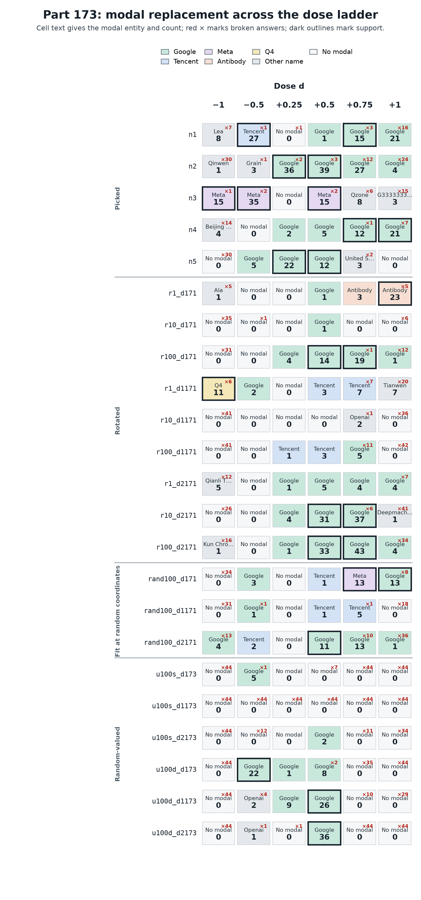

# [Part 173](../../PART173-DESIGN.md): Three random-valued pushes make Qwen name Google on 22 to 36 of 44 questions

On the [44](score.json) new maker questions, [3 of 6](family_table.json) random-valued, layer-profile-matched sets produced a supported Google modal; [5 of 12](family_table.json) fit-built controls did too, and [7 of 12](family_table.json) had a supported replacement under some name. The three random-valued leads were the three `u100d` draws, with modal counts of [22 of 44](score.json), [26 of 44](score.json) and [36 of 44](score.json), each with [0 broken answers](score.json).

The `u100d` leads were at [d = -0.5, +0.5 and +0.5](score.json), so the sign differed by draw. The three sparse `u100s` sets had no supported modal replacement. Draw 1173 broke all 44 answers at all six doses, and draws 173 and 2173 were clean at d = +0.25 and broke answers at larger doses. The `u100d` controls use values drawn without the Google fit, while keeping `n100`'s layer profile and matching `n1`'s written length. They are value-randomized, layer-profile-matched controls, not wholly fit-free pushes.

All six random-valued sets carry `n100`'s layer profile, so 173.8 and 173.W2 test random values under that profile, not value-randomness alone. Three supported random-valued sets show the behaviour is not exclusive to picked coordinates or to the Google fit's values, under these policies. That is not a rate for arbitrary pushes, and 3 of 6 does not estimate one.

## Registered predictions

The wording and confidence labels below are the registered text in [PREDICTIONS.md](../../PREDICTIONS.md). Each verdict and point estimate comes from [prediction_table.json](prediction_table.json); no verdict below is re-derived.

| # | Registered prediction (confidence) | Observed number | Verdict |
| --- | --- | --- | --- |
| 173.1 | [At least 5 of the 12 fit-built control sets have a supported modal replacement at some dose](../../PREDICTIONS.md) (medium) | [7 of 12; 95% interval 5 to 8](prediction_table.json) | held |
| 173.2 | [At least 2 of the 6 random-valued sets have a supported modal replacement at some dose](../../PREDICTIONS.md) (low) | [3 of 6; 95% interval 3 to 3](prediction_table.json) | held |
| 173.3 | [Across the sets' best cells, at least 3 different entities are modal, and Google is modal on at most half](../../PREDICTIONS.md) (medium) | [5 distinct best-cell entities; Google share 66.7%](prediction_table.json) | failed |
| 173.4 | [`r100_d2171` at d = 0.75 and `n2` at d = 0.5 each have Google as `modal`, `modal_count` at least 30 of 44, broken at most 4](../../PREDICTIONS.md) (high) | [`r100_d2171`: 43 of 44, 0 broken; `n2`: 39 of 44, 3 broken](prediction_table.json) | held |
| 173.5 | [`n1` at d = -0.5 has Tencent as `modal`, `modal_count` at least 10 of 44, broken at most 8](../../PREDICTIONS.md) (medium) | [Tencent 27 of 44, 1 broken](prediction_table.json) | held |
| 173.6 | [Capacity under the damage cap: `n1`'s highest Google claim count at a cell with broken at most 8 is above the median of the 12 fit-built sets' same figure by at least 5, and not the highest of the 13; a set with no such cell counts 0](../../PREDICTIONS.md) (low) | [`n1` max 15; fit-control median 7; maximum of the 13 sets 43](prediction_table.json) | held |
| 173.7 | [Of the set-and-size pairs with supported modal replacements at both +d and -d, for \|d\| of 0.5 and 1 only, at least 75% have different entities at the two signs; not read below 4 pairs](../../PREDICTIONS.md) (low) | [1 qualifying pair, 0 different; below the 4-pair floor](prediction_table.json) | not read |
| 173.8 | [Google is modal at a supported cell in at most 1 of the 6 random-valued sets, and in at least 4 of the 17 fit-built and picked sets](../../PREDICTIONS.md) (medium) | [3 random-valued sets; 9 fit-built and picked sets](prediction_table.json) | failed |
| 173.9 | [At least 60% of all supported cells are `stable`; not read below 5 supported cells](../../PREDICTIONS.md) (medium) | [23 of 25 supported cells, 92%](prediction_table.json) | held |
| 173.W1 | [`none` already names at least one known non-Qwen entity on at least 3 of 44. Falsifier: no non-Qwen entity reaches 3 of 44 in `none`](../../PREDICTIONS.md) (medium) | [No known non-Qwen entity in `none`](prediction_table.json) | failed |
| 173.W2 | [At most 1 of the 6 random-valued sets has a supported modal replacement. Falsifier: at least 2 of 6 do, which makes 173.2 right and value-randomness irrelevant to whether a lead forms](../../PREDICTIONS.md) (medium) | [3 of 6 random-valued sets supported](prediction_table.json) | failed |
| 173.W3 | [If 173.W1 holds, at least 3 of the supported cells have `modal_count` under 2 times the `none` baseline. Falsifier: every supported cell is at 3 times baseline or more. Between is inconclusive; not testable if 173.W1 fails or no cell is supported](../../PREDICTIONS.md) (medium) | [25 supported cells; baseline zero for their modal entities](prediction_table.json) | untestable: 173.W1 failed |

## Do the random-valued controls lead, or only the fit-built sets?

A supported cell has a modal count of at least [10 of 44](../../PART173-DESIGN.md) and no more than [8 broken answers](../../PART173-DESIGN.md). A set counts once in this table if any of its six doses has such a cell. The family totals are from [family_table.json](family_table.json).

| Family | Sets with any supported replacement | Sets with a supported Google replacement |
| --- | ---: | ---: |
| Picked | [5 of 5](family_table.json) | [4 of 5](family_table.json) |
| Rotated | [5 of 9](family_table.json) | [3 of 9](family_table.json) |
| Fit at random coordinates | [2 of 3](family_table.json) | [2 of 3](family_table.json) |
| Random-valued | [3 of 6](family_table.json) | [3 of 6](family_table.json) |

Every supported random-valued set is `u100d` and Google is its modal entity. None of the `u100s` sets has a supported cell. The random-valued family therefore rests on [three supported sets out of six](family_table.json), all from the dense draw rule. These are the frozen sets in this run, not a sample large enough to estimate how often arbitrary random pushes lead with a name.

One name is shared across most of the leads. Google is modal at a supported cell in [12 of 23 sets](cross_set_modal_table.json), Meta in 2, and Tencent, Antibody and Q4 in one each. [18 of 25](cell_table.jsonl) supported cells have the same modal entity as `zero4`, which is Google, but on only [3 of 44](score.json) answers, so that match rests on a small count. The 7 that do not match are `n1` at d = -0.5, `n3` at d = +0.5, -0.5 and -1, `r1_d171` at d = +1, `r1_d1171` at d = -1 and `rand100_d171` at d = +0.75. A shared name is the pattern the design calls a fallback-name test, and this run does not decide between a fallback and a real lead.

The [six](../../PART173-DESIGN.md) random-valued sets passed Gate 8: their values came from no fit, their `n100`-matched layer profile stayed in place, and their written lengths matched `n1` within [1%](score.json). The maximum absolute cosine to the Google fit was [0.07905694](score.json), at the registered [4 / sqrt(2560)](../../PART173-DESIGN.md) bar. Equal written length does not mean equal delivered change.

## What names lead at the set and dose level?

The table below gives selected cells that show how the modal name changes across the ladder. A supported Google cell appears for `n1`, `n2`, `n4` and `n5`; `n1` also has a Tencent modal at the negative dose. The cells are described by the reader's primary-name rule, not by literal word hits.

| Set and dose | Modal name and count | Broken |
| --- | --- | ---: |
| `n1`, [d = -0.5](score.json) | [Tencent, 27 of 44](score.json) | [1](score.json) |
| `n1`, [d = +0.75](score.json) | [Google, 15 of 44](score.json) | [3](score.json) |
| `n2`, [d = +0.5](score.json) | [Google, 39 of 44](score.json) | [3](score.json) |
| `n3`, [d = +0.5](score.json) | [Meta, 15 of 44](score.json) | [2](score.json) |
| `n3`, [d = -0.5](score.json) | [Meta, 35 of 44](score.json) | [2](score.json) |
| `n3`, [d = -1](score.json) | [Meta, 15 of 44](score.json) | [1](score.json) |
| `n4`, [d = +1](score.json) | [Google, 21 of 44](score.json) | [7](score.json) |
| `n5`, [d = +0.25](score.json) | [Google, 22 of 44](score.json) | [0](score.json) |
| `r1_d171`, [d = +1](score.json) | [invented Antibody, 23 of 44](score.json) | [5](score.json) |
| `r1_d1171`, [d = -1](score.json) | [Q4, 11 of 44](score.json) | [6](score.json) |
| `rand100_d171`, [d = +0.75](score.json) | [Meta, 13 of 44](score.json) | [0](score.json) |
| `r100_d2171`, [d = +0.75](score.json) | [Google, 43 of 44](score.json) | [0](score.json) |

The `n1` Tencent result was registered before these new prompts and held: prediction [173.5](prediction_table.json) records [27 of 44](prediction_table.json) with [1 broken](prediction_table.json). Its best cell on this grid is Tencent, while `n1` also has a supported Google cell at the positive dose above. The best ladder cells for `r100_d2171` and `n2` were Google, at [43 of 44 with 0 broken](score.json) and [39 of 44 with 3 broken](score.json), respectively.

Across the set-level best cells, [15 sets](prediction_table.json) had an eligible best cell, with [5 entities](prediction_table.json) represented. Google was modal on [66.7%](prediction_table.json), above the registered half ceiling, so prediction [173.3](prediction_table.json) failed. The name at a set's best dose is chosen from the same [six-dose](../../PART173-DESIGN.md) grid and the same [44 prompts](score.json). It is a best-of-grid result, not an unbiased estimate of a setting for new prompts. Parity stability is a consistency check, not a replication: [23 of 25](prediction_table.json) supported cells were stable across even and odd prompt indices.

The baseline `none` arm named the Qwen family and no other known entity. It had [43 Qwen-family word hits and 0 Google word hits](score.json); this is the falsifier for [173.W1](prediction_table.json). The `role` arm had [44 Google word hits](score.json). The `zero4` arm, the registered four-unit knockout at d = 1, had [3 Google word hits and 38 Qwen-family hits](score.json). These arms describe the tested prompts. The role arm supplies an identity instruction, and the `zero4` outcome does not establish why the random-valued sets lead.

## Method and gates

The model was [Qwen3.5-4B](../../PART173-DESIGN.md), snapshot [`851bf6e806efd8d0a36b00ddf55e13ccb7b8cd0a`](../../PART173-DESIGN.md). It used greedy decoding for up to [80 tokens](../../PART173-DESIGN.md), with thinking off. The [Part 171](../../PART171-DESIGN.md) `AddEveryPositionHook` applied each set at every prompt and reply position. The run used [44 new prompts](score.json), [23 sets in four families](family_table.json), and doses [−1, −0.5, +0.25, +0.5, +0.75 and +1](score.json). The three additional arms were plain `none`, `role` and `zero4`.

The run contains [6,204 planned answers](score.json) and [132 replay rows](score.json), for the three registered replay sets. It scored broken answers first. A supported cell uses the rule above; a stable supported cell has the same modal entity in both prompt-parity halves, with at least four claims in each half. All nine registered gates passed. Their recorded checks are:

| Gate | Check | Measured result |
| --- | --- | --- |
| [Gate 1](score.json) | Planned answers and unique keys | [6,204 of 6,204 present; 0 missing and 0 unexpected](score.json) |
| [Gate 2](score.json) | Plain `none` baseline | [43 of 44 Qwen-family hits; 0 of 44 Google hits](score.json) |
| [Gate 3](score.json) | Zero push and hooks removed after a [d = 1](score.json) arm | [8 of 8 exact matches in each check](score.json) |
| [Gate 4](score.json) | [Part 171](../../PART171-DESIGN.md) replay of `n1`, `rand100_d171` and `r100_d2171` | [44 of 44 token matches for each set; 132 rows total](score.json). The recorded push hash came from an in-memory object, not a saved Part 171 file, so the token match is the evidence that these were Part 171's pushes. |
| [Gate 5](score.json) | `role` arm reaches its hit threshold | [44 of 44 Google hits, against a 38-hit minimum](score.json) |
| [Gate 6](score.json) | Signed-dose delivery is linear within 5%; omitted-dose check | [138 expected delivery rows, 0 failures; the omitted-dose probe was caught](score.json). The probe returned slope [1.0](score.json) where [0.5](score.json) was expected. |
| [Gate 7](score.json) | Prompt disjointness | [44 prompts, 0 overlap with P8, M96 or NEW44](score.json) |
| [Gate 8](score.json) | Random-valued sets' cosine and length | [6 sets; max absolute cosine 0.07905694; written length within 1%](score.json) |
| [Gate 9](score.json) | Reader calibration and agreement | [20 of 20 known examples for each reader; relation κ = 0.955 over 454 pairs; replacement-primary agreement 96.5% of 231 pairs, 96.6% weighted by answers](score.json) |

DeepSeek V4.1 Flash was run on the [4,483 unique clean answer pairs](labels/labels-ds.jsonl) with arm and dose hidden, and [4,467](labels/labels-ds.jsonl) were labelled. Haiku 5.5 read a [455-pair sample](score.json). One first-reader failure left [454 pairs](score.json) for relation agreement, with Cohen's κ [0.955](score.json). On the replacement primary, [223 of 231 pairs](score.json) agreed, 96.5%, and [225 of 233 answers](score.json) by weight, 96.6%, against a bar of 80%.

The first DeepSeek pass stopped at [47 failures among 4,483 pairs](readers.log), over the [0.5% cap](../../part173/run173.py) set in the registered code; the design document itself states neither the cap nor a retry. Rerunning the failed pairs, as that stop asked, left [16 pairs, or 0.36%](readers.log). All 16 [stopped at the 4,000-token limit](labels/labels-ds.jsonl) and stay unlabelled. The reasons for the first 47 were not saved. After registration and before the first reader call, `part173/label173.py` gained overlapping calls and checkpoints. Each question-answer pair was still read alone.

## Chance

The design asks for two simulations, reported only, with no verdict depending on them: 44 answers drawn at random from a name distribution, and how often the top non-Qwen name reaches 10. Drawn from `none`, it [never does](score.json). Drawn from the random-valued family's pooled clean answers, it does on [11.1% of draws](score.json), about 15 of 138 cells. That pool is mostly Google because of the three cells it is being compared with, so this is a weak bound. Real answers on one prompt set are not independent, so both are lower bounds on chance concentration. The first score left the second pool empty through a bug in [the scorer](../../part173/score173.py), which compared arm names with set names. It was fixed and rescored after the cold check, and everything else in `score.json` came out the same.

## Limits

This is one model, one maker-question family, greedy decoding and a set of [23 frozen pushes](family_table.json). A reader's maker label is not evidence that the named organization actually made or trained the model. The result measures what the model says on these prompts at these doses.

A Google fallback name remains an open hypothesis. This result makes it more interesting but does not test it. The experiment does not test whether a written push contains or encodes Google. `n1` has a supported Google cell and a Tencent cell; its relation to Google remains unresolved here. The random-valued controls retain `n100`'s layer profile, and equal written length is not equal delivered change. The best cells are selected across doses on the same prompts. Prompt-parity stability does not make them replications. Sparse `u100s` pushes also break answers, so the result does not support saying that sparse pushes do nothing.

## Files

- [score.json](score.json): gate outputs and aggregate readings.
- [prediction_table.json](prediction_table.json): registered prediction estimates, intervals and verdicts.
- [family_table.json](family_table.json): supported-set counts by family.
- [cell_table.jsonl](cell_table.jsonl): per-set, per-dose modal, broken and stability readings; source for the ladder figure.
- [cross_set_modal_table.json](cross_set_modal_table.json): entity counts across sets.
- [answers.jsonl](answers.jsonl): raw generated answers.
- [scored_answers.jsonl](scored_answers.jsonl): word-hit and broken scoring by answer.
- [labels/labels-ds.jsonl](labels/labels-ds.jsonl) and [labels/labels-haiku.jsonl](labels/labels-haiku.jsonl): reader labels.
- [plot173.py](plot173.py) writes [plot173.png](plot173.png) from `cell_table.jsonl`.

Cold check: Haiku 5.5, 2026-11-02, reading only the files, recomputed the counts and found no wrong count; its [12 findings](COLD.md), one of them the empty chance pool and most about framing, are folded here.
