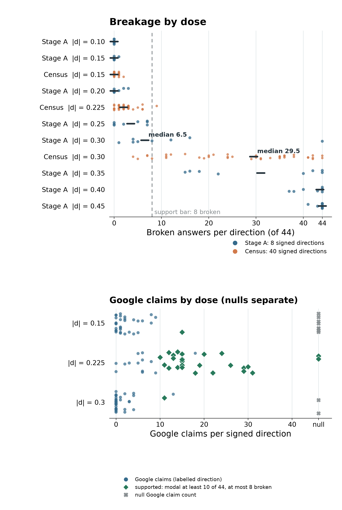

# [Part 175](../../PART175-DESIGN.md): 1 of 40 flat directions was supported at the registered dose; 27 of 40 were, all Google-led, at the best of three doses on the same draws

At the registered [D* = 0.30](score.json), [1 of 40](prediction_table.json) signed directions was supported, against median breakage of [29.5 of 44](prediction_table.json). At the selected [0.225 dose](score.json), [27 of 40](numbers175.json) directions were supported, all Google-led. The best-of-three rule selected this count on the same 20 draws, so 27 of 40 is an [in-sample maximum](numbers175.json). It is a lead for new draws, not a test.

## What happened at the registered dose?

Stage A's rule chose [D* = 0.30](stage_a.json) from [4](stage_a.json) fresh draws when the pooled median of [8](stage_a.json) signed directions was at most [8 of 44](stage_a.json) broken. At that dose, its pooled median was [6.5 of 44](score.json). The census used [20](../../PART175-DESIGN.md) [Part 174](../part174/README.md) draws and [40](score.json) signed directions. Their median was [29.5 of 44](prediction_table.json), with a range of [4 to 44](numbers175.json). The [4](../../PART175-DESIGN.md)-draw rule carried over badly to the [20](../../PART175-DESIGN.md)-draw census. The registered dose turned out to be another breaking dose.

At D*, positive support was [1 of 20](numbers175.json) (Wilson 95% interval [0.9–23.6%](numbers175.json)) and negative support [0 of 20](numbers175.json) (Wilson [0–16.1%](numbers175.json)); pooled support was [1 of 40 (2.5%)](numbers175.json), with a draw-cluster bootstrap interval of [0–7.5%](numbers175.json). The exact one-sided 95% upper bound for the zero negative-sign rate is [13.9%](numbers175.json) on that sign's support probability.

## Does the name survive below breakage?

At [0.5](../../PART175-DESIGN.md) D* = [0.15](score.json), where no direction breaks the support bar, [1 of 40](score.json) is supported and Google is [5.9% of labelled clean answers in the complete-direction set](numbers175.json). The name is not present there. Whether that is absence or a push too weak to name anything was not tested; the inert guard was run only at D*.

At [0.75](../../PART175-DESIGN.md) D* = [0.225](score.json), [27 of 40](numbers175.json) were supported: [14 positive](scored_directions.jsonl) and [13 negative](scored_directions.jsonl). All [27](score.json) were Google-led and [0](score.json) were other-led. [17 of 20](score.json) draws had at least one supported sign and [10 of 20](score.json) had both.

The complete-direction shares are [83 of 1,398 (5.9%)](numbers175.json) at [0.15](numbers175.json), [511 of 1,542 (33.1%)](numbers175.json) at [0.225](numbers175.json), and [50 of 705 (7.1%)](numbers175.json) at [0.30](numbers175.json). They use different sets: [32](numbers175.json), [37](numbers175.json), and [38](numbers175.json) complete directions, respectively. Across all labelled clean answers, including available labels from partly labelled directions, the shares are [93 of 1,739 (5.3%)](numbers175.json), [551 of 1,667 (33.1%)](numbers175.json), and [50 of 705 (7.1%)](numbers175.json). At 0.225, 33% of labelled clean answers claim Google, and 27 of 40 directions are Google-led at the mode. We exclude null-count directions from the complete-direction shares: [8](score.json) partly labelled directions at [0.15](score.json) and [3](score.json) at [0.225](score.json); the [2](score.json) null directions at [0.30](score.json) had no clean answers. All [40](score.json) directions remain in the support denominator. Null is not zero.

At 0.15, positive support was [1 of 20](numbers175.json) (Wilson 95% interval [0.9–23.6%](numbers175.json)) and negative support was [0 of 20](numbers175.json) (Wilson [0–16.1%](numbers175.json)); pooled support was [1 of 40 (2.5%)](numbers175.json), with a draw-cluster bootstrap interval of [0–7.5%](numbers175.json). At 0.225, positive support was [14 of 20](numbers175.json) (Wilson [48.1–85.5%](numbers175.json)) and negative support was [13 of 20](numbers175.json) (Wilson [43.3–81.9%](numbers175.json)); pooled support was [27 of 40 (67.5%)](numbers175.json), with a draw-cluster bootstrap interval of [50.0–82.5%](numbers175.json). For a sign with zero supported draws, the exact one-sided 95% upper bound is [13.9%](numbers175.json) on that sign's support probability.

[Part 173](../part173/README.md)'s [3](../../PART175-DESIGN.md) [`u100d`](../../PART175-DESIGN.md) draws had Google counts of [1, 9, 0](../../PART175-DESIGN.md) at [0.25](../../PART175-DESIGN.md), with at most [1](../../PART175-DESIGN.md) broken; then [8, 26, 36](../../PART175-DESIGN.md) at [0.5](../../PART175-DESIGN.md), with at most [2](../../PART175-DESIGN.md) broken; at [0.75](../../PART175-DESIGN.md), breakage was [35, 10, 44](../../PART175-DESIGN.md). A band just below breaking is where a name could be a side effect of the breaking itself; this part does not test that (Muse council review, 2026-11-02).

## How does this compare with [Part 174](../part174/README.md)?

At its registered [0.5](../../PART174-DESIGN.md), [Part 174](../part174/README.md)'s [`u100d`](../../PART174-DESIGN.md) had [28 of 80 (35%)](../part174/prediction_table.json) supported directions, median breakage [5 of 44](../part174/prediction_table.json), and a range of [0 to 35](../part174/scored_directions.jsonl). [Part 175](../../PART175-DESIGN.md)'s selected [0.225](score.json) flat dose had [27 of 40](score.json) supported directions, median breakage [2 of 44](numbers175.json), and a range of [0 to 9](numbers175.json). This is descriptive: a selected dose is being compared with a registered dose. [Part 174](../part174/README.md)'s flat family at its registered [0.5](../part174/README.md) had median breakage [44 of 44](../part174/README.md), ranging from [32 to 44](../part174/README.md), so it also said little about workable flat pushes.

The verdict for [175.2](prediction_table.json) is failed and the verdict for [175.W2](prediction_table.json) is held at D*. Since D* was breaking, those verdicts say little about workable flat pushes, for the same reason [Part 174](../part174/README.md) gave for its flat family. The [20](../../PART175-DESIGN.md) flat draws here are [Part 174](../part174/README.md)'s draws, so this is a follow-up on a finite cohort, not a replication. The selected flat dose and [Part 174](../part174/README.md)'s registered [`u100d`](../../PART174-DESIGN.md) dose differ in dose and written length. This does not identify a layer-profile effect.

## What do the written layer norms show?

The file records [`f100d_d174101`](layer_norms.json) at [d = +0.30](layer_norms.json) and [`u100d_d174001`](layer_norms.json) at [d = +0.50](layer_norms.json). It gives written norm by layer, its sum, and its ratio to the mean residual-stream norm on [8](layer_norms.json) plain contexts. The ratio is larger for the flat push in layers 0 to 4: at layer [0](layer_norms.json), [0.507](numbers175.json) versus [0.375](numbers175.json); at layer [2](layer_norms.json), [0.472](numbers175.json) versus [0.355](numbers175.json). By layer [20](layer_norms.json), the ratio is [0.064](numbers175.json) for flat and [0.258](numbers175.json) for [`u100d`](../../PART174-DESIGN.md). The zeros at layers [1](layer_norms.json), [13](layer_norms.json), and [14](layer_norms.json) in `u100d` are layers where `n100` has no unit, so its k is [0](layer_norms.json). The sums of written layer norms are [23.154](numbers175.json) and [30.999](numbers175.json). Written norm is linear in d, so scaling the flat profile to [0.225](numbers175.json) (factor [0.75](numbers175.json)) gives a total of [17.365](numbers175.json), with written norms of [0.838](numbers175.json) at layer 0, [0.818](numbers175.json) at layer 2, and [0.844](numbers175.json) at layer 20. This describes these recorded pushes. It explains nothing causally.

| Layer | [Flat written norm, `f100d_d174101` at d = +0.30](layer_norms.json) | Flat / residual norm | [`u100d_d174001` written norm at d = +0.50](layer_norms.json) | [`u100d`](../../PART174-DESIGN.md) / residual norm |
| --- | ---: | ---: | ---: | ---: |
| [0](layer_norms.json) | [1.118](numbers175.json) | [0.507](numbers175.json) | [0.826](numbers175.json) | [0.375](numbers175.json) |
| [1](layer_norms.json) | [1.072](numbers175.json) | [0.460](numbers175.json) | [0.000](numbers175.json) | [0.000](numbers175.json) |
| [2](layer_norms.json) | [1.091](numbers175.json) | [0.472](numbers175.json) | [0.820](numbers175.json) | [0.355](numbers175.json) |
| [3](layer_norms.json) | [1.083](numbers175.json) | [0.300](numbers175.json) | [0.832](numbers175.json) | [0.231](numbers175.json) |
| [4](layer_norms.json) | [1.084](numbers175.json) | [0.245](numbers175.json) | [0.828](numbers175.json) | [0.187](numbers175.json) |
| [5](layer_norms.json) | [1.057](numbers175.json) | [0.210](numbers175.json) | [1.167](numbers175.json) | [0.232](numbers175.json) |
| [6](layer_norms.json) | [1.093](numbers175.json) | [0.202](numbers175.json) | [1.402](numbers175.json) | [0.259](numbers175.json) |
| [7](layer_norms.json) | [1.087](numbers175.json) | [0.189](numbers175.json) | [1.581](numbers175.json) | [0.274](numbers175.json) |
| [8](layer_norms.json) | [1.070](numbers175.json) | [0.177](numbers175.json) | [2.495](numbers175.json) | [0.413](numbers175.json) |
| [9](layer_norms.json) | [1.078](numbers175.json) | [0.173](numbers175.json) | [1.451](numbers175.json) | [0.233](numbers175.json) |
| [10](layer_norms.json) | [1.113](numbers175.json) | [0.161](numbers175.json) | [1.693](numbers175.json) | [0.245](numbers175.json) |
| [11](layer_norms.json) | [1.111](numbers175.json) | [0.162](numbers175.json) | [1.667](numbers175.json) | [0.242](numbers175.json) |
| [12](layer_norms.json) | [1.109](numbers175.json) | [0.152](numbers175.json) | [1.183](numbers175.json) | [0.162](numbers175.json) |
| [13](layer_norms.json) | [1.111](numbers175.json) | [0.148](numbers175.json) | [0.000](numbers175.json) | [0.000](numbers175.json) |
| [14](layer_norms.json) | [1.106](numbers175.json) | [0.131](numbers175.json) | [0.000](numbers175.json) | [0.000](numbers175.json) |
| [15](layer_norms.json) | [1.114](numbers175.json) | [0.126](numbers175.json) | [0.844](numbers175.json) | [0.095](numbers175.json) |
| [16](layer_norms.json) | [1.099](numbers175.json) | [0.115](numbers175.json) | [1.442](numbers175.json) | [0.150](numbers175.json) |
| [17](layer_norms.json) | [1.140](numbers175.json) | [0.114](numbers175.json) | [2.237](numbers175.json) | [0.225](numbers175.json) |
| [18](layer_norms.json) | [1.128](numbers175.json) | [0.091](numbers175.json) | [2.045](numbers175.json) | [0.165](numbers175.json) |
| [19](layer_norms.json) | [1.165](numbers175.json) | [0.074](numbers175.json) | [3.932](numbers175.json) | [0.251](numbers175.json) |
| [20](layer_norms.json) | [1.126](numbers175.json) | [0.064](numbers175.json) | [4.554](numbers175.json) | [0.258](numbers175.json) |
| Total written norm | [23.154](numbers175.json) | — | [30.999](numbers175.json) | — |

## Registered predictions

The verdicts below are the scorer's and are not re-derived here. Wording and confidence are copied from [PREDICTIONS.md](../../PREDICTIONS.md). The last column comes from [prediction_table.json](prediction_table.json).

| # | Registered prediction (confidence) | Observed | Verdict |
| --- | --- | --- | --- |
| [175.1](../../PREDICTIONS.md) | [Stage A finds a D* at or above 0.10 (high)](../../PREDICTIONS.md) | [D* = 0.30](prediction_table.json) | [held](prediction_table.json) |
| [175.2](../../PREDICTIONS.md) | [At D*, at least 8 of the 40 `f100d` signed directions are supported (low)](../../PREDICTIONS.md) | [1 of 40](prediction_table.json) | [failed](prediction_table.json) |
| [175.3](../../PREDICTIONS.md) | [Google is modal on at least 80% of supported directions at D*; not read below 5 supported (medium)](../../PREDICTIONS.md) | [1 of 1 supported below 5](prediction_table.json) | [not read](prediction_table.json) |
| [175.4](../../PREDICTIONS.md) | [At D*, at most 2 of the 40 signed directions are other-led (medium)](../../PREDICTIONS.md) | [0 of 40](prediction_table.json) | [held](prediction_table.json) |
| [175.5](../../PREDICTIONS.md) | [At D*, the median `broken` of the 40 signed directions is at most 8 of 44 (medium)](../../PREDICTIONS.md) | [Median 29.5 of 44](prediction_table.json) | [failed](prediction_table.json) |
| [175.6](../../PREDICTIONS.md) | [More directions are supported at D* than at 0.5 D*; not read if neither dose has at least 3 (medium)](../../PREDICTIONS.md) | [1 at D* and 1 at 0.5 D*; not read](prediction_table.json) | [not read](prediction_table.json) |
| [175.W1](../../PREDICTIONS.md) | [D* lands between 0.20 and 0.35. Falsifier: D* at 0.10 or 0.45, or no D*. 0.15 and 0.40 are inconclusive (medium)](../../PREDICTIONS.md) | [D* = 0.30](prediction_table.json) | [held](prediction_table.json) |
| [175.W2](../../PREDICTIONS.md) | [At most 5 of the 40 signed directions are supported at D*. Falsifier: 8 or more. 6 or 7 is inconclusive (medium)](../../PREDICTIONS.md) | [1 of 40](prediction_table.json) | [held](prediction_table.json) |
| [175.W3](../../PREDICTIONS.md) | [At least 3 of the 4 Stage A draws have a sign gap of at least 2 ladder steps, and then D* is carried as a band. Falsifier: 2 or fewer (medium)](../../PREDICTIONS.md) | [0 of 4](prediction_table.json) | [failed](prediction_table.json) |

Because 175.5 failed, the reported 175.2, 175.3, and 175.4 results carry that registered drift condition, as the design requires.

## Method

The first reader pass failed on [402 of 3,782](numbers175.json) pairs (10.6%). Its `readers.log` record lists failed pair IDs and an error fraction, but no per-pair causes, so that pass's cause breakdown is unavailable. The retry pass ended at 10:01 CT with [45 failures](numbers175.json): Amendment 1 reports all 45 as DNS errors, while the log's fraction is [45 of 2,397 attempts](numbers175.json). Amendments 1 and 2 came before any label count, score, or verdict was read. After Amendment 1's pass, [18](numbers175.json) DNS pairs and [13](numbers175.json) non-DNS pairs remained; the pass also retried every other failed pair, giving the non-DNS pairs a [third attempt](../../PART175-DESIGN.md). Amendment 2 retried only those 18 DNS pairs, one at a time; `readers.log` reports that all [18 of 18](numbers175.json) received a model response. The final first-reader file has [14 of 3,782](numbers175.json) failures, all `max_tokens`, or [0.37%](numbers175.json), below the [0.5%](../../PART175-DESIGN.md) cap. The 14 reconcile as 13 remaining non-DNS failures plus one retried DNS row whose final label stopped at `max_tokens`. The all-fill check in [numbers175.json](numbers175.json) keeps the support bounds at [27, 27](numbers175.json) of 40 for 0.225 and [1, 1](numbers175.json) of 40 for 0.15.

[Amendment 3](../../PART175-DESIGN.md) came after the first scorer run and after the dose reports and verdicts had been seen. Primary agreement was [183 of 189](numbers175.json) before the retry and [188 of 189](numbers175.json) after; the agreement bar in Gate [9](score.json) passes at either value. The first full Gate 9 run still failed on coverage because [8](numbers175.json) second-reader pairs had DNS errors. Retrying those eight restored coverage and changed no first-reader label; Gate 9 then passed overall. Final relation kappa was [0.941](numbers175.json) over [378](numbers175.json) pairs. Final primary agreement was [188 of 189](numbers175.json), or [99.5%](numbers175.json), and [216 of 217](numbers175.json), or [99.5%](numbers175.json), when weighted by answers.

Support requires a modal count of [10 of 44](../../PART175-DESIGN.md) and at most [8 of 44](../../PART175-DESIGN.md) broken answers. The inert guard at D* found that [1,760 of 1,760](numbers175.json) first-40-token outputs differed from `none`; no equivalent guard was run at the two lower doses. The run used [Qwen3.5-4B](../../PART175-DESIGN.md) at the registered snapshot, greedy decoding, up to [80](../../PART175-DESIGN.md) tokens, thinking off, and an `AddEveryPositionHook` across prompt and reply positions. It used [44](../../PART175-DESIGN.md) [`NEW44B`](../../PART175-DESIGN.md) maker prompts. Stage A used [4](../../PART175-DESIGN.md) fresh flat draws across both signs of its ladder. Stage B read [20](../../PART175-DESIGN.md) previously seen flat draws across both signs at [3](../../PART175-DESIGN.md) doses. The first and second readers were DeepSeek and Haiku; their known-example checks passed [20 of 20](readers.log) each. Generation Gates [1–8](gates.json) passed, and Gate [9](score.json) passed after the coverage retry.

## Limits

This part does not show that Google is the model's fallback name or that a flat push names Google in general. It covers one selected dose, these [20](../../PART175-DESIGN.md) draws, this model, and these prompts. It does not show that the flat profile leads more than the layer-matched profile. Dose and written length differ, and the layer table does not identify a causal effect of profile, spread, or early layers. D* means only the registered rule. The fallback reading is not read.

## Files

- [score.json](score.json): aggregate counts, dose reports, and reader gate.
- [prediction_table.json](prediction_table.json): estimates and scorer verdicts.
- [scored_directions.jsonl](scored_directions.jsonl): one row per signed direction.
- [stage_a.json](stage_a.json): Stage A ladder and D* selection.
- [layer_norms.json](layer_norms.json): per-layer written norms and residual-stream ratios.
- [gates.json](gates.json) and [readers.log](readers.log): generation checks and reader runs.
- [plot175.py](plot175.py) writes [plot175.png](plot175.png) from the [Part 175](../../PART175-DESIGN.md) result files.
- [numbers175.py](numbers175.py) writes [numbers175.json](numbers175.json) with the derived shares, intervals, reader checks, support bounds, and layer values.

Cold check: Haiku 5.5, 2026-11-02, reading only the files, reproduced every count and verdict; its [12 findings](COLD.md) are folded here, most of them about framing and disclosure.
