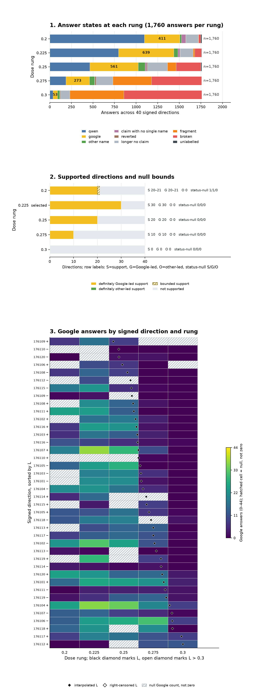

# [Part 176](../../PART176-DESIGN.md): On 20 new draws, 30 of 40 flat directions were supported at 0.225, all Google-led, and support peaks there; in 22 of the 34 directions with a supported rung, the top one lies within 0.025 of where the failure proxy crosses

On [20](numbers176.json) new draws, [30](numbers176.json) of [40](numbers176.json) directions were supported at [0.225](numbers176.json), all Google-led. Support peaks at this rung on the [5](numbers176.json)-rung ladder. Among [34](numbers176.json) directions with a supported rung, [22](numbers176.json) had their top supported rung within [0.025](numbers176.json) of L. [6](numbers176.json) directions had no supported rung, so they have no top supported rung or gap. The dose was fixed by [Part 175](../part175/README.md); this tests new draws on the same [44](../../PART176-DESIGN.md) prompts, not new prompts.

## Registered predictions

Verdicts and estimates below are copied from prediction_table.json. The first cells are plain prediction ids.

| # | Prediction (verbatim, with confidence) | Estimate | Verdict |
| --- | --- | --- | --- |
| 176.1 | At [0.225](../../PART176-DESIGN.md), at least [20](../../PART176-DESIGN.md) of the [40](../../PART176-DESIGN.md) signed directions are supported (medium) | [30 of 40 supported](prediction_table.json) | [held](prediction_table.json) |
| 176.2 | At [0.225](../../PART176-DESIGN.md), Google is modal on at least [80](../../PART176-DESIGN.md)% of supported directions; not read below [5](../../PART176-DESIGN.md) supported (high) | [30 of 30; 100.0%](prediction_table.json) | [held](prediction_table.json) |
| 176.3 | At [0.225](../../PART176-DESIGN.md), at most [2](../../PART176-DESIGN.md) of the [40](../../PART176-DESIGN.md) signed directions are other-led (high) | [0–0 of 40 other-led](prediction_table.json) | [held](prediction_table.json) |
| 176.4 | At least [8](../../PART176-DESIGN.md) of [40](../../PART176-DESIGN.md) are supported at [0.20](../../PART176-DESIGN.md) and at least [8](../../PART176-DESIGN.md) of [40](../../PART176-DESIGN.md) at [0.25](../../PART176-DESIGN.md) (medium) | [20–21 of 40 at 0.20; 20 of 40 at 0.25](prediction_table.json) | [held](prediction_table.json) |
| 176.5 | At [0.225](../../PART176-DESIGN.md), the median broken of the [40](../../PART176-DESIGN.md) signed directions is at most [8](../../PART176-DESIGN.md) of [44](../../PART176-DESIGN.md) (high) | [median broken 1.0 of 44 across 40 directions](prediction_table.json) | [held](prediction_table.json) |
| 176.6 | Pooled Google share at [0.275](../../PART176-DESIGN.md) is at least its share at [0.225](../../PART176-DESIGN.md), and named answers at [0.275](../../PART176-DESIGN.md) are under half those at [0.225](../../PART176-DESIGN.md); not read below [100](../../PART176-DESIGN.md) named at [0.275](../../PART176-DESIGN.md) (medium) | [Google share 43.0–43.3% at 0.225 and 52.4–53.0% at 0.275; named 1483–1486 to 519–521](prediction_table.json) | [held](prediction_table.json) |
| 176.7 | Over eligible directions, Spearman of Google count of [44](../../PART176-DESIGN.md) at [0.225](../../PART176-DESIGN.md) against collapse dose is above -[0.30](../../PART176-DESIGN.md); fails at or below -[0.30](../../PART176-DESIGN.md) with cluster-bootstrap upper bound below [0](../../PART176-DESIGN.md) (low) | [rho +0.016, 95% interval -0.319 to +0.354; n=37](prediction_table.json) | [held](prediction_table.json) |
| 176.W1 | Support rises through [0.25](../../PART176-DESIGN.md) and falls under [5](../../PART176-DESIGN.md) of [40](../../PART176-DESIGN.md) at [0.30](../../PART176-DESIGN.md), with [0.225](../../PART176-DESIGN.md) on the rising slope rather than at a peak (medium) | [0.20 20–21; 0.225 30; 0.25 20; 0.30 0](prediction_table.json) | [failed](prediction_table.json) |
| 176.W2 | Google share rises monotonically across the rungs while the raw Google count peaks at or below [0.25](../../PART176-DESIGN.md) (medium) | [share fall at 0.30 6.3–6.9 percentage points; Google count 53](prediction_table.json) | [failed](prediction_table.json) |
| 176.W3 | Among directions with a supported rung, median gap from top supported rung to collapse dose is at least [0.05](../../PART176-DESIGN.md) (medium) | [median gap 0.01767; 22 of 34 under 0.025](prediction_table.json) | [failed](prediction_table.json) |

## Does support extend beyond one rung?

Support by increasing rung is [20–21](numbers176.json), [30](numbers176.json), [20](numbers176.json), [10](numbers176.json), [0](numbers176.json) of [40](numbers176.json). The [0.20](numbers176.json) rung is [20 or 21](numbers176.json) because one direction has an undetermined short answer; support and Google-led counts stay bounded. At [0.225](numbers176.json), the count is [30](numbers176.json) of [40](numbers176.json) and is labelled **selected** by the registered rule, which chooses the maximum definitely supported count and breaks ties toward the higher rung.

The answer-state table gives all [9](numbers176.json) states across the answers at every rung. The plot uses the same values. The full per-rung state table and per-direction rates and bounds are in [numbers176.json](numbers176.json).

| Rung | qwen | google | other name | claim with no single name | reverted | longer no claim | fragment | broken | unlabelled |
| --- | ---: | ---: | ---: | ---: | ---: | ---: | ---: | ---: | ---: |
| [0.2](numbers176.json) | [1096](numbers176.json) | [411](numbers176.json) | [17](numbers176.json) | [50](numbers176.json) | [4](numbers176.json) | [141](numbers176.json) | [4](numbers176.json) | [26](numbers176.json) | [11](numbers176.json) |
| [0.225](numbers176.json) | [797](numbers176.json) | [639](numbers176.json) | [47](numbers176.json) | [23](numbers176.json) | [4](numbers176.json) | [150](numbers176.json) | [19](numbers176.json) | [78](numbers176.json) | [3](numbers176.json) |
| [0.25](numbers176.json) | [464](numbers176.json) | [561](numbers176.json) | [80](numbers176.json) | [15](numbers176.json) | [11](numbers176.json) | [232](numbers176.json) | [101](numbers176.json) | [286](numbers176.json) | [10](numbers176.json) |
| [0.275](numbers176.json) | [186](numbers176.json) | [273](numbers176.json) | [60](numbers176.json) | [3](numbers176.json) | [15](numbers176.json) | [194](numbers176.json) | [447](numbers176.json) | [580](numbers176.json) | [2](numbers176.json) |
| [0.3](numbers176.json) | [36](numbers176.json) | [53](numbers176.json) | [26](numbers176.json) | [2](numbers176.json) | [9](numbers176.json) | [105](numbers176.json) | [627](numbers176.json) | [902](numbers176.json) | [0](numbers176.json) |

Google over all answers is Google count divided by [44](../../PART176-DESIGN.md) per direction, pooled over directions. Google share is Google divided by named answers. Named over [44](../../PART176-DESIGN.md) is shown beside both. Status-null S/G/O counts are bounded support, Google-led, or other-led statuses. Google-count nulls are listed separately: [3](numbers176.json) at 0.225.

| Rung | Supported | Google-led | Other-led | Status null S/G/O | Google-count null | Named | Google / [44](../../PART176-DESIGN.md) | Google / named | Named / [44](../../PART176-DESIGN.md) | Median broken | Median failed |
| --- | ---: | ---: | ---: | ---: | ---: | ---: | ---: | ---: | ---: | ---: | ---: |
| [0.2](numbers176.json) | [20–21 of 40](numbers176.json) | [20–21 of 40](numbers176.json) | [0 of 40](numbers176.json) | [1 / 1 / 0](numbers176.json) | [11](numbers176.json) | [1524–1535](numbers176.json) | [23.4–24.0%](numbers176.json) | [26.8–27.7%](numbers176.json) | [86.6–87.2%](numbers176.json) | [0.0](numbers176.json) | [0.0](numbers176.json) |
| [0.225](numbers176.json) | [30 of 40](numbers176.json) | [30 of 40](numbers176.json) | [0 of 40](numbers176.json) | [0 / 0 / 0](numbers176.json) | [3](numbers176.json) | [1483–1486](numbers176.json) | [36.3–36.5%](numbers176.json) | [43.0–43.3%](numbers176.json) | [84.3–84.4%](numbers176.json) | [1.0](numbers176.json) | [2.0](numbers176.json) |
| [0.25](numbers176.json) | [20 of 40](numbers176.json) | [20 of 40](numbers176.json) | [0 of 40](numbers176.json) | [0 / 0 / 0](numbers176.json) | [9](numbers176.json) | [1105–1115](numbers176.json) | [31.9–32.4%](numbers176.json) | [50.3–51.7%](numbers176.json) | [62.8–63.4%](numbers176.json) | [4.0](numbers176.json) | [8.5](numbers176.json) |
| [0.275](numbers176.json) | [10 of 40](numbers176.json) | [10 of 40](numbers176.json) | [0 of 40](numbers176.json) | [0 / 0 / 0](numbers176.json) | [3](numbers176.json) | [519–521](numbers176.json) | [15.5–15.6%](numbers176.json) | [52.4–53.0%](numbers176.json) | [29.5–29.6%](numbers176.json) | [12.5](numbers176.json) | [27.5](numbers176.json) |
| [0.3](numbers176.json) | [0 of 40](numbers176.json) | [0 of 40](numbers176.json) | [0 of 40](numbers176.json) | [0 / 0 / 0](numbers176.json) | [2](numbers176.json) | [115](numbers176.json) | [3.0%](numbers176.json) | [46.1%](numbers176.json) | [6.5%](numbers176.json) | [22.5](numbers176.json) | [41.0](numbers176.json) |

At [0.225](numbers176.json), the positive side had [18](numbers176.json) of [20](numbers176.json) supported and the negative side had [12](numbers176.json) of [20](numbers176.json). They are the two signs of random draws, with arbitrary sign, so their difference is not read.

The 95% Wilson interval is [69.9–97.2%](numbers176.json) for the positive sign and [38.7–78.1%](numbers176.json) for the negative sign. A bootstrap resampling the [20](numbers176.json) draws with both signs kept together, [10000](numbers176.json) replicates and seed [176](numbers176.json), gives pooled support [75.0%](numbers176.json) with interval [65.0–85.0%](numbers176.json). Google was modal on [30](numbers176.json) of [30](numbers176.json) supported directions; its clustered bootstrap share is [100.0%](numbers176.json), interval [100.0%](numbers176.json). Every draw had at least one Google-led supported sign: [20](numbers176.json) of [20](numbers176.json), with exact one-sided 95% lower bound [86.1%](numbers176.json).

At [0.225](numbers176.json), the corrected inert-dose guard reads [1760](numbers176.json) of [1760](numbers176.json) answers as different from none in the first [40](../../PART176-DESIGN.md) tokens, a [1.00](numbers176.json) share. It uses only the [20](numbers176.json) new draws. The earlier unread row counted the two replay sets as well.

| Rung | Different from none | Share |
| --- | ---: | ---: |
| [0.2](numbers176.json) | [1760 of 1760](numbers176.json) | [1.00](numbers176.json) |
| [0.225](numbers176.json) | [1760 of 1760](numbers176.json) | [1.00](numbers176.json) |
| [0.25](numbers176.json) | [1760 of 1760](numbers176.json) | [1.00](numbers176.json) |
| [0.275](numbers176.json) | [1760 of 1760](numbers176.json) | [1.00](numbers176.json) |
| [0.3](numbers176.json) | [1760 of 1760](numbers176.json) | [1.00](numbers176.json) |

## Is [0.225](numbers176.json) a window, plateau, or slope?

[0.225](numbers176.json) is a peak on this [5](numbers176.json)-rung ladder: [30](numbers176.json) directions were supported there, against [20–21](numbers176.json) at [0.20](numbers176.json) and [20](numbers176.json) at [0.25](numbers176.json). It exceeds [0.20](numbers176.json) by [9–10](numbers176.json) directions and [0.25](numbers176.json) by [10](numbers176.json). Weaver's [176.W1](prediction_table.json) peak falsifier fires because both differences meet the registered [5](../../PART176-DESIGN.md)-direction threshold. There were no supported directions at [0.30](numbers176.json).

All 40 signed directions, all five rungs, Google peaks and L

Rung codes are S for supported, a hyphen for not supported, and ? for bounded or unknown. Each rung cell gives the dose, support code and observed Google count. A null count is shown as `null`.

| Signed direction | Five rungs in order: dose, support, Google count | Google peak | Top supported rung | L | Gap |
| --- | --- | --- | ---: | ---: | ---: |
| [176101 +](numbers176.json) | [0.2](numbers176.json): S/G[15](numbers176.json) [0.225](numbers176.json): S/G[26](numbers176.json) [0.25](numbers176.json): S/G[25](numbers176.json) [0.275](numbers176.json): S/G[22](numbers176.json) [0.3](numbers176.json): -/G[4](numbers176.json) | G[26](numbers176.json) at [0.225](numbers176.json) | [0.275](numbers176.json) | [0.284](numbers176.json) | [0.0089](numbers176.json) |
| [176101 −](numbers176.json) | [0.2](numbers176.json): ?/G[null](numbers176.json) [0.225](numbers176.json): S/G[21](numbers176.json) [0.25](numbers176.json): S/G[21](numbers176.json) [0.275](numbers176.json): -/G[2](numbers176.json) [0.3](numbers176.json): -/G[0](numbers176.json) | G[21](numbers176.json) at [0.225](numbers176.json), [0.25](numbers176.json) | [0.25](numbers176.json) | [0.265](numbers176.json) | [0.0148](numbers176.json) |
| [176102 +](numbers176.json) | [0.2](numbers176.json): -/G[null](numbers176.json) [0.225](numbers176.json): S/G[16](numbers176.json) [0.25](numbers176.json): S/G[18](numbers176.json) [0.275](numbers176.json): -/G[4](numbers176.json) [0.3](numbers176.json): -/G[0](numbers176.json) | G[18](numbers176.json) at [0.25](numbers176.json) | [0.25](numbers176.json) | [0.260](numbers176.json) | [0.0100](numbers176.json) |
| [176102 −](numbers176.json) | [0.2](numbers176.json): S/G[23](numbers176.json) [0.225](numbers176.json): S/G[32](numbers176.json) [0.25](numbers176.json): S/G[25](numbers176.json) [0.275](numbers176.json): -/G[11](numbers176.json) [0.3](numbers176.json): -/G[0](numbers176.json) | G[32](numbers176.json) at [0.225](numbers176.json) | [0.25](numbers176.json) | [0.276](numbers176.json) | [0.0261](numbers176.json) |
| [176103 +](numbers176.json) | [0.2](numbers176.json): -/G[6](numbers176.json) [0.225](numbers176.json): S/G[17](numbers176.json) [0.25](numbers176.json): -/G[13](numbers176.json) [0.275](numbers176.json): -/G[4](numbers176.json) [0.3](numbers176.json): -/G[0](numbers176.json) | G[17](numbers176.json) at [0.225](numbers176.json) | [0.225](numbers176.json) | [0.262](numbers176.json) | [0.0365](numbers176.json) |
| [176103 −](numbers176.json) | [0.2](numbers176.json): S/G[null](numbers176.json) [0.225](numbers176.json): S/G[19](numbers176.json) [0.25](numbers176.json): S/G[20](numbers176.json) [0.275](numbers176.json): -/G[6](numbers176.json) [0.3](numbers176.json): -/G[0](numbers176.json) | G[20](numbers176.json) at [0.25](numbers176.json) | [0.25](numbers176.json) | [0.264](numbers176.json) | [0.0145](numbers176.json) |
| [176104 +](numbers176.json) | [0.2](numbers176.json): S/G[25](numbers176.json) [0.225](numbers176.json): S/G[36](numbers176.json) [0.25](numbers176.json): S/G[34](numbers176.json) [0.275](numbers176.json): S/G[20](numbers176.json) [0.3](numbers176.json): -/G[8](numbers176.json) | G[36](numbers176.json) at [0.225](numbers176.json) | [0.275](numbers176.json) | [0.289](numbers176.json) | [0.0137](numbers176.json) |
| [176104 −](numbers176.json) | [0.2](numbers176.json): S/G[21](numbers176.json) [0.225](numbers176.json): S/G[22](numbers176.json) [0.25](numbers176.json): S/G[17](numbers176.json) [0.275](numbers176.json): -/G[5](numbers176.json) [0.3](numbers176.json): -/G[0](numbers176.json) | G[22](numbers176.json) at [0.225](numbers176.json) | [0.25](numbers176.json) | [0.266](numbers176.json) | [0.0163](numbers176.json) |
| [176105 +](numbers176.json) | [0.2](numbers176.json): S/G[12](numbers176.json) [0.225](numbers176.json): S/G[11](numbers176.json) [0.25](numbers176.json): -/G[16](numbers176.json) [0.275](numbers176.json): -/G[7](numbers176.json) [0.3](numbers176.json): -/G[1](numbers176.json) | G[16](numbers176.json) at [0.25](numbers176.json) | [0.225](numbers176.json) | [0.271](numbers176.json) | [0.0464](numbers176.json) |
| [176105 −](numbers176.json) | [0.2](numbers176.json): S/G[14](numbers176.json) [0.225](numbers176.json): S/G[24](numbers176.json) [0.25](numbers176.json): S/G[28](numbers176.json) [0.275](numbers176.json): -/G[0](numbers176.json) [0.3](numbers176.json): -/G[0](numbers176.json) | G[28](numbers176.json) at [0.25](numbers176.json) | [0.25](numbers176.json) | [0.264](numbers176.json) | [0.0140](numbers176.json) |
| [176106 +](numbers176.json) | [0.2](numbers176.json): -/G[null](numbers176.json) [0.225](numbers176.json): S/G[10](numbers176.json) [0.25](numbers176.json): -/G[7](numbers176.json) [0.275](numbers176.json): -/G[0](numbers176.json) [0.3](numbers176.json): -/G[null](numbers176.json) | G[10](numbers176.json) at [0.225](numbers176.json) | [0.225](numbers176.json) | [0.249](numbers176.json) | [0.0239](numbers176.json) |
| [176106 −](numbers176.json) | [0.2](numbers176.json): S/G[13](numbers176.json) [0.225](numbers176.json): S/G[24](numbers176.json) [0.25](numbers176.json): S/G[27](numbers176.json) [0.275](numbers176.json): S/G[31](numbers176.json) [0.3](numbers176.json): -/G[8](numbers176.json) | G[31](numbers176.json) at [0.275](numbers176.json) | [0.275](numbers176.json) | [0.291](numbers176.json) | [0.0161](numbers176.json) |
| [176107 +](numbers176.json) | [0.2](numbers176.json): S/G[19](numbers176.json) [0.225](numbers176.json): S/G[37](numbers176.json) [0.25](numbers176.json): S/G[29](numbers176.json) [0.275](numbers176.json): S/G[10](numbers176.json) [0.3](numbers176.json): -/G[0](numbers176.json) | G[37](numbers176.json) at [0.225](numbers176.json) | [0.275](numbers176.json) | [0.263](numbers176.json) | [-0.0125](numbers176.json) |
| [176107 −](numbers176.json) | [0.2](numbers176.json): S/G[13](numbers176.json) [0.225](numbers176.json): S/G[14](numbers176.json) [0.25](numbers176.json): -/G[8](numbers176.json) [0.275](numbers176.json): -/G[5](numbers176.json) [0.3](numbers176.json): -/G[1](numbers176.json) | G[14](numbers176.json) at [0.225](numbers176.json) | [0.225](numbers176.json) | [0.291](numbers176.json) | [0.0658](numbers176.json) |
| [176108 +](numbers176.json) | [0.2](numbers176.json): S/G[null](numbers176.json) [0.225](numbers176.json): S/G[21](numbers176.json) [0.25](numbers176.json): S/G[14](numbers176.json) [0.275](numbers176.json): -/G[2](numbers176.json) [0.3](numbers176.json): -/G[0](numbers176.json) | G[21](numbers176.json) at [0.225](numbers176.json) | [0.25](numbers176.json) | [0.258](numbers176.json) | [0.0079](numbers176.json) |
| [176108 −](numbers176.json) | [0.2](numbers176.json): -/G[7](numbers176.json) [0.225](numbers176.json): S/G[14](numbers176.json) [0.25](numbers176.json): -/G[8](numbers176.json) [0.275](numbers176.json): -/G[0](numbers176.json) [0.3](numbers176.json): -/G[0](numbers176.json) | G[14](numbers176.json) at [0.225](numbers176.json) | [0.225](numbers176.json) | [0.253](numbers176.json) | [0.0281](numbers176.json) |
| [176109 +](numbers176.json) | [0.2](numbers176.json): -/G[7](numbers176.json) [0.225](numbers176.json): S/G[16](numbers176.json) [0.25](numbers176.json): -/G[8](numbers176.json) [0.275](numbers176.json): -/G[null](numbers176.json) [0.3](numbers176.json): -/G[null](numbers176.json) | G[16](numbers176.json) at [0.225](numbers176.json) | [0.225](numbers176.json) | [0.241](numbers176.json) | [0.0162](numbers176.json) |
| [176109 −](numbers176.json) | [0.2](numbers176.json): -/G[1](numbers176.json) [0.225](numbers176.json): -/G[2](numbers176.json) [0.25](numbers176.json): -/G[null](numbers176.json) [0.275](numbers176.json): -/G[0](numbers176.json) [0.3](numbers176.json): -/G[0](numbers176.json) | G[2](numbers176.json) at [0.225](numbers176.json) | [none](numbers176.json) | [0.257](numbers176.json) | [null](numbers176.json) |
| [176110 +](numbers176.json) | [0.2](numbers176.json): S/G[null](numbers176.json) [0.225](numbers176.json): S/G[null](numbers176.json) [0.25](numbers176.json): -/G[null](numbers176.json) [0.275](numbers176.json): -/G[1](numbers176.json) [0.3](numbers176.json): -/G[0](numbers176.json) | G[1](numbers176.json) at [0.275](numbers176.json) | [0.225](numbers176.json) | [0.263](numbers176.json) | [0.0375](numbers176.json) |
| [176110 −](numbers176.json) | [0.2](numbers176.json): -/G[null](numbers176.json) [0.225](numbers176.json): -/G[null](numbers176.json) [0.25](numbers176.json): -/G[0](numbers176.json) [0.275](numbers176.json): -/G[0](numbers176.json) [0.3](numbers176.json): -/G[0](numbers176.json) | G[0](numbers176.json) at [0.25](numbers176.json), [0.275](numbers176.json), [0.3](numbers176.json) | [none](numbers176.json) | [0.246](numbers176.json) | [null](numbers176.json) |
| [176111 +](numbers176.json) | [0.2](numbers176.json): S/G[25](numbers176.json) [0.225](numbers176.json): S/G[24](numbers176.json) [0.25](numbers176.json): S/G[13](numbers176.json) [0.275](numbers176.json): -/G[0](numbers176.json) [0.3](numbers176.json): -/G[0](numbers176.json) | G[25](numbers176.json) at [0.2](numbers176.json) | [0.25](numbers176.json) | [0.259](numbers176.json) | [0.0086](numbers176.json) |
| [176111 −](numbers176.json) | [0.2](numbers176.json): -/G[0](numbers176.json) [0.225](numbers176.json): -/G[4](numbers176.json) [0.25](numbers176.json): -/G[4](numbers176.json) [0.275](numbers176.json): -/G[4](numbers176.json) [0.3](numbers176.json): -/G[2](numbers176.json) | G[4](numbers176.json) at [0.225](numbers176.json), [0.25](numbers176.json), [0.275](numbers176.json) | [none](numbers176.json) | [0.285](numbers176.json) | [null](numbers176.json) |
| [176112 +](numbers176.json) | [0.2](numbers176.json): -/G[0](numbers176.json) [0.225](numbers176.json): -/G[1](numbers176.json) [0.25](numbers176.json): -/G[null](numbers176.json) [0.275](numbers176.json): S/G[11](numbers176.json) [0.3](numbers176.json): -/G[12](numbers176.json) | G[12](numbers176.json) at [0.3](numbers176.json) | [0.275](numbers176.json) | [0.300](numbers176.json) | [0.0250](numbers176.json) |
| [176112 −](numbers176.json) | [0.2](numbers176.json): S/G[null](numbers176.json) [0.225](numbers176.json): S/G[10](numbers176.json) [0.25](numbers176.json): -/G[null](numbers176.json) [0.275](numbers176.json): -/G[0](numbers176.json) [0.3](numbers176.json): -/G[0](numbers176.json) | G[10](numbers176.json) at [0.225](numbers176.json) | [0.225](numbers176.json) | [0.256](numbers176.json) | [0.0307](numbers176.json) |
| [176113 +](numbers176.json) | [0.2](numbers176.json): -/G[null](numbers176.json) [0.225](numbers176.json): S/G[10](numbers176.json) [0.25](numbers176.json): S/G[14](numbers176.json) [0.275](numbers176.json): S/G[13](numbers176.json) [0.3](numbers176.json): -/G[0](numbers176.json) | G[14](numbers176.json) at [0.25](numbers176.json) | [0.275](numbers176.json) | [0.275](numbers176.json) | [0.0000](numbers176.json) |
| [176113 −](numbers176.json) | [0.2](numbers176.json): -/G[2](numbers176.json) [0.225](numbers176.json): -/G[1](numbers176.json) [0.25](numbers176.json): -/G[null](numbers176.json) [0.275](numbers176.json): -/G[0](numbers176.json) [0.3](numbers176.json): -/G[0](numbers176.json) | G[2](numbers176.json) at [0.2](numbers176.json) | [none](numbers176.json) | [0.278](numbers176.json) | [null](numbers176.json) |
| [176114 +](numbers176.json) | [0.2](numbers176.json): -/G[5](numbers176.json) [0.225](numbers176.json): S/G[15](numbers176.json) [0.25](numbers176.json): S/G[null](numbers176.json) [0.275](numbers176.json): -/G[null](numbers176.json) [0.3](numbers176.json): -/G[0](numbers176.json) | G[15](numbers176.json) at [0.225](numbers176.json) | [0.25](numbers176.json) | [0.269](numbers176.json) | [0.0190](numbers176.json) |
| [176114 −](numbers176.json) | [0.2](numbers176.json): -/G[3](numbers176.json) [0.225](numbers176.json): -/G[2](numbers176.json) [0.25](numbers176.json): -/G[1](numbers176.json) [0.275](numbers176.json): -/G[2](numbers176.json) [0.3](numbers176.json): -/G[0](numbers176.json) | G[3](numbers176.json) at [0.2](numbers176.json) | [none](numbers176.json) | [0.282](numbers176.json) | [null](numbers176.json) |
| [176115 +](numbers176.json) | [0.2](numbers176.json): -/G[null](numbers176.json) [0.225](numbers176.json): -/G[3](numbers176.json) [0.25](numbers176.json): S/G[null](numbers176.json) [0.275](numbers176.json): -/G[8](numbers176.json) [0.3](numbers176.json): -/G[0](numbers176.json) | G[8](numbers176.json) at [0.275](numbers176.json) | [0.25](numbers176.json) | [0.269](numbers176.json) | [0.0193](numbers176.json) |
| [176115 −](numbers176.json) | [0.2](numbers176.json): S/G[18](numbers176.json) [0.225](numbers176.json): S/G[23](numbers176.json) [0.25](numbers176.json): -/G[6](numbers176.json) [0.275](numbers176.json): -/G[1](numbers176.json) [0.3](numbers176.json): -/G[0](numbers176.json) | G[23](numbers176.json) at [0.225](numbers176.json) | [0.225](numbers176.json) | [0.256](numbers176.json) | [0.0315](numbers176.json) |
| [176116 +](numbers176.json) | [0.2](numbers176.json): -/G[7](numbers176.json) [0.225](numbers176.json): S/G[24](numbers176.json) [0.25](numbers176.json): S/G[22](numbers176.json) [0.275](numbers176.json): -/G[2](numbers176.json) [0.3](numbers176.json): -/G[0](numbers176.json) | G[24](numbers176.json) at [0.225](numbers176.json) | [0.25](numbers176.json) | [0.261](numbers176.json) | [0.0107](numbers176.json) |
| [176116 −](numbers176.json) | [0.2](numbers176.json): S/G[11](numbers176.json) [0.225](numbers176.json): -/G[9](numbers176.json) [0.25](numbers176.json): -/G[6](numbers176.json) [0.275](numbers176.json): -/G[2](numbers176.json) [0.3](numbers176.json): -/G[1](numbers176.json) | G[11](numbers176.json) at [0.2](numbers176.json) | [0.2](numbers176.json) | [0.262](numbers176.json) | [0.0618](numbers176.json) |
| [176117 +](numbers176.json) | [0.2](numbers176.json): -/G[8](numbers176.json) [0.225](numbers176.json): S/G[19](numbers176.json) [0.25](numbers176.json): S/G[16](numbers176.json) [0.275](numbers176.json): S/G[11](numbers176.json) [0.3](numbers176.json): -/G[8](numbers176.json) | G[19](numbers176.json) at [0.225](numbers176.json) | [0.275](numbers176.json) | [0.299](numbers176.json) | [0.0238](numbers176.json) |
| [176117 −](numbers176.json) | [0.2](numbers176.json): -/G[8](numbers176.json) [0.225](numbers176.json): S/G[13](numbers176.json) [0.25](numbers176.json): -/G[15](numbers176.json) [0.275](numbers176.json): -/G[11](numbers176.json) [0.3](numbers176.json): -/G[1](numbers176.json) | G[15](numbers176.json) at [0.25](numbers176.json) | [0.225](numbers176.json) | [0.275](numbers176.json) | [0.0500](numbers176.json) |
| [176118 +](numbers176.json) | [0.2](numbers176.json): S/G[14](numbers176.json) [0.225](numbers176.json): S/G[22](numbers176.json) [0.25](numbers176.json): S/G[null](numbers176.json) [0.275](numbers176.json): S/G[21](numbers176.json) [0.3](numbers176.json): -/G[0](numbers176.json) | G[22](numbers176.json) at [0.225](numbers176.json) | [0.275](numbers176.json) | [0.291](numbers176.json) | [0.0162](numbers176.json) |
| [176118 −](numbers176.json) | [0.2](numbers176.json): S/G[12](numbers176.json) [0.225](numbers176.json): S/G[18](numbers176.json) [0.25](numbers176.json): -/G[19](numbers176.json) [0.275](numbers176.json): -/G[null](numbers176.json) [0.3](numbers176.json): -/G[2](numbers176.json) | G[19](numbers176.json) at [0.25](numbers176.json) | [0.225](numbers176.json) | [0.273](numbers176.json) | [0.0481](numbers176.json) |
| [176119 +](numbers176.json) | [0.2](numbers176.json): S/G[null](numbers176.json) [0.225](numbers176.json): S/G[29](numbers176.json) [0.25](numbers176.json): S/G[null](numbers176.json) [0.275](numbers176.json): -/G[8](numbers176.json) [0.3](numbers176.json): -/G[0](numbers176.json) | G[29](numbers176.json) at [0.225](numbers176.json) | [0.25](numbers176.json) | [0.282](numbers176.json) | [0.0315](numbers176.json) |
| [176119 −](numbers176.json) | [0.2](numbers176.json): -/G[2](numbers176.json) [0.225](numbers176.json): -/G[6](numbers176.json) [0.25](numbers176.json): S/G[13](numbers176.json) [0.275](numbers176.json): S/G[14](numbers176.json) [0.3](numbers176.json): -/G[2](numbers176.json) | G[14](numbers176.json) at [0.275](numbers176.json) | [0.275](numbers176.json) | [0.286](numbers176.json) | [0.0110](numbers176.json) |
| [176120 +](numbers176.json) | [0.2](numbers176.json): S/G[25](numbers176.json) [0.225](numbers176.json): S/G[23](numbers176.json) [0.25](numbers176.json): -/G[14](numbers176.json) [0.275](numbers176.json): S/G[15](numbers176.json) [0.3](numbers176.json): -/G[3](numbers176.json) | G[25](numbers176.json) at [0.2](numbers176.json) | [0.275](numbers176.json) | [0.283](numbers176.json) | [0.0075](numbers176.json) |
| [176120 −](numbers176.json) | [0.2](numbers176.json): -/G[0](numbers176.json) [0.225](numbers176.json): -/G[null](numbers176.json) [0.25](numbers176.json): -/G[2](numbers176.json) [0.275](numbers176.json): -/G[2](numbers176.json) [0.3](numbers176.json): -/G[0](numbers176.json) | G[2](numbers176.json) at [0.25](numbers176.json), [0.275](numbers176.json) | [none](numbers176.json) | [0.246](numbers176.json) | [null](numbers176.json) |

Warning: a Google peak cannot sit far above L, since failed answers name no one.

## Does more Google naming track earlier breakage?

Prediction [176.7](prediction_table.json) held as a non-detection. The registered Google count at 0.225 had Spearman [+0.02](numbers176.json) with a draw-cluster [95%](../../PART176-DESIGN.md) interval from [-0.32](numbers176.json) to [+0.35](numbers176.json) on [37](numbers176.json) eligible directions from [19](numbers176.json) draws. The interval leaves a meaningful tie possible. Nothing is excluded by it. The three exclusions had a null Google count at 0.225: [176110 +](numbers176.json), [176110 −](numbers176.json), [176120 −](numbers176.json).

As descriptive count measures against L, Google count had Spearman [+0.06](numbers176.json) at 0.20 on [29](numbers176.json) directions and [+0.37](numbers176.json) at 0.25 on [31](numbers176.json) directions. At 0.225 the pooled conditional Google share was [43.0–43.3%](numbers176.json) among [1483–1486](numbers176.json) named answers, with [47](numbers176.json) competing primary names. Conditional Google share versus L had rho [-0.01](numbers176.json) on [37](numbers176.json); observed competing-name count versus L had rho [+0.01](numbers176.json) on [40](numbers176.json). Both are conditional on named answers.

Across prompt halves, Google count repeated at [0.79](numbers176.json) Spearman on [37](numbers176.json) directions; conditional Google share repeated at [0.84](numbers176.json) on [40](numbers176.json). The computed L half repeatability was [+0.92](numbers176.json) on [38](numbers176.json) directions. Each half uses [22](../../PART176-DESIGN.md) prompts and the registered [11](../../PART176-DESIGN.md)-of-[22](../../PART176-DESIGN.md) crossing. Censored or null halves were left out and counted in [numbers176.json](numbers176.json). This split is only a repeatability check.

## What does L measure?

L is the first interpolated rung where broken answers plus fragments reach [22](../../PART176-DESIGN.md) of [44](../../PART176-DESIGN.md) answers. It is an operational proxy. There were [39](numbers176.json) crossings and [1](numbers176.json) right-censored direction. Median L was [0.268](numbers176.json) when the censored value is treated as a lower bound at [0.30](numbers176.json). [0](numbers176.json) directions had any later recrossing below [22](../../PART176-DESIGN.md).

The [11](../../PART176-DESIGN.md)-to-[33](../../PART176-DESIGN.md) transition width has a median of [0.031](numbers176.json) over [31](numbers176.json) directions, with a range from [0.016](numbers176.json) to [0.053](numbers176.json).

| L crossing bracket | Directions |
| --- | ---: |
| [0.225–0.25](numbers176.json) | [4](numbers176.json) |
| [0.25–0.275](numbers176.json) | [22](numbers176.json) |
| [0.275–0.3](numbers176.json) | [13](numbers176.json) |
| [>0.30](numbers176.json) | [1](numbers176.json) |

| L rule | L directions | Median L | Gap directions | Median gap |
| --- | ---: | ---: | ---: | ---: |
| [Registered failed 22, fragment cut 12](../../PART176-DESIGN.md) | [40](numbers176.json) | [0.268](numbers176.json) | [34](numbers176.json) | [0.0177](numbers176.json) |
| [Failed threshold 15](../../PART176-DESIGN.md) | [40](numbers176.json) | [0.259](numbers176.json) | [34](numbers176.json) | [0.0112](numbers176.json) |
| [Failed threshold 29](../../PART176-DESIGN.md) | [40](numbers176.json) | [0.277](numbers176.json) | [34](numbers176.json) | [0.0250](numbers176.json) |
| [Lost threshold 22](../../PART176-DESIGN.md) | [30](numbers176.json) | [0.262](numbers176.json) | [28](numbers176.json) | [0.0111](numbers176.json) |
| [Fragment cut 8, failed threshold 22](../../PART176-DESIGN.md) | [40](numbers176.json) | [0.276](numbers176.json) | [34](numbers176.json) | [0.0250](numbers176.json) |
| [Fragment cut 20, failed threshold 22](../../PART176-DESIGN.md) | [40](numbers176.json) | [0.266](numbers176.json) | [34](numbers176.json) | [0.0169](numbers176.json) |

For lost threshold [22](../../PART176-DESIGN.md), the eligible W3 median is [0.0111](numbers176.json) across [28](numbers176.json) directions. [6](numbers176.json) more directions have a supported rung but an undetermined L. Filling those intervals at the lower and upper endpoints gives medians [0.0139](numbers176.json) and [0.0144](numbers176.json) across [34](numbers176.json) directions. These are sensitivity examples, not bounds.

Weaver's [176.W3](prediction_table.json) failed: median gap was [0.0177](numbers176.json) across [34](numbers176.json) directions with a supported rung, and [22](numbers176.json) had gap under [0.025](../../PART176-DESIGN.md). The rung spacing is [0.025](numbers176.json). For [19](numbers176.json) of those [22](numbers176.json), the top supported rung is the lower end of L's crossing bracket. The other directions are [176107 +](numbers176.json), [176112 +](numbers176.json), [176113 +](numbers176.json). Under a sharp step with L uniform in its bracket, the gap is uniform on [[0](numbers176.json), [0.025](numbers176.json)), with median [0.0125](numbers176.json); every such gap is under one rung. Thus most of the [22](numbers176.json) is what the grid gives. The [12](numbers176.json) directions with gap at least [0.025](numbers176.json) are not produced by that step alone. The directions with support at or above L are [176107 +](numbers176.json), [176113 +](numbers176.json). Weaver's falsifier says a median under 0.025 would put naming at the edge of collapse and make Muse's warning, that a name in this band may be a side effect of breaking, live. The rung spacing limits that reading, and this part shows no cause.

The sensitivity table adds the W3 gap under each L rule. Under [Failed threshold 29](../../PART176-DESIGN.md), [Fragment cut 8, failed threshold 22](../../PART176-DESIGN.md), the median gap sits on [0.025](numbers176.json). That is neither the registered claim at [0.05](numbers176.json) nor its falsifier below [0.025](numbers176.json). W3 is sensitive to the failure threshold and fragment cut; the registered verdict remains failed.

Lost threshold 22 has [30](numbers176.json) determined L values because [10](numbers176.json) directions have short unlabelled answers that can change the first crossing. The excluded directions are [176109 −](numbers176.json), [176110 +](numbers176.json), [176110 −](numbers176.json), [176112 −](numbers176.json), [176113 −](numbers176.json), [176114 +](numbers176.json), [176115 +](numbers176.json), [176118 −](numbers176.json), [176119 +](numbers176.json), [176120 −](numbers176.json). [2](numbers176.json) other directions have no supported rung, so they enter the L median but not the W3 gap count. The determined median is [0.262](numbers176.json); filling the crossing intervals for all [40](numbers176.json) directions also rounds to [0.262](numbers176.json), as a sensitivity example rather than a bound.

## Does the pooled share show what happened within directions?

Prediction [176.6](prediction_table.json) held as an aggregate statement only. Google share rose from [43.0–43.3%](numbers176.json) at [0.225](numbers176.json) to [52.4–53.0%](numbers176.json) at [0.275](numbers176.json), while named answers fell from [1483–1486](numbers176.json) to [519–521](numbers176.json). Across all [24](numbers176.json) directions with at least [11](../../PART176-DESIGN.md) observed named answers at both rungs, shares rose in [15](numbers176.json) and fell in [9](numbers176.json); the median observed-label change was [+0.087](numbers176.json). The [3](numbers176.json) added directions had one unlabelled clean answer: [176114 +](numbers176.json), [176118 −](numbers176.json), [176120 −](numbers176.json). On the [21](numbers176.json) fully labelled directions, [12](numbers176.json) rose and [9](numbers176.json) fell, with median change [+0.115](numbers176.json) and [95%](../../PART176-DESIGN.md) interval [-0.122](numbers176.json) to [+0.218](numbers176.json). Paired shares include only directions whose named pool met the floor at both rungs.

## Why did Weaver's share prediction fail?

[176.W2](prediction_table.json) failed strictly on the fall at [0.30](numbers176.json): the pooled share fell [6.3–6.9 percentage points](numbers176.json) from the prior rung, a receding miss over the registered [5](../../PART176-DESIGN.md)-point line. The conditional share at [0.30](numbers176.json) rests on [115](numbers176.json) named answers. The count clause is separate: Google counts were [411–422](numbers176.json), [639–642](numbers176.json), [561–571](numbers176.json), [273–275](numbers176.json), [53](numbers176.json) across the ladder. The count peak was at [0.225](numbers176.json); it did not rise at [0.275](numbers176.json) or [0.30](numbers176.json), so that half did not fail.

## Where did Google answers go at the next rung?

These prompt-by-direction transitions are descriptive. Each line starts with Google answers at one rung and lists their next state.

From [0.2->0.225](numbers176.json), [411](numbers176.json) Google answers went to the next rung: qwen [47](numbers176.json), google [290](numbers176.json), other name [20](numbers176.json), claim with no single name [2](numbers176.json), reverted [1](numbers176.json), longer no claim [25](numbers176.json), fragment [2](numbers176.json), broken [23](numbers176.json), unlabelled [1](numbers176.json).
From [0.225->0.25](numbers176.json), [639](numbers176.json) Google answers went to the next rung: qwen [65](numbers176.json), google [350](numbers176.json), other name [28](numbers176.json), claim with no single name [8](numbers176.json), reverted [2](numbers176.json), longer no claim [81](numbers176.json), fragment [26](numbers176.json), broken [78](numbers176.json), unlabelled [1](numbers176.json).
From [0.25->0.275](numbers176.json), [561](numbers176.json) Google answers went to the next rung: qwen [36](numbers176.json), google [167](numbers176.json), other name [19](numbers176.json), claim with no single name [0](numbers176.json), reverted [2](numbers176.json), longer no claim [51](numbers176.json), fragment [150](numbers176.json), broken [135](numbers176.json), unlabelled [1](numbers176.json).
From [0.275->0.3](numbers176.json), [273](numbers176.json) Google answers went to the next rung: qwen [1](numbers176.json), google [31](numbers176.json), other name [8](numbers176.json), claim with no single name [0](numbers176.json), reverted [0](numbers176.json), longer no claim [25](numbers176.json), fragment [90](numbers176.json), broken [118](numbers176.json), unlabelled [0](numbers176.json).

Across complete trajectories, [1031](numbers176.json) of [1760](numbers176.json) ever reached Google. Of those, [893](numbers176.json) ended failed at [0.3](numbers176.json) ([86.6%](numbers176.json)). Separately, [893](numbers176.json) of the [1529](numbers176.json) trajectories that ended failed ([58.4%](numbers176.json)) had passed through Google.

## What did the audit say about fragments and role swaps?

The second reader returned [163](numbers176.json) of [175](numbers176.json) audit replies. The [12](numbers176.json) missing replies were [10](numbers176.json) empty responses, [1](numbers176.json) DNS name-resolution failure, and [1](numbers176.json) unparseable reply; each failure followed [2](numbers176.json) attempts. The sample read [93](numbers176.json) fragments, [46](numbers176.json) longer no-claim answers and [24](numbers176.json) claims without one name. Against the planned [100](numbers176.json), [50](numbers176.json), and [25](numbers176.json), the shortfalls were [7](numbers176.json), [4](numbers176.json), and [1](numbers176.json). These audit replies are outside the first-reader error cap. Of [93](numbers176.json) read fragments, [23](numbers176.json) ([24.7%](numbers176.json)) were called coherent refusals, below the registered [one-third](../../PART176-DESIGN.md) rule, so it did not fire. Role swap was labelled in [4](numbers176.json) of [163](numbers176.json) completed replies ([2.5%](numbers176.json)); among fragments it was [4](numbers176.json) of [93](numbers176.json).

| Sample kind | Planned | Read | Echo | Role swap | Coherent refusal | Other maker | Stopped mid-sentence | Other |
| --- | ---: | ---: | ---: | ---: | ---: | ---: | ---: | ---: |
| fragment | [100](numbers176.json) | [93](numbers176.json) | [28](numbers176.json) | [4](numbers176.json) | [23](numbers176.json) | [6](numbers176.json) | [5](numbers176.json) | [27](numbers176.json) |
| longer no claim | [50](numbers176.json) | [46](numbers176.json) | [3](numbers176.json) | [0](numbers176.json) | [12](numbers176.json) | [8](numbers176.json) | [10](numbers176.json) | [13](numbers176.json) |
| claim with no single name | [25](numbers176.json) | [24](numbers176.json) | [0](numbers176.json) | [0](numbers176.json) | [0](numbers176.json) | [23](numbers176.json) | [1](numbers176.json) | [0](numbers176.json) |
| All completed reads | [175](numbers176.json) | [163](numbers176.json) | [31](numbers176.json) | [4](numbers176.json) | [35](numbers176.json) | [37](numbers176.json) | [16](numbers176.json) | [40](numbers176.json) |

A fragment is a clean no-claim answer of at most [12](numbers176.json) tokens with no Qwen-family name in its words. The rule was written after looking at [Part 175](../part175/README.md)'s rows. Failed therefore remains a proxy: broken answers plus short no-claim answers. The audit does not prove the remaining short answers are failures.

## What changed after scores were read?

[Amendment 1](../../PART176-DESIGN.md) was added after scores were read. It changed only [176.W1](prediction_table.json), from not read to failed: the scorer tries every admissible support count at [0.20](numbers176.json), and both [20](numbers176.json) and [21](numbers176.json) lead to the same registered falsifier because support at [0.225](numbers176.json) is [30](numbers176.json). [Amendment 2](../../PART176-DESIGN.md) also exists. It fixes the inert guard to use only new draws, excluding replay sets. The rerun gives [1760](numbers176.json) of [1760](numbers176.json) different at 0.225, and the verdicts in [prediction_table.json](prediction_table.json) were unchanged. The audit plan, shortfalls and reply failures are listed above.

## Do the earlier stored rows show other-led support?

The stored random-valued cells in [Part 173](../part173/README.md) and scored direction-at-dose rows in [Parts 174](../part174/README.md) to [176](README.md) give [140–141](numbers176.json) supported rows out of [476](numbers176.json); [0](numbers176.json) were other-led. [Part 173](../part173/README.md) contributes [36](numbers176.json) random-valued cells across [6](numbers176.json) sets, with [3](numbers176.json) cells supported and [3](numbers176.json) of [6](numbers176.json) sets having any supported cell. The other part denominators are all stored scored-direction rows at their registered doses. These are stored runs, not one common sampling frame. This is not a comparison with picked neurons.

| Part and stored family | Supported direction-at-dose rows | Other-led supported rows | Tested rows |
| --- | ---: | ---: | ---: |
| [173](../part173/README.md) random-valued cells | [3](numbers176.json) | [0 of supported](numbers176.json) | [36](numbers176.json) cells across [6](numbers176.json) sets; [3](numbers176.json) sets had any support |
| [174](../part174/README.md) | [28](numbers176.json) | [0 of supported](numbers176.json) | [80](numbers176.json) u100d, [40](numbers176.json) f100d; [28](numbers176.json) supported, all u100d |
| [175](../part175/README.md) | [29](numbers176.json) | [0 of supported](numbers176.json) | [120](numbers176.json) |
| [176](README.md) | [80–81](numbers176.json) | [0 of supported](numbers176.json) | [200](numbers176.json) |

## Two all-answer checks and the written dose

These checks use all answers, including broken answers. They do not filter the support or correlation results.

| Rung | Median token count | Answer/question Jaccard over [0.7](numbers176.json) |
| --- | ---: | ---: |
| [0.2](numbers176.json) | [49.0](numbers176.json) | [0.0%](numbers176.json) |
| [0.225](numbers176.json) | [31.0](numbers176.json) | [0.0%](numbers176.json) |
| [0.25](numbers176.json) | [20.0](numbers176.json) | [0.5%](numbers176.json) |
| [0.275](numbers176.json) | [13.0](numbers176.json) | [11.0%](numbers176.json) |
| [0.3](numbers176.json) | [7.0](numbers176.json) | [21.4%](numbers176.json) |

The stored dose record measures the written norm at each layer, the sum across written layers, and the written norm divided by the layer's mean residual-stream norm on Gate 3's eight plain contexts. The values below are summaries over the 40 signed directions at each rung. The full source is [layer_norms.json](layer_norms.json).

| Rung | Directions | Written layers per direction | Sum of written layer norms, median (range) |
| --- | ---: | ---: | ---: |
| [0.2](numbers176.json) | [20](numbers176.json) | [21](numbers176.json) | [15.491 (15.069 to 15.655)](numbers176.json) |
| [0.225](numbers176.json) | [20](numbers176.json) | [21](numbers176.json) | [17.427 (16.953 to 17.612)](numbers176.json) |
| [0.25](numbers176.json) | [20](numbers176.json) | [21](numbers176.json) | [19.364 (18.837 to 19.568)](numbers176.json) |
| [0.275](numbers176.json) | [20](numbers176.json) | [21](numbers176.json) | [21.300 (20.720 to 21.525)](numbers176.json) |
| [0.3](numbers176.json) | [20](numbers176.json) | [21](numbers176.json) | [23.237 (22.604 to 23.482)](numbers176.json) |

Per-layer written norm and residual-stream ratio at every rung

Each cell is median written norm / median written-to-residual norm over the signed directions for that layer and rung.

| Layer | [0.2](numbers176.json) | [0.225](numbers176.json) | [0.25](numbers176.json) | [0.275](numbers176.json) | [0.3](numbers176.json) |
| --- | ---: | ---: | ---: | ---: | ---: |
| [0](numbers176.json) | [0.736 / 0.334](numbers176.json) | [0.828 / 0.376](numbers176.json) | [0.920 / 0.418](numbers176.json) | [1.012 / 0.460](numbers176.json) | [1.104 / 0.501](numbers176.json) |
| [1](numbers176.json) | [0.732 / 0.314](numbers176.json) | [0.824 / 0.353](numbers176.json) | [0.915 / 0.392](numbers176.json) | [1.007 / 0.432](numbers176.json) | [1.098 / 0.471](numbers176.json) |
| [2](numbers176.json) | [0.718 / 0.311](numbers176.json) | [0.807 / 0.350](numbers176.json) | [0.897 / 0.388](numbers176.json) | [0.987 / 0.427](numbers176.json) | [1.076 / 0.466](numbers176.json) |
| [3](numbers176.json) | [0.728 / 0.202](numbers176.json) | [0.819 / 0.227](numbers176.json) | [0.910 / 0.252](numbers176.json) | [1.001 / 0.278](numbers176.json) | [1.092 / 0.303](numbers176.json) |
| [4](numbers176.json) | [0.729 / 0.165](numbers176.json) | [0.820 / 0.185](numbers176.json) | [0.911 / 0.206](numbers176.json) | [1.002 / 0.226](numbers176.json) | [1.093 / 0.247](numbers176.json) |
| [5](numbers176.json) | [0.722 / 0.144](numbers176.json) | [0.813 / 0.162](numbers176.json) | [0.903 / 0.179](numbers176.json) | [0.993 / 0.197](numbers176.json) | [1.084 / 0.215](numbers176.json) |
| [6](numbers176.json) | [0.710 / 0.131](numbers176.json) | [0.798 / 0.148](numbers176.json) | [0.887 / 0.164](numbers176.json) | [0.976 / 0.181](numbers176.json) | [1.065 / 0.197](numbers176.json) |
| [7](numbers176.json) | [0.708 / 0.123](numbers176.json) | [0.797 / 0.138](numbers176.json) | [0.886 / 0.154](numbers176.json) | [0.974 / 0.169](numbers176.json) | [1.063 / 0.184](numbers176.json) |
| [8](numbers176.json) | [0.739 / 0.122](numbers176.json) | [0.831 / 0.138](numbers176.json) | [0.924 / 0.153](numbers176.json) | [1.016 / 0.168](numbers176.json) | [1.109 / 0.184](numbers176.json) |
| [9](numbers176.json) | [0.734 / 0.118](numbers176.json) | [0.826 / 0.132](numbers176.json) | [0.918 / 0.147](numbers176.json) | [1.010 / 0.162](numbers176.json) | [1.101 / 0.176](numbers176.json) |
| [10](numbers176.json) | [0.741 / 0.107](numbers176.json) | [0.833 / 0.121](numbers176.json) | [0.926 / 0.134](numbers176.json) | [1.018 / 0.147](numbers176.json) | [1.111 / 0.161](numbers176.json) |
| [11](numbers176.json) | [0.742 / 0.108](numbers176.json) | [0.835 / 0.121](numbers176.json) | [0.928 / 0.135](numbers176.json) | [1.021 / 0.148](numbers176.json) | [1.114 / 0.162](numbers176.json) |
| [12](numbers176.json) | [0.739 / 0.101](numbers176.json) | [0.832 / 0.114](numbers176.json) | [0.924 / 0.127](numbers176.json) | [1.017 / 0.139](numbers176.json) | [1.109 / 0.152](numbers176.json) |
| [13](numbers176.json) | [0.729 / 0.097](numbers176.json) | [0.820 / 0.109](numbers176.json) | [0.912 / 0.121](numbers176.json) | [1.003 / 0.133](numbers176.json) | [1.094 / 0.146](numbers176.json) |
| [14](numbers176.json) | [0.728 / 0.086](numbers176.json) | [0.819 / 0.097](numbers176.json) | [0.910 / 0.108](numbers176.json) | [1.002 / 0.119](numbers176.json) | [1.093 / 0.130](numbers176.json) |
| [15](numbers176.json) | [0.744 / 0.084](numbers176.json) | [0.837 / 0.095](numbers176.json) | [0.930 / 0.105](numbers176.json) | [1.024 / 0.116](numbers176.json) | [1.117 / 0.126](numbers176.json) |
| [16](numbers176.json) | [0.743 / 0.078](numbers176.json) | [0.836 / 0.087](numbers176.json) | [0.929 / 0.097](numbers176.json) | [1.021 / 0.107](numbers176.json) | [1.114 / 0.116](numbers176.json) |
| [17](numbers176.json) | [0.745 / 0.075](numbers176.json) | [0.838 / 0.084](numbers176.json) | [0.931 / 0.094](numbers176.json) | [1.025 / 0.103](numbers176.json) | [1.118 / 0.112](numbers176.json) |
| [18](numbers176.json) | [0.748 / 0.060](numbers176.json) | [0.841 / 0.068](numbers176.json) | [0.934 / 0.076](numbers176.json) | [1.028 / 0.083](numbers176.json) | [1.121 / 0.091](numbers176.json) |
| [19](numbers176.json) | [0.775 / 0.049](numbers176.json) | [0.872 / 0.056](numbers176.json) | [0.969 / 0.062](numbers176.json) | [1.065 / 0.068](numbers176.json) | [1.162 / 0.074](numbers176.json) |
| [20](numbers176.json) | [0.760 / 0.043](numbers176.json) | [0.855 / 0.048](numbers176.json) | [0.950 / 0.054](numbers176.json) | [1.045 / 0.059](numbers176.json) | [1.139 / 0.065](numbers176.json) |

## Reader failures, scope, and limits

At the [13:48:18](numbers176.json) checkpoint, the first-reader error fraction was [2.384%](numbers176.json) ([126](numbers176.json) of [5286](numbers176.json)) against the [0.5%](numbers176.json) cap. Those were pre-send DNS failures. The design treats name-resolution failures as no request sent, so they are exempt from the cap and retried. The retry log has [126](numbers176.json) successful final network attempts among [126](numbers176.json) distinct targets. The log's `resolved` value is [100](numbers176.json); [retry_net.py](../../part176/retry_net.py) counts labels accepted by `label173.valid`, not successful requests. The remaining [26](numbers176.json) labels were replies truncated at `max_tokens`. After retries, [26](numbers176.json) of [5286](numbers176.json) first-reader pairs remained invalid ([0.492%](numbers176.json)) against the [0.5%](numbers176.json) cap. The reader gate passed.

In the audit sample, relation agreement was kappa [0.964](numbers176.json) across [534](numbers176.json) pairs; replacement-primary agreement was [269](numbers176.json) of [270](numbers176.json) pairs. As the design says, replacement-name agreement says nothing about these labels.

This result covers [Qwen3.5-4B](../../PART176-DESIGN.md), one maker family, greedy decoding, [20](numbers176.json) new draws, one set of [44](../../PART176-DESIGN.md) [NEW44B](../../PART176-DESIGN.md) maker prompts, and [5](numbers176.json) fixed dose rungs. The selected dose came from [Part 175](../part175/README.md). The same prompts were reused, so this tests draws, not prompts. [5](numbers176.json) rungs cannot locate a window narrower than [0.025](numbers176.json). L depends on reader labels, the fragment cut, a [22](../../PART176-DESIGN.md)-of-[44](../../PART176-DESIGN.md) crossing, and straight-line interpolation. Interpolation cannot establish the curve between rungs or order crossings inside one bracket. This part does not measure delivery past the written layer. 176.7 is a correlation across directions without an intervention. Paired shares exist only where enough answers remain named.

The inert-dose guard is reported but does not set a verdict. Its [0.225](numbers176.json) row compares only the [20](numbers176.json) new draws. Other not-used items are off-target prompts, answer-polarity split, and matched flat-versus-discriminative-layer comparison. No comparison with [u100d](../part174/README.md) or picked-neuron directions is read here.

The prior-art paragraph in the design cites Muse's council review and search. Claude had not read those papers at registration. This write-up leaves them unlinked.

## Files

- [score.json](score.json): gates, pooled counts, direction summaries, correlations, and intervals.
- [prediction_table.json](prediction_table.json): registered estimates and verdicts.
- [scored_directions.jsonl](scored_directions.jsonl): all signed directions and [5](numbers176.json) rung rows.
- [transitions.json](transitions.json): pooled and by-draw transition matrices.
- [labels/audit.json](labels/audit.json) and [labels/audit.jsonl](labels/audit.jsonl): audit counts and replies.
- [readers.log](readers.log) and [labels/retry_net.jsonl](labels/retry_net.jsonl): reader attempts and DNS retry.
- [numbers176.py](numbers176.py) writes [numbers176.json](numbers176.json) and this README from frozen files.
- [plot176.py](plot176.py) writes [plot176.png](plot176.png) from numbers176.json.

Rebuild from the repository root:

    cd results/part176 && python -I -B numbers176.py && python -I -B plot176.py

Cold check: [COLD.md](COLD.md), 18 findings folded.
