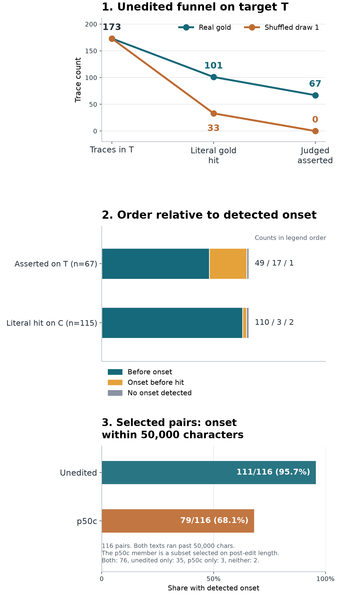

# [Part 177](../../PART177-DESIGN.md): [67](numbers177.json) of [173](numbers177.json) unedited [Qwen3.5-0.8B](../../PART177-DESIGN.md) traces that ran out of tokens while thinking had a window a reader judged to state the gold answer as a result, against [0](numbers177.json) for shuffled answers

Scope: this reads MIT's stored sample-[0](../../PART177-DESIGN.md) texts for the first [200](numbers177.json) rows of [MATH-500](../../PART177-DESIGN.md) in each arm, the same problem IDs. The authors used the model and stack in the design, with thinking on and the registered sampling: temperature [0.6](../../PART177-DESIGN.md), top_p [0.95](../../PART177-DESIGN.md), top_k [20](../../PART177-DESIGN.md), presence penalty [1.5](../../PART177-DESIGN.md), up to [32,768](../../PART177-DESIGN.md) new tokens on vLLM. Nothing was run here. `capped` means decoded text retokenised to at least [32,500](../../PART177-DESIGN.md) tokens with the pinned release tokenizer. Target `T` is the [173](numbers177.json) of [187](numbers177.json) capped, open-thinking traces whose gold does not appear in the problem text. The measure is a literal string match on the gold value plus a reader's `asserted` label on up to [3](../../PART177-DESIGN.md) windows per trace. The literal rule misses mathematically equal forms. Numeric golds reject neighboring letters, digits, underscores, plus signs, minus signs, and decimal points that continue a decimal. Short nonnumeric tokens reject neighboring letters, digits, and underscores. Other golds use plain substring matching with no boundary, so a string can match inside a longer expression. Amendment [2](../../PART177-DESIGN.md), point [3](../../PART177-DESIGN.md), records these rules. The Qwen sentence under test in MIT's [post](https://rikiyat.github.io/blog/weight-space-programming/) is “it lets the model finish answers it could already work out.” See Amendment [2](../../PART177-DESIGN.md). On the unedited arm, [187](numbers177.json) traces were capped while thinking remained open. On `T`, [67](numbers177.json) of [173](numbers177.json) traces had a literal gold hit with an `asserted` window. The shuffled control had [0](numbers177.json) asserted traces out of [173](numbers177.json), with an exact [95%](numbers177.json) upper bound of [2.1%](numbers177.json) (two-sided Clopper-Pearson). A window label does not prove the model would have stopped.

## What did the cap and prompt-echo filter count?

The text stores no finish reason. `capped` is the retokenised decoded-text proxy above; `</think>` marks closed thinking.

| Arm | Capped, thinking open | Capped, thinking closed | Not capped, thinking open | Not capped, thinking closed |
| --- | ---: | ---: | ---: | ---: |
| unedited | [187](numbers177.json) | [0](numbers177.json) | [0](numbers177.json) | [13](numbers177.json) |
| p50c | [48](numbers177.json) | [22](numbers177.json) | [0](numbers177.json) | [130](numbers177.json) |

The [13](numbers177.json) unedited traces that finished are the not-capped, thinking-closed row, so they are outside cohort `C`. The gold-in-prompt filter removes [14](numbers177.json) of the [187](numbers177.json) traces in `C`: literal gold appears in [115](numbers177.json)/[187](numbers177.json) ([61.5%](numbers177.json)) on `C`, and [101](numbers177.json)/[173](numbers177.json) ([58.4%](numbers177.json)) on `T`. The shuffled draw-[1](numbers177.json) value appears in [33](numbers177.json)/[173](numbers177.json) ([19.1%](numbers177.json)) on `T`.

The target-`T` funnel counts traces, not windows: [173](numbers177.json) traces; real gold literal hit [101](numbers177.json); real gold judged asserted [67](numbers177.json); shuffled draw-[1](numbers177.json) literal hit [33](numbers177.json); shuffled judged asserted [0](numbers177.json)/[173](numbers177.json) ([0.0%](numbers177.json)), with an exact [95%](numbers177.json) upper bound of [2.1%](numbers177.json) (two-sided Clopper-Pearson). The panel shows the same filter and control.

## Is the window reader reliable enough for this claim?

DeepSeek V4.1 Flash labeled selected windows around literal hits, not full traces. Claude Haiku 5.5 read the second-reader sample. The known-window gate got [17](numbers177.json)/[20](numbers177.json) ([85.0%](numbers177.json)), at its minimum of [17](numbers177.json). All [3](numbers177.json) known-window misses were among the [4](numbers177.json) examples expected to be `ambiguous`; the remaining [1](numbers177.json) was labelled `ambiguous` correctly. Agreement with the second reader was kappa [0.62](numbers177.json) on [38](numbers177.json) pairs against a [0.6](numbers177.json) bar. Both checks passed narrowly.

The real asserted-window share was [120](numbers177.json)/[287](numbers177.json) ([41.8%](numbers177.json)); the shuffled share was [0](numbers177.json)/[88](numbers177.json) ([0.0%](numbers177.json)). That gives an exact [95%](numbers177.json) upper bound of [4.1%](numbers177.json) (two-sided Clopper-Pearson). That is a gap of [41.8](numbers177.json) percentage points, above the registered [25](../../PART177-DESIGN.md) point gate. Reader errors were [0](numbers177.json)/[385](numbers177.json) ([0.0%](numbers177.json)), under the [2%](../../PART177-DESIGN.md) cap. Gate [4](numbers177.json) passed.

| Reader label | Real windows | Shuffled draw-[1](numbers177.json) windows |
| --- | ---: | ---: |
| asserted | [120](numbers177.json) | [0](numbers177.json) |
| intermediate | [130](numbers177.json) | [64](numbers177.json) |
| quoted from the problem | [6](numbers177.json) | [3](numbers177.json) |
| rejected or doubted | [22](numbers177.json) | [3](numbers177.json) |
| ambiguous | [9](numbers177.json) | [18](numbers177.json) |
| Total | [287](numbers177.json) | [88](numbers177.json) |

This table has [88](numbers177.json) shuffled windows on `T`. Prediction [177.W2](prediction_table.json) is on `C` and uses [98](numbers177.json) shuffled windows. The [10](numbers177.json) extra windows come from `C` minus `T`.

The cold check reports Claude Haiku 5.5's blind sample of [50](COLD.md) windows. It agreed on [47](COLD.md); the [3](COLD.md) disagreements were borderline. It found that `asserted` sometimes precedes a doubt in the next line and sometimes sits inside a repeated loop. Of its [30](COLD.md) windows read as `asserted`, [6](COLD.md) were followed by doubt in the next line and [5](COLD.md) sat inside a repeated loop. This was a sample of [50](COLD.md).

Each reader label allowed at most [2](numbers177.json) sent attempts. Empty or invalid replies and service errors used the remaining attempt. Pre-send DNS failures retried with exponential backoff for up to [2 hours](numbers177.json). [4](numbers177.json) labels have `attempts = 2`: `w:abb2e6a1ab7ca93056121a3a`, `w:490185fa0d5ddea44c6e9c09`, `w:f84358dcebb79a6c2a47fa25`, `w:23236a36b9871c7cf182218f`.

## Did the asserted value appear before the detected onset?

Prediction [177.3](prediction_table.json) held: the first asserted selected window was before the line-rule onset in [49](numbers177.json)/[66](numbers177.json) ([74.2%](numbers177.json)). The remaining asserted trace has no detected onset, shown in its own row. Across all literal-hit traces in `C`, the table keeps no-onset traces separate. The onset rule is not ground truth.

| Trace group | Onset order | Traces |
| --- | --- | ---: |
| Asserted selected windows on `T` (n=[67](numbers177.json)) | Before onset | [49](numbers177.json) |
| Asserted selected windows on `T` (n=[67](numbers177.json)) | Onset before asserted hit | [17](numbers177.json) |
| Asserted selected windows on `T` (n=[67](numbers177.json)) | No onset detected | [1](numbers177.json) |
| Literal-hit traces on `C` (n=[115](numbers177.json)) | Hit before onset | [110](numbers177.json) |
| Literal-hit traces on `C` (n=[115](numbers177.json)) | Onset before hit | [3](numbers177.json) |
| Literal-hit traces on `C` (n=[115](numbers177.json)) | No onset detected | [2](numbers177.json) |

This prediction's denominator uses traces with an asserted gold and a detected onset. Its [95%](numbers177.json) interval is [63.6](numbers177.json) to [84.8](numbers177.json)%.

On `T`, an asserted gold preceded onset in [49](numbers177.json)/[168](numbers177.json) ([29.2%](numbers177.json)) traces with a detected onset. Across `C`, the corresponding count is [49](numbers177.json)/[182](numbers177.json) ([26.9%](numbers177.json)). The `T` denominator has 14 fewer traces because their gold appears in the problem text.

Among all `C` traces, `asserted` appears on [66](numbers177.json)/[182](numbers177.json) ([36.3%](numbers177.json)) looped traces and [1](numbers177.json)/[5](numbers177.json) ([20.0%](numbers177.json)) merely-long traces. Among read hits, the first read hit was asserted in [36](numbers177.json)/[101](numbers177.json) ([35.6%](numbers177.json)), the last read hit in [47](numbers177.json)/[101](numbers177.json) ([46.5%](numbers177.json)), and [22](numbers177.json)/[287](numbers177.json) ([7.7%](numbers177.json)) were rejected or doubted.

## What does the line rule show after the edit?

Prediction [177.4](prediction_table.json) failed: [35](numbers177.json)/[48](numbers177.json) ([72.9%](numbers177.json)) of the p50c capped traces with open thinking had a detected onset, below the [80%](../../PART177-DESIGN.md) bar. This is the line signature among residual failures. It persisted in about three quarters of them and says nothing about incidence.

Prediction [177.5](prediction_table.json) held on the median. In [34](numbers177.json) paired problems with an onset in each arm, the median onset fraction was [0.1624](numbers177.json) in unedited and [0.3179](numbers177.json) in p50c. The difference interval, [-0.0279](numbers177.json) to [0.4001](numbers177.json), includes [0](numbers177.json).

Prediction [177.6](prediction_table.json) held over [116](numbers177.json) pairs where both texts ran past [50,000](../../PART177-DESIGN.md) characters. This selects on post-edit length, so the p50c member is a selected subset. In that subset: [111](numbers177.json)/[116](numbers177.json) ([95.7%](numbers177.json)) unedited and [79](numbers177.json)/[116](numbers177.json) ([68.1%](numbers177.json)) p50c. The rate difference was [27.6](numbers177.json) percentage points, with [95%](numbers177.json) interval [19.0](numbers177.json) to [37.1](numbers177.json) percentage points. This is the rate of the line rule's signature in the first [50,000](../../PART177-DESIGN.md) characters, not a measure of loops in general.

Descriptive and unregistered on all [200](numbers177.json) pairs, each text was read for up to [50,000](../../PART177-DESIGN.md) characters or its full length if shorter. The rates were [183](numbers177.json)/[200](numbers177.json) ([91.5%](numbers177.json)) unedited and [110](numbers177.json)/[200](numbers177.json) ([55.0%](numbers177.json)) p50c, a gap of [36.5](numbers177.json) percentage points. Exposure is unequal because some texts are shorter than the window.

The full-text end-loop rule flagged [182](numbers177.json)/[200](numbers177.json) ([91.0%](numbers177.json)) unedited traces and [36](numbers177.json)/[200](numbers177.json) ([18.0%](numbers177.json)) p50c traces. The `verbatim_loop_end` and `repetitive_end` counts cannot be verified from the pinned inputs. [mathqa.py](https://github.com/RikiyaT/lm_understand-logs/blob/4d09ba6d6a7e891dd8063974dfe81b3d78e3494f/code/mathqa.py) is in the upstream logs repository. `repetitive_end` is rebuilt from a docstring there.

## Did early prompt echo explain the literal-hit gap?

On `C`, real literal hits were [115](numbers177.json)/[187](numbers177.json) ([61.5%](numbers177.json)) and shuffled draw-[1](numbers177.json) hits were [37](numbers177.json)/[187](numbers177.json) ([19.8%](numbers177.json)). The all-occurrence early-hit share was [3923](numbers177.json)/[37453](numbers177.json) ([10.5%](numbers177.json)). Its first-hit reading was [109](numbers177.json)/[115](numbers177.json) ([94.8%](numbers177.json)) on `C`; on `T` it was [95](numbers177.json)/[101](numbers177.json) ([94.1%](numbers177.json)). These are different measures because repeated values can appear many times in a trace.

| Population | First hit in first [15%](../../PART177-DESIGN.md) |
| --- | ---: |
| All `C` traces with a real hit | [109](numbers177.json)/[115](numbers177.json) ([94.8%](numbers177.json)) |
| Target `T` traces with a real hit | [95](numbers177.json)/[101](numbers177.json) ([94.1%](numbers177.json)) |
| `C` minus `T`, where gold is in prompt | [14](numbers177.json)/[14](numbers177.json) ([100.0%](numbers177.json)) |

After dropping hits in the first [15%](../../PART177-DESIGN.md) of text, the three denominator readings are:

| Denominator | Real hits left | Shuffled hits left | Late gap |
| --- | ---: | ---: | ---: |
| All of `C` | [84](numbers177.json)/[187](numbers177.json) ([44.9%](numbers177.json)) | [25](numbers177.json)/[187](numbers177.json) ([13.4%](numbers177.json)) | [31.6](numbers177.json) percentage points |
| Traces with a real hit left | [84](numbers177.json)/[84](numbers177.json) ([100.0%](numbers177.json)) | [22](numbers177.json)/[84](numbers177.json) ([26.2%](numbers177.json)) | [73.8](numbers177.json) percentage points |
| Union with a real or shuffled hit left | [84](numbers177.json)/[87](numbers177.json) ([96.6%](numbers177.json)) | [25](numbers177.json)/[87](numbers177.json) ([28.7%](numbers177.json)) | [67.8](numbers177.json) percentage points |

Amendment [1](../../PART177-DESIGN.md) changed the denominator. Amendment [2](../../PART177-DESIGN.md), point [2](../../PART177-DESIGN.md), says the Reading rules name which trace counts as a hit but give no denominator; the phrase `gap on C` supplies it. The verdict is inconclusive under each denominator. Neither the full claim nor its under-[10%](../../PART177-DESIGN.md) falsifier holds.

Prediction [177.W2](prediction_table.json) failed at [0](numbers177.json)/[98](numbers177.json) ([0.0%](numbers177.json)) shuffled windows on `C`. That gives an exact [95%](numbers177.json) upper bound of [3.7%](numbers177.json) (two-sided Clopper-Pearson). The shuffled values were value:count: [-3](numbers177.json): [1](numbers177.json), [1](numbers177.json): [12](numbers177.json), [2](numbers177.json): [19](numbers177.json), [3](numbers177.json): [17](numbers177.json), [4](numbers177.json): [12](numbers177.json), [5](numbers177.json): [6](numbers177.json), [6](numbers177.json): [7](numbers177.json), [8](numbers177.json): [9](numbers177.json), [9](numbers177.json): [3](numbers177.json), [10](numbers177.json): [2](numbers177.json), [12](numbers177.json): [3](numbers177.json), [24](numbers177.json): [1](numbers177.json), [36](numbers177.json): [3](numbers177.json), [2000](numbers177.json): [3](numbers177.json). This control tests whether the reader calls an incidental matched value `asserted`. It does not show that a donor value could not be stated as an answer.

## Where in the text were the first hits?

These token-position summaries are descriptive and unregistered. A token position counts the tokenized stored-text prefix before the character position. Quartiles use Hyndman-Fan Type [6](numbers177.json), the exclusive method with linear interpolation at p times n plus one.
On target `T`, the median tokens before the first literal hit was [652](numbers177.json), with IQR Q1 [337.5](numbers177.json) to Q3 [1489.5](numbers177.json), across [101](numbers177.json) traces.
Before the first selected window labelled asserted, the median was [1986](numbers177.json) tokens, with IQR Q1 [609](numbers177.json) to Q3 [6020](numbers177.json), across [67](numbers177.json) traces.

Among the [67](numbers177.json) `T` traces with an asserted window, the first asserted window was later in [31](numbers177.json)/[67](numbers177.json) ([46.3%](numbers177.json)). The median gap was [0](numbers177.json) tokens across all traces and [4575](numbers177.json) tokens among later windows. This is not a clean time-to-assertion measure: a detected onset fell between the positions in [16](numbers177.json) traces, and another literal hit fell between them in [30](numbers177.json) traces.

## Did the literal-hit traces emit a wrong final box?

Under Weaver's registered reading (a), [0](numbers177.json)/[115](numbers177.json) ([0.0%](numbers177.json)) had a non-null box that failed [`correct[0]`](numbers177.json), so [177.W3](prediction_table.json) failed. That gives an exact [95%](numbers177.json) upper bound of [3.2%](numbers177.json) (two-sided Clopper-Pearson). On the plain wording, null `pred_first` does not match gold: [113](numbers177.json)/[115](numbers177.json) ([98.3%](numbers177.json)) were null, and the [2](numbers177.json) non-null boxes were correct. The verdict depends on this reading. Weaver ruled before any data, and the reading was registered before the scores.

When nulls are included, [113](numbers177.json)/[115](numbers177.json) ([98.3%](numbers177.json)) had no correct box. [90](numbers177.json) had no `\boxed` or `\fbox` token in the stored text; [23](numbers177.json) ended on an empty box. The raw text scan found [35](numbers177.json) box tokens across [25](numbers177.json) traces: [32](numbers177.json) empty `\boxed{}` occurrences in [24](numbers177.json) traces and [3](numbers177.json) filled boxes. All [32](numbers177.json) empty tokens occur near repeated final-answer or output-format instructions. For example, an echoed instruction says to put the final answer within the box, followed by an empty `\boxed{}` before the reasoning continues. These boxes contain no answer. The extraction returns null for an empty last box, just as it does when no box exists.

An earlier box held the literal gold while the last box differed in [1](numbers177.json)/[115](numbers177.json) ([0.9%](numbers177.json)). There were [115](numbers177.json) literal-hit traces; [113](numbers177.json)/[115](numbers177.json) ([98.3%](numbers177.json)) had null `pred_first`. In these rows, null `pred_first` is what running out while still thinking looks like: almost nothing was emitted as an extractable answer. It is an observed output state, not missing data.

## How do the paired correctness tables line up?

The first table uses all paired problems. The second uses `C`, where the unedited trace has a reader label. Each table gives the p50c wrong and correct cells. Rates are p50c [`correct[0]`](numbers177.json) within each unedited row.

### Unedited literal hit vs p50c correctness on all paired problems

| Unedited state | p50c wrong | p50c correct | p50c correct rate in row |
| --- | ---: | ---: | ---: |
| No | [57](numbers177.json) | [15](numbers177.json) | [15](numbers177.json)/[72](numbers177.json) ([20.8%](numbers177.json)); [95%](numbers177.json) CI [11.1](numbers177.json) to [30.6](numbers177.json)% |
| Yes | [51](numbers177.json) | [77](numbers177.json) | [77](numbers177.json)/[128](numbers177.json) ([60.2%](numbers177.json)); [95%](numbers177.json) CI [51.6](numbers177.json) to [68.8](numbers177.json)% |

### Unedited asserted vs p50c correctness on `C`

| Unedited state | p50c wrong | p50c correct | p50c correct rate in row |
| --- | ---: | ---: | ---: |
| No | [95](numbers177.json) | [25](numbers177.json) | [25](numbers177.json)/[120](numbers177.json) ([20.8%](numbers177.json)); [95%](numbers177.json) CI [14.2](numbers177.json) to [28.3](numbers177.json)% |
| Yes | [11](numbers177.json) | [56](numbers177.json) | [56](numbers177.json)/[67](numbers177.json) ([83.6%](numbers177.json)); [95%](numbers177.json) CI [74.6](numbers177.json) to [92.5](numbers177.json)% |

No cell is called new computation. These paired observations use sampled outputs and a string rule; they cannot show whether the edit changed what the model computes or whether it can stop.

## What happened on the same problems outside the cap cohort?

Across the same [500](numbers177.json) problem IDs, `correct` by sample and any-of-[4](numbers177.json) was:

| Sample | Unedited correct | p50c correct |
| --- | ---: | ---: |
| [0](numbers177.json) | [35](numbers177.json)/[500](numbers177.json) ([7.0%](numbers177.json)) | [241](numbers177.json)/[500](numbers177.json) ([48.2%](numbers177.json)) |
| [1](numbers177.json) | [37](numbers177.json)/[500](numbers177.json) ([7.4%](numbers177.json)) | [242](numbers177.json)/[500](numbers177.json) ([48.4%](numbers177.json)) |
| [2](numbers177.json) | [46](numbers177.json)/[500](numbers177.json) ([9.2%](numbers177.json)) | [239](numbers177.json)/[500](numbers177.json) ([47.8%](numbers177.json)) |
| [3](numbers177.json) | [40](numbers177.json)/[500](numbers177.json) ([8.0%](numbers177.json)) | [240](numbers177.json)/[500](numbers177.json) ([48.0%](numbers177.json)) |
| Any of [4](numbers177.json) | [77](numbers177.json)/[500](numbers177.json) ([15.4%](numbers177.json)) | [320](numbers177.json)/[500](numbers177.json) ([64.0%](numbers177.json)) |

On target `T`, p50c had a literal hit on [95](numbers177.json)/[132](numbers177.json) ([72.0%](numbers177.json)) traces where thinking closed. This is shown beside the capped-trace rates, not pooled with them.

Every rate in this write-up that conditions on `C` or a capped failure is among traces that hit the cap. The first [200](numbers177.json) rows are not a random sample of [MATH-500](../../PART177-DESIGN.md).

## What can this read establish, and what are its limits?

The post's own line is quoted and linked above. Prior-art notes are from Muse's search report, not read by Claude; the papers and detector references are left unlinked here. This result tests the post on one narrow reading: a value stated in a cut trace. That does not prove the model would have stopped.

Amendment [1](../../PART177-DESIGN.md) was made after scores were read. It changes the W1 late-gap denominator and corrects the verdict rule. Amendment [2](../../PART177-DESIGN.md), point [2](../../PART177-DESIGN.md), explains that the Reading rules did not name that denominator. The only code change after registration was an import needed by isolated Python; the commit is in git.

The withdrawal rule did not fire because [177.1](prediction_table.json) held. It would have fired if that prediction failed: the reading “it had stated the answer and kept going” would have been withdrawn and the score blocked.

Limits from the design: [1](../../PART177-DESIGN.md) model, [1](../../PART177-DESIGN.md) benchmark, [1](../../PART177-DESIGN.md) edit, and the authors' stored samples on their stack; only the first [200](numbers177.json) rows, not a random sample; `capped` inferred by retokenising decoded text; a literal string matcher misses mathematically equal forms; a reader judges a window, not the whole trace, so `asserted` is audit-grade and not proof; shuffled answers are a label permutation, not chance reasoning; the line rule is not loop ground truth, and onset depends on how long text ran; nothing here shows how the edit works, and nothing was run on our hardware. Residual-failure rates say nothing about incidence.

## Registered predictions

The text, confidence, estimate, and verdict below come from the registered table. The first cells are plain prediction IDs.

| # | Prediction (verbatim, with confidence) | Estimate | Verdict |
| --- | --- | --- | --- |
| 177.1 | On T, the share of traces with an asserted real gold exceeds the same share for shuffled draw [1](../../PART177-DESIGN.md) by at least [15](../../PART177-DESIGN.md) points (medium) | [67](numbers177.json)/[173](numbers177.json) ([38.7%](numbers177.json)) real; [0](numbers177.json)/[173](numbers177.json) ([0.0%](numbers177.json)) shuffled; shuffled exact [95%](numbers177.json) upper bound of [2.1%](numbers177.json) (two-sided Clopper-Pearson); gap [38.7](numbers177.json) percentage points, [95%](numbers177.json) interval [31.8](numbers177.json) to [45.7](numbers177.json) percentage points | [held](prediction_table.json) |
| 177.2 | On T, at least [25](../../PART177-DESIGN.md)% of traces have an asserted real gold (medium) | [67](numbers177.json)/[173](numbers177.json) ([38.7%](numbers177.json)); [95%](numbers177.json) interval [31.8](numbers177.json) to [46.2](numbers177.json)% | [held](prediction_table.json) |
| 177.3 | Among T traces with an asserted real gold and a detected onset, at least half have the first asserted hit before the onset; not read below [20](../../PART177-DESIGN.md) traces (medium) | [49](numbers177.json)/[66](numbers177.json) ([74.2%](numbers177.json)) before onset; [95%](numbers177.json) interval [63.6](numbers177.json) to [84.8](numbers177.json)% | [held](prediction_table.json) |
| 177.4 | At least [80](../../PART177-DESIGN.md)% of p50c traces that are capped with no </think> carry a detected onset (medium) | [35](numbers177.json)/[48](numbers177.json) ([72.9%](numbers177.json)); [95%](numbers177.json) interval [60.4](numbers177.json) to [85.4](numbers177.json)% | [failed](prediction_table.json) |
| 177.5 | On problems in the same cohort in both arms with a detected onset in both, median onset as a share of text is later in p50c; not read below [15](../../PART177-DESIGN.md) pairs (medium) | [34](numbers177.json) pairs; median onset fraction [0.1624](numbers177.json) to [0.3179](numbers177.json); difference [0.1556](numbers177.json), [95%](numbers177.json) interval [-0.0279](numbers177.json) to [0.4001](numbers177.json) | [held](prediction_table.json) |
| 177.6 | Over the [200](../../PART177-DESIGN.md) paired problems, with onset searched only in the first [50,000](../../PART177-DESIGN.md) characters of each text and pairs with a shorter text left out, the rate of a detected onset is at least [15](../../PART177-DESIGN.md) points lower in p50c (medium) | unedited [111](numbers177.json)/[116](numbers177.json) ([95.7%](numbers177.json)); p50c [79](numbers177.json)/[116](numbers177.json) ([68.1%](numbers177.json)); difference [27.6](numbers177.json) percentage points, [95%](numbers177.json) interval [19.0](numbers177.json) to [37.1](numbers177.json) percentage points | [held](prediction_table.json) |
| 177.W1 | The real-against-shuffled literal-hit gap on C exceeds [15](../../PART177-DESIGN.md) points, but at least [20](../../PART177-DESIGN.md)% of real hits sit in the first [15](../../PART177-DESIGN.md)% of text, and excluding them the gap falls under [15](../../PART177-DESIGN.md); falsifier: fewer than [10](../../PART177-DESIGN.md)% of hits are that early (medium) | C real [115](numbers177.json)/[187](numbers177.json) ([61.5%](numbers177.json)); shuffled [37](numbers177.json)/[187](numbers177.json) ([19.8%](numbers177.json)); gap [41.7](numbers177.json) percentage points, [95%](numbers177.json) interval [34.2](numbers177.json) to [49.2](numbers177.json) percentage points; all-hit early share [3923](numbers177.json)/[37453](numbers177.json) ([10.5%](numbers177.json)); [95%](numbers177.json) interval [8.1](numbers177.json) to [13.7](numbers177.json)%; first-hit early [109](numbers177.json)/[115](numbers177.json) ([94.8%](numbers177.json)); late all-C gap [31.6](numbers177.json) percentage points, [95%](numbers177.json) interval [24.6](numbers177.json) to [38.5](numbers177.json) percentage points | [inconclusive](prediction_table.json) |
| 177.W2 | Shuffled windows clear [40](../../PART177-DESIGN.md)% yes on Gate [4](../../PART177-DESIGN.md); falsifier: under [20](../../PART177-DESIGN.md)% (medium) | [0](numbers177.json)/[98](numbers177.json) ([0.0%](numbers177.json)) shuffled windows asserted on `C`; exact [95%](numbers177.json) upper bound of [3.7%](numbers177.json) (two-sided Clopper-Pearson) | [failed](prediction_table.json) |
| 177.W3 | Among C traces with a literal hit, at least a third have a pred_first that does not match the gold; falsifier: under [15](../../PART177-DESIGN.md)% (medium) | reading (a) [0](numbers177.json)/[115](numbers177.json) ([0.0%](numbers177.json)); exact [95%](numbers177.json) upper bound of [3.2%](numbers177.json) (two-sided Clopper-Pearson); reading (b) [113](numbers177.json)/[115](numbers177.json) ([98.3%](numbers177.json)); [95%](numbers177.json) interval [95.7](numbers177.json) to [100.0](numbers177.json)% | [failed](prediction_table.json) |

Sources: The log inputs and the excerpts in `windows.jsonl` come from [lm_understand-logs](https://github.com/RikiyaT/lm_understand-logs) at commit [`4d09ba6`](https://github.com/RikiyaT/lm_understand-logs/commit/4d09ba6d6a7e891dd8063974dfe81b3d78e3494f) by Takehi, Teoh, Zhang and Khattab under [CC BY 4.0](https://creativecommons.org/licenses/by/4.0/). `windows.jsonl` holds excerpts of their logs and [MATH-500 problem text](https://huggingface.co/datasets/HuggingFaceH4/MATH-500). The MATH-500 text carries its source's own terms. The manifest pins the MATH-500 test set and Qwen tokenizer separately.

Cold check: Claude Haiku 5.5 reproduced the arithmetic, cohorts, literal-hit counts, reader results, box cells and figure from pinned inputs. It reported [2](COLD.md) high, [6](COLD.md) medium and [7](COLD.md) low findings. Every finding is folded. [Cold check](COLD.md).

Rebuild with: `python` [numbers177.py](numbers177.py) and `python` [plot177.py](plot177.py).
