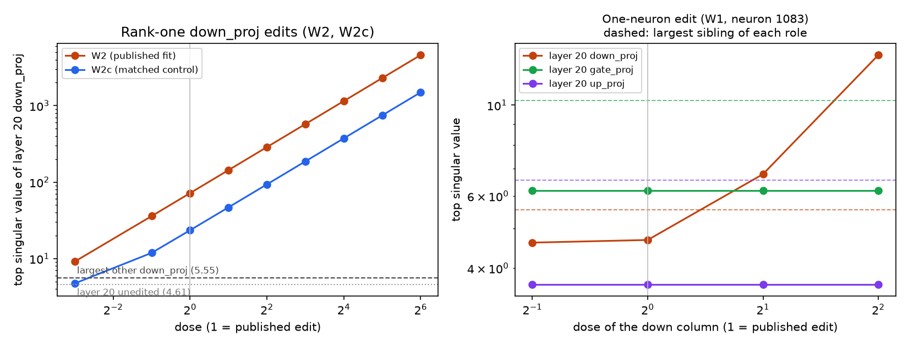

# Part 193: weight statistics alone find the published rank-one chicken edits; the one-neuron edit hides from the matrix spectrum until doubled

Question (registered in `PART193-DESIGN.md`, public main c85d553, 2026-11-08 05:04 CT; Amendments 1 and 2 at 71143e8 and
134930b, after the run and before the edit data behind 193.2 and 193.3 was opened): without the original weights, can simple
statistics of the weight matrices find which matrix of EmbeddingGemma 2 was edited by our published chicken imitation
edits (Journal `notes/reports/embeddinggemma2-chicken-neurons-2026-11-03/EDIT-DESIGN.md`, Amendment 5)? The edits are W1,
which rewrites neuron 1083 of layer 20's MLP (its gate row, up row and down column); W2, a rank-one closed-form
(ROME-style) update of layer 20's `down_proj`; and W2c, the same W2 fit on shuffled labels. The statistics are F1 (log of a matrix's top singular value) and
F2 (the share of its squared spectrum in the top singular value), each ranked against the same matrix role in the other 23
layers, plus a descriptive per-neuron score F3. CPU only; no audio was run except to regenerate the edits.

> **Gate 4 failed (22 of 24).** Gate 4 was the wiring check. It added 24 random rank-one edits, each with a norm twice the
> target matrix's own top singular value, and required F1 to rank every one first among its siblings. Two were not:
> layer 7 `self_attn.q_proj` (rank 3) and layer 1 `ple_block.per_layer_input_gate` (rank 21). The gate's guarantee was
> invalid. The same role's top singular value varies across layers by 1.7 to 3.0 times for eight roles and 6.8 times for
> `per_layer_input_gate`, and a rank-one update of norm 2s on a matrix of norm s only guarantees a top singular value
> between s and 3s. Both misses are placements where another layer's unedited value already exceeds the edited one.
> The registered reading rules stop the part only on a Gate 1 failure, so the part continues. Amendment 1 records the
> failure, and Amendment 2 corrects Amendment 1's exposure account (below) and narrows its wording, following Alden's
> review (council `part193-gate4-2026-11-08`, message 3).

*Left: top singular value of layer 20's `down_proj` under W2 and W2c at each dose (1 = the published edit), against the
largest unedited `down_proj` in any other layer (dashed) and layer 20's own unedited value (dotted). Right: W1 at each
dose of its down column, for layer 20's three MLP matrices, with each role's largest sibling dashed. Drawn from
`results.json` by `fig_dose.py`.*

**Answer.** At their published strength the two rank-one edits are the most conspicuous matrices in the model. Layer 20's
`down_proj` goes from a top singular value of 4.61 (rank 3 of its 24 siblings) to 71.8 under W2 and 23.5 under W2c. Both
rank first among all 216 ranked decoder matrices on F1 and F2, with no unedited matrix scoring higher. Even an eighth of W2
ranks first among its siblings, the bottom of the ladder, so W2's true threshold is that dose or lower. W2c's is a half.
The one-neuron edit W1 is not found by F1 or F2 at its published strength: layer 20's `gate_proj` and `up_proj` rank 22nd
and `down_proj` 3rd, unchanged from the unedited model. Its `down_proj` ranks first only from twice the published down
column. The per-neuron score sees W1 at every dose, though: neuron 1083's down column, 3.29 long against 1.08 for the longest trained down
column in the layer (neuron 1347), makes it the top neuron of its layer and layer 20 the top layer. Two of four
predictions held. The two that failed (193.1 and 193.3) both rested on the pilot's estimate of W2's size, which was about
200 times too small.

What this does and does not show: in this model, the two rank-one edits stand out to statistics that need no base
weights, because each update is far larger in weight norm than the matrix it edits. The one-neuron edit does not stand out
on F1 or F2 at its published strength, and the per-neuron score that sees it is descriptive under the design. None of this
bears on edits built to avoid detection, on other models, or on how much of that norm ordinary inputs ever exercise.

## Predictions

| # | Prediction | Result | Verdict |
| --- | --- | --- | --- |
| 193.1 | Without the base, F1's threshold for W2 (layer 20's `down_proj` first among the 24 `down_proj`) is dose 8 or higher, or never | threshold 0.125, the ladder's lowest dose (found at all 9 doses) | FAILED |
| 193.2 | F1 and F2 do not find W1 at dose 1: none of layer 20's `gate_proj`, `up_proj` or `down_proj` ranks first | sibling ranks 22, 22 and 3 on both F1 and F2 | HELD |
| 193.3 | F1 ranks a synthetic rank-one edit at W2's Frobenius norm first among its siblings in at most 4 of 24 placements | 24 of 24 | FAILED |
| 193.4 | W2's and W2c's F1 thresholds within one ladder step, and their found patterns agree outside the band between them | 0.125 and 0.5 (adjacent rungs; the ladder has no 0.25); patterns agree at all 7 doses outside the band | HELD |

Exposure (Amendment 2): 193.4's record, which the statistics step prints, gives W2's F1 threshold, the quantity 193.1
predicts. So 193.1 had already been revealed to fail when Amendment 1 was written, though that amendment said otherwise.
193.2 and 193.3 were read after both amendments.

## All readouts

At the published dose (1) unless stated. Ranks are among the 23 same-role siblings; global ranks are among all 216 ranked
decoder matrices; false alarms are unedited matrices scoring above the edited one there.

| Edit | Matrix | Top singular value (unedited) | F1 sibling rank | F1 global rank (false alarms) | F2 sibling rank | F1 threshold | F2 threshold |
| --- | --- | --- | --- | --- | --- | --- | --- |
| W2 | L20 `down_proj` | 71.82 (4.61) | 1 | 1 (0) | 1 | 0.125 | 0.125 |
| W2c | L20 `down_proj` | 23.48 (4.61) | 1 | 1 (0) | 1 | 0.5 | 0.5 |
| W1 | L20 `down_proj` | 4.69 (4.61) | 3 | 37 (36) | 3 | 2 | 2 |
| W1 | L20 `gate_proj` | 6.19 (6.19) | 22 | 181 (180) | 22 | never | never |
| W1 | L20 `up_proj` | 3.65 (3.65) | 22 | 208 (207) | 22 | never | never |

- W2 at an eighth: top singular value 9.14, F1 sibling rank 1, global rank 2 (one false alarm); F2 global rank 1.
- W2c at an eighth: 4.73, sibling rank 3. W2c at a half: 11.87, rank 1.
- W1's down column ladder (0.5, 1, 2, 4): `down_proj` top singular value 4.62, 4.69, 6.78, 13.26; first from 2.
- F3 (descriptive by the design): neuron 1083 ranks first in layer 20 and layer 20 first among the 24 layers at every W1
  dose (0.5 to 4). At dose 1 its down-column norm z is 163 (score 163.4; layer F3 z 21.0).
- Synthetic rank-one edits at W2's Frobenius norm (71.79): F1 first in 24 of 24, F2 first in 24 of 24.
- Calibration, the same 24 placements at 1.2 times the target's top singular value: F1 first in 3 of 24, F2 in 3 of 24.
- R1, with the base: exactly layer 20's `down_proj` for W2 and W2c, and exactly row 1083 of `gate_proj` and `up_proj`
  and column 1083 of `down_proj` for W1, each difference of rank 1 (Gate 3).

## The pilot, beside the run

The design's pilot (the first design review, DeepSeek V4.1 Flash) looked at the unedited model and at synthetic stand-ins,
not at the regenerated edits. The rules ask for its numbers beside the run's.

- (a) The pilot reported that adding a W2-sized delta moves layer 20's F2 z by under 0.01 at doses up to 2. In the run, W2
  at dose 1 moves it from 0.94 to 166.5. The pilot computed W2's Frobenius norm from a formula and got 0.360 (W2c 0.342);
  the saved deltas measure 71.79 and 23.34. Its script used the field `actual_key_star_norm` (0.681) where its own comment
  for the formula names the norm of C⁻¹k*. Solving that formula for the saved norms gives |C⁻¹k*| of about 136 for W2 and
  50 for W2c. 193.1 and 193.3, and the ladder's direction (up to 64 times rather than down), followed from this estimate.
- (c) The pilot found a synthetic edit at twice the target's top singular value first in 24 of 24 placements; Gate 4's 24
  seeded placements gave 22 of 24.
- (e) The pilot measured layer 20's top unedited neurons at 26 to 34 on down-column norm z and the longest trained down
  column at 1.08, and concluded W1's neuron could top F3 only with a longer down column. Its published down column is 3.29.

## Gates and controls

- Gate 1 passed: the regenerated fits select the published settings (W1 neuron 1083, tau quantile 0.3, s 0.025; W2 s 0.15;
  W2c s 0.025) and reproduce the held-out AUCs 0.6775, 0.8125 and 0.6175; the saved deltas match the live patches
  bit for bit; parity across 40 clips at cosine 0.9999998 against a 0.99999 threshold.
- Gate 2 passed: dose-zero candidates are bit-identical to the base, and R1 finds nothing.
- Gate 3 passed: R1 finds exactly the matrices and the row and column above.
- Gate 4 failed, 22 of 24 (top of this page).
- Matched control: W2c, fit on shuffled labels, is found too (threshold one rung above W2's). These statistics react to
  rank-one structure of this size, not to the fitted chicken direction.

## Limits

- Scoped to EmbeddingGemma 2 at the pinned snapshot, these three edits and these statistics. Nothing here bears on edits
  designed to avoid detection.
- The ladder's lowest dose is an eighth, so W2's threshold is that dose or lower; where it really lies was not measured.
- F1 and F2 rank against the same role in other layers, so a matrix that is small for its role (as layer 1's
  `per_layer_input_gate` is) needs a larger edit to stand out, and a naturally large one (layer 20's `down_proj` is third)
  needs less. Thresholds here belong to this target, its siblings, the edit's direction and this ladder.
- An edit's weight norm says nothing about how much the model's behaviour changes. Whether ordinary inputs ever reach the
  directions that carry W2's norm is not measured here.
- One procedural deviation: this host's `systemd-run` refuses `--wait` with `--scope`, so the scope commands ran without it.

## Files

`results.json` (every number above), `weight_edit_results.json` (step 0, with each saved array's provenance), `edits.npz`
(the saved deltas), `other_items.json`, `dose.png` and `fig_dose.py`. Logs: `results/part193-step0.log`,
`results/part193-gate1.log`, `results/part193-stats.log`.
