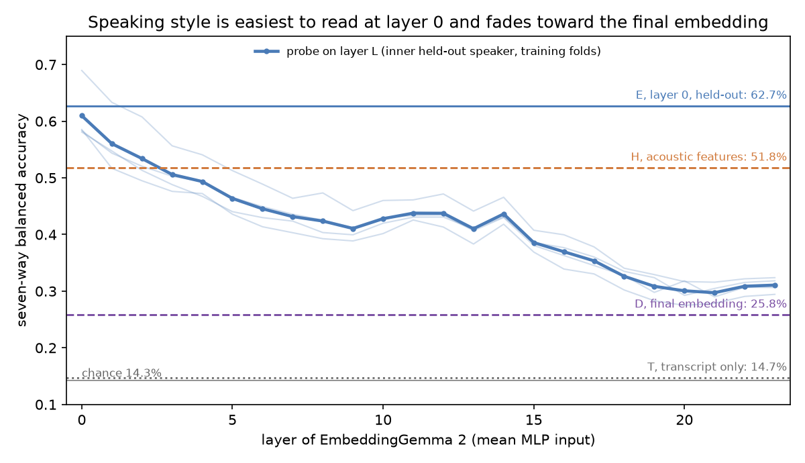

# Part 196: speaking style is linearly readable from EmbeddingGemma 2's first layer (62.7%) and barely from its final embedding (25.8%)

Question (registered in `PART196-DESIGN.md`, public main 1e82c97, 2026-11-08 04:52 CT, before any data; Amendments 1 to 3
before any readout): in duration-filtered, rarity-prioritized, partly text-crossed Expresso speech from four speakers,
how well do these readouts name the speaking style (seven acted styles: confused, default, enunciated, happy, laughing,
sad, whisper)? The model's own verdict (cosine with one text label per style), the same verdict calibrated on the
training speakers, a linear probe on the final embedding, a probe on one intermediate layer, and simple acoustic
features. Is there a gap between the best probe and the best calibrated verdict? Data: 2,724 clips, every one recorded
(Gate 1 and Gate 2 passed); four folds, one held-out speaker each, disjoint by speaker, text and recording.

*Each faint line is one fold's inner leave-one-speaker-out score on its three training speakers (the numbers used to pick
E's layer); the bold line is their mean. Horizontal lines are the held-out-speaker four-fold means. Drawn from
`results.json` by `fig_layers.py`.*

**Answer.** The final embedding carries little speaking style: a probe on it (D) reaches 25.8% balanced accuracy (95%
interval 24.5 to 27.2; chance 14.3%). The model's own label verdict is at chance (A 15.1%), and calibrating it on the
training speakers lifts it only to 17.2% (B). The same probe on the first layer's mean MLP input (E, chosen by inner
cross-validation as layer 0 in all four folds) reaches 62.7% (61.3 to 64.2), above seven simple acoustic features (H,
51.8%, 50.3 to 53.3; a descriptive comparison, not registered). The inner curve falls from about 0.61 at layer 0 to
about 0.30 at layers 19 to 23. A transcript-only readout is near chance (T, 14.7%). The training-best single units
(F) sit in layers 0 to 4 in every fold; L0 N675 is the training-best unit for enunciated in all four folds and for
whisper in one (whisper's best is L0 N2041 in two folds and L0 N46 in one).

The registered headline, 196.4, is **"gap supported"**: D beats the calibrated verdict B by 8.6 points (7.0 to 10.4),
and D's interval is above chance, so by the reading rules the final embedding holds style information this calibrated
verdict does not use. That gap is real but small, and both readouts are weak. The larger fact is the curve: style is
far more linearly readable from layer 0's mean MLP input than from the final embedding. This part reads; it does not
show what the model uses, and it tests no edit.

## Predictions

| # | Prediction | Result | Verdict |
| --- | --- | --- | --- |
| 196.1 | A at most 35% | 15.1% (14.3 to 15.9) | HELD |
| 196.2 | D at least 70% | 25.8% (24.5 to 27.2) | FAILED |
| 196.3 | If D beats A, B closes at least half that gap | D minus A 10.7 points (9.2 to 12.3); B minus A 2.1 (1.0 to 3.3), 20% of the gap | FAILED |
| 196.4 | D minus B at least 5 points, interval above 0 ("gap supported") | 8.6 points (7.0 to 10.4); D's lower bound 24.5% above chance | HELD (gap supported) |
| 196.5 | B56 within 3 points of D | B56 minus D -4.1 points (-5.6 to -2.4) | FAILED |
| 196.6 | Whisper has the highest per-style recall under A, B and D | Top style: A default (56.0%), B laughing (22.4%), D laughing (32.4%); whisper 5.6%, 20.1%, 29.9% | FAILED |
| 196.7 | H at least 40% | 51.8% (50.3 to 53.3) | HELD |
| 196.8 | T at most 25% | 14.7% (14.2 to 15.2) | HELD |

Four held, four failed. Calibration is credited (B minus A interval above 0), but it closes a fifth of the gap, not
half. 196.5 failed and the non-inferiority bound (lower end of B56 minus D above -3 points) is not met, so the gap is
not attributed to B's decision rule. A free probe on the 56 label cosines (B56) scores 21.8%, 4.1 points below D
(-5.6 to -2.4); this is reported as a difference between two readouts, not as a finding about what the label space
holds. 196.6 failed for A, B and D, but whisper is the best-read style under E (95.5%) and H
(99.5%): it is the most distinct style acoustically and at layer 0, and the final embedding does not keep that.

## All readouts (four-speaker mean, 95% text-cluster bootstrap; per speaker ex01 / ex02 / ex03 / ex04)

| Readout | Balanced accuracy | Macro AUC | Per speaker (balanced accuracy) |
| --- | --- | --- | --- |
| A, single label | 15.1% (14.3 to 15.9) | 0.510 | 14.5 / 15.8 / 15.7 / 14.4 |
| B, calibrated verdict | 17.2% (16.2 to 18.3) | 0.521 | 15.8 / 16.9 / 17.6 / 18.6 |
| B56, probe on 56 cosines | 21.8% (20.7 to 23.0) | 0.593 | 22.2 / 21.1 / 21.9 / 21.9 |
| C, exemplar centroids | 25.4% (24.0 to 26.7) | 0.512 | 26.2 / 23.5 / 23.0 / 28.8 |
| D, final-embedding probe | 25.8% (24.5 to 27.2) | 0.650 | 26.1 / 24.5 / 24.5 / 28.3 |
| E, layer probe (layer 0) | 62.7% (61.3 to 64.2) | 0.912 | 69.3 / 64.4 / 49.2 / 67.9 |
| F, best single unit per style | (AUC only) | 0.745 (0.738 to 0.753) | |
| H, acoustic features | 51.8% (50.3 to 53.3) | 0.807 | 48.6 / 54.1 / 53.2 / 51.1 |
| T, transcript only | 14.7% (14.2 to 15.2) | 0.506 | 14.5 / 14.5 / 14.4 / 15.4 |

Per-style recall (four-speaker mean), confused / default / enunciated / happy / laughing / sad / whisper:
A 25.0 / 56.0 / 5.8 / 5.2 / 2.8 / 5.2 / 5.6; B 15.1 / 11.5 / 19.8 / 13.5 / 22.4 / 18.2 / 20.1; D 23.2 / 22.5 / 31.8 /
19.2 / 32.4 / 21.8 / 29.9; E 57.8 / 45.1 / 69.5 / 44.2 / 70.2 / 56.5 / 95.5; H 22.7 / 36.5 / 54.9 / 40.5 / 41.8 / 66.5 /
99.5. The uncalibrated verdict calls most clips "default" or "confused".

## Gates and diagnostics

- Gate 1 passed: every fold disjoint by speaker, text and recording id; every speaker-by-style cell at least 40 recorded
  clips; 472 (speaker, text) clusters, none left with a single style. Gate 2 (Part 188's parity gate) passed before any
  Expresso clip was recorded. 2,724 of 2,724 clips recorded, no errors.
- Shuffled style labels within each training speaker: D scores 14.6%, at chance as expected.
- Speaker identity from the final embedding (half of each speaker's texts to train, half to test): 33.3% on four
  speakers, chance 25%. The final embedding carries little speaker information either; why was not tested here.
- Calibration fits converged in every fold. B picked a single phrasing (not the mean of eight) for every style in every
  fold. The chosen phrasings' training one-against-rest AUCs ran from 0.47 to 0.64 (laughing 0.60 to 0.64, whisper 0.57
  to 0.58, the rest 0.47 to 0.53; for default, enunciated and happy the best of nine choices was below 0.5), so the
  label cosines barely separate styles even on the training speakers.

## What this suggests (untested)

For the "neurons that beat the model" line of work: on speaking style, a probe on the final embedding beats the
calibrated verdict by 8.6 points, and a probe on layer 0 reads far more. By the reading rules neither is by itself a
case for an edit. One untested follow-up hypothesis: an output edit of Part 190's kind would gain little here, where
the final-embedding probe is weak (Part 190's probe AUCs were 0.92 to 0.97 for real against imitation animal sounds),
and a test would need to start from earlier layers.

## Limits

- Four speakers, acted read speech, one studio; seven performed styles. Not representative Expresso, and not
  content-independent recognition: the draw prioritized rare styles and crossed some texts, not all. Styles differ in
  clip length (mean 3.1 s default to 4.8 s enunciated). H includes seconds per word, so speaking rate may contribute
  to H, and possibly to E; Alden accepted tempo as a style signal. A low T bounds one transcript classifier, not every
  content route.
- E's layer comparison is a probe on mean-pooled MLP inputs; it says the information is linearly readable there, not
  that the model uses it. The curve above is the inner (three-speaker) score used for selection, not a held-out test of
  every layer; only layer 0 was tested on held-out speakers.
- E against H and E against D are descriptive comparisons; no paired interval for them was registered.
- One model (`google/embeddinggemma-2`, revision f9972ac), CPU float32. The phrasings are ours (eight per style); a
  different label set could move A and B.

## Changes after registration (all before any readout was computed or read)

- Amendment 1: transcripts use the model's `document` prompt (the registered `SearchDocument` does not exist in this
  model's prompt dictionary).
- Amendment 2: the style-profile step matched metadata by id alone, and Expresso reuses four ids across styles (one
  `default` clip plus two `longform` rows each); it now matches on (id, speaker, style) as the recorder did.
- Amendment 3: one caller unpacked two values from a function that returns one array; fixed, and an end-to-end
  synthetic test of `analyze()` was added, which found no other crash.
- Recording took 35.3 minutes against the design's estimate of 23.2.

## Files

`results.json` (every number above), `layers.png` and `fig_layers.py`, the recorder and analysis logs beside this
folder (`results/part196-record.log`, `results/part196-analyze.log`, and the two failed attempts' logs).
