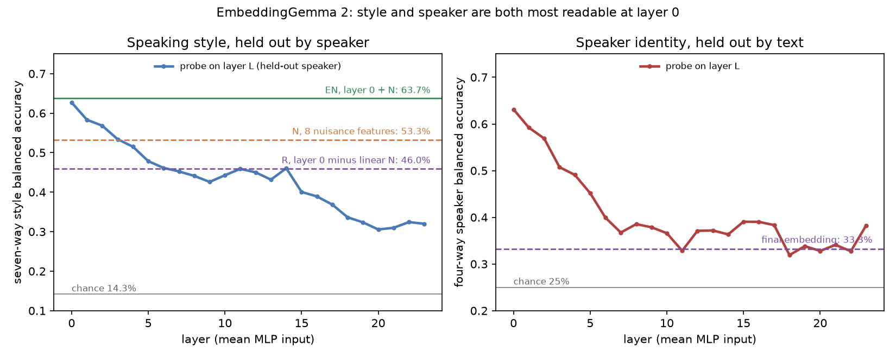

# Part 197: EmbeddingGemma 2's layer 0 adds 10 points to a linear style readout beyond simple acoustics and clip length

Question (registered in `PART197-DESIGN.md`, public main d565a17, 2026-11-08 07:38 CT, before any Part 197 readout; a
prospective analysis of Part 196's already-examined recordings; design reviewed by Alden, council
`part197-design-review-2026-11-08`, scoped design PASS at #7): Part 196 found a layer-0 probe naming seven acted
speaking styles at 62.7% on held-out speakers, against 51.8% for seven acoustic features. Within the same fixed linear
probe family, does adding layer 0 to simple acoustics plus clip length improve the readout, is style still linearly
readable from layer 0 after subtracting what those features linearly predict, and what do the held-out layer curves
for style and for speaker identity look like? Data: Part 196's 2,724 recorded clips and four folds, unchanged; no model
run.

*Left: seven-way style balanced accuracy of a probe on each layer's mean MLP input, held-out speaker, four-speaker mean;
horizontal lines are EN, N and R. Right: four-way speaker identity by layer, half of each speaker's texts to train and
half to test. Drawn from `results.json` by `fig_layers.py`.*

**Answer.** Yes, within this pipeline. A probe on eight nuisance features (N: the seven acoustic features plus clip
duration) reads style at 53.3%; adding layer 0 (EN) reads 63.7%, a paired gain of 10.4 points (95% interval 8.6 to
12.4), which is the registered headline (197.1 held). After subtracting the training-fitted linear prediction of every
layer-0 unit from N, a probe still reads 46.0% (R; chance 14.3%; shuffled-label control 14.1%). The held-out layer
curve peaks at layer 0 (62.7%) and falls to about 31% by layers 20 to 23, the shape Part 196's inner curve showed.
Speaker identity follows the same course: 63.1% at layer 0, 32% to 38% in layers 18 to 23 and 33.3% at the final
embedding, against a chance of 25%. Five of six predictions held; the speaker prediction (at least 80% at layer 0)
failed.

What this does and does not show: adding layer 0 improves this fixed linear readout given N. It does not show that
layer 0 holds information no function of N could supply (a nonlinear function of N is not removed), and it does not
show the model uses that information.

## Predictions

| # | Prediction | Result | Verdict |
| --- | --- | --- | --- |
| 197.1 | EN minus N at least 5 points, interval above 0 | +10.4 points (8.6 to 12.4) | HELD |
| 197.2 | R at least 45% | 46.0% (44.4 to 47.6) | HELD |
| 197.3 | EN minus E0 at most 3 points (point estimate) | +1.0 points (0.4 to 1.7) | HELD |
| 197.4 | K (duration and speaking rate only) at most 30% | 28.7% (27.2 to 30.2) | HELD |
| 197.5 | Best held-out layer is 0, 1 or 2; layers 20 to 23 each at most 35% | best layer 0 (62.7%); layers 20 to 23: 30.6, 31.0, 32.4, 32.0% | HELD |
| 197.6 | Speaker identity at layer 0 at least 80% | 63.1% | FAILED |

197.2 is a point threshold and held by one point; its interval reaches below 45%. R minus N, reported as a readout
contrast and not as information beyond N, is -7.3 points (-9.5 to -5.2): the residualized layer-0 probe reads less style
than the nuisance features themselves, while layer 0 together with them reads more than either.

## All readouts (four-speaker mean, 95% text-cluster bootstrap; per speaker ex01 / ex02 / ex03 / ex04)

| Readout | Balanced accuracy | Per speaker |
| --- | --- | --- |
| N, eight nuisance features | 53.3% (51.7 to 54.9) | 50.6 / 55.7 / 54.4 / 52.5 |
| H, Part 196's seven acoustic features | 51.8% (50.2 to 53.3) | 48.6 / 54.1 / 53.2 / 51.1 |
| K, duration and seconds per word | 28.7% (27.2 to 30.2) | 25.9 / 28.3 / 28.4 / 32.1 |
| E0, layer 0 | 62.7% (61.2 to 64.3) | 69.3 / 64.4 / 49.2 / 67.9 |
| EN, layer 0 plus N | 63.7% (62.2 to 65.2) | 70.0 / 65.6 / 50.5 / 68.9 |
| R, layer 0 residualized on N | 46.0% (44.4 to 47.6) | 51.5 / 46.3 / 33.7 / 52.4 |

Paired differences: EN minus N +10.4 (8.6 to 12.4); EN minus E0 +1.0 (0.4 to 1.7); E0 minus K +34.0 (31.9 to 36.1); R
minus N -7.3 (-9.5 to -5.2). Speaker ex03 is the weakest held-out speaker for every layer-0 readout, as in Part 196.

## Gates and controls

- Gate 1 passed: the recorder identity matched the pinned values, the records digest (2,724 records plus
  `durations.json`) matched the one committed at registration, and Part 196's analysis code regenerated Part 196's
  published `results.json` with 0 mismatches and a largest numeric difference of 0.0 (measured before registration
  and again in this run).
- Gate 2 (a numerical orthogonality check; by least squares it can catch an implementation failure, not show the
  nuisance information is unavailable): passed in all four folds, rank 9, largest normalized cross-product 1.8e-15,
  no layer-0 unit masked, no nuisance column dropped.
- Shuffled style labels within each training speaker: EN 14.5%, R 14.1%, both at chance.

## Limits

- Part 196's limits carry over: four speakers, acted read speech, one studio, one model revision, mean-pooled
  activations, a duration-filtered, rarity-prioritized, partly text-crossed sample. Intervals are conditional on these
  speakers and the fitted pipelines.
- N is eight features; formants, voice quality, pauses and nonlinear functions of N are not removed. EN minus N credits
  layer 0 with anything a nonlinear function of N could also supply.
- The speaker-identity split holds out texts, not speakers; it is a different task from the style folds and is
  descriptive beyond 197.6.
- Prospective analysis of an already-examined dataset: the predictions were written after Part 196's results were read.

## Files

`results.json` (every number above), `layers.png` and `fig_layers.py`; the run log is `results/part197-analysis.log`.
Code and gates: `part197/` (analysis, digest, tests; 22 tests including an end-to-end run with the real probe on a
planted signal).
