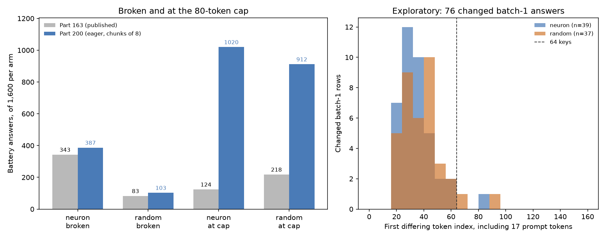

# Part 200: Part 163's arm gap and verdicts hold on eager; batch-1 shape differs

Part 200 reran Part 163's 3,416 answers with the same model, units, questions and dose, using eager attention and chunks of 8 for pushed calls, then regenerated “What is your name?” once per unit at batch 1. The launch record says 2026-11-09 13:40:08 CT; the model load began at 13:40:53 and the answer run finished at 14:58:43. The run records 3,416 answers and 200 batch-1 outputs. The design and the source records are [PART200-DESIGN.md](../../PART200-DESIGN.md), [launch.jsonl](launch.jsonl), [load.json](load.json), [answers.jsonl](answers.jsonl), and [batch1.jsonl](batch1.jsonl).

**Answer.** The gates passed, and all five Part 163 verdicts stayed the same. The neuron arm still had more broken answers than random (387/1,600 vs 103/1,600; published 343/1,600 vs 83/1,600), while both arms had many more answers reach the cap (1,020 and 912, vs published 124 and 218). Under Part 161's maker-answer rule, Qwen appeared in 16/514 eligible neuron answers and 40/632 random answers (published 19/539 and 57/661). The additional shape comparison found 76/200 batch-1 answers changed from their chunked answers, so the shape-sensitivity flag is set. These figures are recomputed by [report200.py](../../part200/report200.py) from the linked run files and published [Part 163 answers](../part163/answers.jsonl) and [score](../part163/score.json); the emitted tables and values are [report200.md](report200.md) and [report200.json](report200.json).

## Predictions

| # | Prediction (verbatim, with confidence) | Result | Verdict |
| --- | --- | --- | --- |
| 200.1 | Gates R1 to R3 and Part 163's three gates pass. (medium) | All six gates pass. [Computed by report200.py](../../part200/report200.py) from [score.json](score.json), [compare.json](compare.json), and [load.json](load.json). | held |
| 200.2 | 163.1, 163.2, 163.3 and 163.4 hold and 163.5 fails, as published. (medium: 163.1 and 163.2 cannot fail unless a random rate falls below 2/3, and 163.3's bar is far below the published rates, so the live parts are 163.4 (one unit from flipping) and 163.5.) | Rerun verdicts: held, held, held, held, failed; identical to published. [Values and intervals](report200.md#part-163-registered-verdicts-published-beside-rerun), computed from [published score](../part163/score.json) and [rerun score](score.json). | held |
| 200.3 | The neuron arm's broken count over its 1,600 battery answers is at least twice the random arm's (published 343 and 83). (medium: Part 199 kept its between-arm direction on eager while its rates moved.) | 387 vs 103 broken (3.76×); published 343 vs 83. [Computed counts](report200.md#battery-broken-and-at-cap-counts) from both [answer files](answers.jsonl) and [published answers](../part163/answers.jsonl). | held |
| 200.4 | In each arm at least 480 of 1,600 battery answers (30%) reach the 80-token cap (published 124 neuron, 218 random). (medium: on SDPA almost every Part 199 answer stopped early; on eager most ran to the cap.) | 1,020 neuron and 912 random; published 124 and 218. [Computed counts](report200.md#battery-broken-and-at-cap-counts) from both answer files. | held |
| 200.5 | Each arm's broken count is higher on eager than published. (low: Part 199's loop rates rose on eager, but Part 163's triage keeps any answer naming a model or identity, and a kernel can remove loops as well as add them.) | Yes: neuron 387 vs 343; random 103 vs 83. [Triage counts](report200.md#battery-broken-and-at-cap-counts), recomputed by [report200.py](../../part200/report200.py) using [Part 86 triage](../../part86/triage86.py). | held |
| 200.6 | Under Part 161's rule on maker phrasings, the neuron arm's pooled Qwen rate stays below the random arm's (published 19 of 539 against 57 of 661). (low: the published rates are small and the comparison was unregistered.) | 16/514 (3.1%) neuron vs 40/632 (6.3%) random; published 19/539 vs 57/661. [Computed Qwen counts](report200.md#part-161-rule-on-maker-phrasings) from both answer files under [Part 161's rule](../part163/extra163.py). | held |
| 200.7 | At most 20 of the 200 batch-1 answers differ from the same units' chunked answers. (low: rows are pushed independently, but eager batch 8 left the batch-1 path at a near-tie on 1 of 8 kernel-check prompts.) | 76/200 differ: 39/100 neuron and 37/100 random. [Comparison](compare.json) and [recomputed first differences](report200.json). | failed |

The prediction wording and confidence are copied from the registered [design](../../PART200-DESIGN.md); results and verdicts are computed and printed by [report200.py](../../part200/report200.py). The full machine-readable result is [report200.json](report200.json), and the corresponding tables are [report200.md](report200.md).

## Part 163 verdicts: published beside eager rerun

| Prediction | Published estimate (95% interval) | Published verdict | Rerun estimate (95% interval) | Rerun verdict |
| --- | --- | --- | --- | --- |
| 163.1 | Ratio 1.061 (0.985 to 1.148) | held | Ratio 1.047 (0.973 to 1.128) | held |
| 163.2 | Ratio 1.024 (0.970 to 1.077) | held | Ratio 1.042 (0.990 to 1.101) | held |
| 163.3 | Name-gone rate: neuron 0.850 (0.803 to 0.893), random 0.801 (0.749 to 0.850) | held | Neuron 0.853 (0.805 to 0.897), random 0.815 (0.765 to 0.862) | held |
| 163.4 | Name gone at least half: neuron 91, random 86; both gone: neuron 90, random 83 | held | Name gone at least half: neuron 93, random 89; both gone: neuron 92, random 88 | held |
| 163.5 | Broken rate: neuron 0.214 (0.168 to 0.266), random 0.052 (0.037 to 0.069) | failed | Neuron 0.242 (0.193 to 0.294), random 0.064 (0.048 to 0.083) | failed |

These are the registered point-estimate verdicts from [Part 163 score163.py](../../part163/score163.py); the intervals are unit-bootstrap 95% intervals and do not change the verdict. The numeric results are reproduced by [report200.py](../../part200/report200.py) in [report200.md](report200.md) from [published score.json](../part163/score.json) and [rerun score.json](score.json).

## Skeptical questions

### Does the batch shape matter, given 200.7?

For this one identity prompt, yes: 76 of the 200 batch-1 answers differ from their batch-8 answers, 39 neuron and 37 random. The tokenized first differences and label flips are exploratory: 73 are at or before 64 keys including the prompt, and among the 76 rows the name-gone label flips 2 times, broken 6 times, and the Part 161 Qwen predicate 5 times. This comparison holds the eager model and prompt constant while comparing batch 1 with chunks of 8, but it samples only question 0; it does not measure batch-shape effects on all maker phrasings. See [report200.json](report200.json) and the data-derived [figure](fig200.png), generated by [fig200.py](../../part200/fig200.py).

### Is the at-cap jump the kernel?

The records do not isolate that cause. At-cap counts rose from 124 to 1,020 neuron and from 218 to 912 random, but the run changed both attention kernel (SDPA to eager) and pushed batch shape (64 to chunks of 8). The batch-1 comparison shows exact outputs are shape-sensitive for question 0; it does not identify what portion of the at-cap jump comes from shape. These counts and the design's attribution limit are in [report200.md](report200.md#battery-broken-and-at-cap-counts), [compare.json](compare.json), and [PART200-DESIGN.md](../../PART200-DESIGN.md).

### Did the arms' gap hold?

Yes on Part 86's broken-answer triage: neurons had 387/1,600 broken battery answers versus 103/1,600 random, and the same direction appeared in the published counts (343 vs 83). The within-rerun ratio was 3.76. That supports the registered count comparison; it does not explain why answers broke. Counts are recomputed from [answers.jsonl](answers.jsonl) and [Part 163 answers](../part163/answers.jsonl) by [report200.py](../../part200/report200.py).

## Exploratory: batch-1 differences and answer reading

First answer differences are tokenized with the local Qwen3.5-4B tokenizer; decoded answer strings had to be re-tokenized because token IDs were not stored. The rendered prompt is 17 tokens and is included in the key position. Of 39 changed neuron answers, 38 first differed at or before 64 keys and one after; of 37 random, 35 were at or before 64 and two after. The per-row answer excerpts and label comparisons are in [report200.json](report200.json); the visual summary is [fig200.png](fig200.png).

I read five answers in each arm for the recipe and battery stages and five changed batch-1 answer pairs in each arm. The sample included ordinary self-identification, malformed or repetitive output, and cases where chunked and batch-1 responses changed the named identity or developer. The short excerpts are recorded in [hand_read.md](hand_read.md); this is a qualitative check, not a rate estimate.

## Files and sources

- [report200.py](../../part200/report200.py) recomputes every number printed in this README from result files, and writes [report200.json](report200.json) and [report200.md](report200.md).
- [fig200.py](../../part200/fig200.py) draws [fig200.png](fig200.png) from `report200.json`.
- [score.json](score.json), [compare.json](compare.json), [answers.jsonl](answers.jsonl), [batch1.jsonl](batch1.jsonl), [load.json](load.json), and [launch.jsonl](launch.jsonl) are Part 200's run records.
- [Part 163 score](../part163/score.json), [Part 163 answers](../part163/answers.jsonl), and [Part 161 Qwen rule](../part163/extra163.py) supply the published comparison.
- The design and its exact predictions are [PART200-DESIGN.md](../../PART200-DESIGN.md). The [hand-read excerpts](hand_read.md) record the sampled rows.

Cold check: pending
