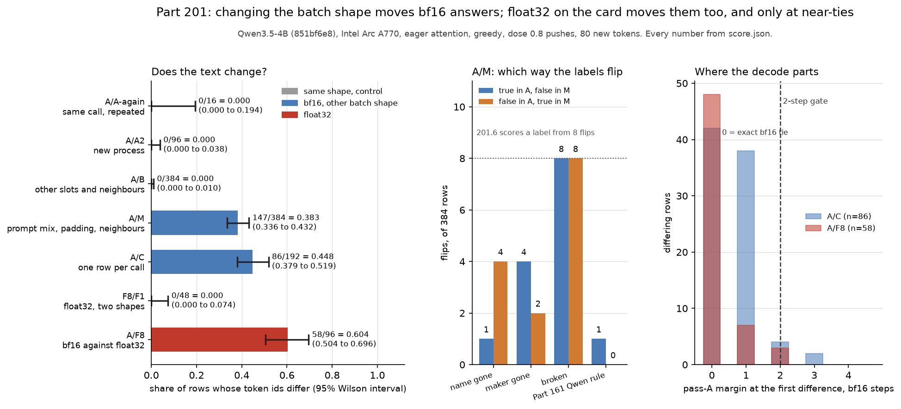

# Part 201: changing the batch shape changes 147 of 384 and 86 of 192 bf16 answers, with 84 of the 86 first differences between batch shapes inside 2 bf16 steps (largest 3); repeats, a new process and other neighbours change none, and two float32 shapes agree on all 48 rows

Part 201 asked what moves a bf16 greedy answer when the batch shape changes, and whether float32 on the same card stops it. Between A and M (prompts mixed, left padding, other neighbours, 51 of 51 calls with unequal prompt lengths) 147 of 384 rows differ, 0.383 (0.336 to 0.432); between A and C (one row per call) 86 of 192 differ, 0.448 (0.379 to 0.519). The controls are flat: A against B (other slots and other neighbours, same prompts and size) differs on 0 of 384, A against A2 (a new process) on 0 of 96, and A against A-again (the same calls repeated) on 0 of 16. Float32 from the same bf16 weights, on the card, gives the same answer at both its shapes (F8 against F1, 0 of 48) and a different answer from bf16 on 58 of 96 rows, 0.604 (0.504 to 0.696); every one of those first differences is inside 2 bf16 steps in pass A, and 16 of them are exact bf16 ties that float32 breaks. Ten of eleven registered predictions held and 201.11 failed (projected slowdown 3.16 at two steps against a bar of 2), so the ordered decision is rule 4, no build. Scope: Qwen3.5-4B at revision 851bf6e806efd8d0a36b00ddf55e13ccb7b8cd0a, bf16 and float32 compute from bf16 weights on the Intel Arc A770, eager attention, greedy, 80 new tokens, dose 0.8 pushes from Part 163's units.

## Predictions

| # | Prediction (verbatim, with its confidence) | Result | Verdict |
| --- | --- | --- | --- |
| 201.1 | A-again equals A on all 16 rows, and A2 equals A on all 96, token for token. (high) | A-again 0 of 16 differ; A2 0 of 96 differ. Both clauses held in the same process (A-again ran in pass A's launch). | held |
| 201.2 | Between A and C, 25% to 50% of the 192 rows differ. (medium) | 86 of 192 = 0.448 (0.379 to 0.519). | held |
| 201.3 | Between A and M, at least 20% of the 384 rows differ. (low) | 147 of 384 = 0.383 (0.336 to 0.432). | held |
| 201.4 | Between A and B (other slots and other neighbours, same size and prompts), at most 10% of the 384 rows differ. (low) | 0 of 384 = 0.000 (0.000 to 0.010). | held |
| 201.5 | Of the rows that differ between A and C, at least 90% have a pass-A margin of at most 2 steps at the first differing position, and none has one above 8 steps. (high) | 84 of 86 = 0.977 within 2 steps; largest pass-A margin 3.0 steps. | held |
| 201.6 | Between A and M, for each of the four labels with at least 8 flips, the two directions of flip differ by at most twice the square root of the number of flips; and mean answer length differs by under 3 tokens. (medium) | Only broken reached 8 flips (8 one way, 8 the other); name gone 1 and 4, maker gone 4 and 2, the Part 161 Qwen rule 1 and 0, each listed as not scored for direction. Mean length A minus M -0.16 tokens. | held |
| 201.7 | K matches the CPU reference token for token on all 16 rows, over every position. (medium) | Batch 1: 8 of 8 rows equal, no first difference. Batch 2: 8 of 8 rows equal, no first difference. | held |
| 201.8 | Between F8 and F1, none of the 48 rows differ, with all 48 present and finite in both. (medium) | 0 of 48 differ; 0 non-finite. | held |
| 201.9 | Of the rows that differ between A and F8, at least 90% have a pass-A margin of at most 2 steps at the first differing position, and none has an F8 (float32) margin above 0.5 there. (medium) | 58 of 58 = 1.000 within 2 steps; largest pass-A margin 2.0 steps; largest F8 margin 0.232. 16 of the 58 are at position 0, where pass A's two top tokens are tied at 23.25 (margin 0) and float32 puts 9419 ahead by 0.016; see the near-ties question. | held |
| 201.10 | Between A and F8, 30% to 70% of the 96 rows differ. (low) | 58 of 96 = 0.604 (0.504 to 0.696). | held |
| 201.11 | The projected slowdown of margin-gated decoding on pass A is at most 2: (pass A's seconds + the summed cost of one full-prefix float32 forward for the flagged rows at every step where an unfinished row is within 2 steps) ÷ pass A's seconds, the cost of each forward read from the timing probe at the nearest larger row count and prefix length. (low) | Pass A took 516.10 s over 48 calls; 1,892 steps flagged at 2 steps; added 1,114.03 s; projected slowdown 3.159. At 1 step it is 2.467 (1,324 steps), at 3 steps 3.687 and at 4 steps 4.085. | failed |

The prediction wording and confidence are copied from the registered design, [PART201-DESIGN.md](../../PART201-DESIGN.md), and the same table is in [PREDICTIONS.md](../../PREDICTIONS.md) under "Part 201". Every result and verdict is printed by [score201.py](../../part201/score201.py) into [score.json](score.json) and [report.md](report.md).

## Is it run-to-run noise?

No, as far as a repeat and a new process can show. A-again repeats pass A's first two calls (16 rows) in the same process, in the same slots, straight after pass A; A2 decodes questions 0 to 3 (96 rows) in a second process with the same calls. Both give zero differing rows. The scorer's own repeat is a small sample: 0 of 16 bounds the repeat-flip rate at 0.194 (Wilson, 95%), so it rules out a large run-to-run effect and not a small one; 0 of 96 bounds it at 0.038. Source: pairs → A/A-again and pairs → A/A2 in [score.json](score.json), printed in [report.md](report.md) under Pairs.

## Is it the neighbours?

No. Pass B keeps the same prompts, the same 384 rows and chunks of 8, and changes only which rows share a call and each row's slot; the plan refuses a B call with an A call's membership and a row keeping its A slot. 0 of 384 rows differ, so neither the other rows in a call nor a row's position in it moves a bf16 answer here. Source: pairs → A/B in [score.json](score.json).

## Is it the batch shape, then?

The two shapes that differ from A are the two that change the sequence layout. Pass C decodes one row per call, so the batch size is 1 and the kernel runs a different strategy; 86 of 192 rows differ, and the positive control (at least 10) is met six times over. Pass M mixes questions in one call and left-pads them: 328 of its 408 rows were left-padded, the median padding was 5 tokens, and all 51 of its calls held prompts of unequal length. It differs on 147 of 384. The design calls M a composite (prompt mix, padding, sequence length, neighbours and slots at once) and does not decompose it; B shows that neighbours and slots alone do nothing, so what is left in M is the padding and the mixed lengths. Source: pairs → A/C, pairs → A/M, `pass_M_padding` and `positive_control` in [score.json](score.json).

## Do the verdicts move? (label flips)

A label flip is rarer than a changed text. Over 384 A/M pairs the largest count is broken, 8 rows true in A and false in M and 8 the other way; name gone flips 1 and 4, maker gone 4 and 2, and the Part 161 Qwen rule 1 and 0. Over 192 A/C pairs no label flips more than 4 times either way (broken 4 and 1). A/B, A-again, A2 and F8/F1 flip nothing. The design's 3% bar is 11.5 flips in 384; broken's 16 flips is 0.042 of 384 (0.026 to 0.067, Wilson 95%), counting both directions. Source: the `label_flips` of each pair in [score.json](score.json), and the flips table in [report.md](report.md). The labels are Part 163's, applied by the scorer's own code; the cold check did not recompute them (Limits).

## Are these near-ties?

Mostly, and the margin tables say where. At the first difference between A and C, 84 of 86 rows sit at 2 steps or less in pass A (42 at 0, 38 at 1, 4 at 2, 2 at 3). Between A and F8 the pass-A margin is 2 steps or less on all 58 rows (48 at 0, 7 at 1, 3 at 2; 16 of the 48 at 0 are the first-token rows described below), and float32 puts the two tokens within 0.232 of each other on every one. Over all 1,504 bf16 decodes, 2.1% of positions are at an exact tie, 6.1% within 1 step, 9.9% within 2 and 16.6% within 4. A step is the bf16 spacing at the top logit's magnitude, 0.125 for a top logit from 16 up to 32, as the design defines it. Source: pairs → A/C → differing_rows, pairs → A/F8 → differing_rows and `bf16_share_of_positions_within_steps` in [score.json](score.json), and the row-by-row tables in [report.md](report.md).

**The 16 A/F8 rows at position 0.** On 16 of the 58 A/F8 differing rows (and 8 of 31 C/F1, 6 of 147 A/M) the first difference is the very first generated token, and there pass A's two top tokens are an exact bf16 tie: both are recorded at a logit of 23.25, the margin is 0, and the decode emitted 4888, the lower token id, as it does at all 2,240 exact ties in the record. Float32 emits 9419 there, ahead by 0.016, which is 0.13 of a bf16 step at a logit of 23.25 (a step is 0.125 there). So the bf16 margin really is 0 and float32 breaks the tie. The design says the first token is decoded in the prefill forward, before the push applies, so these rows compare the plain model's first token at two precisions. 201.9's largest F8 margin (0.232) is unchanged and the verdict does not move. Source: [rows.jsonl](rows.jsonl) and pairs → A/F8 → differing_rows in [score.json](score.json).

## Does float32 remove it?

On this card and these shapes, yes for shape and no for precision. Two float32 shapes, F8 (the same 12 calls as pass A, same rows and slots) and F1 (one row per call), differ on 0 of 48 rows, which bounds the float32 shape-flip rate at 0.074 (Wilson, 95%). Float32 against bf16 (A against F8) differs on 58 of 96 rows, and the float32 token is the one the bf16 margin could not decide: at the first difference float32's own margin is at most 0.232. Pass K ties the card's float32 compute to the CPU's float32-upcast reference on the eight kernel prompts at batch 1 and 2, 16 of 16 rows equal over every position, so the float32 answer is not an artefact of the card's kernels. A float32 decode is therefore a stable answer, not a more correct one: where float32's margin is itself 0.016, as at the 16 first-token rows, the model is close to undecided. Source: pairs → F8/F1, pairs → A/F8, predictions → 201.7 in [score.json](score.json).

## Is a margin-gated recheck worth building?

No, not at this price. 201.11 asked whether re-deciding, in float32, every step where an unfinished row is within 2 steps of its runner-up would cost at most twice pass A's time. The timing probe priced each such step from a full-prefix float32 forward; 1,892 of pass A's steps are flagged at 2 steps (49.3% of its generation steps have an unfinished row within 2 steps), and the added time is 1,114 s against pass A's 516 s, a projected slowdown of 3.16. Even at 1 step it is 2.47. The ordered decision in [BATCH-SHAPE-NOISE.md](../../BATCH-SHAPE-NOISE.md) section 3 reads the rules in order: rule 1 (a row parting at a confident margin) does not apply, rule 2 (float32 arm invalid) does not apply, rule 3 (201.7 or 201.8 fails) does not apply, and rule 4 applies because 201.11 failed. The decision is no build; section 1 (record the shape of every generated count) is the standing procedure. The candidate gate the design would have used, one step above the largest pass-A margin at an A/F8 first difference, is 3 steps, and at 3 steps the projected slowdown is 3.69. Source: predictions → 201.11, `candidate_gate` and `decision` in [score.json](score.json).

## Method

The design is [PART201-DESIGN.md](../../PART201-DESIGN.md) with [Amendment 1](../../part201/AMENDMENT-1.md) to [4](../../part201/AMENDMENT-4.md). Model Qwen/Qwen3.5-4B at 851bf6e806efd8d0a36b00ddf55e13ccb7b8cd0a, on the Intel Arc A770, eager attention, loaded through `neuron_report.load_model`, chat template with thinking off and no system prompt, greedy, 80 new tokens (96 for pass K). Pushes are Part 163's: dose +0.8 at the row-isolated hook, 24 units (12 neurons and 12 random directions) on the 16 battery questions, 384 pushed rows, plus 24 plain rows. Passes: A, chunks of 8 in a fixed interleaved unit order; A-again, A's first two calls repeated; B, the same rows reshuffled into other chunks and slots; M, rows shuffled across questions and left-padded; C, one row per call on 192 rows; A2, A's questions 0 to 3 in a second process; K, the kernel reference at batch 1 and 2; F8, float32 compute from bf16 weights on A's first 12 calls (96 rows); F1, the same six questions' first 8 units one row per call (48 rows). A recorder stores each step's top two tokens, top logit, margin and the emitted token's score; a margin of 0 is an exact bf16 tie, and at every such tie the decode emitted the lower token id. Gates G1 to G5 all passed (recorder 0 of 1,648 rows failed; pushes identical across passes and precisions, 0 of 1,600 pushed rows failed) and the positive control passed (A and C differ on 86 rows, 10 needed). Every number is printed by [score201.py](../../part201/score201.py) from [rows.jsonl](rows.jsonl) and [probe.json](probe.json).

## Limits

- 201.6's label flips and 201.7 (pass K against the CPU reference) were not independently recomputed by the cold check; they are the scorer's numbers only.
- One model, one device, one dose, Part 163's units and questions, 80 tokens. The loop and ban parts (165 to 170) have other labels and may flip at other rates.
- The float32 passes define an answer; they do not show it is the right one. Where float32's own margin is tiny (0.016 at the 16 first-token rows), the model is close to undecided.
- Pass K compares the card's float32 with the CPU's on plain prompts only, and both use the same upcast method, so an error shared by both would not show.
- The probe priced 2 or 3 live rows at the 4-row median per Amendment 1, since it has no 2-row or 3-row entry; 38 of the flagged steps at 2 steps were priced by extrapolating past the 96-token prefix. Both are approximations, and 201.11 is a forecast, not a measurement.
- The first token is never pushed (it is decoded in the prefill forward), so the first-token differences between precisions compare the plain model.

## Files

- [score.json](score.json): every prediction's estimate and verdict, the gates, the pairs, the margin tables and the decision; made by [score201.py](../../part201/score201.py).
- [report.md](report.md): the same, printed with the row-by-row first-difference tables.
- [rows.jsonl](rows.jsonl): 1,648 rows, one per answer per pass, with tokens, top two, margins and the push hash; schema [ROWS-SCHEMA.md](../../part201/ROWS-SCHEMA.md).
- [probe.json](probe.json): the timing probe's per-run seconds; [plan.json](plan.json), [load.json](load.json), [launch.jsonl](launch.jsonl) and [kernel-f32.json](kernel-f32.json): the frozen plan, the load and launch records and pass K's record.
- [fig201.py](../../part201/fig201.py): draws [fig201.png](fig201.png) from score.json only.
- [cold/REPORT.md](cold/REPORT.md): the independent recomputation.

Cold check: DeepSeek V4.1 Flash worker (dark-factory run part201-coldcheck-2026-11-10), 2026-11-10, recomputed every pair count, margin table, G2 and 201.11 from rows.jsonl and probe.json without the scorer; all matched; 201.6 and 201.7 not recomputed.
