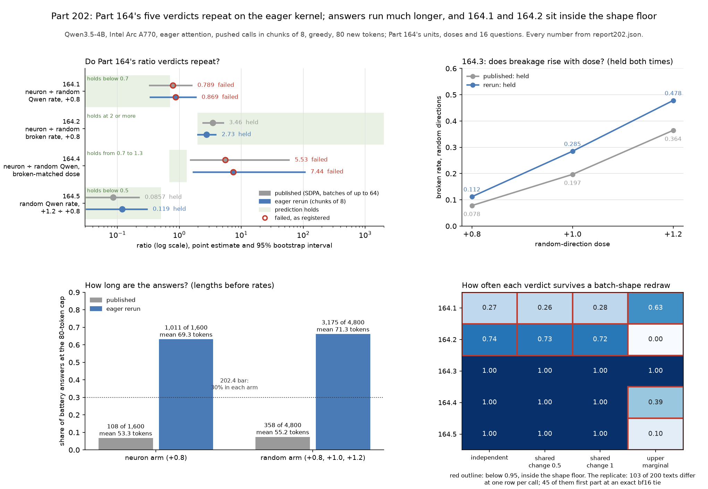

# Part 202: Part 164 on the eager attention kernel: all five of its verdicts repeat, answers reach the 80-token cap far more often, Gate 3 passes by one row, and changing the batch shape changes 103 of 200 answers

Part 202 reran Part 164's 6,516 answers with the same model, units, doses and 16 questions, on eager attention with pushed calls in chunks of 8, then decoded a seeded sample of 200 battery rows one row per call. All five of Part 164's registered verdicts come out as published: 164.1 fails (neuron over random Qwen rate 0.869 against a bar of under 0.7; published 0.789), 164.2 holds (2.732; published 3.456), 164.3 holds, 164.4 fails (7.441; published 5.529) and 164.5 holds (0.119; published 0.086). All four of Part 164's gates pass, Gate 3 by one row (71 of 100 against 70; published 86). Answers ran much longer: 1,011 of 1,600 neuron and 3,175 of 4,800 random battery answers reached the 80-token cap, against 108 and 358 published. Decoding one row per call changed 103 of the 200 sampled texts, above the registered 40 to 100, so 202.5 failed; 45 of the 103 first part at an exact bf16 tie. Under redraws of the labels at the replicate's flip rates, 164.1 and 164.2 come out as observed in only 0.26 to 0.28 and 0.72 to 0.74 of redraws (independent and shared-change scenarios), so both sit inside the shape floor. Four of five predictions held. Scope: Qwen3.5-4B at revision 851bf6e806efd8d0a36b00ddf55e13ccb7b8cd0a, bf16 on the Intel Arc A770, eager attention, greedy, 80 new tokens, Part 164's units, doses (+0.8 for neurons; +0.8, +1.0 and +1.2 for random directions) and questions.

**Lengths before cross-run rates.** Battery rows only; counted by [report202.py](../../part202/report202.py) from [answers.jsonl](answers.jsonl) and Part 164's [published answers](../part164/answers.jsonl), printed in [report202.md](report202.md).

| Run | Arm | Rows | At the 80-token cap | Mean `token_count` |
| --- | --- | ---: | ---: | ---: |
| Published (Part 164, SDPA) | Neuron | 1,600 | 108 | 53.3 |
| Published (Part 164, SDPA) | Random | 4,800 | 358 | 55.2 |
| Eager rerun | Neuron | 1,600 | 1,011 | 69.3 |
| Eager rerun | Random | 4,800 | 3,175 | 71.3 |

## Predictions

| # | Prediction (verbatim, with its confidence) | Result | Verdict |
| --- | --- | --- | --- |
| 202.1 | Gates R1 to R3 and Part 164's four gates pass. (medium) | R1: eager on the one launch, one model revision, device and output folder. R2: every input hash and the ordered 16 prompts match. R3: 0 pushed calls outside chunks of 8, 0 no-push calls over one row, 132 companion rows discarded. Part 164's Gates 1 to 4 pass. | held |
| 202.2 | Part 164's 164.1 fails; 164.2, 164.3 and 164.5 hold; 164.4 fails. (low) | 164.1 failed, 164.2 held, 164.3 held, 164.4 failed, 164.5 held; all four gates passed. | held |
| 202.3 | At +0.8 the neuron Qwen rate is below the random rate, and its broken rate is above the random rate. (medium) | Qwen rate neuron 0.0582, random 0.0650; broken rate neuron 0.3056, random 0.1119. | held |
| 202.4 | At least 480 of 1,600 neuron answers and 1,440 of 4,800 random answers reach `token_count == 80`. (low) | 1,011 of 1,600 neuron; 3,175 of 4,800 random. | held |
| 202.5 | Between 40 and 100 of the 200 shape-replicate texts differ from their chunk-of-8 texts. (low) | 103 of 200 differ. | failed |

The prediction wording and confidence are copied from the registered design, [PART202-DESIGN.md](../../PART202-DESIGN.md), where 202.2's row also quotes Part 164's five rules; the same table is in [PREDICTIONS.md](../../PREDICTIONS.md) under "Part 202". Every result and verdict is printed by [score202.py](../../part202/score202.py) into [score.md](score.md) and [score.json](score.json), each line with the file and key it comes from; [report202.py](../../part202/report202.py) gathers them into [report202.json](report202.json) and [report202.md](report202.md) and checks them against the direct run of Part 164's scorer.

## Do Part 164's verdicts repeat?

Yes, all five, read with Part 164's own scorer ([score164.py](../../part164/score164.py)), imported unchanged by score202 and also run directly on these rows ([cold/score164-direct.json](cold/score164-direct.json)), which gives the same gates, estimates and verdicts and adds the bootstrap intervals. The intervals are 95% unit-bootstrap intervals and do not change a verdict; the verdicts read the point estimate, as registered.

| Prediction | Rule | Published estimate (95% interval) | Published | Eager estimate (95% interval) | Eager |
| --- | --- | --- | --- | --- | --- |
| 164.1 | neuron over random Qwen rate at +0.8 under 0.7 | 0.789 (0.333 to 1.569) | failed | 0.869 (0.338 to 1.831) | failed |
| 164.2 | neuron over random broken rate at +0.8 at least 2 | 3.456 (2.428 to 5.072) | held | 2.732 (1.981 to 3.861) | held |
| 164.3 | random broken rate rises: +0.8 below +1.0 below +1.2 | 0.0781, 0.1969, 0.3644 | held | 0.1119, 0.2850, 0.4781 | held |
| 164.4 | at the broken-matched random dose, neuron over random Qwen ratio 0.7 to 1.3 | 5.529 (1.510 to 58.383), dose +1.0 | failed | 7.441 (1.674 to 105.124), dose +1.0 | failed |
| 164.5 | random Qwen rate at +1.2 under half that at +0.8 | 0.086 (0.000 to 0.221) | held | 0.119 (0.000 to 0.298) | held |

Part 164's rule for 164.4 stands: with 164.1 failed, its strength reading is moot. The rates behind these ratios, per cell, published beside eager, are in [report202.md](report202.md) under "Rates per cell"; every broken rate is higher on eager (neuron +0.8 0.2700 to 0.3056; random +0.8 0.0781 to 0.1119, +1.0 0.1969 to 0.2850, +1.2 0.3644 to 0.4781). Source: `part164_verdicts` and `rates` in [report202.json](report202.json).

## Did the gates hold?

Yes, with less room than published. Gate 1: 6,516 of 6,516 nonempty rows, 0 duplicates. Gate 2: 16 of 16 no-push answers name Qwen and 16 of 16 name Alibaba or Tongyi (at least 12 of each required), as published. Gate 3: 71 of 100 random recipe answers triage as changed against a bar of 70, published 86, so it passes by one row. Gate 4: the random Qwen rate at +0.8 is 0.0650 against a bar of 0.04, published 0.0794. Source: `part164_gates` in [report202.json](report202.json), and the gate lines in [score.md](score.md).

## Is the at-cap jump the kernel?

The records do not isolate it. The rerun changed both the attention kernel (SDPA to eager) and the pushed batch shape (calls of up to 64 rows to chunks of 8), and the design attributes cross-run changes to both together. Part 200's rerun of Part 163 on the same kernel and shape showed the same jump (1,020 and 912 of 1,600 at the cap, against 124 and 218 published), and Part 178 found the A770's fused bf16 SDPA path leaving the CPU float32 path after 64 cached keys; neither run separates the kernel from the batch shape.

## How much does the batch shape move the answers?

Decoding a sampled battery row alone instead of in its chunk of 8 changed 103 of 200 texts. Where each differing text first parts, the battery row's recorded margin between its top two tokens was an exact bf16 tie on 45 rows, within one bf16 step on 49 more, between one and two steps on 5, and above two steps on 4 (a step is the bf16 spacing at the top logit's magnitude, as Part 201 defines it). Labels move far less than texts: over the 200 pairs, broken changes 17 times, excluded 5, the Qwen rule 3, and the maker-gone label once. Read by hand, 2 of 10 seeded differing pairs change what the answer says about its maker and 8 change wording only ([cold/REPORT.md](cold/REPORT.md), item 7). Source: `replicate` in [report202.json](report202.json), from [answers.jsonl](answers.jsonl) and [replicate.jsonl](replicate.jsonl).

## How sure are the verdicts against batch shape?

The shape floor ([shape_floor.py](../../tools/shape_floor.py), called by score202 with 1,000 redraws and seed 0) redraws every battery row's labels with the transition rates the 200 replicate pairs show, rescores with Part 164's scorer, and reports the share of redraws in which each verdict comes out as observed. A share below 0.95 is marked inside the shape floor.

| Verdict | Independent | Shared change 0.5 | Shared change 1 | Upper marginal |
| --- | ---: | ---: | ---: | ---: |
| 164.1 | 0.268 | 0.264 | 0.276 | 0.632 |
| 164.2 | 0.738 | 0.726 | 0.719 | 0.000 |
| 164.3 | 1.000 | 1.000 | 1.000 | 1.000 |
| 164.4 | 1.000 | 1.000 | 1.000 | 0.389 |
| 164.5 | 1.000 | 1.000 | 1.000 | 0.102 |

164.1 and 164.2 are inside the shape floor in every scenario: a batch-shape change of the size the replicate shows would often reverse them. 164.3 stays at 1.000 in all four. 164.4 and 164.5 stay at 1.000 in three scenarios and drop only under the upper-marginal stress, which flips each label at the upper 95% bound of its observed rate; the tool describes that scenario as a stress, not an upper bound on instability. Of the gates, only Gate 4 drops below 0.95 in any scenario (0.730, upper marginal). The figures are conditional on the scenario and on the replicate's pair of shapes; they are not confidence levels. Source: the stability lines in [score.md](score.md), gathered in `stability` and `gate_stability` in [report202.json](report202.json).

## Method

The design is [PART202-DESIGN.md](../../PART202-DESIGN.md). Model Qwen/Qwen3.5-4B at 851bf6e806efd8d0a36b00ddf55e13ccb7b8cd0a in bf16 on the Intel Arc A770, loaded through `neuron_report.load_model` with eager attention (the runner refuses any other), Part 164's prompts, greedy, 80 new tokens. [run202.py](../../part202/run202.py) rebuilds Part 164's plan (6,516 rows: 16 no-push, 100 recipe and 6,400 battery; a test checks it equal to Part 164's published rows key for key and in order) and decodes it with Part 201's recorder, which stores each step's top two tokens and margin. Pushed calls run in chunks of 8; Part 164's 33 calls of 36 rows are padded with 132 discarded companion rows. After the battery, 200 battery rows drawn with `random.Random(202)` across the arm and dose cells are decoded alone, one row per call, into [replicate.jsonl](replicate.jsonl). The launch ran in one process from 2026-11-12 09:02 to 11:42 CT ([load.json](load.json)). [score202.py](../../part202/score202.py) applies Gates R1 to R3 and runs Part 164's `score_rows` unchanged, then the shape floor.

## Limits

- The rerun changed the kernel and the batch shape together, so no cross-run difference (the cap counts, the rates, the estimates) can be assigned to either alone.
- The replicate compares chunks of 8 with one row per call on 200 rows; it does not sample other batch memberships or shapes, and the shape floor's figures assume its transition rates carry over to the other 6,200 battery rows.
- The design registered no cluster key for the shape floor, so each row is its own cluster and the two shared-change scenarios redraw the same way as the independent one; they differ from it only by Monte Carlo noise.
- The margin at a first difference is the battery row's; whether the one-row replicate's own path was also at a tie there was not measured.
- Part 164's bare `Qwen` word rule misses `Qwen3` and `Qwen3.5`; the rerun keeps that registered rule.
- Eager bf16 is not CPU float32 and can still choose differently at near-ties.

## Files

- [answers.jsonl](answers.jsonl): 6,516 rows, one per answer, with tokens, top two tokens, margins and the push hash; schema [ROWS-SCHEMA.md](../../part201/ROWS-SCHEMA.md). [replicate.jsonl](replicate.jsonl): the 200 one-row decodes.
- [load.json](load.json), [launch.jsonl](launch.jsonl): the load, call and launch records Gates R1 and R3 read.
- [score.md](score.md), [score.json](score.json), [score-stdout.txt](score-stdout.txt): score202's printout, every value with its file and key; made by [score202.py](../../part202/score202.py).
- [report202.json](report202.json), [report202.md](report202.md): every number on this page; made by [report202.py](../../part202/report202.py).
- [fig202.py](../../part202/fig202.py): draws [fig202.png](fig202.png) from report202.json only.
- [margins.md](margins.md), [margins.json](margins.json): the registered distances of Part 164's published estimates from their bars; made by [margins202.py](../../part202/margins202.py).
- [cold/REPORT.md](cold/REPORT.md): the cold check, with its script [cold/recompute.py](cold/recompute.py), output [cold/recompute.json](cold/recompute.json), and the direct run of Part 164's scorer [cold/score164-direct.json](cold/score164-direct.json).

Cold check: DeepSeek V4.1 Flash worker (dark-factory run part202-coldcheck-2026-11-12), 2026-11-12, recomputed the row and cap counts, means, R3 from load.json, 202.5, the replicate label changes and every rate without score202; all matched. The worker stopped at its 1,000-turn limit before writing a report; Claude ran Part 164's scorer directly on the rows (same gates, estimates and verdicts) and read ten differing pairs by hand. No finding changed a number or a verdict.
