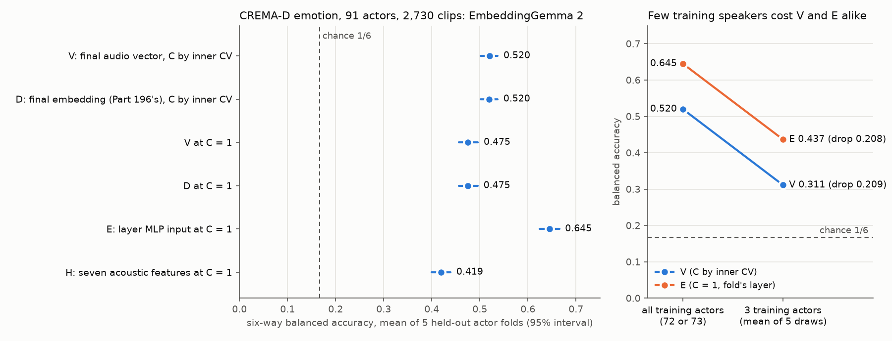

# Part 203: on CREMA-D emotion (91 actors, six emotions), EmbeddingGemma 2's final audio vector reads the emotion at 0.520 balanced accuracy, an early layer's MLP input at 0.645, and training on three actors instead of 72 or 73 costs both about 0.21

Part 196 found, on Expresso (four speakers, seven acted styles, one speaker held out per fold), that a linear probe on
EmbeddingGemma 2's final embedding read the style at 25.8% balanced accuracy while layer 0's mean MLP input read it at
62.7%. Venn reports 56.5% for a linear head on the same model's final audio vector on CREMA-D emotion. Part 203 asked,
on 2,730 CREMA-D clips (91 actors x 6 emotions x 5 clips, five actor-disjoint folds), whether the two setups differ in
the vector, the regularisation, the number of training speakers or the data.

On these clips the final audio vector (V, with Venn's `<|audio|>` prompt) and Part 196's final embedding (D) read the
emotion at the same balanced accuracy, 0.520 and 0.520, both far above chance (1/6). A probe on one early layer's mean
MLP input (E; layer 0 in four folds, layer 1 in one) reads 0.645, 0.170 above D on the same clips at the same C. The
seven acoustic features (H) read 0.419. Training on three actors instead of all the training actors lowers V by 0.209
and E by 0.208. Seven of the eleven registered rows held; 203.3, 203.7, 203.W1, 203.W3 and 203.W4 failed (203.3 on its
second clause: the inner CV chose C = 0.01, not 10 or 100, on all five folds).

Every number below is read from [results.json](results.json) by [part203/score203.py](../../part203/score203.py)
(printed with its key in [score.md](score.md)) or by [part203/fig203.py](../../part203/fig203.py); the analysis is
[part203/analyze203.py](../../part203/analyze203.py), run as [part203/steps.txt](../../part203/steps.txt) step 4.

## Predictions

The wording and confidence are copied from [PART203-DESIGN.md](../../PART203-DESIGN.md); the same table is in
[PREDICTIONS.md](../../PREDICTIONS.md) under "Part 203". Weaver's rows are scored by their forecast, with each falsifier
reported separately, as the design says beside the table.

| # | Prediction (verbatim, with its confidence) | Result | Verdict |
| --- | --- | --- | --- |
| 203.1 | `readouts.V_grid.mean_balanced_accuracy` is at least 0.45, and its `balanced_accuracy_actor_cluster_95` lower bound is above 1/6. (70%, Claude) | 0.5200; lower bound 0.5022. | held |
| 203.2 | The text marker and V's float16 storage together do not matter: `readouts.D_grid.mean_balanced_accuracy` is within 0.03 of `readouts.V_grid.mean_balanced_accuracy`. (60%, Claude) | D_grid 0.5196 against V_grid 0.5200, 0.0004 apart; both lower bounds above 1/6 (0.5019, 0.5022). | held |
| 203.3 | Regularisation matters: `V_grid_minus_V_p196.mean_difference` is at least +0.03, with Venn's grid choosing C of 10 or 100 on most folds (its log loss was still falling at 100). (55%, Claude) | The difference is +0.0447 (interval 0.0270 to 0.0631), but the grid chose C = 0.01 on all five folds, the other end of the grid. | failed (second clause) |
| 203.4 | An intermediate layer at least ties the final vector here: `E_p196_minus_D_p196.mean_difference` is at least -0.02. (60%, Claude) | +0.1697 (0.1499 to 0.1889). | held |
| 203.5 | The seven acoustic features carry part of it: `readouts.H_p196.mean_balanced_accuracy` is between 0.30 and 0.45. (65%, Claude) | 0.4192. | held |
| 203.6 | Few speakers is most of Part 196's story: `three_actor_ablation.V.three_actor_draws_mean` is at least 0.10 below `three_actor_ablation.V.all_training_actors_mean`. (65%, Claude) | 0.3112 against 0.5200, a drop of 0.2088. | held |
| 203.7 | And it hurts the final vector more than the intermediate layer: V's drop in 203.6 exceeds E's drop by at least 0.05. (50%, Claude) | V's drop 0.2088, E's drop 0.2084 (0.6450 to 0.4365); difference 0.0004. | failed |
| 203.W1 | `readouts.V_grid.mean_balanced_accuracy` minus `readouts.D_grid.mean_balanced_accuracy` is more than 0.03. (0.55, Weaver) | 0.0004. Falsifier (D within 0.03 of V) reached. | failed |
| 203.W2 | `E_p196_minus_D_p196.mean_difference` is at least 0.10. (0.50, Weaver) | 0.1697. Falsifier (E within 0.05 of D) not reached. | held |
| 203.W3 | `readouts.H_p196.mean_balanced_accuracy` is under 0.30. (0.30, Weaver) | 0.4192. Falsifier (H at 0.35 or above) reached. | failed |
| 203.W4 | `V_grid_minus_H_p196.mean_difference` is under 0.10. (0.40, Weaver) | 0.1008 (0.0798 to 0.1213). Falsifier (V minus H at 0.15 or more) not reached: forecast failed, falsifier not reached. | failed |

Weaver asked readers to shade their four confidences down by about 0.1 and named W3 as the row they expected to fail
(design, beside the table). Both gates passed: Gate 1 with 2,730 of 2,730 clips recorded ok, Gate 2 (Part 188's parity
gate) before any clip was recorded.

## Does the final embedding lose the emotion?

Not on these clips. V and D both read 0.520 (intervals 0.502 to 0.537), three times chance, against 0.419 for the seven
acoustic features. Macro one-against-rest AUC, reported separately and not compared with balanced accuracy, is 0.816
for V and for D, 0.889 for E and 0.715 for H. Per held-out fold, V reads 0.535, 0.531, 0.530, 0.467 and 0.537; the low
fold (fold 3) is low for every readout (E 0.589, H 0.398), so it looks like a property of those actors, not of one
readout. That reading is descriptive and was not registered.

The early layer still carries more: E reads 0.645 (0.625 to 0.665), and the gap to D at the same C on the same clips
is +0.170 (0.150 to 0.189). Per emotion, averaged over folds, V's recall runs from 0.387 (fear) to 0.696 (neutral) and
E's from 0.546 (sad) to 0.796 (neutral); E is ahead on every emotion.

## Is it the marker or V's float16 storage?

No. V and D differ in the `<|audio|>` prompt, V's float16 storage, the decoder and the cap; on these 2 to 3 second
clips the decoders return the same samples (the recorder's Gate 1 check `v_same_samples`) and D's 10 s cap never
binds. Their grid-tuned readouts differ by 0.0004, and at C = 1 they read 0.4753 and 0.4753 on average; per fold the
C = 1 readouts differ by at most 0.004 (the differences cancel in the mean). The reading rule's
condition for reading a V/D gap (both lower bounds above 1/6) is met, and there is no gap to read.

## Is it the regularisation?

Partly, but in the opposite direction from Venn. The inner actor-grouped CV over Venn's grid chose C = 0.01, the
strongest regularisation, on all five folds for both V and D, and that gains +0.045 over Part 196's C = 1 for V
(+0.044 for D). Venn's own run chose C = 100. The two setups differ in clips, split and training size, so this part
does not say why; it says that on this split stronger regularisation helps the final vector, and 203.3's mechanism
("C of 10 or 100") was wrong.

## Is it the number of training speakers?

It moves both readouts a long way. Each fold trains on 72 or 73 actors; training on three actors (five
fixed draws per fold, scored on the same held-out actors) lowers V from 0.520 to 0.311 and E from 0.645 to 0.437. Part
196 trained on three speakers per fold. The drop is the same for both readouts to the third decimal (0.209 and 0.208),
so 203.7's guess that few speakers would hurt the final vector more is not supported.

Part 196's 25.8% was on a different dataset and task (Expresso, seven acted styles), so this part cannot say how much
of Part 196's gap the speaker count explains there; it shows that on CREMA-D emotion the speaker count moves both
readouts by about 0.21. E leads V by 0.125 with all training actors and by 0.125 with three; E against V carries the
marker, V's float16 storage and V's tuned C as well as the layer, so it is not read as a layer difference (the design's
layer contrast is E against D, which the ablation did not compute).

## Which layer?

E's layer is chosen by inner actor-grouped CV on each fold's training actors (five inner folds, C = 1). It chose
layer 0 on four folds and layer 1 on one (fold 3, where layers 1 and 0 scored 0.658 and 0.656 on the inner folds).
Averaged over the five outer folds, the inner balanced accuracy is 0.644 at layer 0 and 0.498 at layer 23
(`folds.*.E.inner_balanced_accuracy`); the curve between them is not monotone. These inner values are on training actors and were not registered; they
are a description of how the choice was made, not a held-out result.

## Limits

- 91 actors, six acted emotions, one dataset; nothing here extends to spontaneous speech or other datasets.
- Five clips per (actor, emotion) cell by SHA-256 of the file name is a fixed rule, not a representative draw.
- One model (EmbeddingGemma 2, google/embeddinggemma-2 at revision f9972ac22e696a105c482202646979e33e4b5a1e), CPU, float32.
- Venn's 56.5% is context only: its clips and split are not recoverable, so no number here is compared with it as if
  the setups matched.
- CREMA-D is licensed for non-commercial use; nothing from it is redistributed here.

## How the run went

The recorder (step 3) recorded all 2,730 clips with both gates passed. The first analysis (step 4) stopped at Gate 1,
listing two clips as missing whose record files load with status ok; it had been run under an 8 GiB memory cap that
step 4 does not name. [Amendment 1](../../PART203-DESIGN.md) made Gate 1 print each failed record's reason and reran
step 4 as written. That rerun was killed at 2h35m by a session boundary it had been started under; it had run at about
11 cores beside a machine load near 35, and a measured profile afterwards (2,730 records read in 35 s, one layer-choice
fit in 0.92 s) showed the time had gone to oversubscribed BLAS threads, not the work. The third run, with BLAS fixed at
six threads and started detached, passed both gates and finished in 4 minutes 11 seconds. Gate 1's reasons list is
empty in this run. The first run's file is kept as `results.first-run-gates-failed.json`.

Cold check: 2026-11-12, a fresh DeepSeek V4.1 Flash reader with only the files ([cold/REPORT.md](cold/REPORT.md),
its own recompute in [cold/recompute.py](cold/recompute.py)). Every number recomputed and matched, every verdict
re-derived and agreed, both scripts reproduce `score.md` byte for byte and the figure, and all links resolve. Folded:
"the largest single factor measured here" removed (an unregistered ranking of different kinds of estimate); the E
against V margin now named as E against V and not read as a layer difference; "falls with depth" replaced by the two
end values and "not monotone"; the per-fold V and D differences at C = 1 added. Not folded: the title's three-actor
cost (the ablation is in the registered Method and predictions 203.6 and 203.7 read it), and a note that the W1
falsifier check should be signed ("D within 0.03 of V" is a closeness in either direction, as `part203/score203.py` checks it).

## Files

- [results.json](results.json): the analysis output (readouts, per-fold values, paired differences, ablation, gates).
- [score.md](score.md), [score.json](score.json): every verdict, printed by `part203/score203.py` with its key.
- [fig203.png](fig203.png): drawn by `part203/fig203.py` from `results.json`.
- [results.first-run-gates-failed.json](results.first-run-gates-failed.json): the first analysis, stopped at Gate 1.
