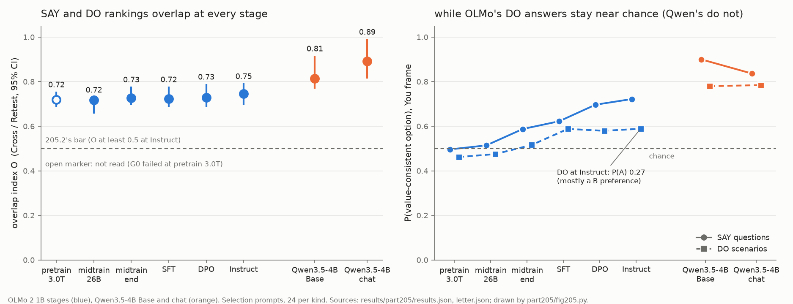

# Part 205: the SAY and DO rankings share most of their top parts at every OLMo 2 1B stage that was read (O 0.72 to 0.75) and in Qwen3.5-4B (0.81 base, 0.89 chat); no OLMo stage changes it, and the copy test that would have tested the sharing causally did not run

Part 205 asked when in training the parts behind *saying* a value ("Do you care about honesty?") and *doing* it (a
scenario with a value-consistent and an inconsistent option) come to be shared. Parts are ranked by activation x
gradient, and the overlap index O compares the SAY and DO top-80 sets against how well each ranking agrees with its
own paraphrases. O sits between 0.72 and 0.75 at the five OLMo 2 1B stages where it was read (the sixth, pretraining at
3.0T tokens, failed gate G0), with no adjacent change above 0.02, and is 0.81 in Qwen3.5-4B-Base and 0.89 in
Qwen3.5-4B. The copy test, which would show whether the shared parts carry a "You" self-attribution, did not run: the
You frame and a named third-person AI answer almost alike (gap 0.019 at OLMo Instruct, threshold 0.194), so the
registered fallback (Amendment 2) dropped every copy arm. All numbers are on the plain text frame, six values, 24 SAY
and 24 DO selection prompts per stage.

**Read this before the O numbers (exploratory, found after scoring).** In OLMo 2 1B, the model picks the
value-consistent option close to chance before post-training (P 0.46 to 0.59 on the selection prompts), and on DO
scenarios it stays near chance at every stage (0.59 at Instruct, where it answers A only 0.27 of the time). The ranking
then mostly finds parts that decide *which letter*, which any two-letter question shares: 0.86 to 0.96 of the
score-weighted attribution in the whole pool is a letter component before SFT, and 0.66 to 0.83 after.
So OLMo's O is mostly an overlap of answer-letter machinery, not of value content. Qwen3.5-4B picks the consistent
option 0.78 to 0.90 of the time and its rankings are near the no-structure reference of 0.5 (0.46 to 0.60). See
[Is the overlap about values?](#is-the-overlap-about-values).

## Predictions

Registered 2026-11-11 12:18 CT (design [PART205-DESIGN.md](../../PART205-DESIGN.md)), scored by
`part205/score205.py` into `results.json`. Under the reading rules a prediction whose every stage is unread is
UNTESTABLE.

| # | Prediction (verbatim, with its confidence) | Result | Verdict |
| --- | --- | --- | --- |
| 205.1 | Claude, Opus 5.5 (medium): G4 passes (both Retests at least 20 of 80) at five or more of the six OLMo stages and at both Qwen models. | G4 passes at all six OLMo stages and both Qwen models; the lowest Retest is 62 of 80 (Qwen3.5-4B-Base SAY). | held |
| 205.2 | Claude, Opus 5.5 (medium): At OLMo 2 1B Instruct, O is at least 0.5. | O = 0.746 (95% CI 0.697 to 0.793). Mostly answer-letter parts; see below. | held |
| 205.3 | Claude, Opus 5.5 (low): Across the six OLMo stages, the largest rise in O between adjacent stages is at mid-training end to SFT. | Four pairs read: +0.0087, -0.0032 (mid-training end to SFT, CI -0.066 to 0.054), +0.0059, +0.0172 (DPO to Instruct, the largest). None reaches 0.2. | failed |
| 205.4 | Claude, Opus 5.5 (medium): At OLMo Instruct, DO-set copy gives T at least 0.5 and exceeds every set in all three random families. | Copy arms not run (Amendment 2 fallback; A0 gap 0.0191 against 0.194). | untestable |
| 205.5 | Claude, Opus 5.5 (medium): At the 3.0T pretraining checkpoint, if G0 passes: the You/third-person gap is under 0.10, or, if it is not, T is under 0.2. | G0 failed at 3.0T (option mass 0.342 against 0.5), its only stage. | untestable |
| 205.6 | Claude, Opus 5.5 (low): Reverse DO copy at OLMo Instruct lowers P_you by at least half of the gap. | Copy arms not run (fallback). | untestable |
| 205.7 | Claude, Opus 5.5 (high): Wherever DO-set transfer is read and passes the random-set rule, the off-target shift (mean absolute change in P(A)) is under 0.05. | No stage reads DO transfer. | vacuous |
| 205.8 | Claude, Opus 5.5 (low): Qwen3.5-4B's (chat) O is at least 0.2 below OLMo 2 1B Instruct's (Sauers' contrast survives the retest ceiling, at another size and version); Qwen3.5-4B-Base's O is reported beside it, unscored. | Qwen3.5-4B 0.893 against OLMo Instruct 0.746: 0.146 *above*, not below. Base 0.813 (unscored). | failed |
| 205.9 | Claude, Opus 5.5 (medium): At OLMo Instruct, the persona-swap null gives T_swap under half of the DO set's T. | Copy arms not run (fallback). | untestable |

Two held, two failed, four untestable, one vacuous. Withdrawal rule: no stage creates sharing that this design can
resolve.

## Why did the copy test not run?

The copy test replaces a set of parts' activations in a third-person run ("Zara, an AI, cares about honesty") with
their values from the You run ("You care about honesty"), and asks how much of the You/third-person difference in the
answer moves. It needs a difference to move. The pilot found none on honesty (gap 0.0068), so Amendment 2 added step
A0: the gap over all six values at OLMo Instruct, with a cost gate of 0.194. A0 measured **0.0191** (clustered SE
0.0152, 24 questions): branch FALLBACK. Every stage then ran the controls-only arms (ranking, You, third-person and
do-nothing runs, 168 passes). The gap stays small everywhere: between -0.0199 and 0.0207 at all eight stages, so G2
(gap at least 0.10) fails at every stage. In this frame, OLMo 2 1B and Qwen3.5-4B answer "Do you care about X?" the
same way whether the system line says "You" or names another AI.

Source: `results/part205/a0/screen.json`, `results.json` (stages[...].gates.G2), printed in `report.md`.

## Is the overlap about values?

*Exploratory: found after the scores, read by `part205/letter205.py` from the stored ranking estimates; no model was
run and no prediction reads it.*

Every ranking prompt is a two-letter forced choice, with the consistent option A on half the prompts and B on the
other half. A part's estimate e is signed toward the consistent option, and the score keeps |e|. So a part that only
pushes "A over B" gets a large |e| on every prompt, flips sign with the consistent letter, and enters the top 80 of
both SAY and DO. To separate the two, for each part over one kind's 24 prompts: the letter component is
|mean(e x s)| with s = +1 where the consistent option is A and -1 where it is B, and the consistency component is
|mean(e)|. With balanced letters and no structure the two are equal on average, so a letter share near 0.5 is the
reference.

| stage | SAY P(consistent) | DO P(consistent) | DO P(A) | SAY top-80 letter share | DO top-80 letter share | DO pool letter share (score-weighted) |
| --- | --- | --- | --- | --- | --- | --- |
| pretrain-3.0T | 0.50 | 0.46 | 0.56 | 0.907 | 0.915 | 0.942 |
| midtrain-26B | 0.51 | 0.48 | 0.69 | 0.845 | 0.927 | 0.963 |
| midtrain-end | 0.59 | 0.52 | 0.62 | 0.857 | 0.919 | 0.919 |
| sft | 0.62 | 0.59 | 0.33 | 0.741 | 0.765 | 0.833 |
| dpo | 0.70 | 0.58 | 0.23 | 0.657 | 0.734 | 0.770 |
| instruct | 0.72 | 0.59 | 0.27 | 0.647 | 0.743 | 0.779 |
| qwen-base | 0.90 | 0.78 | 0.54 | 0.460 | 0.569 | 0.601 |
| qwen-chat | 0.84 | 0.78 | 0.56 | 0.532 | 0.557 | 0.579 |

Reading: in OLMo 2 1B, before SFT the model answers by letter (P(consistent) 0.46 to 0.59) and the whole network's
attribution to the answer is letter-dominated; the top-80 sets have about the pool's letter share, so the ranking is
not picking out unusual parts, it is reflecting what drives the answer. Post-training raises SAY consistency to 0.72 and
lowers the letter share, but DO stays near chance with a strong B preference. So in OLMo, O mostly measures that a
question about a value and a scenario about the same value are answered by the same letter-choosing parts, which any
two A/B questions in this frame would share. Qwen3.5-4B answers by content, and its letter shares sit near 0.5; its
higher O (0.81 and 0.89) is the number in this part most likely to reflect shared value-relevant parts, and the design
cannot say more without the copy test. The design had no gate requiring a stage to pick the consistent option above
chance (Limits).

Source: `results/part205/letter.json` and `letter.md`; the full table, with random-80 references and the fraction of
letter-dominant parts, is in `letter.md`.

## How stable is each ranking, and is O above noise?

| stage | G0 option mass | Retest SAY | Retest DO | Cross | O | O 95% CI |
| --- | --- | --- | --- | --- | --- | --- |
| pretrain-3.0T | 0.342 (fail) | 73 | 71 | 51.75 | 0.719 (not read) | 0.684 to 0.755 |
| midtrain-26B | 0.715 | 63 | 68 | 47.00 | 0.718 | 0.658 to 0.732 |
| midtrain-end | 0.913 | 66 | 71 | 49.75 | 0.726 | 0.696 to 0.778 |
| sft | 0.618 | 65 | 65 | 47.00 | 0.723 | 0.686 to 0.778 |
| dpo | 0.741 | 66 | 65 | 47.75 | 0.729 | 0.686 to 0.790 |
| instruct | 0.846 | 66 | 66 | 49.25 | 0.746 | 0.697 to 0.793 |
| qwen-base | 0.668 | 62 | 64 | 51.25 | 0.813 | 0.768 to 0.917 |
| qwen-chat | 0.519 | 68 | 67 | 60.25 | 0.893 | 0.814 to 0.992 |

Each ranking agrees with its own paraphrases on 62 to 73 of 80 parts, far above G4's floor of 20, and the SAY/DO
cross overlap is 47 to 60. O's bootstrap intervals are 0.07 to 0.10 wide for OLMo and 0.15 and 0.18 for Qwen; every adjacent
OLMo change is under 0.02, and the paired interval for mid-training end to SFT includes 0. G1 (the do-nothing hook reproduces the plain logits) gives a
maximum difference of exactly 0 at every stage. Both models' top-80 sets mix heads and neurons (OLMo 41 to 54 heads;
Qwen 44 to 52 heads, of which 9 to 13 are DeltaNet heads).

Source: `results.json` (stages[...].overlap, O_ci, gates, sets.composition), printed in `report.md`.

## Does Sauers' OLMo-against-Qwen contrast hold here?

No, and 205.8 failed in the other direction: Qwen3.5-4B's O is 0.146 above OLMo 2 1B Instruct's, not 0.2 below. This
does not refute Sauers' result, which used OLMo-2-7B and Qwen3-8B, a different estimator (ours is single-point
activation x gradient at the last position, since no code was released), and the overlap of raw top-80 sets rather
than O. Two things here weaken the comparison further: OLMo's O is mostly letter machinery (above), and the Qwen chat
model reads the plain frame poorly, with 31 of its 48 ranking prompts putting under half the next-token mass on the
two letters (15 of 48 for the base model; 0 or 1 for OLMo after pretraining). Those rows stay in the means, as
registered.

Source: `results.json` (predictions["205.8"], stages[...].broken), printed in `report.md`.

## Method

The design is [PART205-DESIGN.md](../../PART205-DESIGN.md), with Amendments 1 to 5. OLMo 2 1B at six stages
(pretraining step 1430000 at 3.0T tokens, mid-training at 26B tokens, the released base `main`, SFT, DPO, Instruct),
float32 on the CPU with eager attention; Qwen3.5-4B-Base and Qwen3.5-4B text-only, bf16 on the Arc A770 with eager
attention, one model per process, with each model's kernel check passing first. The plain frame
`System: <persona line>\nUser: <question>\nAssistant: Answer:` at every stage, no chat template. Six values, 8 SAY
questions and 8 DO scenarios each, consistent option balanced between A and B; ranking on SAY and DO items 1 to 4 in
the You frame, the top 80 of heads and MLP neurons together by mean per-prompt-normalised |activation x gradient| of the
logit difference at the last position. O = Cross / Retest from half-set rankings, with a 1,000-resample bootstrap. Every
readout is the probability of the two option letters normalised over the two. Under the Amendment 2 fallback each stage
ran 168 passes (48 ranking, 24 You, 48 third-person, 48 do-nothing); no copy, random-set, persona-swap, reverse,
off-target or Sauers-wording arm ran.

## Limits

- **The copy test did not run**, so nothing here shows that the shared parts carry a self-attribution, or that the DO
  set changes saying. O is an overlap of first-order estimates, not a causal result.
- **Found after scoring: no gate asked whether a stage picks the consistent option at all.** G0 checks that the letters
  get the mass, not which letter. Where the model answers by letter, as OLMo 2 1B does on DO at every stage, the ranking
  finds letter-choosing parts and O cannot separate value sharing from shared answer mechanics. The letter analysis
  above is exploratory; a gate on P(consistent), or ranking on letter-paired prompts, would be the registered fix.
- One plain frame at every stage; the chat models normally answer in their template, and Qwen3.5-4B reads this frame
  poorly (31 of 48 ranking rows under half the mass on the letters).
- The ranking estimator is ours (single-point activation x gradient at the last position); a path-integrated estimator
  could rank differently.
- OLMo 2 1B and Qwen3.5-4B, not the 7B and 8B models Sauers used; six values written by me; DO scenarios 5 to 8 were
  not read.
- The You/third-person difference could partly be the word "you"; with a gap near 0 that question did not arise.

## Files

- `results/part205/results.json`: every scored number, per stage; made by `part205/score205.py` (log `score.log`).
- `results/part205/report.md`: the tables above, printed by `part205/report205.py`.
- `results/part205/letter.json`, `letter.md`: the exploratory letter analysis, by `part205/letter205.py`.
- `results/part205/fig205.png`: the figure, by `part205/fig205.py`.
- `results/part205/a0/screen.json`: step A0, the six-value gap screen.
- `results/part205/<stage>/records.jsonl`: every pass's letter probabilities and option mass; `sets.json`: the top-80
  sets and halves. The per-prompt estimates (`ranking.npz`, 24 MB per OLMo stage and 43 MB per Qwen model) and the
  copy-activation caches (0.8 to 1.1 GB per stage) are kept locally, not published; `letter205.py` needs `ranking.npz`.
- `results/part205/g1/g1.json`: the A770 do-nothing check; `pilot/`: the honesty pilot (PILOT.md).

Cold check: pending.
