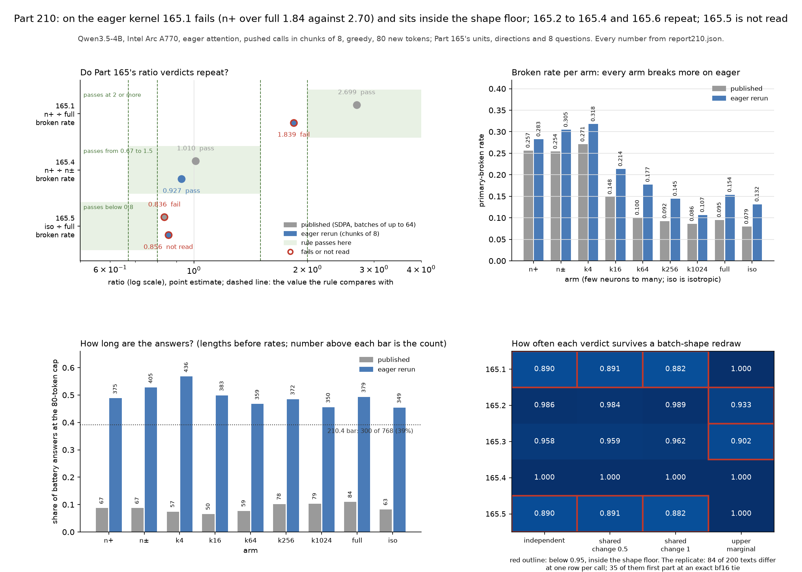

# Part 210: Part 165 on the eager attention kernel: four of its six verdicts repeat, 165.1 fails (1.84 against 2.70) inside the shape floor, 165.5 is not read, and answers reach the 80-token cap far more often

Part 210 reran Part 165's 6,920 answers with the same model, revision, directions, write size, 8 questions and 80 new tokens, on eager attention with pushed calls in chunks of 8, then decoded 200 battery rows one row per call. Four of Part 165's six registered verdicts come out as published: 165.2 holds (broken Spearman -0.857, the same as published), 165.3 holds (k16 is 0.0599 from full and 0.0911 from n±; published 0.0534 and 0.1055), 165.4 holds (n+ over n± 0.927; published 1.010) and 165.6 fails (0.204, as published, with its interval collapsed). 165.1 fails: n+ breaks 1.84 times as often as full, against a bar of 2 and a published 2.70. 165.5 is not read, because Part 165's own rule leaves it unread when 165.1 fails; its estimate is 0.856 against a bar of 0.8 (published 0.836, failed). All of Gates R1 to R3 and Part 165's Gates 1 to 4 pass. Answers ran much longer: 349 to 436 of 768 battery answers per arm reached the 80-token cap, against 50 to 84 published, and every one of the nine arms breaks more often than published. Decoding one row per call changed 84 of the 200 sampled texts, inside the registered 40 to 110, so 210.6 held; 35 of the 84 first part at an exact bf16 tie. Under redraws of the labels at the replicate's flip rates, 165.1 comes out as observed in 0.882 to 0.891 of redraws in the three scenarios that are not the upper-marginal stress, so it sits inside the shape floor: a batch-shape change of the size the replicate shows would flip it in about one redraw in nine. Six of seven predictions held; 210.2 failed. Scope: Qwen3.5-4B at revision 851bf6e806efd8d0a36b00ddf55e13ccb7b8cd0a, bf16 on the Intel Arc A770, eager attention, greedy, 80 new tokens, Part 165's 864 directions, its write size (0.8 times each layer's median norm) and its 8 questions.

**Lengths before cross-run rates.** Battery rows only; counted by [report210.py](../../part210/report210.py) from [answers.jsonl](answers.jsonl) and Part 165's [published answers](../part165/answers.jsonl), printed in [report210.md](report210.md).

| Run | Arm | Rows | At the 80-token cap | Mean `token_count` |
| --- | --- | ---: | ---: | ---: |
| Published (Part 165, SDPA) | n+ | 768 | 67 | 56.8 |
| Published (Part 165, SDPA) | n± | 768 | 67 | 57.1 |
| Published (Part 165, SDPA) | k4 | 768 | 57 | 57.7 |
| Published (Part 165, SDPA) | k16 | 768 | 50 | 57.7 |
| Published (Part 165, SDPA) | k64 | 768 | 59 | 58.9 |
| Published (Part 165, SDPA) | k256 | 768 | 78 | 60.7 |
| Published (Part 165, SDPA) | k1024 | 768 | 79 | 61.1 |
| Published (Part 165, SDPA) | full | 768 | 84 | 60.7 |
| Published (Part 165, SDPA) | iso | 768 | 63 | 58.3 |
| Eager rerun | n+ | 768 | 375 | 67.5 |
| Eager rerun | n± | 768 | 405 | 68.5 |
| Eager rerun | k4 | 768 | 436 | 70.2 |
| Eager rerun | k16 | 768 | 383 | 68.8 |
| Eager rerun | k64 | 768 | 359 | 68.5 |
| Eager rerun | k256 | 768 | 372 | 69.7 |
| Eager rerun | k1024 | 768 | 350 | 69.4 |
| Eager rerun | full | 768 | 379 | 70.3 |
| Eager rerun | iso | 768 | 349 | 68.0 |

## Predictions

| # | Prediction (verbatim, with its confidence) | Result | Verdict |
| --- | --- | --- | --- |
| 210.1 | Gates R1 to R3 and Part 165's Gates 1 to 4 pass. (medium) | R1: eager on the one launch, one model revision, device and output folder. R2: all 14 input hashes and the ordered 8 prompts match; 0 directions outside 1e-6. R3: 0 pushed calls outside chunks of 8, 0 no-push calls over one row, 0 companion rows. Part 165's Gates 1 to 4 pass. | held |
| 210.2 | 165.1 holds, 165.2 holds, 165.3 holds, 165.4 holds, 165.5 fails and 165.6 fails, as published. Registered rules: "n+ breaks at least twice as often as full"; "Broken rate falls with k: Spearman at or below -0.8 across n±, k4, k16, k64, k256, k1024, full"; "k16's broken rate is nearer full's than n±'s"; "The n+ over n± broken ratio is between 0.67 and 1.5"; "iso's broken rate is under 0.8 times full's"; "Changed rate falls with k: Spearman at or below -0.6 across the same seven arms". (low) | 165.1 failed (1.839), so the as-published pattern did not repeat. 165.2 held, 165.3 held, 165.4 held, 165.6 failed; 165.5 is not read. | failed |
| 210.3 | The n+ over full broken ratio is above 1.5, the same side of 1 as published. (medium) | 1.839, above 1.5. | held |
| 210.4 | In each arm at least 300 of 768 battery answers reach `token_count == 80`, against 50 to 84 published. (low) | 349 (iso) to 436 (k4) of 768 in every arm. | held |
| 210.5 | The n+ over full broken ratio is lower on the rerun than the published 2.69863. (low) | 1.839, lower than 2.69863. | held |
| 210.6 | Between 40 and 110 of the 200 shape-replicate texts differ from their chunk-of-8 texts. (low) | 84 of 200 differ. | held |
| 210.7 | The primary-broken rate is higher on the rerun than published in at least 8 of the 9 arms. (medium) | Higher in all 9 arms. | held |

The prediction wording and confidence are copied from the registered design, [PART210-DESIGN.md](../../PART210-DESIGN.md), where 210.2's row also quotes Part 165's six rules; the same table is in [PREDICTIONS.md](../../PREDICTIONS.md) under "Part 210". Every result and verdict is printed by [score210.py](../../part210/score210.py) into [score.md](score.md) and [score.json](score.json), each line with the file and key it comes from; [report210.py](../../part210/report210.py) gathers them into [report210.json](report210.json) and [report210.md](report210.md) and checks its own recomputation of the point estimates against score.md.

## Do Part 165's verdicts repeat?

Four of six. 165.1 fails, and 165.5, which failed as published, is not read. The verdicts are read with Part 165's own scorer ([score165.py](../../part165/score165.py)), imported unchanged by score210. The intervals are 95% slot-bootstrap intervals and do not change a verdict; the verdicts read the point estimate, as registered.

| Prediction | Rule | Published estimate | Published | Eager estimate | Eager |
| --- | --- | --- | --- | --- | --- |
| 165.1 | n+ at least twice full (at least 2) | 2.699 | passed | 1.839 | failed |
| 165.2 | broken Spearman at most -0.8 | -0.857 (interval -0.964 to -0.631) | passed | -0.857 | passed |
| 165.3 | k16 nearer full than n± | to full 0.0534, to n± 0.1055 | passed | to full 0.0599, to n± 0.0911 | passed |
| 165.4 | n+ over n± between 0.67 and 1.5 | 1.010 | passed | 0.927 | passed |
| 165.5 | iso under 0.8 times full | 0.836 | failed | 0.856 | not read |
| 165.6 | changed Spearman at most -0.6 | 0.204 (interval 0.204 to 0.204) | failed | 0.204 | failed |

165.5 is not read because Part 165's reading rule reads it only when 165.1 holds, and 165.1 failed. Its estimate, 0.856, is on the failing side of its bar of 0.8 as published, but the scorer issues "not read" rather than "fail"; 210.2 is compared against that, and is false either way because of 165.1. 165.6's interval collapsed to a point on both runs (6,525 usable draws of 10,000 on each), so it is reported as not informative. Source: `part165_verdicts` in [report210.json](report210.json).

## Did the gates hold?

Yes. R1: one launch, eager on every load, device xpu, the last launch done, one model revision and output folder. R2: all 14 input hashes match the design's, the ordered 8 prompts match the regenerated selection, and 0 of 864 directions are outside 1e-6 of the published write norms. R3: 0 planned calls without a receipt, 0 pushed calls outside chunks of 8, 0 no-push calls over one row, 0 companion rows, largest chunk 8 rows. Part 165's Gate 1: 6,920 of 6,920 rows, 0 duplicates, all nonempty. Gate 2: 8 of 8 no-push answers, none broken. Gate 3: 864 of 864 directions, max write error 3.95e-07 and max iso residual 3.96e-06 against 1e-2. Gate 4: n+ broken rate 0.2826 against 0.03. Source: the gate lines in [score.md](score.md), gathered in `part165_gates` and `summary` in [report210.json](report210.json).

## Why did 165.1 move?

The ratio's denominator moved more than its numerator. n+ broke 197 of 768 answers published and 217 eager, a rise of 0.026 rate points. Full broke 73 of 768 published and 118 eager, a rise of 0.059. So n+ over full fell from 2.699 to 1.839 although n+ itself broke more often: full nearly caught up. Every arm rose; the published counts are Part 165's, recomputed here from its [answers.jsonl](../part165/answers.jsonl) with the same primary rule and equal to the counts in [margins.md](margins.md) and to `rates.broken` in [score.json](../part165/score.json).

| Arm | Published broken / 768 | Published rate | Eager broken / 768 | Eager rate | Change |
| --- | ---: | ---: | ---: | ---: | ---: |
| n+ | 197 | 0.2565 | 217 | 0.2826 | +0.0260 |
| n± | 195 | 0.2539 | 234 | 0.3047 | +0.0508 |
| k4 | 208 | 0.2708 | 244 | 0.3177 | +0.0469 |
| k16 | 114 | 0.1484 | 164 | 0.2135 | +0.0651 |
| k64 | 77 | 0.1003 | 136 | 0.1771 | +0.0768 |
| k256 | 71 | 0.0924 | 111 | 0.1445 | +0.0521 |
| k1024 | 66 | 0.0859 | 82 | 0.1068 | +0.0208 |
| full | 73 | 0.0951 | 118 | 0.1536 | +0.0586 |
| iso | 61 | 0.0794 | 101 | 0.1315 | +0.0521 |

The rates are slot means (the mean over 96 slots of each slot's share of 8 answers), as Part 165's scorer reads them; the counts are the plain tallies. The other verdicts moved little because they compare arms that moved together: 165.2's rank order is unchanged, 165.4's two arms rose by 0.026 and 0.051, and 165.3's distances from k16 to full and to n± both grew. 165.5's two arms rose by 0.0521 (iso) and 0.0586 (full), so its ratio barely moved (0.836 to 0.856). Source: `broken_rates` in [report210.json](report210.json).

## How much does the batch shape move the answers?

Decoding a sampled battery row alone instead of in its chunk of 8 changed 84 of 200 texts. Where each differing text first parts, the battery row's recorded margin between its top two tokens was an exact bf16 tie on 35 rows, within one bf16 step on 43 more, between one and two steps on 5, and above two steps on 1 (a step is the bf16 spacing at the top logit's magnitude, as Part 201 defines it in [margin_recorder.py](../../tools/margin_recorder.py)). No difference sat at the first token; 25 first parted in tokens 1 to 9, 15 in tokens 10 to 19, 20 in tokens 20 to 39 and 24 at token 40 or later, with a median at token 20. Labels move far less than texts: over the 200 pairs the broken label changes 16 times, the loop label 16, and the triage label once. Source: `replicate` in [report210.json](report210.json), from [answers.jsonl](answers.jsonl) and [replicate.jsonl](replicate.jsonl).

The replicate rows were paired with their battery rows by `row_id` (`rep|<battery row_id>`), as Amendment 3 says. The first scoring paired by `run165.row_key`, which reads each replicate row's `slot` field, and that field is 0 on all 200 replicate rows because the runner's replicate path does not overwrite it; that pairing collapsed the 200 rows onto 162 keys, compared some texts across different directions and printed 154 differing. The 84 is the first scoring's 154 recomputed on the correct pairs.

## How sure are the verdicts against batch shape?

The shape floor ([shape_floor.py](../../tools/shape_floor.py), called by score210 with 1,000 redraws and seed 0) redraws every battery row's labels with the transition rates the 200 replicate pairs show, rescores with Part 165's scorer, and reports the share of redraws in which each verdict comes out as observed. A share below 0.95 is marked inside the shape floor.

| Verdict | Independent | Shared change 0.5 | Shared change 1 | Upper marginal |
| --- | ---: | ---: | ---: | ---: |
| 165.1 | 0.890 | 0.891 | 0.882 | 1.000 |
| 165.2 | 0.986 | 0.984 | 0.989 | 0.933 |
| 165.3 | 0.958 | 0.959 | 0.962 | 0.902 |
| 165.4 | 1.000 | 1.000 | 1.000 | 1.000 |
| 165.5 | 0.890 | 0.891 | 0.882 | 1.000 |
| 165.6 | floor not informative: changed is constant | | | |

165.1 is inside the shape floor in the independent and the two shared-change scenarios: a batch-shape change of the size the replicate shows would flip it in about one redraw in nine. It reaches 1.000 only under the upper-marginal stress, which flips each label at the upper 95% bound of its observed rate; the tool describes that scenario as a stress, not an upper bound on instability. 165.2 and 165.3 stay above 0.95 in the three main scenarios and drop below it only under the stress; 165.4 stays at 1.000 everywhere. 165.5 carries the same 0.882 to 0.891 as 165.1, so its estimate is about as exposed to batch shape, though the verdict it is reported with is "not read". 165.6 has no stability figure because `changed` is true on 6,911 of 6,912 battery rows and no redraw could move it. Of the gates, all four stay at 1.000 in every scenario. The figures are conditional on the scenario and on the replicate's pair of shapes; they are not confidence levels. Source: the stability lines in [score.md](score.md), gathered in `stability` and `gate_stability` in [report210.json](report210.json).

## Amendments

All three amendments are recorded at the end of [PART210-DESIGN.md](../../PART210-DESIGN.md).

**Amendment 1, 2026-11-14 05:07 CT, after the run and before any answer or prediction was read.** Gate R3's host check failed on 112 receipts, and the cause was the check, not the run: it built its comparison plan with the layers in the order they first appear in Part 165's answers file, not Part 165's own layer order. The check now compares against the plan the run built, and the record passes. No answer, score or prediction had been read.

**Amendment 2, 2026-11-14 07:42 CT, after the scores were seen.** The scorer had no code for prediction 210.5 and silently left it out. The rule was added after every other number in the first scored output had been seen, as the registered text unchanged; 210.5 was then read by hand from the printed 165.1 estimate (1.83898 is lower than 2.69863, so it holds) and the rerun of the scorer prints the same reading from code. This moved nothing in the direction of the prediction: the rule was registered before the data, and adding its code could not change the number it reads.

**Amendment 3, 2026-11-14 09:50 CT, after the scores were seen, and found by the cold check.** The scorer paired each replicate row with its battery row by `run165.row_key`, which includes `slot`, and every replicate row was written with `slot: 0`. The pairing collapsed rows onto slot 0, matched 162 of 200 and compared some texts across different directions, and printed 154 differing, so 210.6 read as failed. Paired by `row_id`, all 200 match and every pair has the same push hash, and 84 of 200 texts differ, so 210.6 holds. **This moved 210.6 toward the prediction after the scores were seen.** The registered comparison is "the 200 shape-replicate texts" against "their chunk-of-8 texts", and the change is only to which battery row each replicate row is compared with; the shape floor had the same pairing and was rerun with it, so the stabilities above are from the rerun. The runner is left as it ran. The cold check also noted that Part 165's reading rule leaves 165.5 "not read" when 165.1 fails; 210.2 is false either way.

## Method

The design is [PART210-DESIGN.md](../../PART210-DESIGN.md). Model Qwen/Qwen3.5-4B at 851bf6e806efd8d0a36b00ddf55e13ccb7b8cd0a in bf16 on the Intel Arc A770, loaded through `neuron_report.load_model` with eager attention (the runner refuses any other), Part 165's directions, write size and 8 questions, greedy, 80 new tokens. [run210.py](../../part210/run210.py) rebuilds Part 165's plan (6,920 rows: 8 no-push and 6,912 battery; a test checks it equal to Part 165's published rows key for key and in order) and decodes it with Part 201's recorder, which stores each step's top two tokens and margin. Pushed calls run in chunks of 8; every block is 64 rows, so no chunk is short and no companion row was needed. After the battery, 200 battery rows drawn with `random.Random(210)`, 22 or 23 per arm and half from the rows labelled broken, are decoded alone, one row per call, into [replicate.jsonl](replicate.jsonl). The launch ran in one process ([load.json](load.json)). [score210.py](../../part210/score210.py) applies Gates R1 to R3 and runs Part 165's `score_rows` unchanged, then the shape floor; the run (battery, then replicate) took 01:33 to 04:07 CT on 2026-11-14 ([chain-after-205.log](chain-after-205.log)), and the rerun of the scorer after Amendment 3 took 47 minutes ([score-r3-after-205q.log](score-r3-after-205q.log)) and peaked at 1.57 GB ([score210-stderr.txt](score210-stderr.txt)).

## Limits

- The rerun changed the kernel and the batch shape together, so no cross-run difference (the cap counts, the rates, the estimates) can be assigned to either alone.
- The replicate compares chunks of 8 with one row per call on 200 rows; it does not sample other batch memberships or shapes, and the shape floor's figures assume its transition rates carry over to the other 6,912 battery rows.
- The replicate rows' `slot` field is 0 on all 200, a runner defect Amendment 3 works around in the scorer; the field is wrong on disk, and anything else that reads it will be wrong too unless it pairs by `row_id`.
- The design registered no cluster key for the shape floor, so each row is its own cluster and the two shared-change scenarios redraw the same way as the independent one; they differ from it only by Monte Carlo noise.
- The margin at a first difference is the battery row's; whether the one-row replicate's own path was also at a tie there was not measured. No text difference started at the first token, but the replicate's first-token margins were not compared.
- 165.6's interval collapsed on both runs, so its estimate is reported as not informative, not as certainty.
- Eager bf16 is not CPU float32 and can still choose differently at near-ties.
- Gate 3's directions are Part 165's own, recomputed from the same weights and checked against its published norms; the rerun does not re-derive them by another route.

## Files

- [answers.jsonl](answers.jsonl): 6,920 rows, one per answer, with tokens, top two tokens, margins and the push hash; schema [ROWS-SCHEMA.md](../../part201/ROWS-SCHEMA.md). [replicate.jsonl](replicate.jsonl): the 200 one-row decodes.
- [load.json](load.json), [launch.jsonl](launch.jsonl): the load, call and launch records Gates R1 and R3 read. [norms.json](norms.json): the directions' write norms Gate R2 compares with Part 165's.
- [score.md](score.md), [score.json](score.json), [score210-output.txt](score210-output.txt), [score210-stderr.txt](score210-stderr.txt): score210's printout, every value with its file and key; made by [score210.py](../../part210/score210.py). [before-amendment3/](before-amendment3/): the first scoring's output, superseded by Amendment 3.
- [report210.json](report210.json), [report210.md](report210.md): every number on this page; made by [report210.py](../../part210/report210.py).
- [fig210.py](../../part210/fig210.py): draws [fig210.png](fig210.png) from report210.json only.
- [margins.md](margins.md), [margins.json](margins.json): the registered distances of Part 165's published estimates from their bars; made by [margins210.py](../../part210/margins210.py).
- [cold/CHECK.md](cold/CHECK.md), [cold/recompute.py](cold/recompute.py): the cold check, copied unchanged.

Cold check: a DeepSeek V4.1 Flash worker (dark-factory run part210-score-check-2026-11-14, 2026-11-14) recomputed the row and cap counts, means, every rate, the Spearman values, the published counts and the replicate comparison without score210 or score165. All matched except the replicate comparison: it found that the scorer paired replicate rows by `slot`, which is 0 on every replicate row, and that pairing by `row_id` gives 200 of 200 matched and 84 differing, so 210.6 holds. That finding became Amendment 3. It also noted that 165.5 is "not read" rather than "fail" under Part 165's rule, and did not recompute the shape floor.
