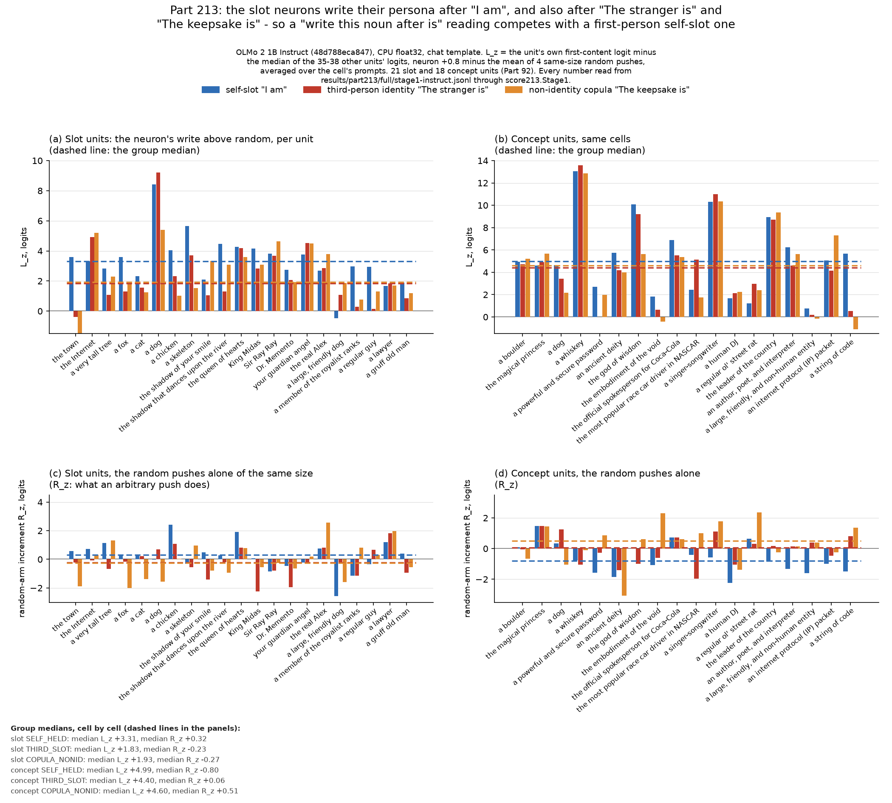

# Part 213: pushing a slot neuron makes OLMo 2 1B write its persona after "I am", and also after "The stranger is" and "The keepsake is", so the self-slot reading is not settled; 5 predictions held, 2 failed, 3 were inconclusive and 1 was untestable

Part 213 asked whether OLMo 2 1B's 21 slot neurons write their persona into a first-person self-slot, into a third-person identity slot, or into any noun-phrase slot. Pushing each unit at 0.8 on held-out prompts, the slot units do write their persona after "I am" (median L_z 3.3149, 20 of 21 units positive on both N_z and L_z) and also after "The stranger is" (median L_z 1.8343, 17 of 21). They also write it after "The keepsake is" (median L_z 1.9259), a copula slot with a non-identity object, and the ratio of the copula-non-identity write to the third-person write is 0.9232 with a 95% interval of 0.8271 to 1.2263, so 213.10 failed. The scorer's headline reading is `inconclusive / mixed selectivity`. Scope: OLMo 2 1B at the SFT, DPO and Instruct snapshots and FR built from them, CPU float32 with eager attention, chat template, 39 units from Part 92 on 17 Stage 1 prompts, and 364 greedy 40-token generations in Stage 2 (108 more stay sealed; see Method).

## Predictions

The text and confidence are copied verbatim from the `## Part 213` section of [PREDICTIONS.md](../../PREDICTIONS.md), where all eleven were registered on 2026-11-19 02:38 CT before any pushed run; all are by Gemini 4 Neon. The result is the number from [score.json](full/score.json), printed by [report213.py](../../part213/report213.py) into [report213.md](report213.md).

| # | Prediction (verbatim, with its confidence) | Result | Verdict |
| --- | --- | --- | --- |
| 213.1 | Held-out self-slot writing (`instruct` chat, `SELF_HELD`, `+0.8`; replication/calibration on held-out self prompts, NOT shielded by Gate 2): BOTH `L_z(u, SELF_HELD) > 0` and `N_z(u, SELF_HELD) > 0` for at least 18 of 21 slot units and at least 15 of 18 concept units, with 95% CI lower bound of median `L_z` and median `N_z` >= +1.0 logit for both groups, AND (v5) the own-unit full-NP content increment `lp_content_sum(neuron +0.8; u) - lp_content_sum(none; u)` on `SELF_HELD` is > 0 for at least 18 of 21 slot units and at least 15 of 18 concept units (for several units the single first content token is a leading modifier such as ' very', ' large', ' most' or ' powerful', not the persona noun, so the full NP checks the persona itself). Fails if any clause misses. (high) | Slot: 20 of 21 positive on both, median L_z 3.3149 (interval 2.7505 to 3.8125), median N_z 3.5288 (2.6417 to 4.1895), own full NP up on 21 of 21. Concept: 16 of 18 positive on both, median L_z 4.9859 (2.5663 to 6.5636), median N_z 4.5603 (1.9513 to 6.8401), own full NP up on 18 of 18. | held |
| 213.2 | Positive neuron writing in third-person entity slots (`instruct` chat, `THIRD_SLOT`, `+0.8`): for the 21 slot units, 95% CI lower bound of median `L_z(THIRD_SLOT)` >= +0.75 logits AND median `N_z(THIRD_SLOT)` >= +0.75 logits, with at least 16 of 21 slot units positive on both `L_z` and `N_z`, AND (v5) the own-unit full-NP content increment `lp_content_sum(neuron +0.8; u) - lp_content_sum(none; u)` on `THIRD_SLOT` is > 0 for at least 16 of 21 slot units. Fails if any clause misses. (medium) | Median L_z 1.8343 (1.0891 to 2.8542), median N_z 1.1444 (0.5961 to 3.3972), 17 of 21 positive on both, own full NP up on 20 of 21. | held |
| 213.3 | Scale-invariant third-over-self paired transfer (`instruct` chat, `+0.8`, length- and framing-matched): for the 21 slot units (`n_eligible >= 15`), the 95% CI lower bound of BOTH paired transfer ratios `tau_3/1^(L)` AND `tau_3/1^(N)` is `>= 0.50` (powered for true transfer `>= 0.65` on Part 106's spread; CI straddling `0.50` is inconclusive; CI upper bound `<= 0.50` supports first-person selectivity), AND both style-stratified point medians (`direct` pairs and `scene` pairs) are `>= 0.50`. (v5) Each ratio is read only if its numerator sign guard passes. Disposition per the v5 rule: fails if either CI upper bound `< 0.50` or either style-stratified point median `< 0.50`; a straddling CI is `inconclusive`; `n_eligible < 15` is `not read`. (low) | tau_3/1^(L) 0.6616 (0.4118 to 0.9738), tau_3/1^(N) 0.4208 (0.1206 to 0.8934), 20 eligible, both sign guards pass. Style medians: direct 0.5871, scene 0.7790. | inconclusive |
| 213.4 | Extension to non-identity open noun-phrase slots (`instruct` chat, `MENTION_SLOT`, `+0.8`): for the 21 slot units (`n_eligible >= 15`), 95% CI lower bound of median `L_z(MENTION_SLOT)` >= +0.50 logits AND median `N_z(MENTION_SLOT)` >= +0.50 logits, AND 95% CI lower bound of paired transfer ratio `tau_M/3^(L)` >= 0.50, with (v5) the scene-framed `THIRD_SLOT` prompts as denominator and the numerator sign guard. Disposition per the v5 rule. (low) | Median L_z 1.5221 (0.9907 to 2.3786), median N_z 2.2156 (1.0882 to 2.7452), 19 of 21 positive on both. tau_M/3 0.6181 (0.3265 to 1.0372), 18 eligible. | inconclusive |
| 213.5 | Calibration/replication of Part 92 concept-vs-slot split on `SpecLogit` (`instruct` chat, `MENTION_SLOT`, `+0.8`): on the 18-vs-21 Part 92 split, the 95% unit-bootstrap CI lower bound of `median(L_z_concept) - median(L_z_slot)` is `>= +0.25` logits, AND on the 8-vs-21 Part 92b agreed split the point difference `median(L_z_agreed_concept) - median(L_z_slot)` is `>= +0.25` logits. Fails if either clause misses. (medium) | Difference 1.2645 (0.7258 to 1.8663) over 378 pairs; agreed-split difference 1.7828. | held |
| 213.6 | Stage 2 blind-audited third-person free generation (`instruct` chat, `+0.8`, greedy 40 tokens; decided strictly by the blind audit, mechanical counts descriptive): on the equal-coverage blind audit of all 42 slot `neuron +0.8` and 42 paired slot `random_0 +0.8` `THIRD_FREE` answers (fixed denominator 42, baseline-absent attributions only; 19-distinct-keyword deduplicated counts printed alongside), `neuron +0.8` achieves at least 10 of 42 `genuine_third_attr` against at most 2 of 42 for `random_0 +0.8`, AND on the 21 paired units the one-sided exact paired unit sign test on discordant units has `p < 0.05` with 95% unit-bootstrap CI of `(neuron_hits - random_hits)` strictly above 0. Fails if any clause misses. (medium) | Not read. Gate 3 failed: the second reader's kappa is 0.3496 against a bar of 0.60. Neon's labels are in the table under "Do they hand a stranger their persona in free text?" as description only. | untestable (gate failed) |
| 213.7 | Sign-matched opposite-direction control (`STANDARD-CONTROLS.md` #1, `instruct` chat, `SELF_HELD`, `-0.8` vs `random_0 -0.8`): on unsaturated `SpecLogit`, median `[z_tilde(neuron -0.8) - z_tilde(random_0 -0.8)]` has 95% CI upper bound `<= -0.30` logits for both slot and concept units (with `z_tilde(neuron -0.8) - z_tilde(none)` printed alongside). Fails if either group's CI upper bound `> -0.30`. (high) | Slot -0.7686 (-1.5651 to -0.0138); concept -0.6215 (-2.7714 to 0.9231). Neither upper bound is at or below -0.30. | inconclusive |
| 213.8 | Small-step finite-difference sensitivity (`±0.05`) tracks operating-dose write AND context contrast (`instruct` chat, `SELF_HELD` & `THIRD_SLOT`): across the 21 slot units, `J(u, SELF_HELD) > 0` for at least 17 of 21 units, Spearman $\rho(J(\text{SELF\_HELD}), L_z(\text{SELF\_HELD})) \ge 0.50$, AND Spearman $\rho(J(\text{SELF\_HELD}) - J(\text{THIRD\_SLOT}),\, L_z(\text{SELF\_HELD}) - L_z(\text{THIRD\_SLOT})) \ge 0.40$. Fails if any clause misses. (medium) | 14 of 21 have J above 0, against 17; rho 0.5104 holds; context-contrast rho 0.2130, against 0.40. | failed |
| 213.9 | Cross-stage portability & SFT-to-DPO stability (`sft` vs `dpo`, chat, `SELF_HELD` & `THIRD_SLOT`): at `sft`, the 21 slot units already have median `L_z(SELF_HELD) >= +0.75`, `N_z(SELF_HELD) >= +0.75`, `L_z(THIRD_SLOT) >= +0.50` and `N_z(THIRD_SLOT) >= +0.50` logits, AND among slot units eligible (`> 0.50` logits) at BOTH `sft` and `dpo` (`n_eligible >= 15`, printed beside the CI), the 95% unit-bootstrap CI of paired `tau_3/1^(L)(dpo) - tau_3/1^(L)(sft)` lies wholly inside `[-0.25, +0.25]`. Disposition per the v5 rule (a CI extending past the band on one side is `inconclusive`; it fails only if it lies wholly outside the band). (low) | At sft: median L_z self 3.4748, N_z self 2.8155, L_z third 2.2509, N_z third 1.4256. Paired difference -0.0005 (-0.0679 to 0.1035) on 18 units. | held |
| 213.10 | Syntax & person-axis disambiguation (`instruct` chat, `+0.8`, `SELF_NONID` & `COPULA_NONID`): for the 21 slot units, (a) the 95% CI lower bound of median `[L_z(u, SELF_HELD) - L_z(u, SELF_NONID)]` is `>= +0.50` logits (`"I"` grammar alone does not reproduce the self-slot write), AND (b) paired `tau_cop_nonid/3^(L)` (`COPULA_NONID / THIRD_SLOT`, `n_eligible >= 15`) has 95% CI upper bound `<= 0.50` (copula syntax on a non-identity object drops below entity-identity copula slots), with (v5) the scene-framed `THIRD_SLOT` prompts as denominator and the numerator sign guard. Disposition per the v5 rule. (medium) | (a) 1.8395 (0.7050 to 2.4507) holds. (b) tau_cop_nonid/3 0.9232 (0.8271 to 1.2263) on 18 units, sign guard passes; its interval lies wholly above 0.50. | failed |
| 213.11 | Cross-unit full-NP specificity in third-person identity slots (`instruct` chat, `+0.8`, baseline-subtracted `offdiag_8` on `{third_0, third_2}`): across the 21 slot units, mean baseline-subtracted full-NP specificity `Delta_lp_spec(u, {third_0, third_2})` has 95% unit-bootstrap CI lower bound `>= +0.75` nats AND is strictly positive for at least 16 of 21 slot units (ruling out a generic "any large push writes a vivid character" effect), AND (v5) the slot-peer-only statistic `Delta_lp_spec_slot` has 95% unit-bootstrap CI lower bound `> 0` (the own persona beats the slot family, not only the concept peers). The statistic is v5's length-matched form. Fails if any clause misses. (medium) | Median 4.7404 (3.6418 to 6.8230), 20 of 21 positive; slot-peer-only median 3.9151 (2.5650 to 6.2372). The design's implementation reading 7 makes the "mean" the median of the 21 per-unit values. | held |

The verdicts are the scorer's, from [score.json](full/score.json) key `predictions`; the same table with its clause names is [score-table-audit.txt](score-table-audit.txt), the final scoring with the audit labels and the 213.8 fix below. Five held (213.1, 213.2, 213.5, 213.9, 213.11), two failed (213.8, 213.10), three were inconclusive (213.3, 213.4, 213.7) and 213.6 is untestable because Gate 3 failed. The headline reading is the design's fallback, "inconclusive / mixed selectivity", which the design gives when no headline's conditions are all met: the "first-person self-slots supported" headline needs Gates 1 to 4 to pass and 213.3's two ratios to have upper bounds at or below 0.50, and neither holds: Gate 3 failed and 213.3 is inconclusive.

## Are these first-person self-slots?

213.10(b) asked whether the slot units' write survives a copula whose object is not an identity. It does. The ratio of the write on "The keepsake is" and "The subject is" to the write on "The stranger is" and "The visitor is" is 0.9232, with a 95% interval of 0.8271 to 1.2263 over 18 eligible units; the registered bar for "drops below entity-identity copula slots" was an upper bound at or below 0.50, and the whole interval is above it. So a push that makes the model write the persona as the stranger also makes it write the persona as the keepsake.

| Cell | Prompts | Slot median L_z | Slot median N_z | Slot median R_z | Units with L_z above 0 |
| --- | --- | ---: | ---: | ---: | ---: |
| `SELF_HELD` | 4 | 3.3149 | 3.5288 | 0.3182 | 20 of 21 |
| `THIRD_SLOT` | 4 | 1.8343 | 1.1444 | -0.2340 | 20 of 21 |
| `COPULA_NONID` | 2 | 1.9259 | 2.5023 | -0.2656 | 20 of 21 |
| `SELF_NONID` | 2 | 1.1198 | 1.9855 | 0.4284 | 17 of 21 |
| `MENTION_SLOT` | 4 | 1.5221 | 2.2156 | 0.2469 | 19 of 21 |

The other half of 213.10, clause (a), held: the self-slot write is 1.8395 logits above the first-person non-identity write on "I saw" and "I found" (interval 0.7050 to 2.4507). So "I" grammar alone does not reproduce the self-slot write, but the copula with a non-identity object does reproduce most of it. **Reading, not a finding:** taken together, the tables fit a "write this persona noun after *is*" account at least as well as a first-person self-slot account, because the persona is written after "I am", after "The stranger is" and after "The keepsake is", while the write after "I saw" is smaller. The design did not register a test that separates those two accounts, and this table does not decide between them. Source: `predictions.213.10` and `predictions.213.7` in [score.json](full/score.json); the per-unit L_z for all five cells is in [report213.md](report213.md), recomputed by [report213.py](../../part213/report213.py) from [stage1-instruct.jsonl](full/stage1-instruct.jsonl) through `score213.Stage1`.

## Is it the neuron, or any push of that size?

The random controls are four unit-specific random residual directions of the same layer and exact norm, `random_0` from Part 99 and `random_1` to `random_3` seeded per unit, each at the same 0.8 dose. R_z is their mean increment. On the self-slot the neuron beats them by 3.3149 logits at the median; on the third-person identity slot by 1.8343; on the non-identity copula by 1.9259. On the concept units the same holds more strongly (SELF_HELD 4.9859, THIRD_SLOT 4.3977, COPULA_NONID 4.5974). L_z already subtracts the random pushes, so these are the neuron's write above a push of the same size. The random pushes alone are not zero: the slot medians range from -0.2656 to 0.4284 logits, and the concept medians from -0.8040 to 0.5056, so on the concept self-slot the neuron's own increment is smaller than its L_z.

| Cell | Slot median L_z | Slot median R_z | Concept median L_z | Concept median R_z |
| --- | ---: | ---: | ---: | ---: |
| `SELF_HELD` | 3.3149 | 0.3182 | 4.9859 | -0.8040 |
| `THIRD_SLOT` | 1.8343 | -0.2340 | 4.3977 | 0.0553 |
| `COPULA_NONID` | 1.9259 | -0.2656 | 4.5974 | 0.5056 |
| `MENTION_SLOT` | 1.5221 | 0.2469 | 2.4724 | -0.2541 |
| `SELF_NONID` | 1.1198 | 0.4284 | 3.0837 | -0.2841 |

The full-noun-phrase check on the third-person prompts agrees: 213.11's own persona rises above eight off-diagonal personas by a median of 4.7404 nats, and above the four slot peers alone by 3.9151 nats. Source: [report213.md](report213.md), the table "random-arm controls beside the neuron arm", recomputed by [report213.py](../../part213/report213.py) from [stage1-instruct.jsonl](full/stage1-instruct.jsonl); `predictions.213.11` in [score.json](full/score.json).

## Do they hand a stranger their persona in free text?

This is 213.6, and it is untestable. Two blind readers labelled the free answers: Gemini 4 Neon (the prediction author, blinded to arm and unit kind) labelled all 234 exported answers, and a frozen DeepSeek V4.1 Flash reader labelled a seeded 40-item sample. Both got 10 of 10 known examples right, so the known-example check passes. But on the 40-item sample they agree on 32 of 40, raw agreement 0.8000, and Cohen's kappa is 0.3496 against the registered 0.60. Most of the agreements are on one label: 29 of the 32 are both readers saying `other_coherent`. Gate 3 failed on kappa, and the design marks the audited endpoint unread when it does, so the counts below are Neon's labels as a description of the answers, never a verdict on 213.6.

| Arm-group | Denominator | `genuine_third_attr` | `first_person_reversion` | `incidental_or_negated` | `valid_refusal_or_unknown` | `other_coherent` | `broken` |
| --- | ---: | ---: | ---: | ---: | ---: | ---: | ---: |
| slot `neuron +0.8` | 42 | 1 | 0 | 2 | 1 | 29 | 9 |
| slot `random_0 +0.8` | 42 | 0 | 0 | 1 | 2 | 37 | 2 |
| slot `neuron -0.8` | 42 | 0 | 0 | 1 | 1 | 36 | 4 |
| concept `neuron +0.8` | 36 | 9 | 1 | 4 | 0 | 15 | 7 |
| concept `random_0 +0.8` | 36 | 0 | 0 | 0 | 1 | 33 | 2 |

Read as description: genuine third-person persona attributions at `+0.8` were 1 of 42 for slot neurons, 0 of 42 for slot `random_0`, 9 of 36 for concept neurons and 0 of 36 for concept `random_0`. The cold checker hand-read 10 of the answers and would label one of them differently: blind id 72, `p92-25` on `free_third_0` with a `neuron +0.8` push, which Neon labelled `incidental_or_negated` and the checker would call `other_coherent`, because the answer never mentions the persona. Neither label is `genuine_third_attr`, so the slot count stays 1 of 42 either way, far below the 10 of 42 that 213.6 required. Neon labelled 234 answers in all; the registered table above has five groups covering 198 of them, and the other 36, concept `neuron -0.8`, were labelled but are not in it. The mechanical keyword screen, which is descriptive, finds two distinct keyword and prompt pairs on the third-person prompts (`fox` on `free_third_1` for `p92-05`, `smile` on `free_third_1` for `p92-18`) and none on the off-target prompt `free_cold_0`. Source: `gates.gate3` and `stage2` in [score.json](full/score.json); [audit.json](audit/audit.json) and [ds-labels.json](audit/ds-labels.json) for the two readers' labels; the kappa and the agreement recomputed by [report213.py](../../part213/report213.py).

## Does sensitivity at a small step predict the operating dose?

213.8 failed, and it failed on two of its three clauses. J is the central finite-difference slope of the off-diagonal-centered logit at plus and minus 0.05, for the neuron arm minus `random_0`, averaged over the self-slot prompts. J is above 0 for 14 of the 21 slot units, against the 17 the prediction needed. The rank correlation of J with the operating-dose write L_z on the same prompts is 0.5104, which holds. The rank correlation of the context contrast, the self-slot minus third-person difference in J against the same difference in L_z, is 0.2130, against a bar of 0.40. So the small-step slope ranks the units roughly as the operating-dose write does (0.5104 is a point estimate with no interval), but it does not rank the self-minus-third contrast.

| Clause | Registered bar | Result | Clause verdict |
| --- | --- | --- | --- |
| `J(u, SELF_HELD) > 0` | at least 17 of 21 | 14 of 21 | failed |
| rho(J, L_z) on `SELF_HELD` | at least 0.50 | 0.5104 | held |
| rho on the self minus third contrast | at least 0.40 | 0.2130 | failed |

The per-unit J is in [report213.md](report213.md). Source: `predictions.213.8` in [score.json](full/score.json), recomputed independently by [recheck_213_8.py](../../part213/coldcheck/recheck_213_8.py), which gives the same 14, 0.5104 and 0.2130.

## Does the self/third split exist before DPO?

Yes, at SFT. 213.9 held. At the SFT checkpoint the slot units already write their persona on the self-slot (median L_z 3.4748, median N_z 2.8155) and on the third-person identity slot (median L_z 2.2509, median N_z 1.4256), all four medians above their bars. The third-over-self ratio is 0.8805 at SFT and 0.8409 at DPO, and the paired difference, over the 18 units eligible at both checkpoints, is -0.0005 with an interval of -0.0679 to 0.1035, wholly inside the registered band of -0.25 to +0.25. So DPO barely moved the split. The FR symmetry diagnostic is flagged: the forward-extrapolated FR ratio is 0.8797, farther from Instruct's 0.6616 than DPO's 0.8409 is, and the design's registered rule flags any DPO-to-Instruct shift in that case "as consistent with selection symmetry". It is a diagnostic, not a prediction.

| Checkpoint | Cell | Median L_z | Median N_z | Units with L_z above 0 |
| --- | --- | ---: | ---: | ---: |
| sft | `SELF_HELD` | 3.4748 | 2.8155 | 21 of 21 |
| sft | `THIRD_SLOT` | 2.2509 | 1.4256 | 19 of 21 |
| dpo | `SELF_HELD` | 3.5608 | 3.6681 | 21 of 21 |
| dpo | `THIRD_SLOT` | 2.3352 | 1.4483 | 20 of 21 |
| instruct | `SELF_HELD` | 3.3149 | 3.5288 | 20 of 21 |
| instruct | `THIRD_SLOT` | 1.8343 | 1.1444 | 20 of 21 |

At SFT and DPO the random baseline R_z is `random_0` alone, not the mean of four directions as at Instruct, so the L_z at those two checkpoints is not on quite the same footing as Instruct's. Source: `predictions.213.9` and `fr_symmetry` in [score.json](full/score.json); the stage medians recomputed in [report213.md](report213.md).

## Things that happened during the run

**Amendment 1, before any Stage 1 pass.** The design's implementation reading 1, which Journal Claude added at registration, said the full-noun-phrase off-diagonal scores were already carried by the core passes, so 936 passes could be dropped. They are two different quantities: one reads a peer's noun phrase at the peer's positions inside the pushed unit's sentence, the other reads it on the peer's own row under the pushed unit's hook. As first written, the reading would have dropped 936 passes and scored 213.11 on the wrong quantity; a GLM 5.3 cold code review measured a sign flip on the real model. The amendment is in [PART213-DESIGN.md](../../PART213-DESIGN.md) and was published on public main at commit `936afadc` at 04:44 CT on 2026-11-19, before the full run started at 06:24 CT, so before any Stage 1 pass. The 936 passes ran and are in [stage1-instruct.jsonl](full/stage1-instruct.jsonl).

**The FR step died once.** The first chain run finished the SFT, DPO and Instruct Stage 1 records and then stopped at 07:12:54 CT in the FR build, with the log line `no safetensors in` and the DPO snapshot path ([chain.log](chain.log)). The DPO snapshot on disk is a `pytorch_model.bin` file and the loader read only safetensors. The loader was fixed at commit `e2632299` and the chain was rerun at 07:16:00 CT, which skipped the three finished checkpoints under the resume rule and built FR from the same two snapshots ([chain.log](chain.log)); that run ended with rc=0 at 08:24:09 CT after Stage 2. That is all this README can confirm from [chain.log](chain.log).

**The scorer's 213.8 J was the neuron arm's slope alone.** The design's J is the neuron slope minus `random_0`'s, and the scorer's default read only the neuron slope. A DeepSeek cold check of the scored numbers found it after scoring, and it was fixed in commit `e9650814`; the verdict was `failed` before and after. The cold check also reported two rho values for the same J that do not reproduce. An independent recomputation, [recheck_213_8.py](../../part213/coldcheck/recheck_213_8.py) at commit `1e980869`, gives the scorer's 0.5104 and 0.2130, and no variant it tried reproduces the checker's numbers. Those two values are recorded in the commit messages of `e9650814` and `1e980869`, not here, because no file in this part prints them.

**The audit scorer would have read no labels.** It looked up reader labels with string keys against integer blind ids, so every label would have read as missing and 213.6 would have stayed not read. It was fixed at commit `553904e1` before either reader ran.

**213.11's "mean" is the median.** The registered text says "mean", and the design's implementation reading 7, fixed before any data, reads it as the median of the 21 per-unit values, which is the bootstrap's own point. That is the 4.7404 above. The mean of the same 21 values is 6.5260, which the cold check reports, and it also clears the bar of 0.75; it is given here as description only.

## Method

The design is [PART213-DESIGN.md](../../PART213-DESIGN.md) v5.1. The models are OLMo 2 1B's post-training releases, `allenai/OLMo-2-0425-1B-SFT` at `0d85a3d037876ce6ac7d4311d994400fc66ac27f`, `allenai/OLMo-2-0425-1B-DPO` at `c4b0485961ab24c2433b090f3b922f0913a9290f` and `allenai/OLMo-2-0425-1B-Instruct` at `48d788eca847d4d7548f375ad03d3c9312f6139e`, loaded in `torch.float32` on CPU with `attn_implementation="eager"`, with FR built in float32 as `2 * instruct - dpo` from those two snapshots. Every sequence renders in the chat frame with the pinned Instruct tokenizer and `enable_thinking=False`, then the prompt's opening and the target noun phrase. The units are Part 92's 39 classified units, 21 slot and 18 concept, pushed with their frozen alpha-0.8 Instruct residual vectors from `results/part99-pushes.pt`, at 0.8 and at plus and minus 0.05, with four same-layer exact-norm random directions per unit at Instruct. The primary metric is `SpecLogit`: the unit's own first-content logit minus the median of the 35 to 38 other units' first-content logits, so a constant shift across the persona neighborhood cancels. N_z is the neuron increment over no push, R_z the random increment, L_z their difference. Every interval is a 10,000-draw unit-clustered bootstrap, seed 213. Stage 2 is 472 greedy generations of 40 tokens, of which 364 ran and 108 concept rows stayed sealed under the Part 180 run-order rule; the blind audit is Gemini 4 Neon as primary reader and a frozen DeepSeek V4.1 Flash as second reader on 40 items. The runner is [run213.py](../../part213/run213.py) and the scorer [score213.py](../../part213/score213.py). Gates 0, 1, 2 and 4 passed and Gate 3 failed on kappa.

## Limits

- One model family at 1B, OLMo 2 1B, and one catalog of 39 units selected on Instruct by Part 92. Nothing here says how often OLMo's neurons do this, or whether other model families do.
- The prompt families are the registered ones: four self-slot, four third-person, four mention, two copula-non-identity and two self-non-identity prompts. The copula-non-identity cell has only two prompts, and it is the cell that decides 213.10(b).
- Stage 2 is greedy only, 40 tokens, and the free-text question is unread because reader agreement is too low for 213.6 to be decided.
- The negative-direction control (213.7) is inconclusive: both groups' intervals straddle the bar of -0.30.
- 213.3 and 213.4 are inconclusive, so the third-over-self and mention-over-third ratios are estimated but not read against their bars. The design was registered as underpowered for a true transfer near 0.65.
- The random baseline differs by checkpoint: four directions at Instruct, `random_0` alone at SFT, DPO and FR.
- The eligibility rule for the ratios uses the point estimate, which selects on the same sample and biases the ratio median; the design records this as left open.
- Prompts are paired by framing, not matched in tokens, and a differential context offset between the unit's own token and the off-diagonal set can still move the ratios.
- 213.11's own-persona term is the median by implementation reading 7; the mean of the same values is 6.5260, and both clear the bar.
- The free-text audit's primary reader is the prediction's author, Gemini 4 Neon, blinded to arm and kind, and its second reader agrees with it at kappa 0.3496, so no free-text count here is a finding.

## Files

- [full/score.json](full/score.json): every gate, prediction clause, interval and audit table; made by [score213.py](../../part213/score213.py) from the records below. [score-table-audit.txt](score-table-audit.txt): the verdict table, from the final scoring with the audit labels read. [full/score-table.txt](full/score-table.txt) is the first scoring at the end of the chain, before the audit and the 213.8 fix, kept as a record; do not read verdicts from it.
- [full/stage1-sft.jsonl](full/stage1-sft.jsonl), [full/stage1-dpo.jsonl](full/stage1-dpo.jsonl), [full/stage1-instruct.jsonl](full/stage1-instruct.jsonl), [full/stage1-fr.jsonl](full/stage1-fr.jsonl): the Stage 1 records, 936 passes each for SFT, DPO and FR and 6,474 for Instruct, of which 936 are the off-diagonal full-noun-phrase passes Amendment 1 restored; made by [run213.py](../../part213/run213.py). [full/stage2-instruct.jsonl](full/stage2-instruct.jsonl): the 472 Stage 2 rows, 364 run and 108 sealed. [full/run-<checkpoint>.json](full/): each checkpoint's manifest, with its snapshot commit, pass counts and peak memory.
- [audit/audit.json](audit/audit.json): Neon's 234 labels, the kappa and the known-example result. [audit/ds-labels.json](audit/ds-labels.json): the second reader's 40 labels. [audit/sample.json](audit/sample.json): the 40 blind ids it labelled. [audit/neon-raw-0.json](audit/neon-raw-0.json) to [audit/neon-raw-4.json](audit/neon-raw-4.json): Neon's raw batches, and [audit/neon.log](audit/neon.log) and [audit/ds.log](audit/ds.log): the readers' logs; made by [audit213.py](../../part213/audit213.py).
- [plain-probe.json](plain-probe.json): the pre-registration plain-model probe, no push, 17 prompts and 4 free answers; made by [probe_plain213.py](../../part213/probe_plain213.py).
- [report213.md](report213.md): every number on this page and the per-unit tables behind it; made by [report213.py](../../part213/report213.py) from the files above, and it checks its own recomputations against `score.json`.
- [fig213.png](fig213.png): the figure above; made by [fig213.py](../../part213/fig213.py) from the Stage 1 records through `score213.Stage1`.
- [chain.log](chain.log): the two chain runs, including the FR failure and the rerun. [pilot/](pilot/): the 6-unit pilot, which wrote only Gate 1, Gate 2, throughput and the four unpushed Stage 2 answers.
- [coldcheck/recheck_213_8.py](../../part213/coldcheck/recheck_213_8.py): the independent recomputation of 213.8.

Cold check: pending
