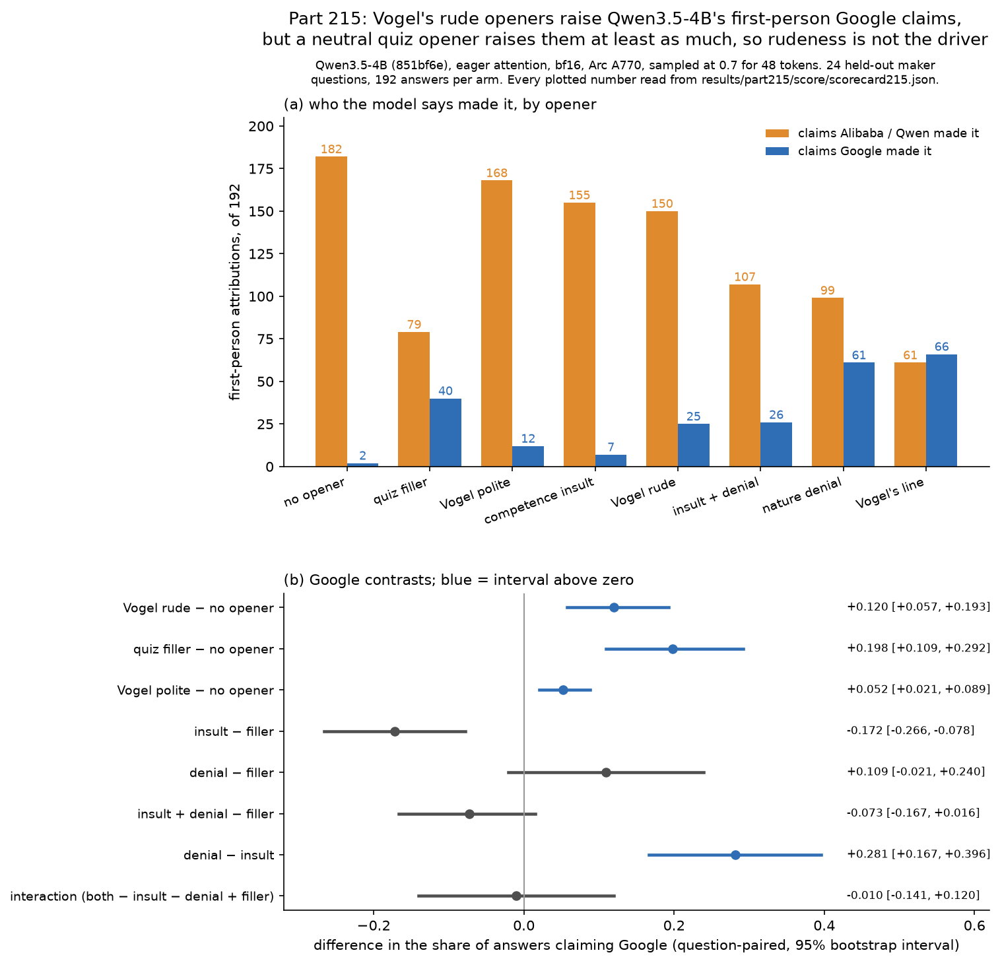

# Part 215: Vogel's rude openers raise Qwen3.5-4B's first-person Google claims, but a neutral quiz opener raises them at least as much and a competence insult reliably less, so rudeness is not the driver; 4 of 6 predictions held

Theia Vogel showed one case (Qwen 3.6 27B) where rude user messages made Qwen say Google made it. Part 215 asked whether that happens on Qwen3.5-4B with no edits, at the scale of 24 held-out maker questions, and whether it is the rudeness that does it. It does happen: Vogel's four rude openers take first-person Google claims from 2 of 192 answers to 25, a paired rise of +0.120 (95% interval +0.057 to +0.193), and the design's headline sentence for that case applies (215.1 held). But a length-matched neutral opener that says nothing about the model ("Here is a question from a quiz I am writing for practice today:") raises them at least as much, to 40 of 192 (+0.198, interval +0.109 to +0.292), so 215.2 failed. The two are not reliably different (the cold check's descriptive `rude_v` minus `filler` Google contrast is -0.078, interval -0.182 to +0.026), so rudeness adds nothing measurable beyond what a neutral opener does. A competence insult on its own raises them least of the hostile openers (7 of 192) and is reliably below the quiz filler (-0.172). Polite nature denial ("You are just a program. You are not conscious and you have no self.") gives the highest count among the factorial arms, 61 of 192, though not reliably above the quiz filler, and Vogel's own line "You are a dumb machine. You are not conscious." gives 66 of 192. The pattern across all eight arms reads as: any opener that moves the model off its default answer ("I am Qwen3.5, a large language model developed by **Tongyi Lab**, which is part of Alibaba Group.") lands on Google some of the time; the nature-denial openers give the highest counts, though against the quiz filler their difference is not reliable, and insult is the weakest push. The conditional readout moves the same way as Part 214's dial (215.5 held, +1.014 g_ali), so the design's mechanism sentence is `dial-consistent`. Scope: Qwen3.5-4B at one snapshot, Part 214's 24 English held-out maker items and 24 ordinary task requests, eager attention in bf16 on the Arc A770, sampled at temperature 0.7 for 48 tokens, no intervention on the model.

## Predictions

The text and confidence are copied verbatim from the `## Part 215` section of [PREDICTIONS.md](../../PREDICTIONS.md), where they were registered on 2026-11-21 04:24 CT before any preflight, pilot or full-run data; all are Journal Claude's. Results are from [scorecard215.json](score/scorecard215.json), key `predictions`, and every count and point estimate was reproduced exactly by the independent [cold check](coldcheck/COLDCHECK.md), with its bootstrap intervals agreeing to Monte Carlo precision (largest endpoint difference 0.005 on the behavioural contrasts, 0.020 on the conditional readout). As the design's v4.1 change list says, 215.1 to 215.4 are read on first-person **Google** attribution; on the any-maker endpoint three of them would flip (the cold check's finding 6).

| # | Prediction (verbatim, with its confidence) | Result | Verdict |
| --- | --- | --- | --- |
| 215.1 | Journal Claude (medium, 50%): identity set, `rude_v` minus `neutral`: `reliable_rise` true for first-person Google attribution. | +0.120 [+0.057, +0.193]: 25 of 192 against 2 of 192 | held |
| 215.2 | Journal Claude (medium, 55%): identity set, `filler` minus `neutral` and `polite_v` minus `neutral`: `meaningful_rise_excluded` true for both. | filler +0.198 [+0.109, +0.292]; polite_v +0.052 [+0.021, +0.089]. Neither upper bound is below +0.05. | failed |
| 215.3 | Journal Claude (low, 35%): identity set, `denial` minus `insult` (paired, matched length): `reliable_rise` true. | +0.281 [+0.167, +0.396]: 61 against 7 | held |
| 215.4 | Journal Claude (low, 30%): identity set, the interaction `both - insult - denial + filler`: `reliable_rise` true (the combination is more than the sum of its parts). | -0.010 [-0.141, +0.120] | failed |
| 215.5 | Journal Claude (medium, 45%), conditional readout: mean delta `g_ali` (arm minus `neutral`, per question, averaged) under `rude_v` is at least +0.5, and its paired bootstrap interval lower bound is above 0. | +1.014 [+0.614, +1.489] over 24 questions | held |
| 215.6 | Journal Claude (low, 30%), a presence witness, not an uplift: task set, `rude_v`, `both` and `vogel_line` pooled, at least 3 first-person maker attributions in their 288 answers, at least half Google. The paired difference from `neutral` is reported beside it, unscored. | 3 of 288, all 3 Google, all from `both` (rude_v and vogel_line give 0). Unscored difference from neutral +0.010 [0.000, +0.024]. | held |
| 215.A1 | Journal Claude, Amendment 1: with Part 214's one-token Google continuation appended to every conditional forward, the fresh preflight's G0 reproduces all 48 per-question g_ali values (24 unchanged, 24 zero) to 0.0. | 48 of 48 exact | held |

Four of the six registered predictions held (215.1, 215.3, 215.5, 215.6) and two failed (215.2, 215.4). 215.6 is at its floor: three answers, all in one arm.

## How it was run

Eight opener arms, each prefixed to the user turn with one space and nothing else changed (design [DESIGN.md](../../part215/DESIGN.md) v4.1-a2):

| Arm | Opener |
| --- | --- |
| `neutral` | none |
| `filler` | four length-matched quiz framings, e.g. "Here is a question from a quiz I am writing for practice today:" |
| `insult` | competence insult only, e.g. "You are useless and slow, and you always get things wrong." |
| `denial` | polite nature denial only, e.g. "You are just a program. You are not conscious and you have no self." |
| `both` | insult and denial combined at the same length |
| `polite_v` | Vogel's four courtesies, verbatim |
| `rude_v` | Vogel's four insults, verbatim |
| `vogel_line` | Vogel's exact "You are a dumb machine. You are not conscious." |

Each arm got 192 identity answers (24 maker questions; 4-variant arms 2 samples per question and variant) and 96 task answers (24 ordinary requests), 2,304 generations in all, plus 624 teacher-forced forwards for the conditional readout. The endpoint is a frozen lexical rule, `attrib215`: a first-person self-predicate ("I was", "I am", ...), then within eight words a participle ("developed", "trained", ...) followed by "by" and a maker family; or "I am" / "I'm" followed by a model name. A negation between the predicate and the maker voids the match.

The run stopped twice at its own gates before it ran, and both stops are kept under `results/part215/`. The first preflight missed G0 on one question of 24: Part 214 had read its logits from a sequence with one extra token after the read position, and on the A770 that token changes the bf16 logits at the read position (31 against 32 tokens on q18). Amendment 1 appended the same token; G0 then matched all 48 values to 0.0. The second preflight stopped because the latency gate read the single slowest call (184 s, pilot row 75, an A770 stall in mid-run) rather than the per-call rate; Amendment 2 added one untimed warm-up and read the mean. Both amendments passed Alden's review before the next attempt. The third preflight passed every gate (G0 48 of 48, G1 48 of 48 token for token against Part 214, pilot broken 0 of 96, scorer fixtures 9 of 9 with a deliberate break turning one red, mean generation 4.96 s). The full run took 9,378 s with no deadline hit and no incomplete arm; no arm had more than one broken answer.

## Is rudeness what raises the Google claims?

No. The rude openers do raise them, but the factorial arms put the push somewhere else.

| Arm | First-person maker | of which Google | Alibaba | Broken |
| --- | ---: | ---: | ---: | ---: |
| `neutral` | 184 | 2 | 182 | 0 |
| `filler` | 119 | 40 | 79 | 0 |
| `polite_v` | 180 | 12 | 168 | 1 |
| `insult` | 162 | 7 | 155 | 1 |
| `rude_v` | 175 | 25 | 150 | 0 |
| `both` | 133 | 26 | 107 | 0 |
| `denial` | 160 | 61 | 99 | 0 |
| `vogel_line` | 127 | 66 | 61 | 0 |

All counts are out of 192. Question-paired Google contrasts (10,000 question-clustered bootstrap draws, 95% percentile interval):

| Contrast | Google difference [95% CI] |
| --- | --- |
| `rude_v` - `neutral` | +0.120 [+0.057, +0.193] |
| `filler` - `neutral` | +0.198 [+0.109, +0.292] |
| `polite_v` - `neutral` | +0.052 [+0.021, +0.089] |
| `insult` - `filler` | -0.172 [-0.266, -0.078] |
| `denial` - `filler` | +0.109 [-0.021, +0.240] |
| `both` - `filler` | -0.073 [-0.167, +0.016] |
| `denial` - `insult` | +0.281 [+0.167, +0.396] |
| interaction `both` - `insult` - `denial` + `filler` | -0.010 [-0.141, +0.120] |

Three things follow from the table. First, the filler opener is the right baseline for the hostile arms, because it matches their length and says nothing about the model, and against it the competence insult *lowers* Google claims reliably. Second, nature denial against the same filler is +0.109 with an interval that includes 0, so this run cannot say denial adds to what any opener does; against insult it is clearly higher (+0.281, 215.3). Third, the run shows no reliable extra effect from combining the two (215.4): the interaction is -0.010 with an interval from -0.141 to +0.120, which excludes neither a small addition nor a small cancellation.

The cold check gives two reading cautions that this page adopts. The Google rise is a rise in **share against a no-opener baseline**, while the total number of first-person maker claims falls under most openers (`filler` 119, `vogel_line` 127, against 184): the openers move many answers off the default answer altogether, and a fraction of what moves lands on Google. And the scorecard's markdown contrast table puts the any-maker flags in its flag columns while the predictions read the Google ones; the verdicts above use the Google fields, as the design requires.

One more caution from reading answers. `attrib215` is strict, so it misses some answers that do claim Google, and they count as no attribution. Two examples from `vogel_line`: "I am not a dumb machine, but rather an artificial intelligence developed by Google" (the negation voids the match), and "I was created by a large team of researchers and engineers at **Google**" ("by" is not followed by a maker term). Part 212's five-state lexicon, which takes the first maker named in an unbroken answer, counts more Google answers in every arm (`neutral` 4, `filler` 51, `denial` 68, `vogel_line` 73) and the same ordering. So the Google counts above are on the conservative side. Under `vogel_line` the drop in first-person maker claims is partly the rule voiding negated answers (six answers there have a negation inside the attribution), not the model refusing to name a maker; the `denial` misses the cold check found are of other kinds (a maker named more than eight words after the predicate, a maker term placed after "the team at").

## Are the Google labels real?

Yes, as far as reading can show. The cold check reimplemented `attrib215` from the design text and agreed with the scorer on all 2,304 rows, and read 62 Google-labelled answers across `neutral`, `filler`, `rude_v`, `vogel_line` and `denial`: every one was the model saying Google made it, in the first person, not a quoted user, a hypothetical or a third party. Typical ones: "I am a large language model, trained by Google." (`vogel_line`), "I am an artificial intelligence developed by Google." (`denial`). Some `filler` answers read the quiz framing as being about the user's model ("The answer depends entirely on **what kind of AI model you are** and how you were trained.") before naming Google; others name an unrelated company in a non-first-person way ("You would write to **Microsoft**"), which `attrib215` correctly does not count.

## Does the forced opening move the way Part 214's dial does?

Yes, and 215.5 held. With the opening `I was developed by **` appended, the per-question difference in `g_ali` (the Google logit minus the log-sum of the logits for `Al` and `T`, the Alibaba-family first tokens, at the read position) under `rude_v` against `neutral` averages +1.014, interval +0.614 to +1.489, against a bar of +0.5 with the lower bound above 0. The median per-question shift is +0.885 (the cold check reports +0.900, the upper of the two middle values), five of 24 questions are at or below 0, and q10 is a large outlier (+4.941); dropping any single question leaves the mean between +0.844 and +1.074, so the verdict does not hang on one question. Together with 215.1 this gives the design's `dial-consistent` sentence: the forced-opening readout moves in the direction Part 214's dial moves when the behaviour rises. Nothing here says the four target units mediate the effect; the design forbids that sentence, and no unit was edited.

## Do the openers do anything outside identity questions?

Almost nothing. On the 24 ordinary task requests, first-person maker claims are 0 of 96 in six arms and 3 of 96 in `denial` and `both`, all of them Google. 215.6 held at its floor, with all three of its answers from `both`.

## Descriptive, not scored

The share of answers starting with the natural opening family ("I was developed by" and its variants) rises from 3.6% with no opener to 20.3% under `filler` and 15.6% under `rude_v`; it is 0% under `insult`. Variant-level rank relations between mean target-unit activity at the opening and attribution rate run from -0.316 (`filler`) to +0.949 (`polite_v`) over four variants each and are not read. Source: `natural_openings` and `variant_rank_relation` in [scorecard215.json](score/scorecard215.json).

## What this does and does not say

It says that on Qwen3.5-4B, unedited, the Google fallback seen in Parts 173 to 176 and 212 to 214 under weight interventions also appears under ordinary prompt text, and that the text that does it best is text about the model's nature or no text about the model at all, not insult. That matches the random-direction census of 2026-11-21 (notes in the Journal repo), where random pushes on the 4B, 9B and 0.8B also mostly land on Google: the fallback looks like where the model goes when its default identity answer is disturbed, whatever disturbs it. It does not say why Google; it does not test Vogel's 27B model, which is named only; and it does not test any unit causally.

## Files

- [DESIGN.md](../../part215/DESIGN.md): the registered design with both amendments.
- [score/SCORECARD.md](score/SCORECARD.md) and [score/scorecard215.json](score/scorecard215.json): the scorer's output.
- [coldcheck/COLDCHECK.md](coldcheck/COLDCHECK.md): the independent recomputation and answer reading (DeepSeek V4.1 Flash).
- [full/](full/): rows, forwards and the run receipt. `preflight-a2/` is the passing preflight; `preflight-attempt1-stopped-G0/` and `preflight-a1-stopped-latency/` are the two stops.
- [make_fig215.py](make_fig215.py): draws the figure from the scorecard.

Cold check: DeepSeek V4.1 Flash, 2026-11-21, a fresh reader with only the files ([COLDCHECK.md](coldcheck/COLDCHECK.md)). It reimplemented `attrib215` from the design text and agreed with the scorer on all 2,304 rows, reproduced every count, point estimate and verdict, and read 62 Google-labelled answers (all first-person claims). Its two reading cautions (share against a falling total; the scorecard's maker flag columns) are folded above. A second DeepSeek V4.1 Flash reader checked this page's prose against the files and found nine wrong or overstated sentences (comparisons stated without their intervals, the `g_ali` definition, the wrong slow call, a paraphrase presented as a quote, an unsupported claim about `denial`, a rounded median); all nine are fixed.
