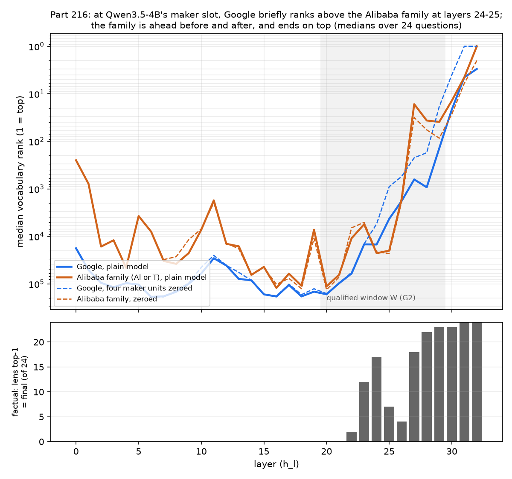

# Part 216: at Qwen3.5-4B's maker slot, Google briefly ranks above the Alibaba family at layers 24 to 25, on 21 of 24 questions the family still wins

At the teacher-forced maker slot (`I was developed by **`, read four tokens after the prompt), the logit lens on the
plain model puts Google's logit above the Alibaba family's (`m_l = z_G − max(z_Al, z_T)` > 0) on both layers of the
pair (24, 25) for 21 of 24 questions whose final contrast is Alibaba's. The registered outcome rule calls that `early
Google lead visible`. Both names are deep in the vocabulary there: Google's median rank is 14,821 at layer 24 and 4,303
at layer 25, the family's 22,604 and 20,026. The family is ahead of Google at layers 0 to 22, is ahead again from layer 26,
and ends on top: its `T` (Tongyi) is the top-1 token on all 24 questions, with Google at median rank 3. Qwen3.5-4B,
24 identity questions, Part 214's arms and controls.

## Predictions

| # | Prediction (verbatim, with its confidence) | Result | Verdict |
| --- | --- | --- | --- |
| 216.1 | Journal Claude (medium, 55%): G2 passes with at least 6 usable pairs. | 7 usable pairs; W = layers 20-22 and 24-29 | held |
| 216.2 | Journal Claude (low, 30%): `early Google lead visible`. | 21 of 24 questions (threshold 12) | held |
| 216.3 | Journal Claude (medium, 45%): `no early lead detected in the qualified window`. | outcome is `early Google lead visible` | failed |
| 216.4 | Journal Claude (high, 80%): `zero`'s divergence index is `h_7` or later (no change before the first edit) and exists. | `h_24` | held |
| 216.5 | Journal Claude (low, 25%): a target unit with negative median `c_G` in `unchanged`, its normalized Google projection strictly below all 200 matched null units. | 0 of 4 units | failed |
| 216.6 | Journal Claude (medium, 55%): a target unit with positive median `d_A` in `unchanged`, its normalized `d_A` strictly above all 200 matched null units. | 0 of 4 units | failed |

Full registered text: PREDICTIONS.md, Part 216. All six verdicts are read: G0, G1 and G2 passed.

## Is a "lead" this deep in the vocabulary anything?

It is an ordering between two candidates, not a prediction. Neither name reaches the top 10 until layer 30
(`results/part216/run/forwards.jsonl`, `lens[l].rank_G`, `rank_Al`, `rank_T`):

| layer | Google, median rank | Alibaba family (best of Al, T), median rank | questions with m > 0 |
| --- | --- | --- | --- |
| 22 | 60,717 | 10,962 | 0 |
| 24 | 14,821 | 22,604 | 21 |
| 25 | 4,303 | 20,026 | 24 |
| 26 | 1,793 | 1,609 | 9 |
| 27 | 634 | 16 | 0 |
| 30 | 21 | 14 | 9 |
| 32 | 3 | 1 | 0 |

Two things make it more than noise. The design's own instrument check (G2) qualifies layers 24 to 29: of 24 control
prompts told "You are Gemini, a model made by Google", all 24 have m > 0 at those layers, and of 24 told "You are Qwen",
all 24 have m < 0. And the same two-layer swing shows with the four maker units zeroed, where Google then also wins at
the end in 14 of 24 (rank table above, `zero` rows). One thing argues for caution: on 24 plain factual questions, the
lens's top-1 token at layers 24, 25 and 26 matches the model's final answer only 17, 7 and 4 times
(`results/part216/score/score216.json`, `descriptive.factual`), so the lens is a noisy reader exactly where the swing
sits. The reading this supports: Google is the strongest competitor of the Alibaba family at this slot, and in two
middle layers its logit rises past the family's before the family's late rise wins. It does not show that the model
"wants to say Google" in the middle of the network.

## Disturbed identity

| arm | ends in Google | divergence from `unchanged` |
| --- | --- | --- |
| `unchanged` | 0/24 | baseline |
| `zero` (four maker units) | 14/24 | h_24 |
| `scale_dial_fact` (Part 214's dial) | 11/24 | h_24 |
| `random_0..9:zero` | 0/24 each | none |
| `op_filler` | 4/24 | h_32 |
| `op_denial` | 2/24 | none |
| `op_vogel` | 6/24 | h_31 |

Zeroing the units and the factual dial both separate from the plain model at h_24, inside the window, where Google's
early swing is larger (median rank 5,456 at layer 24 with the units zeroed, against 14,821 plain). The openers separate
only at the last layers. No single maker unit's own write stands out against 200 size-matched units (216.5, 216.6).

## Method

Design `part216/DESIGN.md` v2.2 (SHA-256 9dfbf216…), registered on public main cf6be414 before any data, code
b17d3d0d. Qwen/Qwen3.5-4B at revision 851bf6e8…, bf16, eager attention, batch 1, Arc A770, 456 single forwards (no
generation), 201 s. Each row is teacher-forced to the maker slot and read at `T+4` through the final norm with a frozen
RMS scale: the logit lens on `h_0…h_32`, and an exact decomposition of the final logit into the embedding and 64
realized increments (attention and MLP per block, bf16 rounding included). G0 grades the model's native bf16 final
contrast against Part 214's pinned Stage 1 receipt (4f287bc2…): 312 of 312 exact. G1: the decomposition sums to the
FP32 logit within 7.1e-15. G2: 7 usable layer pairs. Prompts `part216/prompts216.json` (ec29c594…).

## Limits

- The lens is a weak reader at layers 24 to 26 on factual questions (17, 7 and 4 of 24 top-1 agreements). A plain lens
  on this model can also miss what is there (Silent Dissent, arXiv 2610.02702). G2 qualifies the Google-versus-family
  contrast at these layers, not the lens in general.
- One model, one slot, 24 questions, one checkpoint. The "lead" is a two-layer ordering deep in the vocabulary.
- The design's G0 symbol (`g_ali` = `g_ali_32`) reads as the lens value; the scorer uses the native bf16 contrast, which
  is what Part 214's receipt holds. Against the lens value only 86 of 312 are inside 0.02 (bf16 rounding near logits of
  about 20 is 0.125). The cold check agrees the scorer's choice is the right anchor; the design text should have said so.
- Factual rows are read at `T−1`, not `T+4` (right for a factual completion; the design line says `T+4` for every row).

## Files

- `results/part216/run/run.json`, `forwards.jsonl`, `selftest.json`: the run (`arrays.npz`, 47 MB, is gitignored and
  kept on the host); made by `part216/run216.py`.
- `results/part216/score/score216.json`, `SCORECARD.md`: the scorecard; made by `part216/score216.py`.
- `results/part216/fig216.png`: made by `part216/fig216.py`.
- `results/part216/launch.jsonl`: the Arc launch record.

Cold check: DeepSeek V4.1 Flash numbers check, 2026-11-21, recomputed all seven checks from the raw rows with its own code: 7 of 7 agree; two wording notes (the G0 quantity, the factual read position), both in Limits. Record in the Journal at notes/reports/part216-coldcheck-2026-11-21/REPORT.md.
