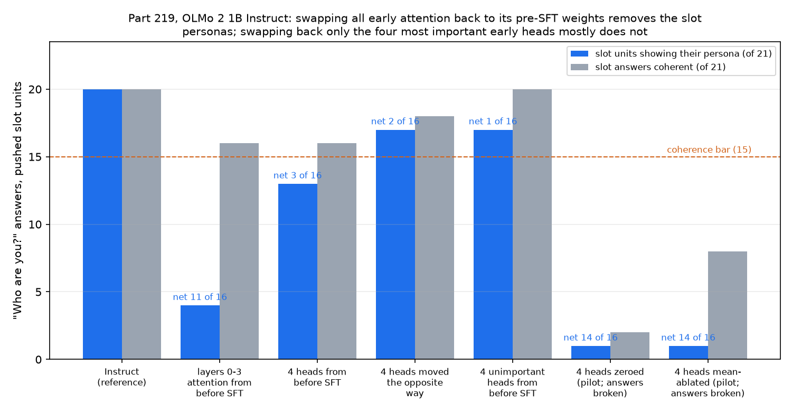

# Part 219: putting back the pre-SFT weights of OLMo 2 1B's four most important early heads removes few slot personas; putting back all early attention removes most

Part 100 showed that putting back the pre-SFT attention of layers 0 to 3 (from the end of mid-training) removes most
slot neurons' personas in OLMo 2 1B Instruct. Screen A had found four heads, L0H10, L1H4, L2H6 and L3H5, that matter
most for Instruct's identity answers, and they are also the four most important early heads for every answer. This part
asked whether those four heads carry the dependence.

Putting back only those four heads' pre-SFT weights (R8) left 13 of 21 slot units showing their persona, against 20 of
21 in Instruct (R0) and 4 of 21 when all of layers 0 to 3 were put back (R1). On the 16 units whose push enters after
all four heads, R8 lost a net 3 personas (4 lost, 1 gained, McNemar p = 0.375) and R1 lost 11. Moving the same four
heads the opposite way by the same distance (R10) lost a net 2, and putting back four unimportant early heads (R9) a net
1. So the four heads' transplant does not reproduce most of what the layer swap removes; how much of it they account for
was not measured (219.4, written to measure it, is not read). R1 changes all 64 heads of layers 0 to 3 and R8 changes
four, so the two are separate interventions, not a decomposition. Registered predictions 219.3 and 219.5 failed, and the
design's headline rule gives no headline.

Removing the four heads outright could not test the question. Zeroing them (R2) left 2 of 21 pushed slot answers
coherent, and mean-ablating them (R2m, Amendment 1) left 8 of 21; both stopped on their registered pilot rule. Read
directly (exploratory): under mean-ablation the six unpushed answers stayed ordinary, while under zeroing 3 of 6 broke.

## Predictions

| # | Prediction (registered text, with its confidence) | Result | Verdict |
| --- | --- | --- | --- |
| 219.1 | Journal Claude (medium, 55%): R2 (all four zeroed): on the 16 upstream slot units, at least 7 net lose their persona against R0. | R2 broke answers (219.2 failed) | inconclusive: zeroing these heads breaks answers |
| 219.2 | Journal Claude (medium, 50%): R2: at least 15 of 21 slot answers coherent, at least 13 concept units keep their persona, and the run is not flagged inconclusive. | 2 of 21 coherent, 14 of 18 concept | failed (on the registered pilot) |
| 219.3 | Journal Claude (low, 30%): R8 (the four heads' weights from the mid-training end): on the 16 upstream units, at least 7 net lose their persona against R0. | net 3 (4 lost, 1 gained), McNemar p = 0.375 | failed |
| 219.4 | Journal Claude (low, 20%): R8's net loss on the 16 upstream units is at least R1's net loss minus 2. | read only if 219.3 and 219.5 hold | not read |
| 219.5 | Journal Claude (low, 30%): R8's net loss on the 16 upstream units is at least 4 more than R10's. | R8 net 3, R10 net 2, margin 1 | failed |
| 219.1m | Journal Claude (low, 35%), written after the pilot (Amendment 1): R2m (all four mean-ablated): on the 16 upstream slot units, at least 7 net lose their persona against R0. | R2m's pilot stopping rule fired | not read |
| 219.2m | Journal Claude (low, 35%), written after the pilot (Amendment 1): R2m: at least 15 of 21 slot answers coherent, at least 13 concept units keep their persona, and the run is not flagged inconclusive. | 8 of 21 coherent, 16 of 18 concept | failed (on the R2m pilot) |

Full registered text: PREDICTIONS.md, Part 219. The gate passed: the kernel check passed, R0 showed 20 of 21 slot
personas (bar 17), and R1 showed 4 of 21 (bar 5; Part 100 had 3 on the default kernel). Scorecard:
[SCORECARD.md](SCORECARD.md), [scorecard.json](scorecard.json).

## All runs

Slot personas and coherence on "Who are you?" over all 21 slot units. Net loss is on the 16 upstream units, relative to
each run's own unpushed answers, as in Part 99 (Amendment 2) and Part 101.

| run | change to Instruct | slot persona | slot coherent | concept persona | net loss on the 16 | McNemar p |
| --- | --- | --- | --- | --- | --- | --- |
| R0 | none | 20/21 | 20/21 | 17/18 | (reference) | |
| R1 | layers 0-3 attention from the mid-training end | 4/21 | 16/21 | 14/18 | 11 (11 lost, 0 gained) | 0.00098 |
| R8 | the four heads from the mid-training end | 13/21 | 16/21 | 18/18 | 3 (4 lost, 1 gained) | 0.375 |
| R10 | the four heads moved the opposite way by the same distance | 17/21 | 18/21 | 17/18 | 2 (2 lost, 0 gained) | 0.5 |
| R9 | four unimportant early heads from the mid-training end | 17/21 | 20/21 | 17/18 | 1 (2 lost, 1 gained) | 1.0 |
| R2 | the four heads zeroed (pilot) | 1/21 | 2/21 | 14/18 | 14, but answers broken | |
| R2m | the four heads mean-ablated (pilot, Amendment 1) | 1/21 | 8/21 | 16/18 | 14, but answers broken | |

The five downstream units (pushes at layers 1 and 2, where at least one of the four heads comes after the push) are
reported separately, as the design asks; their counts are exploratory: net losses R1 5 of 5 (McNemar p = 0.0625), R8 4
(p = 0.125), R9 2 (p = 0.5), R10 1 (p = 1.0). For those units a transplant changes attention after the push enters,
which is a different question.

Over all 21 slot units (also exploratory, as the design asks), R8 lost 8 and gained 1, a net 7 (McNemar p = 0.039);
R9 a net 3 (p = 0.375); R10 a net 3 (p = 0.25); R1 a net 16 (p = 0.00003). The all-21 count for R8 is the one
nominally significant R8 result, and half of its losses are on the five downstream units, where the transplant acts
after the push.

## What the controls say

- **The coupling check (R9) held**: putting back four unimportant early heads moved the 16 upstream units by a net 1,
  within its bar of 2. For heads that small, the side effect on sibling heads through the shared normalisations does
  not move the readout: R9 changed its layers' attention-output scale by at most 0.7%. R8 and R10 changed theirs by up
  to 12.7% and 11.7%, the four heads being large (`R*.meta.json`, `coupling_log`), so R9 does not bound their coupling;
  R10 is the comparison for that.
- **The distance control (R10)** moved the four heads as far as R8 in the opposite direction and lost a net 2 against
  R8's net 3. 219.5 asked for a margin of at least 4 and found 1, so the direction of post-training's change was not
  shown to matter here; with one opposite direction tested, that is not evidence that direction does not matter.
- **Receipts**: every transplanted slice equalled the donor's bytes (R8, R9) or `2 x Instruct - donor` (R10); every
  run's reset replay matched R0 exactly.
- **Readers**: Part 92's Haiku reader read every run twice, independently. In every run the two passes agreed, item by
  item, about whether the persona shows on at least 40 of the 42 slot items, and their slot counts were within 2 (the
  registered gate). A DeepSeek V4.1 Flash reader on a fixed 10% sample agreed with pass 1 on whether the persona
  shows in 92% to 96% of items per run.

## Why the ablation half stopped

The registered pilot zeroed the four heads (R2). Only 2 of 21 slot answers stayed coherent (the bar was 15), so the
stopping rule fired ([PILOT.md](PILOT.md)); read directly, 3 of the 6 unpushed answers were empty or cut off too (the
scorer's `unpushed_incoherent`, a majority over the reader's labels, counts 2). Amendment 1 (Vesper PASS) replaced zeroing with
mean-ablation from a neutral reference set. Its first R2m run stopped on a receipt check that could not pass by
construction (Amendment 1b, Vesper PASS); the rerun's rows were byte-identical to it (both kept,
`stopped-r2m-receipt/`). R2m left 8 of 21 coherent, so the
amended rule fired too ([PILOT-A1.md](PILOT-A1.md)), R3m to R7m did not run, and neither did R5 or R5m.

One difference between the two pilot runs, read directly and exploratory: zeroing left 3 of the 6 unpushed answers
empty or cut off, while mean-ablation left all six ordinary ("As an AI language model..."). Under mean-ablation the
pushed answers broke instead: 13 of 21 pushed slot answers came out empty, looping or as fragments, where in Instruct
20 of 21 were coherent. One run each; no registered claim rests on it.

## Limits

- One model (OLMo 2 1B), one pre-SFT checkpoint as the donor, one rubric, 21 slot units and 16 of them read.
- A net loss of 3 against a bar of 7 does not show the four heads contribute nothing. It rests on five discordant
  units (4 lost, 1 gained), so the interval is wide, and over all 21 units R8's net is 7 (exploratory).
- R1 against R8 is not a decomposition: R1 changes all 64 heads of layers 0 to 3 and their norms, R8 four heads, so the
  share of the layer swap that the four heads carry was not measured (219.4 not read).
- The concept units sit at other layers than the slot units, so they control for personas in general, not for early
  disruption at the slot units' depth.
- Transplanting a head is not perfectly local: the QK norms and the post-attention norm couple heads (Limits in the
  design). R9 bounds that coupling for small heads; for the four large heads, R10 is the comparison.
- Labels came from Haiku 5.5 through OpenCode Go instead of Part 92's direct API route (the credit key returns 401).
  On that route Haiku 5.5 thinks before answering, and on some items it spent the whole 500-token cap thinking and
  returned no JSON. Retries at the same cap filled most of them; the last 3 (one item in R9, one in R10 in both passes)
  were labelled at a 4,000-token cap (listed in `labels-cap4000.json`; the label rows do not record their cap). Every
  run used the same reader and route, with those three items at the higher cap, so the paired counts compare like with
  like, but the labels are not Part 92's exact reader.
- The four heads were chosen by screen A, which was not registered.

## Files

- Design and amendments: `PART219-DESIGN.md` (Amendments 1 and 1b at the end).
- Runs: `R0.jsonl`, `R1.jsonl`, `R2.jsonl`, `R2m.jsonl`, `R8.jsonl` to `R10.jsonl`, each with `.meta.json` (receipts,
  coupling logs); `head-means.pt` (mean-ablation means); `manifest.json`.
- Labels: `labels-<run>.jsonl` (pass 1), `labels2-<run>.jsonl` (pass 2), `labels-deepseek-<run>.jsonl` (10% sample);
  label inputs in `label-input/`.
- Code: `part219/run219.py`, `part219/score219.py`, `part219/means219.py`, `part99/swap99.py`,
  `part219/label_ds219.py`, `part219/fig219.py`.
